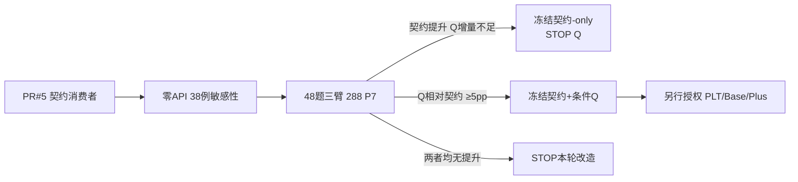

# Q值机制联合CLE下一阶段深度研究与执行路线图

## 执行摘要与边界

**边界：本报告只读取附件06/07、既有附件及GitHub PR#5/分支；未访问本机、未运行命令、私有模型或Docker，也未启动实验。结论：GO契约主线；CONDITIONAL GO保留LLM选卡的条件化Q；STOP直接`semantic_q`替代现Q及覆盖型续学。先做零API审计，再至多288次P7三臂筛查。**

## 机制判断：Q真正的潜力不在“继续刷覆盖”

MemRL把记忆价值定义为状态相关的 \(Q(s,m)\)：当前任务状态 \(s\) 下使用记忆 \(m\) 对后续行动成功的期望效用，并在语义过滤后让效用直接参与最终记忆决策。fileciteturn0file7 当前CLE实际更接近“**全局卡片标量 \(Q(m)\)+当前相似度**”：候选内分别标准化相似度和Q，按0.5/0.5重排，但最终仍由LLM（大语言模型）选择至多三张；每张声明采用卡又共享整段代码的±1结果。fileciteturn0file6

这解释了现有数据最重要的现象：**Q已经足够强地改变了行为，却没有形成净Joint收益。** D_init的296个可比首查询中281题改变选卡成员，225题新增成员被声明采用，但改选组仅19救回、17损失；全体从历史L1的138/303变为140/303。旧D_gate中Q2也只有102/298，而强相似度Q1为104/298。因此“Q影响不够大、再多学一些就会自然提分”不是当前最有支持的解释。fileciteturn0file2 fileciteturn0file9

反而，1003给出了直接的授信反例：卡片明确要求保留外部`USER_POST_FORMAT`，模型两轮均声明采用，却仍重新定义该变量；两轮失败随后都降低该卡Q。也就是说，**当前Q同时吸收了卡片知识质量、任务适用性、选卡组合、模型落实能力和其他代码错误**，并非纯粹估计“这条经验是否正确”。fileciteturn0file1 fileciteturn0file5

PR#5正好从链路下游攻击这一问题：补齐公开`return/raise`进入检索，加入公开接口/外部绑定检查，固定公开内部用例，并且只有c1逐例无回归、无新增硬契约违规且确有改善时才替换c0。历史静态审计中，303个最终代码发现16个明确违规，其中12个属于原已测失败；140个原Joint通过没有被这组规则标记。**这不是12题已经救回，但证明存在无需继续Q学习就能直接干预的损失通道。** fileciteturn9file0

### 一个新的关键代码结论

PR#5当前还**不能直接作为“契约+原Q机制”实验入口**。

`joint_contract.make_provider()`创建`HskTreeRetriever`时传入了`retrieval_mode/delta/lambda_q`，却没有传`candidate_order`；因此默认`semantic_llm`仍是普通候选顺序。另一方面，CLI现有的`--retrieval-mode semantic_q`会走`semantic_value_select`，即数值机制直接决定最终经验，而不是历史在线Q2的“Q重排候选→LLM再选卡”。fileciteturn4file0 fileciteturn12file0 fileciteturn13file0

所以不能为了方便直接把`semantic_q`叫作“Q2新版”。**正确下一步是一个很小的接线修改：继续使用`semantic_llm`，显式暴露`candidate_order=similarity|q`，让条件化策略只决定是否启用Q顺序。**这样才是在契约改进后检验原Q思想，而不是偷偷换研究对象。

另外，新消费者目前每次`run_one`自行生成公开suite（内部用例集）。若比较“契约-only”与“契约+Q”，应当在每个题目×重复内先冻结同一个suite，再分叉两臂，否则suite生成差异会混进Q效应。fileciteturn4file0 fileciteturn10file0

## 定量预测：两种潜力的数量级并不相同

**契约-only的直接已知机会约为4个百分点的历史上界。** PR#5在当前D_init最终代码中找出12个“已测失败且具有明确接口/绑定违规”的结果；即使不现实地假设12题全部变Joint，上界也只是12/303＝**3.96个百分点**。若未来新消费者能真正救回其中30%–60%，对应约**+1.2至+2.4个百分点**。这只是基于历史故障构成的情景预测，不是已测提分，而且公开内部用例还可能发现这12题之外的机会。fileciteturn6file0

Q的潜在空间更大，但必须**有能力事前避开损失**。对D_init已观察到的20救回、18损失，设条件化路由能保留救回比例 \(t\)，却误保留损失比例 \(f\)，则相对L1的事后可利用空间为：

\[
\Delta J \approx \frac{20t-18f}{303}.
\]

若 \(t=0.8,f=0.2\)，约为 **+4.09个百分点**；若 \(t=0.9,f=0.1\)，约为 **+5.35个百分点**。这说明要获得“明显收益”，真正任务不是继续提升覆盖，而是找到一个**生成前可观察、能够区分何时Q排序值得使用**的状态变量。20/18来自真实结果，但80%/20%等是假设情景，不是性能预测。fileciteturn0file2

附件06又说明全局覆盖不足已经不是充分解释：旧M1资格清理后466→416张，但固定298个查询中仍有127题呈现顺序改变、69题数值前三成员改变；Q3更显示“真实历史有支持”与“置换后被分配visits”在采用层分别是485/829和191/829。Q机制对**支持分布和曝光上下文**非常敏感。fileciteturn0file0

因此我预测下一阶段的收益排序为：

**契约保持 > 条件化Q路由 > 新一轮全局卡片Q共享奖励 > 单纯增加有Q卡覆盖。**

914个AI题卡标签、人审0，以及旧候选池指标不能改变这个顺序；附件06中的候选指标还属于旧检索设置，且存在2个`insufficient`标签，不能与当前\(\delta=-1\)协议直接混合优化。fileciteturn0file0

## 改进方向与有界实验设计

| 改进名称 | 目标 | 输入 | 动作 | 预算 | 阈值 | 输出 | 结论支持 |
|---|---|---|---|---|---|---|---|
| **零API契约×Q损失敏感性** | 判断18个Q损失是否集中于可识别契约错误 | 03的38不一致案例、07卡正文、PR#5 `public_contract_audit.json` | 按task_id连接，只比较“救回/损失×静态契约flag”；Fisher精确检验并报告比值比 | 0 API、0 Token、38题、0重复、≤2人工小时 | **提案门**：损失侧富集OR≥3且双侧p≤0.10才认为契约混杂值得建模；否则只记“未发现富集” | 2×2表、题号清单 | 只能说明历史损失与契约违规相关，不是新政策成绩 |
| **契约-only** | 先去除已观察的功能/接口损失 | PR#5、1939卡固定正文、D_gate预选48个不同family | `P7_public_contract_v1`，显式`candidate_order=similarity`；Q冻结 | 与下行三臂试验共用 | 相对当次旧P7 **≥+3pp**，两次重复方向不冲突；≤0则停止该版本 | Joint/F/S、c0/c1选择、公开suite与正式结果 | 支持/反驳公开契约消费者本身的增益 |
| **契约+条件化Q** | 只在Q信号可靠时启用q-order | 同上，加当前972卡Q快照；路由只能读生成前公开契约、候选Q/visits/相似度等 | 保持`semantic_llm`与LLM三卡选择；路由动作仅`similarity↔q`，禁止`semantic_q`直接top-k | **48题×3臂×2重复=288 P7**；最多576代码候选；≤4500模型请求、≤4000万Token、≤1000 embedding；人工≤6小时 | 相对契约-only **≥+5pp**、两重复同方向、family-bootstrap 80%区间下界>0；≤0即STOP；0–5pp记不确定，不扩全量 | 冻结路由、逐题配对Joint、候选/选择轨迹 | 通过才支持“条件化Q对改进CLE有增量价值” |
| **直接`semantic_q`或继续D_grow刷覆盖** | 强化Q影响/提高访问率 | 当前972/1939状态 | 直接数值选卡或继续原共享奖励 | **STOP** | 无当前推进门 | 不执行 | 现有证据不足以证明信息价值；且会同时改变选择机制或继续累积授信混杂 |

这里三臂是：**旧P7、契约-only、契约+条件化Q**。48题从D_gate按CWE轮转、每family至多一题预先固定；D_gate已历史曝光，因此只能是开发筛查，不包装成新独立测试。当前972张有visits的冻结状态及其1939卡快照已在仓库清单记录。fileciteturn7file0

条件路由第一版不需要复杂模型。建议状态仅含：是否存在明确外部绑定、签名是否可解析、候选中有visits比例、负Q比例、最大访问数、Q排序相对相似度排序的位移。**不得使用生成后F/S、失败类型、最终采用、隐藏测试或Base/Plus结果。**若零API历史筛查无法得到可重复的事前区分信号，就直接把Q路由固定为关闭，而不是继续细分直到找到阳性。



## 决策建议与最终测试策略

**GO：契约-only。** 它对应已经观察到的明确失败链，而且代码已存在、201项相关测试通过；但新模型Joint仍为0次实测，不能跳过前瞻比较。fileciteturn6file0

**CONDITIONAL GO：条件化Q。** 先修正PR#5的Q接线，使其保持“重排→LLM选卡”机制，并把公共suite在两新臂之间冻结共享。这里真正值得学习的是一个小的**路线价值**：“本任务使用相似度路线还是Q路线”，而不是继续给1939张卡用整段代码共享奖励。若以后确需在线学习，也应优先让路线Q每个完整P7按最终Joint更新一次；这是未来新协议，不得追认成旧Q实验结果。

**STOP：恢复原D_grow覆盖学习、直接数值`semantic_q`、立刻跑全量D_gate或Base/Plus。** 条件化Q如果在288 P7筛查中没有相对契约-only的增量，就没有理由用“学习还不够”继续扩张。

即使筛查成功，本轮预算也不能覆盖完整PLT298+Base115+Plus140：单臂已是**553 P7**。因此三集合最终比较必须是下一次独立授权；届时冻结代码、路由、972快照和所有阈值，不再从Base/Plus反馈调Q。仓库当前也明确记录Base/Plus所需原Docker环境以及模型凭据在本网页环境不可用。fileciteturn6file0

## 证据保存、复现入口与最小收尾

必须永久保留：PR#5提交与源码哈希；`data_inventory.json`、`public_contract_audit.json`、`calibration_summary.json`、`verification.json`、`runtime_preflight.json`、`snapshot_recovery.json`；附件06资格回放、附件07卡正文、03的38例、02记录提取、原协议01和MemRL论文05；以及当前Q快照：

`translation_work/diagnostics/20261020/cle_q_online_v1/D_grow/frozen/m_star_q.jsonl`

其仓库清单记录为1939张卡、972张有visits。fileciteturn7file0

| 最小收尾交付物 | 当前状态 |
|---|---|
| 旧资格清理1090→928、466→416及Q3映射证据 | **已完成，不重复** fileciteturn0file0 |
| PR#5代码、201测试、12题校准、静态审计 | **已完成；不是新Joint** fileciteturn6file0 |
| 条件Q正确接线：`semantic_llm + candidate_order=q` | **未实现/待代码核验** |
| 两新臂共享固定public suite | **未实现/待代码核验** |
| 38例零API契约×损失交叉表 | **推荐唯一新增零API分析** |
| 48题三臂前瞻筛查 | **未授权、不得自动执行** |
| Base/Plus Docker与原模型凭据 | **网页端不可用，须本地核验** |
| 人工相关性标签 | **仍为0；限制检索质量主张，但不是Joint试验前置条件** |

当前仓库已有可直接进行**零API预检**的入口；不加`--run`不会启动模型：

```bash
python -m methods.cle_ablation.run_joint_contract \
  --dataset PLT \
  --tasks configs/cle_dinit_full_learning_20261020_v4b/tasks.json \
  --memory docs/cle_evidence_package_20261015/experience_pool_1939.jsonl \
  --arms P7 P7_public_contract_v1 \
  --limit 2 --repeats 1 \
  --max-http-attempts 2500 \
  --max-total-tokens 20000000 \
  --out translation_work/diagnostics/20261022/cle_joint_contract/new_preflight
```

该命令来自PR#5说明。fileciteturn2file0 **当前不存在一个诚实可直接运行的“条件化Q”命令**：在暴露`candidate_order`并冻结共享suite之前，不能拿`--retrieval-mode semantic_q`冒充它。

真正会改变本报告决策的缺失证据只有三类：第一，前瞻三臂中契约-only是否真实提高Joint；第二，条件化Q相对同一契约消费者是否出现稳定≥5个百分点的增量；第三，当前972快照、原模型版本和正式验证环境是否能按记录身份恢复。凭据或Docker缺失只阻塞执行；914个人工标签未完成只限制“检索精确率/召回率”主张。**在这些证据出现以前，最合理的路线不是继续把Q学得更久，而是先让CLE少犯已知契约错误，再检验一个状态相关、可关闭的Q策略是否真正提供额外Joint。**