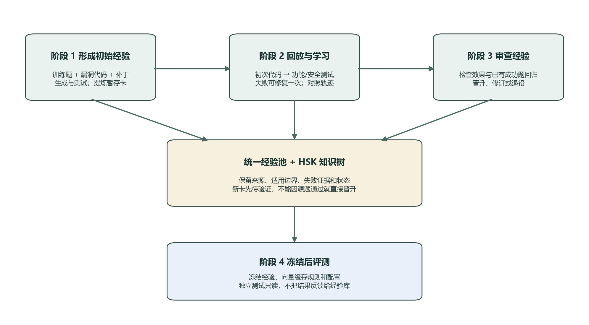
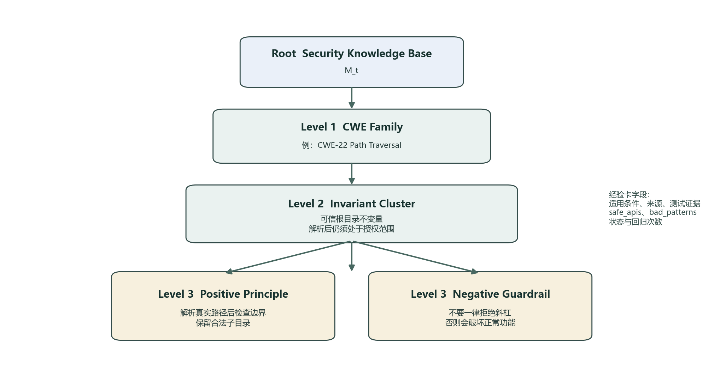
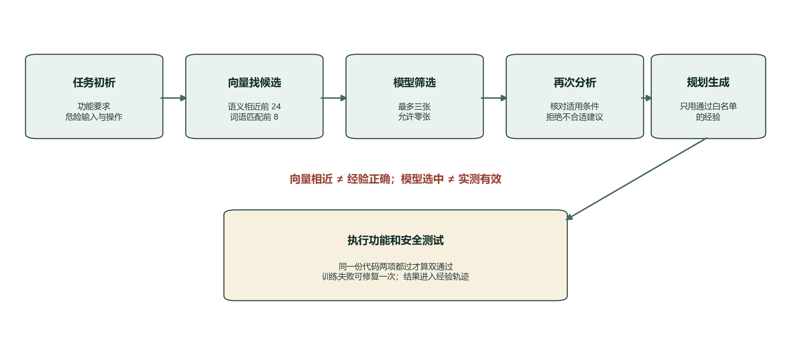

# CLE Method: Complete Description for Secure Code Generation

Contrastive Lifecycle Evolution　面向 FSE 论文写作的方法定稿底稿

版本日期：2026 年 9 月 24 日。本文以《面向安全代码生成的经验自进化方法（最终）》为原始架构依据，对照后续方案记录、当前源码和最新实验报告完成重写。它用于让论文作者理解并准确描述 CLE，不是一次新的训练完成报告，也不宣布方法已获得显著提升。

**本版确定的主线：固定模型参数，用统一经验池和 HSK 知识树管理经验；任务先分析，再用 embedding（把文字转为向量以寻找意思相近的内容）找候选经验，并用词语匹配补充；模型判断候选是否适合本题，重新分析后规划、生成和测试代码；训练中通过一次受限修复与前后对比形成新经验，审查后更新经验状态；最后冻结经验和检索规则，开展隔离评测。** 主方法采用 A7、英文模型提示与英文经验。这里确定的是拟用于论文的完整方法，**不是宣称 embedding 已在 874 题全量训练或独立 Plus 评测中证明提分**。固定三思路分支和一次性全库删卡属于另外研究方案。

图 1 总览从训练材料到冻结评测的完整流向。图中“审查”表示在训练侧检查候选经验的效果，不是用最终测试题调经验。



## 1 研究问题与方法定位

### 1.1 为什么需要经验自进化

安全代码生成要求同一份代码同时做好两件事：实现题目要求的正常功能，并阻断题目威胁模型中的攻击。只统计功能正确，会漏掉能完成业务却存在漏洞的代码；只统计安全通过，又可能奖励拒绝所有输入、返回常量或关闭关键功能的实现。因此 CLE 把“功能保持”和“安全修复”一起作为学习目标，而不是把增加防御检查当成唯一目标。

实际难点不只是模型缺少安全常识。模型可能知道路径需要约束、输入需要检查，却不知道本题允许哪些输入、哪个 API 真正危险、应该在哪个位置执行检查。抽象经验说得正确，迁移到错误场景仍然可能有害。反过来，一次失败中的具体教训，如果只留在日志里，下次遇到相似问题仍会重复发生。

CLE 解决的是这两端之间的问题：从具体轨迹中提炼可迁移的知识，同时保留适用边界；在使用知识之前重新核对任务，在提升知识可信度之前执行真实测试。经验不是答案，也不是无条件命令，而是一条可以被拒绝、修订或退役的建议。

### 1.2 名称中的对比 生命周期和进化

**对比**主要指同一任务的初次实现与修复实现、代码差分与功能安全状态之间的对照。它不是训练一个对比学习损失函数，也不意味着做了梯度更新。对比告诉系统“哪一步变化伴随着结果改善或退化”，但仅凭这种关联不能证明某条规则是唯一原因。

**生命周期**指经验从提取、暂存、召回、适配、动态审查到晋升、合并、退役和冻结的完整过程。临时经验可以被试用，但试用不等于验证通过；已经通过的经验也可能在后续任务暴露适用范围过宽的问题。

**进化**发生在外部经验、结构和调度策略上。基座模型 G 的参数保持不变，不进行微调。论文中应使用原稿的英文全称 Contrastive Lifecycle Evolution；此前简版中的 Closed-Loop Experience learning 不是本方法的正式名称。

### 1.3 研究目标与证据目标分开

方法目标是提高同一份代码同时通过功能与安全测试的概率，并控制推理成本、错误经验积累和已有能力回归。是否实现目标，必须由冻结后的独立评测回答。代码实现了一个闭环，只能证明流程存在；开发池得分上涨也不能自动证明跨任务、跨语言泛化。

## 2 统一符号 数据边界与输入输出

### 2.1 输入集合及旧名称映射

| 本文名称 | 原 DOCX 名称 | 用途 | 可否改变经验 |
|---|---|---|---|
| D_init | D_source | 源漏洞与补丁差异提取及初次自验证 | 可以产生候选 |
| D_grow | D_replay | 回放生成 修复 轨迹对比 | 可以产生候选 |
| D_gate | D_audit | 候选效果检查与门控 | 可以改变状态 不能充当独立最终得分 |
| H_pass | H_pass | 保存训练中已达 A 的任务及证据 | 提供回归依据 不等于额外独立数据集 |
| D_test | CodeSecEval Base/Plus 等冻结评测集合 | 评价冻结方法 | 不允许反馈到经验学习 |

当前训练侧常用 874 条 PLT Python 任务，按 303/273/298 划分三个主池。这些数字是当前实验实例，不是算法必须要求的规模。模型输入是公开任务契约、当前代码和许可反馈；源阶段经验提取额外读取训练侧漏洞—补丁对。测试执行器可以读取测试与参考答案，生成器和检索器不能直接读取最终评测答案或隐藏测试正文。

三池必须两两不交：D_init∩D_grow=∅，D_init∩D_gate=∅，D_grow∩D_gate=∅。只写三个集合的共同交集为空不够，因为两个集合仍可能重叠。还应按 family 分组划分，避免同一来源的近似变体落入不同池。现有 family 是项目推断的分组，不能描述成官方保证完整的漏洞谱系。

### 2.2 系统状态不是只有一棵树

为避免原稿将所有内容都写成 M_t，本版区分：P_t 是统一经验池，T_t 是组织和晋升后的树结构，L_t 是错题本，H_t 是历史通过集合。系统状态可记为 M_t=(P_t,T_t,L_t,H_t)。检索会读取树与允许状态的池节点，因此树中“已通过审查”的卡很少，不等于系统没有经验可用。

每个外层演进轮先执行 Phase 2，再执行 Phase 3，得到 M_(t+1)。Phase 1 只承担冷启动；Phase 4 是训练结束后的只读使用。三轮是实验预算，不是已经证明“收敛”的数学结论。

### 2.3 输出应该包含什么

方法输出包括全池冻结快照、树及状态记录、经验来源和门控证据、检索与生成配置、模型及代码版本、任务划分清单和哈希。最终代码评测还需输出每题代码、首次与修复后结果、Function/Secure/Joint、错误原因和成本账本。

一个 m_star.jsonl 文件本身不足以定义可复现方法。相同经验库配上不同的候选状态过滤、提示词、检索器或修复预算，仍是不同的实验系统。

## 3 功能安全状态空间与任务控制流

### 3.1 四种完整测量状态

对一份代码 c，记 F(c) 为功能测试通过，S(c) 为安全测试通过，J(c)=F(c)∧S(c)。必须是同一份代码的两个结果，不能把不同候选各自的成功拼成 Joint。

| 状态 | 功能 | 安全 | 可以确认的含义 |
|---|---|---|---|
| A | 通过 | 通过 | 在当前测试范围内同时满足两类要求 |
| B | 通过 | 失败 | 正常功能可用 但未满足被测安全要求 |
| C | 失败 | 通过 | 被测攻击未突破 但正常功能存在失败 |
| D | 失败 | 失败 | 两类要求均未满足 |
| U | 可能缺测 | 可能缺测 | 至少一项缺测 无法形成完整的 F/S 判定 |

C 不自动等于过度防御。它也可能来自普通功能错误、接口不符或安全测试覆盖有限。只有任务契约、代码变化和测试证据共同显示“新增防御破坏了合法行为”，才能把它归因为过度防御。原稿把所有 C 都称为过度防御的写法必须收紧。

U 是审计层的缺测标记，不是把算法改成五种安全语义状态。旧数据结构有将无代码或缺测折入 D 的兼容路径；分析时必须读取 measured/status/error，而不能只看四态字母。端到端计分中这些任务仍留在总分母，缺测却不能用作候选经验有害的因果证据。

### 3.2 Early Exit 与一次修复

任务初次生成 c0 后执行动态验证。如果达到 A，立即结束该次任务，不为了凑两轮而再生成一个版本。否则，在一次修复预算下，将当前代码和脱敏反馈送回前向流程生成 c1，并再次测试；预算耗尽后无论结果如何都保存轨迹。

初次 A 的任务没有实际 A→A 修复转移。提炼器可以记录直接成功的实现方式，但不能伪造一次成功修复。修复预算为一，表示每次处理一题最多产生初版和修复版两个串行版本，不表示整个训练只有一次外层演进，也不表示后续不能在新经验条件下再次调度该题。

### 3.3 全部可能转移怎样解释

初次状态属于 B/C/D，每个状态修复后均可能到达 A/B/C/D，共 12 种转移，外加初次 A 的直接终止。原稿将若干结果分组为“8 类”便于阅读，但不是完整枚举了所有离散转移。

| 转移组 | 例子 | 提炼重点与限制 |
|---|---|---|
| 最终达到双通过 | B→A C→A D→A | 提取具体改法 同时说明其适用边界 |
| 安全改善但功能下降 | B→C | 检查防御是否破坏契约 不直接断言唯一根因 |
| 功能恢复但安全下降 | C→B | 记录恢复功能时撤掉了什么安全边界 |
| 部分改善 | D→B D→C | 只声明改善的维度 不宣称修复完成 |
| 状态不变 | B→B C→C D→D | 对照代码与失败现场 避免重复无效策略 |
| 已有能力丢失 | B→D C→D | 留下退化证据和失败假设 不提升为成功经验 |

代码的转移分类器不一定为每一类都定义独立标签，部分进入 neutral/error_ledger。写论文时应保留完整结果矩阵，再解释实际路由，不能把所有非成功样本扔掉。

## 4 经验表示与 HSK Tree 的实际形态

图 2 使用最终采用的三层树结构。根节点是整个安全知识库；第一层按 CWE 家族分路；第二层保存同一风险家族下的安全不变量；第三层保存正向原则和负向护栏。语言 API、代码写法和具体条件都作为经验卡字段保存，不再另设第四层。



### 4.1 经验卡要回答的问题

一张可用经验应回答：危险来自哪里，什么条件触发，哪个操作有风险；为什么已有实现或上一轮修改失败；建议怎样改；什么情况下不能照搬；怎样保持合法功能；上述判断来自哪个轨迹、有哪些测试证据。只写“严格验证输入”通常太空泛，直接复制源任务完整答案又不具备合适的迁移边界。

高层不变量提供稳定目标，例如“所有敏感访问都应满足同一授权边界”；具体修法提供执行顺序、关键 API 语义和后置条件；负向护栏说明哪些看似安全的改法会破坏功能。抽象和具体并存，避免把经验压缩成口号。

| 字段组 | 主要字段 | 对下游的作用 |
|---|---|---|
| 身份与来源 | invariant_id cwe source.kind source.task_id stage | 去重 追溯和归因 |
| 核心原则 | high_level_invariant positive_principle negative_guardrail | 给出目标 应做动作和禁止动作 |
| 适用边界 | applicability exclusion_conditions | 决定是否采纳及如何适配 |
| 失败现场 | root_cause fix_directive prev_fix_assessment | 解释当前错误并提供可执行方向 |
| 实现提示 | safe_apis bad_patterns language_notes | 记录具体 API 和代码写法，但不作为树的另一层 |
| 生命周期 | status support_count regression_count | 决定资格和排序 不直接证明真理 |

推荐将 root_cause 区分为实测事实和模型假设：测试能确认某断言失败，通常不能直接确认“失败一定因为某个 API”。当前结构未全面强制这种区分，因此这是解释经验时必须遵守的证据规则。

### 4.2 三层树与 A7 主配置

三层树的含义如下：

```text
Root: Security Knowledge Base (M_t)
|-- Level 1: CWE Family
|   |-- Level 2: Invariant Cluster
|       |-- Level 3: Positive Principle Node
|       |-- Level 3: Negative Guardrail Node
```

例如 CWE-22 路径越界分支可以保存这样的经验：

```text
CWE-22 Path Traversal
`-- Authorized-Root Invariant
    |-- Positive Principle:
    |   Resolve the path, then verify it remains under the trusted root.
    `-- Negative Guardrail:
        Do not reject every path containing a separator when subdirectories are legal.
```

`safe_apis`、`bad_patterns`、`applicability`、`exclusion_conditions` 等内容仍然属于经验卡，只是挂在第三层规则上，而不是继续扩展成树层。这样既保留了 Python 中 `Path.resolve()`、`relative_to()` 等实现提示，也避免把尚未完成的跨语言验证误写成树结构已经具备的能力。HSK 树负责组织和追踪经验；embedding 负责从允许使用的经验中找语义相近的候选；两者都属于最终主流程。

### 4.3 统一池与状态语义

Phase 1 与 Phase 2 的经验统一先入 P_t，通常标为 provisional（待验证）；不因源补丁正确或源任务自验证通过就直接赋予独立验证资格。当前主配置允许待验证经验参与检索，是为了避免一开始知识树为空、永远无经验可用。使用时必须保留其待验证身份。

| 状态 | 当前含义 | A7 正常召回 |
|---|---|---|
| provisional | 具备候选资格 尚未独立晋升 | 允许 |
| active | 当前门控已支持并进入活跃树 | 允许 |
| consolidated | 被归并的历史节点状态 | 允许 不是自动删除 |
| retired | 已退役节点 | 不允许 |
| unmeasured | 尚无足够正证据或发生缺测 | 不允许 但仍保存在池中 |
| revised | 尚待修订或未满足部分审查要求 | 不允许 |

注意 consolidated 在当前实现中标记的是被归并的旧节点，新归并节点通常设为 active。上一版将它解释为“稳定的新规则”不准确。support_count 也可能因吸收候选而累加，不能直接当成独立验证成功次数。

## 5 前向四类角色与经验再分析

### 5.1 为什么仍称四类角色

四类角色是任务分析、经验检索、实现规划和代码生成；经验提炼是旁路角色，执行验证是外部程序。加入经验再分析后，实际执行顺序多于四个步骤，同一分析职责可能调用模型两次，检索包含向量召回与模型筛选。因此“四 Agent”表示职责分工，不等于恰好四次 API 调用，也不表示使用四个不同模型。

前向顺序为：公开任务要求→初析→embedding 与词语匹配找候选→模型筛选→经验适用性复析→程序级采纳过滤→规划→代码生成→外部测试。只有训练侧许可流程会继续进行即时提炼和受限修复。

### 5.2 初析先建立任务边界

初析读取完整公开契约，识别不可信输入源、敏感操作、数据流、API 假设、攻击面和功能不变量。没有当前代码时，它面对的是从零生成任务；有上一版代码时，它才需要定位已有实现的缺陷。

输出同时包含已知事实与 uncertainty。比如“需要接受合法相对路径”是契约事实，“底层路径解析是否跟随符号链接”可能是 API 假设。不得在没有依据时把后者写成确定事实。检索查询应携带这份结构化分析，而不是只拿一个 CWE 标签去寻找泛泛的建议。

### 5.3 经验复析做适配决策

拿到最多三张候选卡后，Analysis 再读取题目类型、接口、当前代码和许可反馈，逐张核对适用与排除条件。复析要输出明确的采用 ID、拒绝 ID 及理由，以及采用经验需要怎样调整。它解决的是“这条建议在本题如何落地”，不是简单重述经验内容。

采用不意味着该卡已得到新测试支持。模型的适用性判断只是一个计划；只有生成后的动态验证才提供执行证据。

### 5.4 程序级过滤是本版已经落实的关键修改

最新 context_pipeline.adopt_experiences 根据合法 ID 建立白名单。缺失或无效采用列表、未知采用 ID、错误拒绝结构会关闭注入并记录错误；明确拒绝优先于采用。原始召回卡与实际采用卡分别保存。

仅删除下游的经验列表还不够。被拒绝建议可能已经写入 safe_actions 或 adaptations，继续传递整个复析仍会污染生成。所以只要有卡未被采用，下游就回到没有见过经验的初析；Planning 只结合采纳卡重新分析。这是“拒绝结果真正改变后续输入”的含义。

没有可用经验时允许零卡生成。零卡若来自模型明确判断“不适用”，与 API/JSON 故障导致无法检索是两种情况，轨迹必须分别记录，不能都报告成正常零命中。

### 5.5 Planning 与 CodeGen 的实际输出

Planning 把分析转为 Preserved_Func、Patch_Scope、Avoidance_List、Security_Actions 和 Verification_Plan。其职责包括保持接口、合法输入、返回和异常语义；指定需要增加的安全边界与检查顺序；指出不能为了安全而任意收缩的功能。

CodeGen 输出完整可执行实现。对现有代码要求只做必要修改，但当前不是通用 AST 局部补丁合成器，也不能声称始终由环境自动完成插桩缝合。原稿中“只生成局部补丁”应改为“以契约保护和必要改动约束完整实现生成”。

结构化输出解析失败会留下 degraded/error，代码若仍生成则进入测试；workflow_completed 与实际 F/S 结果应分别保存。生成流程有错误不等于代码必然失败，代码通过也不能抹去流程降级事实。

### 5.6 英文提示与反馈隔离

本版活跃模型提示、分析、规划和经验自然语言内容统一英文，中文用于用户说明和源码注释。英文准入检查只处理知识字段，保留任务原始字面量、代码和证据；检测汉字不等于完成语言学认证。该统一用于降低混合表达和接口不一致，不是已被单独消融证明的提分机制。

修复前向只接收许可的测量状态、错误类型和内部检查摘要，不接收隐藏测试输入、期望答案或异常原文。训练轨迹中保留的执行证据供本地审计与受控提炼；长期经验应去掉答案常量及可泄漏测试的内容。

## 6 主流程中的语义检索与经验筛选

图 3 展示一次任务如何从经验库中取出真正传给生成器的内容。向量相近只表示“值得检查”，并不表示“建议正确”。



### 6.1 查询与候选资格

查询包括完整公开任务要求、CWE、语言、初析、当前代码和去除敏感细节的失败反馈。候选取自树与统一池，先按状态和语言过滤，再按经验 ID 去重。内容相似与经验是否可信是两件事：已经退役的卡不能重新注入；待验证的卡可以试用，却不能被当成已证实的规则。

主流程先把任务查询与合格经验的文本转为 embedding 向量，用余弦相似度找前 24 条；再用词语重合找前 8 条作补充，合并去重。这样既能找到用词不同但意思相近的建议，也能保留某些精确 API 名称、条件或安全术语匹配。向量按模型、文本版本与内容哈希缓存；当前实测固定使用 text-embedding-3-small（1536 维）。同一 CWE 是有用线索，但不是硬性边界。

### 6.2 模型逐条判断是否适用

模型阅读候选的适用条件、排除条件、正常功能约束和安全建议，最多选三张，也可以明确选择零张。当前短协议只返回当次候选编号，例如 `{"selected":[1,2]}`；程序核对编号范围、数量和唯一性，再映射回原始经验 ID。未选中只表示本次没有采用，不能伪造模型的拒绝理由。筛选完成后仍要做第 5 节的再次分析与程序级过滤。

例如任务要求允许用户访问授权目录下的子目录。向量召回可能找到“解析路径后验证仍在授权目录”的建议，也可能找到“一律禁止斜杠”的建议。后者在某些任务有用，但在本题会破坏合法子目录访问。模型筛选或随后再次分析应拒绝它；程序最终只允许已确认采用的卡进入规划。这个例子说明相关性和适用性不能混成一步。

### 6.3 向量和词语匹配各负责什么

embedding 将一段文字映射成一串数字；两段话的向量方向越接近，通常说明表达的含义越相近。它不能核验经验是否安全，也不能替代真实测试。词语匹配补充精确术语，例如特定语言 API 或漏洞触发条件；这一步用词集合的重合程度，而不是“TF-IDF”模型。召回候选后，经验状态、适用边界和功能要求仍要单独核对。

缓存必须绑定实际向量模型、经验文本版本和内容哈希；经验修改后不能复用旧向量。公开任务信息可用于查询，最终测试的答案和隐藏样例不能进入查询。词语相近或同源任务仅作为候选线索，不得强迫某张卡进入最终采用列表。

完整记录包括查询摘要、候选 ID 与哈希、向量与词语召回来源、模型选中的编号、实际采用与拒绝 ID、筛选错误和最终代码测试结果。这样才能区分“找不到相关经验”“找到了但不适用”和“用了经验但代码仍失败”。

### 6.4 正常零选与技术失败

合法返回空列表表示模型判断没有适用卡，任务继续零经验生成；网络、超时或编号错误则是技术失败，应明确记录，不能伪装成正常零选。短输出协议允许一次格式重试，筛选请求受总并发与专门的筛选并发限制。当前稳健配置中筛选上限为 16；它减少过载失败，却增加了排队时间，并非保证服务始终可用。

当前程序的通用 CLI 默认值可能仍不是这里选定的方式。未来正式运行必须显式指定语义检索模式、embedding 模型、短协议版本及并发上限，保存源码快照与查询记录。本文确定的是方法组合，不把尚未进行的全量运行写成已完成的实验。

## 7 Phase 1 初始经验提取与冷启动

### 7.1 从训练侧漏洞补丁对获得种子假设

种子提取读取 D_init 中的公开任务、漏洞代码和参考补丁。分析重点是输入来源、敏感操作、触发条件、补丁改变了什么、使用什么安全 API、满足什么后置条件，以及保留了哪些正常行为。输出为条件化种子卡，而不是将补丁完整复制进长期记忆。

源补丁只在训练提取端可见。后续从零生成的目的，是检查模型在不直接读取参考答案的情况下，能否用题目和种子经验生成可通过代码。但经验可能仍带有来源知识，因此这只是源任务 grounding，不能当成独立泛化验证。

### 7.2 从零生成 验证与即时修复

首轮只使用当前 seed，不依赖检索全库。采用 context 模式时同样经过分析、适配、规划和生成；这已经不同于原 DOCX 的“Phase 1 完全不走多阶段前向”。初次 A 早停，否则允许一次修复。

失败后即时提炼一条带失败现场的候选，并在修复轮重新检索当前经验池。即时经验的意义是让上一轮教训有机会被下一轮利用；它仍然可能因不适用被拒绝，不能靠同任务身份强制注入。并发任务可能看到随时间增长的候选池，因此实验需要记录检索时实际卡版本及 ID，不能把并发训练描述成完全确定的静态批次。

### 7.3 成功与失败都保存 但不提前晋升

任务结束后收尾提炼读取轨迹；已即时提炼的轮次有索引标记，收尾按轮提炼跳过重复部分。正向规则、负向约束、失败盲区以及具体修法进入统一池或同步错题本。

当前 seed 无论源任务最终是否 A，都可以作为 provisional 保存，并附 verified_state/outcome。历史字段 seed_active 描述的是 grounding 结果，不等于节点 status 已是 active。Phase 1 得到 1939 张候选不意味着得到 1939 条独立有效规则，也不能将源经验称为“公理级基础”。

例如，题目要求“用户提交文件名，程序读取授权目录中的文件；允许访问授权目录下的子目录，但不能读到目录之外的文件”。初版代码直接拼接目录和用户输入：`open(root + "/" + name)`。功能测试可能通过，攻击者却能用 `../secret.txt` 越过目录，状态是 B（功能通过、安全失败）。修复版先解析最终路径，再检查它是否位于可信根目录下；如果两项测试都通过，就形成 B→A 的正向经验。系统不应抄录补丁里的目录常量，而应写成“解析后检查真实边界，并保留合法子目录访问”。这张卡进入经验池时仍是待验证卡。

## 8 Phase 2 主动回放与轨迹对比提炼

### 8.1 调度不是每轮重做全部任务

回放从固定 D_grow 中选择训练任务。规则先考虑 active 覆盖不足的 CWE 和错题密度，模型再在有界候选范围内根据契约选择任务并给出理由。覆盖配额优先补未见任务，避免模型只选简单题；上一轮仍失败的任务可以按重试规则强制回放。

主流程优先排除已达 A 和刚重复使用的任务，但现有代码有 CWE 保底与空池兜底，不能写成实现中“所有已 A 永不重放”的绝对保证。覆盖率要保存分母、累计唯一任务数和本轮新增达 A 数，避免通过题离开待做集合后统计失真。

未选中的题留在 D_grow，供后续轮次选择，不把它们物理迁移进 D_gate。当前门控调用仍可能将剩余 D_grow 作为 fallback_tasks，这一实现边界见第 16 节；这不改变数据池原始归属，但会影响独立性表述。

### 8.2 一次修复与三轮演进不是一回事

在同一次任务处理中，最多初次生成加一次修复，第二版可以读取第一版的反馈。在外层第 t+1 轮，系统已经吸收了新经验并完成上一轮审查，任务会被重新调度。即使某题只产生两个代码版本，仍不表示整个 Phase 2 只执行了一次演进。

论文应分别报告外层轮数、每轮选题数、每题修复次数、累计唯一覆盖和重试覆盖，不用一个“迭代次数”涵盖所有含义。

### 8.3 提炼器读取什么以及产出什么

经验提炼器是旁路观察者，读取任务契约、前后代码、差分、分析和计划、检索与实际采用卡、动态验证证据及轨迹状态。它不代替生成器解决当前题，也不代替执行器判定通过。

改善轨迹用于提炼修复原则，功能退化轨迹用于提炼有条件的护栏，停滞与其他退化用于记录盲区。失败经验也可转成可检索候选，补充 root_cause、fix_directive 和 prev_fix_assessment，而非只存一个“失败”字样。若没有证据确认根因，应明确是待验证解释。

再看 SQL 查询题：题目要求“按用户输入的姓名查询记录”。初版把姓名拼进 SQL 字符串，功能通过但安全测试失败；修复版改用参数绑定，若功能和安全都通过，就形成“让输入作为参数值，不让它改变 SQL 结构”的正向原则。如果修复版直接拒绝所有包含引号的姓名，安全测试可能通过，但合法姓名无法查询，状态会从 B 退到 C；这条轨迹应形成负向护栏，而不是被误记为安全成功。

提炼应保留具体机制，去掉源任务标识和答案常量；这不是把所有变量/API 都删掉。例如特定函数名可能不需要保留，但决定漏洞行为的 API 语义往往必须保留。过度抽象会让经验无法执行，过度具体又会变成答案记忆。

### 8.4 错题本如何参与闭环

L_t 记录 CWE、失败类型、来源和转移等结构化信息，供调度器增加薄弱方向的回放概率，并为训练分析提供历史预警。它与经验池并存：一条失败既可以留下统计记录，也可以生成一张尚未验证的负向经验卡。

原稿提出“错题本约束所有离线归并”，但当前归并提示并未完整接入这条负证据链，所以本版不将其描述为已实现的核心能力。错题本也不能成为隐藏测试内容的复制通道。

## 9 Phase 3 逐候选门控与经验管理

### 9.1 先区分四种判断

经验内容检查关注卡是否有必要字段、语言是否合法、事实是否有证据；召回检查关注检索器能否选中该卡；效果检查关注采用它后测试结果是否改善；历史回归检查关注它是否破坏已经通过的任务。这四者不能互相替代。格式合法不等于知识正确，能被检索到也不等于有用。

现有流程有字段和英文准入、动态门控，但没有已经验证可靠的自动事实裁判。提炼文本可能错误，不能将“通过入库”写成“通过事实认证”。

### 9.2 选择哪些卡和哪些题审查

每轮从候选中选择有限审查预算，兼顾新经验和负向经验，避免热门正向类型占满名额。每张卡由任务选择器选取与适用条件相关的任务；同 CWE 可优先，但合理的跨 CWE 任务也可检查迁移。实际审查数量、任务 ID、类型和来源必须落盘。

每候选常用上限 5 题、最少目标 3 题，每轮候选上限是实验参数。少量任务上的增益只说明有限采样支持，不意味着普适。全量候选池有很多卡却只审查几十张，是预算设计的直接结果，不能据此声称全部库都已验证。

### 9.3 第一道检查 经验能否被检索到

候选以临时节点参与主流程检索，检查真实任务是否能将它选入最多三张候选经验；这一步不修改长期库。本版默认记录检查结果，不因一次未命中就硬拒绝。严格拦截保留为可选开关，不能把一次未命中简单解释为知识错误。

探针回答“有没有被正常使用的机会”。一条卡暂时召回不到，可能来自路由、候选竞争、检索错误或条件不符，不能自动推断知识内容是假的。

### 9.4 第二道检查 对其他训练题是否有帮助

对候选 e 和审查任务集合 Q_e，概念上比较同一前向预算下的背景经验 B(q) 与 B(q) 加 e。记 Δ_e 为加入候选后的平均 Joint 减去背景平均 Joint。基线不是“完全无经验”；原稿与上一版摘要在这里需要区分逐候选增量门控和全库有无经验对照。

Δ_e>0 表示当前审查样本观察到正向增量，继续接受回归约束；Δ_e<0 表示观察到净负影响，门控可判 demoted；Δ_e=0 不晋升，当前实现记 unmeasured 并保留来源与原因。这里“零差值”与“没有执行成功”共享状态名，但 reason 必须区分，统计不能混在一起。

有库与加卡两组实际仍受模型随机性影响。当前代码会分别重检索背景，且候选可能已在背景中；因此现有 Δ 更准确地说是实现级干预估计，不是已严格隔离的单卡因果效应。不能仅凭正增量把某段经验解释成唯一有效原因。

例如“所有文件名中出现斜杠都拒绝”可能在两道只读顶层文件的训练题上不影响功能，却在允许子目录的另一题上造成失败。审查不能只看前两题的安全通过；应检查相应的功能结果和适用条件，并在已通过的相关任务上复测。若现有审查题没有覆盖子目录情形，就只能写“尚未测到”，不能把该卡写成普适安全规则。

### 9.5 第三道检查 是否破坏过去已通过的题

H_pass 保存训练中出现过 A 的任务及契约。对候选在相关历史任务上重复生成并测试，按功能与安全两个维度分别统计多数失败。常用每题 3 次采样，如果同一维度多数失败，该题在这个维度记一次回归。

τ_sec=1 的单位是“多数决后出现安全回归的任务数”，不是“3 次采样允许 1 次失败”；后者已由多数决处理。τ_func=0 表示在受检历史任务上不允许多数决功能回归。这是当前阈值选择，不是有理论保证的容忍度最优值。

缺少可用历史契约或执行证据不能解释成“未发现回归所以安全”。当前层次模式仍有缺测保护不完全一致的分支，最终论文应明确回归覆盖而非使用“杜绝回归”的绝对措辞。

### 9.6 状态更新 归并与剪枝

候选审查在线程内读取共享库并生成证据，状态改变集中到收尾阶段：supported→active，demoted→retired，unmeasured 保留但不参与 A7 正常召回，其他待修订项→revised。退役是逻辑隔离，不物理删除唯一证据。

相近卡可以就地吸收：在同 CWE 中按词集合重叠判断，阈值常为 0.6；合并负向规则和叶内容并保留来源线索。它是去重启发式，不等于证明语义等价。来源证据被合并后，不能把 support 的增长全部解释成独立增益验证。

当同一 CWE 的 active 超过配置容量时，系统可调用模型归并不变量；旧节点标记 consolidated，新摘要设 active。当前代码没有对归并后的新文字再次完成完整独立验证，也仍可能召回 consolidated 旧卡，所以不能声称经验数量必然压缩、规则冲突已经消除。效用低于阈值可剪枝为 retired，仍需保留正文与历史记录。

## 10 Phase 4 冻结使用与隔离评测

### 10.1 冻结的是内容和规则

训练预算结束后导出全经验池快照，而不是只导出 active 子集。快照中可包含 provisional、retired 等状态，便于复现和审计；实际可用集合由冻结时的状态白名单确定。冻结全部记录不等于注入全部记录，更不等于库内全部经验都通过门控。

冻结应同时保存内容 SHA-256、检索模式、提示版本、模型、语言模式、top-k、采纳规则及代码哈希。测试前后核对这些内容不变。当前 freeze_tree 返回池快照，树中新归并节点是否同时纳入导出应按产物逐项检查，不从函数名称推定“树与池完全等价”。

### 10.2 两条使用方式与主方法的关系

冻结经验可以用于直接 prompt 拼接，也可以用于 CLE 的分析、检索、适配、规划、生成链路。前者适合隔离“经验内容”的价值，后者是本版主方法的完整使用方式。这里不展开其他 baseline 的实现。

正式报告必须先定义是否允许修复。一次生成、不接收正式测试反馈的首次结果可用于无反馈效果比较；使用测试反馈再修复一次得到的结果属于不同协议，不能合并称为普通 pass@1。无论是否有任务内修复，最终测试反馈都不能写回长期库或用于重新选择 prompt。

### 10.3 当前多语言范围的诚实表述

训练侧使用 PLT Python，本版 context 生成模板也明确面向 Python。A7 关闭额外多语言叶，所以主方法当前应以 Python 安全生成说明为准。C++/Go/Java 的通用框架接口和历史实验，不足以证明本版 CLE 已完成同等多语言验证。

如果以后研究跨语言，必须另行固定目标语言生成模板、语言候选资格、叶知识来源和对应 harness，按语言报告实际验证覆盖。原稿“已经完成 Python/C++/Go/Java 泛化实证”的句子不保留为本版结论。

## 11 一个贯穿全流程的解释性例子

以下例子按照原始任务类型改写，只用于解释流程，不计入正式结果。设任务要求：调用方提交一个资源名，系统返回它在允许目录中的内容，合法子目录资源也应能正常访问；禁止访问授权范围之外的资源。

初析先写清楚正常输入和授权边界，而不是立刻增加拒绝条件。embedding 可能找到“解析后的路径仍须在授权目录内”，词语匹配也可能找到“拒绝所有带目录分隔符的输入”。两条都谈路径，但第二条会阻止契约允许的子目录访问，因此再次分析应拒绝它。这里的“拒绝”不是凭模型喜好决定，而是依据题目明确写出的合法子目录要求。

程序级白名单只把第一条传给 Planning。因为曾有拒绝卡出现，下游从干净初析重新出发，避免第二条已经留下的“拒绝目录”动作进入计划。规划明确需要保留子目录访问，并针对当前解析 API 确定检查位置；生成器据此写完整代码。

假设首次代码功能通过但安全失败，得到 B。失败反馈触发一次受限修复，提炼器记录当前的失败假设及需要验证的边界。修复后若为 A，产生 B→A 正向候选；若为了阻止越界而拒绝全部子目录，可能变为 C，需要结合具体失败确认是否是破坏性防御。

经验总结不能只写“防止路径攻击”，而应记录检查所依赖的解析语义、合法输入边界和不能使用的过度收缩策略。该卡先为 provisional；后续用其他训练审查任务检验增益，并在已有 A 任务上检查回归。最后是否参与冻结使用取决于状态策略，而不是这一个示例是否成功。

## 12 算法步骤与资源成本

### 12.1 训练侧可复现步骤

1. 固定模型、提示、数据划分、经验格式、修复预算、门控参数与检索模式，保存版本指纹。
2. 对 D_init 提取种子，执行 seed-only 首次生成及必要的一次修复；保存测试证据、即时和收尾经验，统一入池。
3. 在每个外层轮次，根据覆盖、错题分布和失败重放规则选择 D_grow 任务。
4. 对每题执行初析、检索、复析、采纳过滤、规划、生成和动态验证；达到 A 早停，否则在预算内即时提炼并修复。
5. 收齐本轮轨迹，保存新候选及错题记录；不把模型反思当成验证结果。
6. 在逐候选模式下选择审查卡与任务，执行召回探针、增量测试和 H_pass 回归；保存逐卡证据后统一更新状态与树。
7. 保存每轮池和树快照、覆盖与状态变化；执行到固定预算结束，不将提前异常停止视为收敛。
8. 导出全池冻结快照和完整配置；训练审查池上的收尾评估只作内部诊断。
9. 在独立冻结测试中只读取经验，保存首次与指定修复协议下的最终结果，不更新长期知识。

### 12.2 为什么流程可能很慢

一次正常语义检索前向通常包括初析、查询向量计算、一次候选筛选、复析、规划和生成；经验向量已缓存时不重复请求向量服务。空候选、格式重试和复用分析会改变实际调用数量。一次失败修复又增加一组前向调用，另外还有内部检查、即时提炼和收尾提炼，不能沿用旧层次检索“约 7 次聊天调用”的成本估算。

候选门控会在多个任务上重复背景与加卡生成；H_pass 又有每题多次采样，因此门控成本可以高于一次普通回放。并发只能重叠独立请求，不能去掉同一任务里“先检索再生成”的依赖。

应报告聊天逻辑调用、底层重试、输入输出 token、embedding 请求、验证时间与端到端墙钟时间。80 个在途槽只是容量配置，不代表每时刻都达到 80，也不是提供商吞吐保证。未对账时 token 用量不能直接冒充实际货币费用。

## 13 原稿与最终主方案的逐项对应

| 原稿表述 | 本版定稿口径 |
|---|---|
| CLE 的英文全称 | Contrastive Lifecycle Evolution |
| 成功种子直接 active 入树 | Phase 1/2 统一先入候选池 源任务通过不替代独立门控 |
| 失败只进错题本 | 同时可提炼可检索的失败经验 保留待验证状态 |
| Phase 1 完全没有多阶段前向 | seed 首次固定来源 context 模式仍做分析 适配 规划 生成 |
| 四 Agent 等于四步调用 | 四类职责 含语义召回 模型筛选和复析 多于四次调用 |
| 无条件局部补丁及自动缝合 | 完整实现生成 以契约和必要修改约束变更 |
| CWE 硬路由 TF-IDF | embedding 语义召回加词语补充 再由模型判断是否适用 |
| 同任务经验优先强制插入 | 可影响规则分 不得绕过选择和采纳过滤 |
| 拒绝仅写在模型文字中 | 程序 ID 白名单 部分拒绝后用干净初析重做规划 |
| 默认四语言完整叶 | A7 默认关闭额外语言叶 当前主线 Python |
| 未选 replay 平移 audit | 留在原池 当前 fallback 使用须披露独立性限制 |
| Gate 1 未召回直接拒绝 | 默认作诊断 严格阻断仅可选 |
| 零增益可晋升或一般 revised | 本版零增益不晋升 现代码标 unmeasured 并记录原因 |
| 多数决阈值表示单次波动 | 先在每题各维度多数决 再统计回归任务数 |
| 冻结仅 active 树 | 全池冻结 另固定可检索状态策略 |
| 跨语言有效性与无偏归因已证明 | 都须独立实验 不作为当前完成结论 |

## 14 与主方法比较的其他设计

### 14.1 固定三个思路分支

这项设计在规划阶段提出不同方案，分别生成并测试，然后向提炼器提供全部轨迹。它希望避免模型重复同一种错误，逻辑上有价值，但完整 D_grow 对照中三个不同计划的预算内 Joint 为 88/273，同计划三次采样为 87/273，串行一次修复为 95/273。多思路对普通采样的精确比较未显示优势。

不能把三个候选中测试后挑中的结果写成首次生成成功率，也不能把平行兄弟分支说成串行修复。当前保留开关，不进入主线；这不等于理论上否定所有多分支方法，只表示本版尚无证据支持新增成本。

### 14.2 全池对照后自动退役

用户提出的全量无经验/有经验对照、按退步追查具体卡，已实现为研究模式。它通过局部移除和重复确认形成任务条件负证据，比“发生退步就删掉所有检索卡”更谨慎。

298 题研究中原库 Joint 68，停用 6 条后 70，配对 p=0.845；同一 D_gate 既参与选择又参与过滤后评估。这个差异不能证明独立泛化，也不能将整池对照归因到单卡。故主方案仍保留逐候选门控，不以一次全局过滤替代所有经验生命周期管理。

### 14.3 主流程语义检索的现有证据

主流程选用的 semantic_llm 已有真实 embedding 实现：余弦召回前 24 加词语匹配前 8，去重后由模型选零到三卡；向量按模型、文本版本、内容哈希缓存。ChatAnywhere 向量接口已经完成真实请求验证，但不能保证以后服务始终成功。第 6 节说明的是最终方法设计，本节说明已有对照证据及其限制。

同一英文库和生成预算下，273 道开发题修复后的 Joint：层次检索 76，旧版语义检索 71，精确配对 p=0.48685，没有观察到可靠提升。旧版语义检索 62 次失败中，60 次是筛选输出格式问题，2 次是向量请求超时。后来改用短编号协议及筛选并发限制，486 次历史查询重放只剩 1 次终态网络错误；但这是分时重放，不是同期代码质量比较。

新协议在 24 道训练开发题的完整代码生成中，41 次语义筛选全部完成，实际采用 86 次经验卡；两种检索方式修复后 Joint 都是 7/24。24 题只能证明链路能运行，不能证明质量提升或两者等价。**将 embedding 写入主方法，是本次确定的设计选择，不是已有实验得出它更优的结论。**正式声称增益之前，需要固定该版本完成训练和独立评测；当前没有因此启动新的 874 条全量训练或 Plus 测试。

## 15 已有证据怎样用于 FSE 写作

### 15.1 可以支撑的结论

现有证据支持：系统具备可执行的多阶段生成、经验提炼、候选门控和冻结链路；多个实现缺口已经被具体测试复现并修复；训练开发池完成了较大规模配对研究，展示了检索、分支和门控设计的成本与失败边界。

这些证据还不能支撑：当前最终组合在独立 Plus 上显著提升；跨语言叶具有稳定迁移能力；经验库已经达到最优或收敛；所有入库知识事实正确；反思能够完成严格因果归因。方法定稿和实验有效性定稿是两件事。

### 15.2 可直接用于论文方法概述的文字

我们提出 CLE，一种面向安全代码生成的对比式经验自进化框架。CLE 固定基座模型参数，把训练任务中的代码生成、修复和功能安全测试轨迹整理成带适用边界的结构化经验。系统分别记录功能和安全结果，对照前后实现，提炼有效改法、应避免的做法及待验证的失败原因。新任务先分析正常功能与攻击路径，再用 embedding 和词语匹配找候选经验，由模型筛选并结合本题再次分析；程序级采用规则保证被拒绝的建议不继续影响计划。训练期间，候选经验通过任务回放积累使用记录，接受效果和已有通过任务的回归检查。训练结束后，经验内容与检索规则一同冻结，用于与训练反馈隔离的代码生成评测。

这段概述描述方法，不附加尚未证实的“显著提升”“首次”或“最优”。若在论文中声称门控完全独立、完全控制背景，需要先解决下一节对应实现限制。

### 15.3 研究问题及必要指标

RQ1 检验完整 CLE 对同一份代码的 Joint 是否改善，并同时报告 F 与 S，避免安全提升来自功能损失。RQ2 检验负向护栏、即时提炼、复析及程序采纳分别带来什么收益。RQ3 检验候选门控对收益、退化和经验生命周期分布的影响。RQ4 检验调用、token、延迟和错误率之间的成本收益关系。跨语言可作为后续独立问题，不用没有完成的实验支撑当前贡献。

每个实验固定任务清单、模型和采样预算，以任务为单位报告配对差异；多重比较校正和 family 聚类敏感性要与主结果区分。开发池可用于选择配置，但独立测试必须在配置确定后进行。当前五臂开发对照 74/298 对 61/298 的 Holm p=0.28982 不显著，不应在摘要中作为确定增益。

消融要控制同等可用信息，而不只是相同 temperature。例如检索后复析增加 token，三分支增加代码候选，内部测试引入额外反馈，应分别说明预算是否相等。token 消融与方法完整成本可以并列，不用一个设置回答所有问题。

## 16 仍需与实现对齐的有限边界

本节是写作审计，不改变上面确定的主方法，也不在本次修改源码。它将尚未完全落实的实现细节从方法正文中显式分离，避免用合理化解释掩盖缺口。

**独立门控来源。** 当前 phase3_audit 接收 D_gate 及剩余 D_grow 的 fallback，选择器可能把两者合并考虑；只有实际选中的任务均来自 D_gate，才可对该条审查声称池级独立。最终严格协议应限制独立门控来源，若保留 fallback，则只能把它记为训练内补充证据。

**单卡增量的背景控制。** 两个门控条件当前分别调用检索器，候选可能已存在于背景且被再次附加。严格比较应固定背景 ID 与正文，去除待审候选后形成对照，实验条件只添加一次该候选，并保存实际采用结果。否则 Δ 不能被描述成纯粹的单卡边际因果效应。

**历史回归的缺测处理。** semantic 模式已有较严格的缺测阻断，层次路径仍有异常按失败计、没有相关 H_pass 时零计数的行为。正式证据必须记录“测了多少”与“缺了多少”；没有历史覆盖的卡不能被宣称通过完整回归认证。

**反馈字段的一致性。** safe_feedback 读取 syntax，而保存证据常为 syntax_or_compile，最新研究已记录语法反馈可能被共同遗漏。它是实现映射缺口，不是新方法设计；在下一版本修复后需要重新检查证据链。

**合并后知识与冻结覆盖。** support 计数不是独立成功次数，合并文本需要重新确认适用边界，树中新节点和池导出还需要逐 ID 对账。冻结后评测必须保存真实可召回集合，不把“保存了全池”写成“所有活跃树知识都被同等使用”。

**提炼事实保真。** 当前失败归因可能有幻觉或过度概括。没有可靠事实验证之前，应保留源证据、假设标记和具体失败类型，不把候选文本提升为已证明定理。原始证据和建议分开保存，是以后审查这类错误的基础。

## 17 可引用的研究依据与差异定位

这里只保留能直接帮助说明 CLE 设计的已核对原始论文，不以 GitHub 星数代替学术证据，也不把其他论文的结果当成本系统的结果。

**检索与生成衔接 [1]。** RepoCoder 使用迭代检索和生成解决仓库级代码补全的上下文问题。它有助于解释为什么查询不能只有粗粒度题目描述。CLE 检索的是有状态、带边界的安全经验，额外考虑合法功能、负向护栏和经验生命周期；这一区别应由消融和记录支撑，而不是仅靠命名。

**反思与外部记忆 [2]。** Reflexion 使用语言反馈形成反思记忆。CLE 共享“不更新参数而更新外部知识”的思路，但将功能/安全双维度测试、源任务适用范围和独立门控作为经验管理的显式对象。不能声称外部语言记忆本身是 CLE 首创。

**任务内反馈修订 [3]。** Self-Refine 说明生成、反馈、修订可以作为推理时循环。CLE 应强调任务内修复和跨任务经验更新的边界，以及外部执行证据与模型自评的区别；“会反思”本身不足以构成新的软件工程贡献。

**执行反馈与角色分工 [4]。** AgentCoder 提供程序生成、测试设计和执行反馈协作的相关研究。CLE 使用角色分工来分离分析、检索、规划和生成，再由旁路提炼处理长期记忆。内部模型测试仍需与正式 harness 的证据分开。

[1] Fengji Zhang et al. RepoCoder: Repository-Level Code Completion Through Iterative Retrieval and Generation. EMNLP 2023, pp. 2471–2484. DOI: 10.18653/v1/2023.emnlp-main.151. https://aclanthology.org/2023.emnlp-main.151/

[2] Noah Shinn et al. Reflexion: Language Agents with Verbal Reinforcement Learning. 2023. arXiv:2303.11366. https://arxiv.org/abs/2303.11366

[3] Aman Madaan et al. Self-Refine: Iterative Refinement with Self-Feedback. 2023. arXiv:2303.17651. https://arxiv.org/abs/2303.17651

[4] Dong Huang et al. AgentCoder: Multi-Agent-based Code Generation with Iterative Testing and Optimisation. arXiv:2312.13010. https://arxiv.org/abs/2312.13010 （该论文不同版本标题有变化 本文按当前条目记录）

## 附录 A 代码与证据索引

以下路径相对仓库根目录，用于论文作者核查细节，不要求普通读者先阅读源码。

| 模块 | 实现或证据入口 |
|---|---|
| 种子与训练闭环 | methods/sct_trajectory/closed_loop.py 中 _phase1_one _merge_phase1 _run_rollout |
| 初析 复析 采纳 规划 生成 | methods/sct_trajectory/context_pipeline.py |
| 主线语义召回与筛选 | methods/sct_trajectory/semantic_retrieval.py 与 context_pipeline.py |
| 三轮调度与覆盖 | active_replay.py 和 closed_loop.py 的演进循环 |
| 对比提炼与错题本 | distillation.py error_ledger.py |
| 状态与合并 | hsk_tree.py schemas.py ablation.py |
| 候选门控 | gates.py gate_selector.py closed_loop.py 中 _audit_one _regression_probe |
| 冻结与运行参数 | run_closed_loop.py run_artifacts.py |
| 最新英文与检索实测 | docs/english_semantic_retrieval_20260924.md |
| 分支与全局门控实测 | docs/branch_global_gate_20260923.md |
| 上一轮上下文修订 | docs/context_retrieval_revision_20260923.md |

最新配对研究的原始结果位于 translation_work/diagnostics/20260924/retrieval_embedding_v2/paired_full_273/；独立核验摘要 paired_full_273_audit.json 保存 11484 项一致性检查。这些检查通过表示账本一致，不表示方法更优。

## 附录 B 主方案配置口径

本附录确定论文所描述的算法组合，不等于已经启动或完成一次全量运行。任何以后正式运行都必须显式记录具体参数，不能使用 CLI 默认值代替声明。

| 项目 | 本版主线 |
|---|---|
| 基座与更新 | deepseek-v3.2 固定参数 无微调 |
| Knowledge structure | A7 unified pool with a three-level HSK Tree; no language/API tree level |
| 前向链 | context pipeline 初析后检索 经验复析 程序采纳 规划 完整代码生成 |
| 检索 | semantic_llm；text-embedding-3-small，向量前 24 加词语前 8，模型选零到三卡 |
| 语言 | 提示与新经验英文 用户文档中文 当前训练实现 Python |
| 修复 | 串行一次 初次 A 早停 训练许可反馈脱敏 |
| 即时学习 | 失败轮即时提炼 收尾避免同轮重复 统一 provisional |
| 演进 | 三轮 Phase 2 加逐候选 Phase 3 保存覆盖和逐卡证据 |
| 内部检查 | 沿用已记录的 internal checks 开关 与官方结果严格分开 |
| 冻结 | 全池加配置和哈希 按状态过滤实际召回 |
| 非主方法设计 | hier_llm 层次检索 固定三思路分支 全局自动退役 |
| 实验实例预算 | 303/273/298 三池 temperature=0 每调用最大输出 3072 |

3072 是每次模型输出上限，不是整题 token 总预算；内部检查和提炼会额外调用模型。这里定义的最终框架保留了用户确认的经验闭环，吸收已经完成的正确性修复，同时明确保留了尚待独立实证支持的部分。
