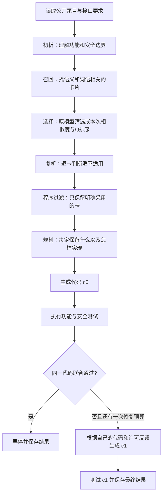

# 从零理解 CLE 与 Q 值：课题、机制、实验和科研判断

整合后的项目总介绍见 [CLE 项目全景手册](CLE项目全景手册_零基础完整版_20261016.md)。本文保留为 Q 专题的扩展讲义。

日期：2026-10-16。阅读对象：第一次接触代码生成、经验检索和科研实验的读者。

这份报告回答“为什么做、怎样做、怎样判断”；配套的[本项目实验报告](CLE_Q探索实验报告_零基础版_20261016.md)回答“实际做了什么、花了多少、得到了什么”。两份报告以本地代码和截至本日保存的实验记录为依据。本轮只整理材料，没有新增模型调用或实验。

先记住一句话：**CLE 希望模型从过去的编程经历中学会使用经验；这次 Q 探索只检验，给经验记录历史成绩，能不能帮助系统选到更有用的经验。** 目前已证明这套记录和选卡机制能运行，也确实改变了部分选择；尚未证明它提高了最终正确率。

## 阅读路线

| 想解决的问题 | 阅读位置 | 读完应该能够自己解释什么 |
|---|---|---|
| 项目究竟在做什么 | 第 1–4 节 | 为什么要同时检查正常功能和安全；经验卡是什么 |
| Q 到底是什么 | 第 5–7 节 | 怎样更新 Q；怎样用 Q 排序；为什么不直接相信高 Q |
| 为什么做这么多实验 | 第 8–11 节 | 对照、冻结、打乱、共享初析各自排除什么解释 |
| 怎样读懂结果 | 第 12–14 节 | 分母、显著性、逐题证据和成本怎样看 |
| 与论文、贡献、下一步有什么关系 | 第 15–17 节 | 什么是已经实现，什么才是科学发现；怎样决定继续或停止 |

不必先背术语。每个术语会在出现处解释，公式也从具体数字开始。

## 1. 项目要交出怎样的程序

CLE（Contrastive Lifecycle Evolution，对比式生命周期演进：比较代码修改前后的经历，把可迁移的经验保存下来，再审查和更新经验）研究的是安全代码生成（让模型根据要求写出既能正常工作、又能抵御指定攻击的代码）。

例如，一道题要求“根据用户身份读取其有权访问的文件”。程序需要同时做到：合法用户能够读到文件；越权用户读不到别人的文件。

功能正确性（程序是否完成题目要求的正常行为）和安全性（程序是否挡住测试所覆盖的非法行为）必须同时成立。把所有读取请求一律拒绝，可能通过部分安全测试，却完全没有完成正常功能。

本项目使用三个指标（用数字描述实验结果的统一口径）：

| 记号 | 专业名称与简单解释 | 读一个结果时应想到什么 |
|---|---|---|
| F | Function，功能测试通过 | 合法输入、输出形式、接口等是否符合要求 |
| S | Secure，安全测试通过 | 已有安全用例覆盖的攻击是否被正确处理 |
| Joint | 联合通过，同一份代码同时通过 F 和 S | 这是本次 Q 探索的核心正确率口径 |

`Joint = F AND S`。这里 AND（逻辑“并且”）要求两项同时成立。不能拿第一版的 F 和第二版的 S 拼出一个 Joint。

测试通过表示通过这套测试，不能自动推出在所有输入和所有攻击下都正确。测试覆盖（测试实际检查到了哪些情况）也是研究结果的边界。

## 2. 模型、Agent、经验库分别做什么

大语言模型（LLM，根据输入文字生成分析或代码的模型）是执行具体思考和生成任务的组件。本批实验使用的模型名称是 `deepseek-v3.2`。

Agent（按程序安排调用模型、检索资料和执行测试的工作流程）是“如何使用模型”的系统。CLE Agent 可以多次调用同一个模型完成不同职责，并不要求每个角色使用不同模型。

经验库（保存可重复使用的编程经验的外部文件集合）是系统的笔记本。模型权重（模型内部决定其行为的大量数值参数）在本次实验中没有改变；改变的是笔记本中每张经验卡的 Q 数值。

因此，“模型训练”至少要分清三件事：

| 说法 | 实际改变什么 | 本次是否做了 |
|---|---|---|
| 参数微调（通过训练改变模型内部参数） | 模型权重 | 没有 |
| 经验演进（生成、修改和审查外部经验） | 卡片正文、组织结构和状态 | 完整 CLE 有这项设计，本次固定库 Q 实验未执行完整演进 |
| Q 学习（根据使用后的成绩更新卡片分数） | `q_value` 和 `q_visits` | 已在全部 D_grow（经验学习任务池）任务上执行一轮 |

API（程序请求外部服务的接口）是模型调用的通道。ChatAnywhere 是本批使用的服务中转渠道，不是模型本身。Embedding 模型（把文字转成可比较的数字向量的模型）负责找相似经验；它与写代码的 LLM 是两种不同用途的模型。

提示词（告诉模型本次任务、约束和输出格式的输入文字）决定模型看到什么。调用模型、执行测试、更新文件，是程序安排的不同动作。

## 3. 经验卡究竟装了什么

经验卡（把一次或多次编程经历整理成有适用范围的建议）不是简单的一道题和标准答案。当前方法说明要求卡片表达危险来源、适用条件、正确做法、错误做法和功能边界。

下面是**教学示例，不是某张实际卡片的原文，也不是实验成绩**：

| 卡片内容 | 示例 | 为什么需要 |
|---|---|---|
| 安全不变量（无论怎么修改都应该保持的安全条件） | 文件最终位置必须处于授权目录内 | 给出判断目标 |
| 正向原则（建议执行的正确动作） | 先解析路径，再核对它仍在授权目录内 | 给出实现方向 |
| 负向护栏（指出不能采用的错误捷径） | 合法子目录被允许时，不要一律禁止斜杠 | 防止以安全为由破坏功能 |
| 适用条件（什么时候可以参考此建议） | 用户提供文件路径，程序访问本地文件 | 防止不相关经验被硬套 |
| 排除条件（什么时候不能照搬） | 当前对象不是文件系统路径 | 提醒模型识别边界 |
| 来源与证据（经验从哪里来、观察到过什么） | 某训练任务、修改前后代码、测试状态 | 允许研究者回看依据 |
| 生命周期状态（这张卡目前处于怎样的审查阶段） | 待验证、活跃、退役 | 控制卡片的使用资格 |
| Q 值（采用该卡后的历史整体成绩估计） | 0.3 | 影响有资格卡片之间的排序 |

HSK Tree（分层安全知识树，用层级组织安全经验）按 CWE（常见软件弱点分类，例如注入、越权）和安全不变量组织卡片。树负责组织；语义检索（按意思相近程度找内容）负责召回；Q 负责在相关候选中考虑历史成绩。这三件事不能互相替代。

当前固定库有 1939 张来自 Phase 1（建立初始经验的阶段）的候选卡。候选（还需要进一步验证的内容）不等于可靠规则；这些卡的初始状态是 `provisional`（待验证）。部分卡可能过于泛化、含错误解释，或者不适用于当前任务。

### “原题能 100% 找回来”能证明什么

Recall@3（已知目标卡是否出现在检索前 3 张中的比例）只检查找回目标。项目早期的 30 查询小实验中出现过这个指标的 100%，不能改写成“任何新题的经验都能选对”或“代码正确率 100%”。

自检索（用与建卡来源高度相近的信息再找这张卡）往往比迁移检索（在新题上找有帮助的经验）容易。卡片保留来源 ID，也不等于生成器直接读到原题答案；要分别检查“文件保存了什么”和“实际注入模型的字段是什么”。本项目有专门的卡片文本投影函数（只挑选允许字段形成检索或模型输入）。

所以，检索命中率不能独自证明机制优秀。还要检查新题隔离、适用性、实际采用以及最终测试效果。

## 4. 三种流程层次：不要把 Phase、修复次数和实验组混在一起

### 4.1 完整 CLE 的四个 Phase（方法的大阶段）

| 阶段 | 做什么 | 主要输入 | 输出 | 本次 Q 探索的位置 |
|---|---|---|---|---|
| Phase 1：冷启动（先建立第一批经验） | 从训练侧漏洞与修复对提取种子经验并自验证 | D_init，初始来源任务池，303 题 | 初始候选经验库 M0 | 复用现成 1939 卡，没有重新产卡 |
| Phase 2：经验增长（做题、修复、提炼跨题经验） | 在 D_grow 中调度任务，分析修改前后轨迹 | D_grow，经验学习任务池，273 题 | 新候选经验、失败记录、通过历史 | 本次只借用其做题过程学习固定卡的 Q |
| Phase 3：候选审查（判断新经验是否值得保留） | 检查独立增量与历史回归 | D_gate，开发审查池，298 题；H_pass，过去通过任务的记录 | 卡片晋升、修订或退役 | 本次使用 D_gate 做冻结库对照，没有运行完整逐卡准入 |
| Phase 4：冻结评价（停止改方法后看独立新题表现） | 只读使用最终经验与配置 | Base/Plus，独立评价数据集 | F、S、Joint 和成本 | 本次没有运行 |

这里 303、273、298 是当前 Python（一种编程语言）训练侧划分，合计 874 题，不是算法的固定常数。Base/Plus 与这三个训练开发池用途不同。

完整 CLE 的一轮外层演进（更新整个经验系统的一次循环）是 Phase 2 后接 Phase 3。三轮外层演进不等于每题修复三次。H_pass 是历史记录，不是一份额外的独立测试集。

### 4.2 单道题如何运行

公开契约（题目公开说明的函数名、参数、返回值、已有变量和合法行为）进入流程后：



初析（第一次理解题目）可能理解错。复析（拿到经验后重新判断适用性）也可能拒绝卡片。程序采纳过滤（按合法采用 ID 控制下游真正得到哪些卡）让拒绝结果在代码层生效。

`c0` 是初次代码；`c1` 是一次修复后的代码。修复代码（针对上一版失败进行修改得到的程序）仍然是解题产物，不是在修复 CLE 系统自身的源码。

P7（项目消融实验中一条生成流程的编号）在本次采用首次 Joint 通过就早停（满足停止条件后不再继续生成），否则最多一次修复。最终成绩来自实际最后输出的代码。Oracle 选择（看过测试答案后挑表现最好的一版）只适合另外标记的诊断，不能冒充系统真实选择。

A7（CLE 的一个主配置编号）也不是第七个 Phase；`methods/a7_exploration/` 则是另一条旁路研究入口。本报告只沿旧 CLE 与 P7 的 Q 接入工作解释。

### 4.3 为什么在 D_gate 跑实验，不等于完成 Phase 3

数据位置和实验操作是两个维度。D_gate 可以用来审查一张候选卡，也可以用来比较三套冻结的选卡方法。前者会形成生命周期决策；后者只产生比较结果。

本次“固定库评价”没有生成新卡，没有晋升或退役卡，没有完成完整 Phase 2→3。文件名 `m_star_q.jsonl` 也不能改变这个事实：本次它是 **M0 加上学到的 Q**，不是已经完成全部生命周期审查的最终知识库。

## 5. Q 值是什么：先算三次，再看公式

Q 值（某张卡被实际采用后，最终整份代码获得怎样成绩的历史估计）在本次初始为 0。它不是成功概率，也不是人工给卡片正确性打的分。

奖励信号（把一次测试结果转成学习用数字）定义为：同一代码 F 与 S 都通过，记 `+1`；两项完整测量但没有联合通过，记 `−1`。缺测（没有可靠测试结果）、技术失败和不具备奖励资格的记录不参与更新。

假设某张卡连续被采用三次，结果为成功、成功、失败。采用本次学习率 α=0.3（每次新成绩对旧分数的影响强度）：

| 次数 | 旧 Q | 本次奖励 | 计算 | 新 Q |
|---|---:|---:|---|---:|
| 初始 | — | — | 还没有观察 | 0 |
| 第 1 次 | 0 | +1 | 0 + 0.3 × (1 − 0) | 0.3 |
| 第 2 次 | 0.3 | +1 | 0.3 + 0.3 × (1 − 0.3) | 0.51 |
| 第 3 次 | 0.51 | −1 | 0.51 + 0.3 × (−1 − 0.51) | 0.057 |

通用公式是：

```text
Q_new = Q_old + α × (r − Q_old)
      = (1 − α) × Q_old + α × r
```

`Q_old` 是更新前分数，`Q_new` 是更新后分数，`r` 是本次奖励。这叫指数移动平均（较新的观察权重更大，较旧观察的影响逐步减弱）。不是“成功次数除以总次数”：上面的两次成功、一次失败，成功比例是 2/3，但 Q 是 0.057。

`q_visits`（该卡获得有效更新的次数）同时加 1。它不是独立题目数；同题 c0 与 c1 都采用它，就可能贡献两次更新。

### Q 为什么不等于“卡片功劳”

奖励归因（决定最终成绩应该记到哪个部件名下）是本次机制的关键限制。若三张卡都被采用，它们共享同一份代码的奖励。代码因为接口写错失败，三张本来正确的安全建议也可能一起收到 −1。

这叫信用分配问题（最终成功或失败由很多因素共同造成，难以分清每个因素的独立贡献）。因此，负 Q 只能表示“在这些使用经历中整体成绩偏差”，不能直接解释成“该卡有害”。

本实现采用每卡一个全局数值（同一卡在不同题目上共用一个分数），没有单独学习每种任务条件下的价值，也没有使用未来状态的奖励递推。强化学习（通过行为后的奖励调整选择的方法）是它的思想来源；不能因此把它等同于完整、已收敛的最优策略学习。

## 6. Q 怎样进入选卡

召回（先从大库中找到一批值得检查的候选）先取向量相似度前 24 张，再补充词语匹配前 8 张，合并去重。去重和资格过滤后，不保证总是恰好 32 张。

余弦相似度（用两个文字向量的方向接近程度表示语义相似）先过 δ（最低相似度门槛）。最新实验 δ=0.7613717780938312，来自 D_grow 召回分数的第 80 百分位（约 80% 的校准分数不高于这个位置）。本次要求严格大于该门槛。

δ 不是“正确概率 76.14%”，也不是某种通用最佳阈值。它依赖向量模型和具体数据。过不了门槛的卡，即使 Q 高也不能被选中。

过门槛后，计算：

```text
score = (1 − λ) × z(similarity) + λ × z(Q)
```

`score`（组合排序分数）用于排队；`λ`（历史效用权重）本次为 0.5；`z`（标准化，把不同尺度的数值变成相对候选平均值的高低）只在本次合格候选内部计算。

标准化的具体公式为 `z(x) = (x − 平均值) / 标准差`。标准差（数值围绕平均值分散的程度）为 0 时，该项全部记 0。这样不会把 0.8 左右的相似度与 −1 到 +1 的 Q 直接混加。λ=0.5 表示两项标准化分数权重相等，不表示它们各解释一半的代码正确率。

### 一个真实执行过算术核对的教学例子

下表四张虚构卡都超过示例门槛 0.80，仍按实际代码最多选 3 张。**数值仅用于教学，不是实验数据。**

| 卡 | 相似度 | Q | 组合分数，约 | 纯相似度名次 | 加 Q 后名次 |
|---|---:|---:|---:|---:|---:|
| A | 0.90 | −0.60 | 0.0408 | 1 | 3 |
| B | 0.88 | −0.30 | 0.0627 | 2 | 2 |
| C | 0.84 | 0 | −0.2317 | 3 | 4 |
| D | 0.82 | +0.60 | 0.1282 | 4 | 1 |

纯相似度选 A、B、C；加 Q 选 D、B、A。换进 D 是集合变化（选中的卡成员变了）；原有卡互换先后是顺序变化（成员可能不变，只改排列）。两者都值得记录，但都还没有证明代码变好。

实际顺序是：**相关候选 → 过门槛 → 数值排序选至多 3 张 → 复析判断适用 → 程序只传递实际采用卡 → 生成代码。** Q 数字本身没有被当作新提示词告诉模型。

### 0 分为什么需要小心

Q=0、visits=0 表示未知（尚未得到有效反馈），不是“已经证明一般”。如果其他卡都是负 Q，未知卡就可能被推到前面。最新实验的两个改选后被采用的新成员正是这种情况：旧卡被负分压下，新卡自己还没有学习经历。

## 7. Q 怎样学习：为什么“全量做题”仍没有“全量学卡”

固定经验库（学习过程中不改卡片正文、数量和生命周期状态）是为了先单独检验 Q 的作用。如果同时增加好卡、改提示词、换模型，就无法判断成绩变化来自哪里。

本次在全部 D_grow 的 273 题上运行原 P7，采用原 `semantic_llm`（由模型从召回候选里选择经验）的曝光方式（哪些卡有机会真正被使用）。**学习阶段没有用正在变化的 Q 指挥选卡。**

各题记录实际采用的卡与 c0/c1 的测试结果，再按预先固定的任务顺序更新 Q。因为生成时不读正在变化的 Q，这种并行生成、顺序回放奖励的方法与本次定义相容。若以后让 Q 一边变化一边决定下一题选卡，就不能直接沿用这个等价解释。

最新学习记录是：1939 张卡中，297 张得到过更新，覆盖率（至少有一次学习观察的卡占总卡数的比例）15.32%；1642 张仍没有更新。297 张中有 172 张只更新一次，只有 104 张涉及至少两个不同题族。

题族（内容同源或高度相关的一组任务）用于避免把改写题当作很多独立新题。本项目的题族来自数据清单中的分组推断，不是已经核实完全部原始生成关系的官方证明。

学习覆盖不足与 Q 无效不是同一个判断。前者说明许多卡没有足够观察；后者要求在 Q 真正影响决策的条件下，看它是否持续帮助新任务。

## 8. 科研实验先回答一个明确问题

研究问题（希望通过证据回答的具体问题）是：

> 固定经验内容、候选召回和解题预算后，学到的 Q 是否比纯语义相似度选卡更有用，并提高同一代码的联合通过率？

假设（可被数据支持或反驳的预期）可以写为：“真实 Q 所包含的历史信息能够选出更有帮助的经验”。替代解释（同一现象的其他可能原因）包括：随机换卡也行、初析不同、模型输出波动、题目接口有缺陷。

实验不是不断加样本直到看到更高分，而是逐个减少这些替代解释。

| 科研术语 | 在本项目中是什么 | 为什么需要 |
|---|---|---|
| 自变量（主动改变的因素） | 纯相似度、真实 Q、打乱 Q 的选卡规则 | 知道自己在检验什么 |
| 因变量（观察其变化的结果） | Joint，以及 F、S、成本和采用过程 | 知道怎样判定收益 |
| 控制变量（尽量保持相同的条件） | 题目、卡正文、模型、修复上限、门槛等 | 减少其他变化混进结果 |
| 混杂因素（既随实验组变化又可能影响结果的因素） | 例如某组同时换更强模型 | 防止把模型收益错算给 Q |
| 基线（用来比较的新方法之外的参考方法） | Q1 纯相似度；早期另有 Q0 原模型筛卡 | 判断改变带来多少增量 |
| 消融实验（移除某个部件看结果如何变化） | 把 Q 权重设为 0 | 分离该部件的作用 |
| 安慰剂对照（保留改动形式，但破坏其有效信息） | 打乱 Q 与卡片的对应关系 | 检查真实历史信息是否比任意扰动更有用 |

## 9. 三臂为什么这样设计

实验臂（接受一种固定处理方式的实验组）在最新实验中有三个。“Q1、Q2、Q3”是组名，不是 Q 的三个取值，也不是三个 Phase。

| 组名 | 选择方式 | 它回答什么 |
|---|---|---|
| Q1 | 同门槛，纯相似度排序，λ=0 | 不使用历史分数时能做到怎样 |
| Q2 | 相似度加真实学习 Q，λ=0.5 | 实际 Q 方案的表现怎样 |
| Q3 | 相似度加同 CWE 内打乱的 Q，λ=0.5 | 如果保留分数分布、却弄乱“谁得到什么分”，是否也差不多 |

置换（按固定随机规则重新分配数值）在 Q3 中同时打乱 `(Q, visits)` 配对；同 CWE 内置换保留每类弱点自己的分数分布，减少不同类别学习多少不一样带来的影响。随机种子（让这次打乱可重复的固定数字）为 20261015。

Q2−Q1 检查加入 Q 的增量；Q2−Q3 检查真实历史对应关系的价值。一种固定置换仍然只是一个对照实例，并没有证明所有随机置换都会怎样。

早期还比较过 Q0（原模型筛卡流程）。Q0 与 Q2 不只差一个 Q 数字：是否调用筛卡模型、是否使用数值门槛也有差异。因此 Q2 比 Q0 快或分高，不能直接全部归因于 Q。

## 10. 为什么冻结、分池、共享首次初析

冻结（比较期间不再修改经验、Q 和关键配置）使各组面对同一份已学好的材料。否则 Q2 做完第一题更新了 Q，后面比较的就不是同一个固定方案。

数据泄漏（把本应只用于评价的信息用来改进被评价方法）会让分数虚高。例如看过 Base/Plus 的隐藏答案后改卡，再用这些题报告泛化能力（在未参与改进的新题上继续有效的能力），就失去了独立测试意义。

所以 D_grow 用来学习，D_gate 用来开发诊断，预留确认集（开发期间暂时不用的一组题）在方案确定后才用于确认，最终 Base/Plus 独立评价另行进行。重复研究 D_gate 后，它仍是开发材料，不能再当从未见过的独立最终证据。

### 共享首次初析解决什么

初析可能影响检索查询（用于找卡的文字输入）。如果 Q1 把题目理解为“路径问题”，Q2 理解为“权限问题”，两组找到不同卡，就不能只怪排序公式。

共享首次初析（一道题只生成一次初始分析，三个组复用这份结果）使 c0 的查询、候选 ID 和相似度一致。最新记录已经核对这些相同。

它没有锁死后续输出。复析、规划和代码仍由各组分别生成；c1 要分析各自不同的上一版代码和反馈。温度 0（减少模型采样随机性的设置）也不能保证服务每次输出完全相同。因此仍需逐题看差异发生在哪里。

### 为什么不直接给模型隐藏测试

隐藏测试（只由执行器掌握、用于评价的具体输入和预期结果）不是解题材料。模型可以获得许可反馈（协议允许的测量状态和错误类型等），研究者可以离线检查原始记录，但不能把参考答案直接塞回生成输入来“修好”分数。

参考实现（数据集提供的正确解法示例）用于预检（运行实验前检查数据和执行环境）。参考实现能通过，也不保证公开题面与测试接口完全一致；最新 1015 题正是这个反例。

## 11. 为什么已经做过这些批次

每批详细数字见配套报告。这里先看设计逻辑：

| 步骤 | 最初不确定什么 | 做了什么 | 能解决到哪一步 |
|---|---|---|---|
| 接线与小探针（少量题检查能否跑通） | Q 是否真的读取、更新并影响选卡 | 少量学习加对照 | 工程机制可运行，不证明提分 |
| 原 P7 协议对齐（统一实验执行办法） | 自定义脚本与项目方法是否相同 | 复用原单题生成和验证入口 | 避免把不同流程硬说成同一实验 |
| 8 学习题加 24 评价题 | 少量 Q 能否表现出增益 | 原筛卡、相似度、真实 Q、全局打乱 Q 四臂 | 发现学习覆盖少、流程错误和归因不足 |
| 全部 D_grow 固定库学习 | 是不是只是没给 Q 足够学习机会 | 跑完 273 题，只更新实际采用卡 | 扩大到 297 张学过的卡；没有直接回答提分 |
| 最新库 8 题三臂 | 增加学习后是否改善；全局打乱是否不公平 | 改为同 CWE 打乱 | 看到真实改选、实际采用，但未提升 Joint |
| 零 API 回放（只重算保存的数据，不请求模型） | 后半段还在大幅改排序吗 | 重建不同学习进度的 Q，重排旧查询 | 观察排序稳定程度，不能产生新正确率 |
| 共享初析 8 题三臂 | 前一批是否被各组初析差异干扰 | c0 共用分析，再分别完成生成与修复 | 更直接观察排序机制；仍未得到可归因收益 |

注意：最新 8 题与上一批 8 题不同。共享初析这一改动本身是否提升分数，不能靠两批总分直接推断，因为任务也同时变了。

## 12. 读结果先问“分母是什么”

样本单位（一次独立观察所对应的对象）决定能不能把数字相加：

| 单位 | 最新实验数量 | 怎么理解 |
|---|---:|---|
| 任务 | 8 | 8 道不同题 |
| 题族 | 8 | 按现有分组清单，8 个不同来源族 |
| 任务×实验臂记录 | 24 | 同一题在三种策略下各做一次 |
| 代码尝试 | 41 | 每条记录可能有 c0 和 c1 |
| LLM 逻辑调用 | 148 | 初析、复析、规划、生成等模型请求的总数 |
| 被采用的卡次 | 各臂不同 | 同一卡在不同尝试中重复出现会重复计数 |

24 条记录不是 24 道独立题，41 次尝试也不是 41 个独立样本。配对比较（在同一批题上逐题比较两种方法）比只看两个总分更能控制题目难度。

最新 Q1 的 Joint=2/8，Q2=3/8。差值是 12.5 个百分点（两个百分比相减的单位），不是“成功概率可靠地提高了 12.5%”。这 1 道差异题没有采用任何经验卡，所以也没有直接经过 Q 改选路径。

### 为什么 p 值和置信区间仍要看

p 值（在某个无差异假设及统计模型成立时，观察到当前或更极端差异的概率）不是“Q 无效的概率”。最新精确 McNemar 检验（专门比较同题两种方法二元对错差异的检验）只看一赢零输的非一致配对，双侧 p=1。

95% 置信区间（按同一方法长期重复取样时，约 95% 的这类区间能覆盖真实差异）很宽，本批保守区间约为 −42.02 到 +57.55 个百分点。它不是对这一次区间包含真值的概率承诺；它直观提醒我们，8 题对总体差异的估计非常不精确。

多重比较校正（同时做多个检验时控制偶然报喜的办法）本次采用 Holm 方法。校正前后 p 都为 1。没有显著差异（当前证据不足以排除统计上的无差异解释）不等于已证明等效（差异足够小，落在事先确定的可接受范围内）。

比统计量更直接的机制证据是：**唯一救回题并没有卡片介入。** 即便总分差大一些，也要先解释这个断点。

## 13. 怎样找出“不提分”的原因

机制链（一个改动通向最终结果时必须经过的步骤）是：

```text
卡得到有效学习 → 相关卡进入候选 → Q 改变选择 → 新卡被采用
→ 经验被正确落实到代码 → 代码满足功能和安全 → 新题联合通过率提高
```

每一段都可能断，不能把所有失败统称为“Q 不行”。

| 可能瓶颈 | 要看什么记录 | 最新证据怎样理解 |
|---|---|---|
| 学习覆盖不足 | Q 更新、visits、不同题族数 | 只学到 297/1939 卡，很多只见过一次 |
| 召回或门槛阻断 | 候选、相似度、过门槛数 | Q2 的 13 次尝试中 7 次没有卡过门槛 |
| 采纳阻断 | 选中卡与实际采用 ID 的差别 | 选中不保证采用；Q2 共选中 18 卡次，采用 5 卡次 |
| 模型落实失败 | 生成代码是否保留接口、模板和权限边界 | 777 等题即使采用建议，也自行编造已有配置 |
| 评价材料问题 | 公开契约、执行器准备的变量、参考代码 | 1015 的公开变量名与执行环境不一致 |
| Q 机制的归因偏差 | 相同奖励是否记给多卡；失败是否其实来自接口 | 全代码奖励不能准确给每张卡分功劳 |

声明采用（模型在结构化结果中说采用哪张卡）与正确落实（代码实际满足该卡的关键条件）也不同。本项目用程序白名单确保采用卡能传入下游，但它不会自动保证模型实现正确。

反事实重排（固定已经出现的查询，只改变排序规则来问“另一规则会选谁”）可用零 API 分析判断 Q 是否改变选卡。它没有重新生成代码，因此不能告诉我们另一选法会不会通过测试。

事后敏感性分析（看到结果后，按明确理由重算部分样本以判断结论是否依赖它们）可以帮助解释缺陷题，但不能偷偷替换事先确定的主结果。最新报告保留全部 8 题，再单列去除缺陷题的辅助结果。

## 14. 成本和“多轮收敛”怎样理解

Token（模型读写文本时使用的计量单位）不是字数。一次请求很长，可能比多次短请求更贵。最新 Q2 比 Q1 少 4 次调用，却多用 11,974 Token，说明只数请求次数不够。

需要区分学习成本（先做题得到 Q）、在线生成成本（使用已冻结 Q 解新题）、Embedding 成本（计算文字向量）和离线分析成本（本地重算已有记录）。共享初析只发生 8 次，应单列一次，不能给三个组各算一遍。

墙钟时间（从启动到结束实际等了多久）与作业时间之和（把所有并行任务各自耗时加起来）也不同。并行 4 个任务后，后者通常更大。模型用量能核对，实际账单还需对应服务价格和账户账单；本报告不把旧价格估算当报销金额。

### Q 必须重复很多轮才有用吗

收敛（某个量随继续学习逐渐稳定）需要先说明“什么稳定”：Q 数字、选卡名次，还是新题正确率？这三个结论互不等价。

本项目固定 α=0.3，新的成败仍有较大权重；反复做同类题可能使 Q 继续波动。重复同一题也不等于获得新的独立证据。不能从 MemRL 的理论分析直接推出本实现必然收敛，因为数据、选择方式、奖励与学习过程都不同。

最新零 API 回放发现：最后 27 道学习题加入后，在固定的 43 条历史查询上只改变 2 条排序，且这两条来自同一任务的不同实验臂。这个结果支持“这批查询上的排序后期变化较少”，不能证明 Q 数值严格收敛或继续训练必定无用。

在数据接口、模型落实和奖励归因已经出现问题时，盲目重复整轮学习不一定最有信息价值。应先确定究竟哪一段机制需要验证。

## 15. 与 MemRL 的关系，以及什么才算贡献

MemRL（通过运行反馈学习外部记忆效用的方法）原文提出先按语义相关性召回，再结合标准化的相似度和 Q 选择记忆，并按实际注入上下文的记忆更新效用。本次公式参考其第 4 节式（4）、式（7）。原文已在本地保存并核对，[论文原文 v2](https://arxiv.org/pdf/2601.03192v2)。

因此，**Q 更新公式、两阶段选记忆和“历史收益影响选择”不是本项目首创。** 本次工作属于机制迁移（把已有机制接入另一个明确任务与系统），不是完整复现（按原论文的完整数据与流程重做其全部结论）MemRL。

本项目值得研究的具体问题是：在带适用条件和负向护栏的安全经验卡上，以同一代码 F/S 联合作为反馈，并且存在复析拒绝、一次修复和生命周期管理时，历史效用到底能不能可靠帮助生成？

贡献（研究相对已有知识增加了什么可验证认识）需要分层说明：

| 层次 | 当前可以说什么 | 还不能据此说什么 |
|---|---|---|
| 工程实现 | Q 存储、更新、排序、冻结与逐题记录已接通 | 实现完成就代表方法先进 |
| 实验设计 | 真实 Q、同类打乱、共享初析与逐题机制检查用于分辨原因 | 设计合理就代表效果已成立 |
| 实证发现（真实数据支持的观察） | 在当前探索条件下，改选和采用没有形成可归因的 Joint 增益；发现接口与落实问题 | Q 普遍无用、CLE 已优于其他方法 |
| 方法创新（新机制及其经过验证的作用） | 需要另行提出、比较和验证 | 把借来的 Q 改名作为原创贡献 |

这些诊断可以帮助选择研究方向；要成为稳固的论文贡献，还需要清楚的问题定位、相关工作比较、充分的新题证据和可复现分析。不能只靠“用了很多模块”判断贡献够不够。

## 16. 下一步怎样做，才是在回答问题

本轮是报告整理，以下是研究决策说明，不代表已经启动新实验。

默认优先处理已经观察到的公开契约使用与结构化输出问题，然后在预先固定的新开发题上保持三臂一致。契约保护（明确要求沿用题目已提供的变量和接口）应同时作用于各臂；不能只帮 Q2 修错，再和旧 Q1 分数比较。

如果还要检验 Q 本身，可以按三个不同问题选择，避免一次全改：

| 方向 | 检验的问题 | 最小改动 | 代价和判定 |
|---|---|---|---|
| 先恢复可判读的生成链 | 是不是卡有用，但输出一直弄错接口 | 所有臂共同增加明确的公开契约约束，保持 Q 库、排序公式和修复预算 | 一批新的三臂开发题；要同时看格式、改选、采用和 Joint |
| 再检验稀疏 Q 的影响 | 未学习的 0 分是否因挤掉负分卡而造成误导 | 单独比较当前 Q 与预先规定的低观察量处理办法 | 这是新的选择机制，需要新对照，不能事后调整到分数最好 |
| 再检验奖励归因 | 整体失败是否错误惩罚了正确卡 | 在受控小任务上固定背景，只增减待研究卡 | 需要额外生成预算；仍受模型输出变化影响，不能只看单次差异 |

确认实验（配置固定后，用事先保留的新任务检验开发观察）只有在开发链能清楚解释时才有价值。预留 24 题、完整 CLE 训练与 Base/Plus 当前都没有启动。

停止规则（事先说清哪些结果意味着继续、修改或停止）可以允许“现有 Q 方案没有获得支持”作为阶段结论。科研不是必须把每个想法做出正提升；及时知道一个想法在哪里受阻，也能减少下一轮盲目花费。

## 17. 你能否独立复述：十二个自查问题

| 问题 | 应能说出的核心答案 |
|---|---|
| CLE 最终要优化什么？ | 同一代码正常功能与安全同时通过，不能靠拒绝所有请求换安全分 |
| Q 学习有没有让模型本身变聪明？ | 没改模型权重；只改外部卡片的历史分数 |
| 找到卡、选中卡、采用卡有什么区别？ | 进入候选、进入最终候选小集、真正允许传入生成下游，是三层 |
| Q=0 是否表示中等可靠？ | 未观察卡也是 0，必须结合 visits 与独立题族看 |
| 为什么只更新实际采用卡？ | 没参与生成的卡不应该承接这次结果；但采用卡共享奖励仍有归因问题 |
| 为什么已经跑完 273 题还只学到 297 张卡？ | 大部分卡没有进入有效采用与奖励链；全量题不等于全量卡 |
| 三臂分别控制什么？ | Q1 去掉 Q，Q2 用真实 Q，Q3 保留分布但弄乱卡与分数的关系 |
| 共享首次初析解决了全部公平性问题吗？ | 只对齐首次查询和候选；后续生成与修复仍不同 |
| 为什么 Q2 最新 3/8 不能直接说提分？ | 唯一额外通过题没有采用卡，样本也很小 |
| 为什么 41 次代码尝试不能写成 41 个独立样本？ | 同题的修复和不同实验臂之间互相关联 |
| 为什么不把坏题删掉再报好看结果？ | 会改变预定分母；应保留主结果并另外解释缺陷与辅助分析 |
| 现在完成了完整 CLE 的最终证明吗？ | 没有；完成的是固定库 Q 的开发探索，完整演进和独立最终评价尚未运行 |

## 证据与代码导航

| 想核对什么 | 入口 |
|---|---|
| CLE 名称、卡片结构、四阶段与研究问题 | [当前方法说明](CLE_Method_Complete_Description_20260924_Final.md)，第 1–10、15–16 节 |
| MemRL 公式来源与迁移边界 | [接入任务书](CLE_MemRL记忆Q值接入方案与实验任务书_20261015.md)，第 2 节；[原文 v2](https://arxiv.org/pdf/2601.03192v2) |
| Q 更新、奖励与标准化排序 | [memory_q.py](../methods/sct_trajectory/memory_q.py)：`update_q`、`update_adopted`、`rank_candidates` |
| 候选召回与两种数值选择 | [semantic_retrieval.py](../methods/sct_trajectory/semantic_retrieval.py)：`recall_semantic_candidates`、`semantic_value_select` |
| 实际采纳和下游输入 | [context_pipeline.py](../methods/sct_trajectory/context_pipeline.py)：`adopt_experiences`、`run_context_pipeline` |
| 原 P7 单题生成与测试 | [runner.py](../methods/cle_ablation/runner.py)：`generate`、`run_one` |
| 全 D_grow 学习与覆盖 | [全量固定库学习记录](CLE_全Dgrow固定库Q学习记录_20261016.md) |
| 最新完整技术记录 | [回放与共享初析实验](CLE_Q回放与共享初析8题实验_20261016.md) |
| 逐批数字、逐题解释和操作文件 | [配套零基础实验报告](CLE_Q探索实验报告_零基础版_20261016.md) |

早期任务书中的“未实现”“尚未运行”是当时状态。判断截至本日做到了哪里，应以配套实验报告及最新实际产物为准。
