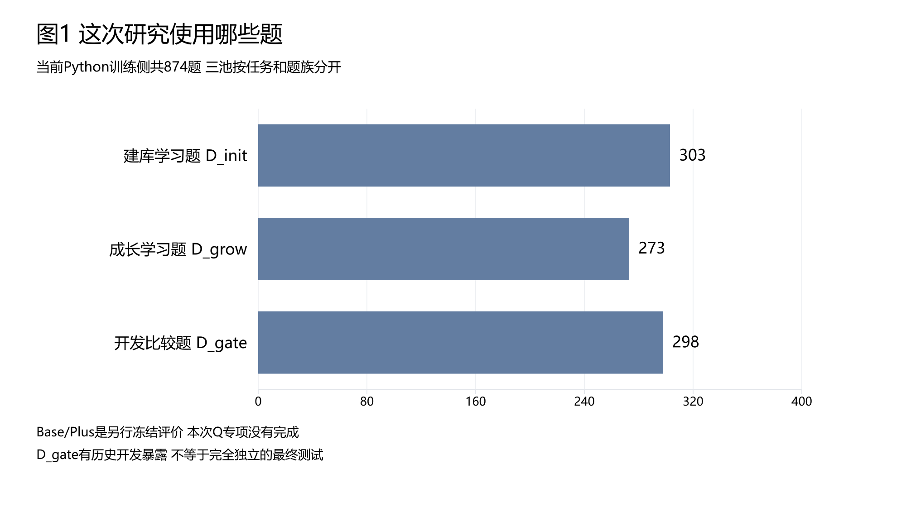
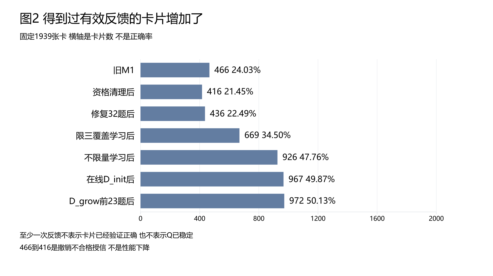
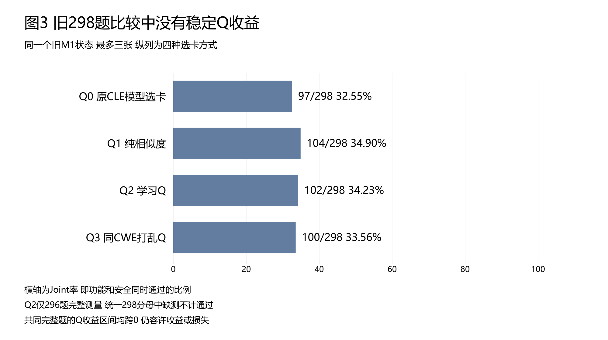
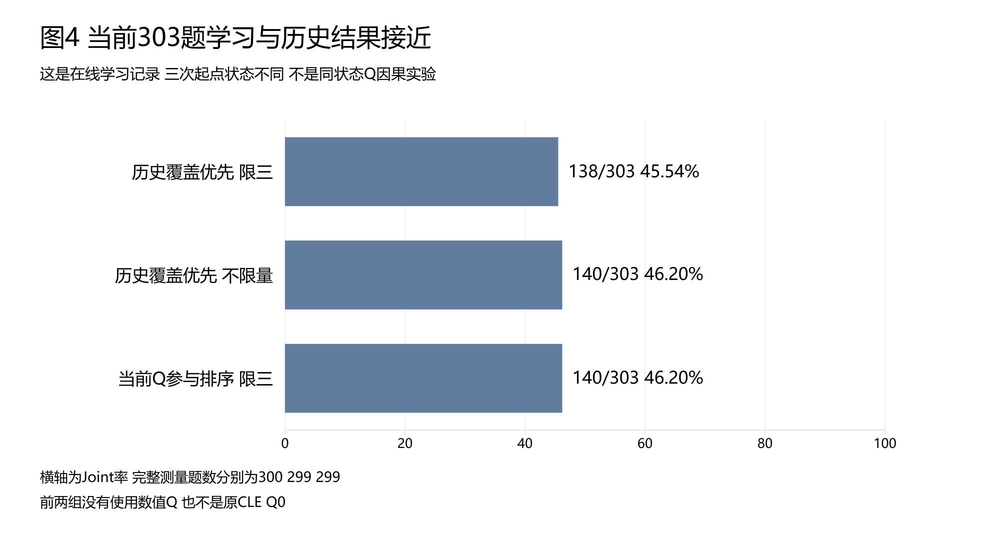
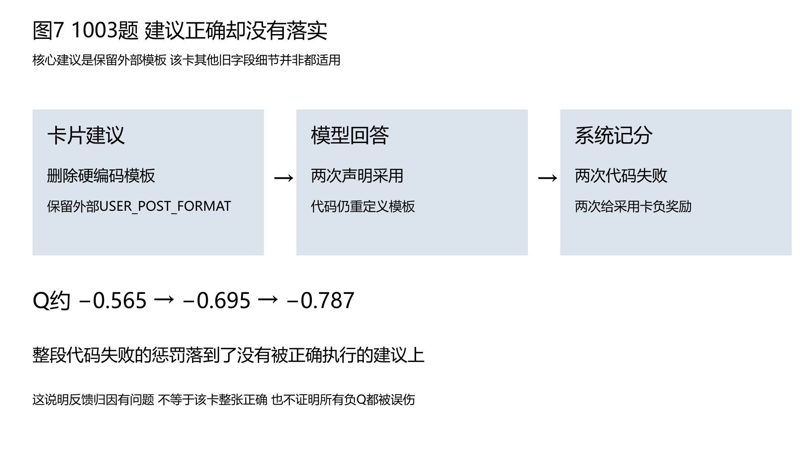

# CLE本周Q值探索组会讲稿

日期为2026年10月21日，内容截至当晚实验暂停点。讲稿由Gemini 4 Argon High依据6 Pro综合审阅及本地逐题分析重写，本地完成数字核对、图表和Word排版。

使用方法为按11个展示页的顺序，配合图表朗读正文；末尾问答和数字摘要供准备与追问时使用，不必全部朗读。这里的展示页是讲述顺序，不是Word的物理页码。完整科学分析保留在文末所列原报告中。

本轮只整理材料，没有恢复实验。核心结论是Q确实影响选卡，但稳定提分尚未建立。

### 第1页：项目背景与我们要解决的问题

各位老师、同学大家好。今天向大家汇报我们本周在CLE项目中围绕Q值选卡开展的探索工作，面向第一次接触本项目的老师和同学，我们先简要交代背景。我们做的是安全代码生成，目标是在不修改大模型参数的前提下，让模型写出的代码既能完成正常业务功能，又能防住安全漏洞。平时让模型写代码很容易顾此失彼：只管功能跑通可能会留漏洞，一味拒绝输入又会破坏正常功能，所以评判代码必须看Joint，也就是同一份代码同时通过功能测试和安全测试。为了帮模型避坑，原项目提炼了1939张固定的经验卡作为避坑指南，做题时先检索候选卡生成初次代码，没通过再最多修复一次。本周我们要回答的是：给每张经验卡加上记录过往解题成败口碑的Q值来帮模型选卡，能不能稳定提高Joint通过率。

### 第2页：题目分组与经验卡库边界

接下来请大家看图1的三池题数横条图，了解我们的数据分工。我们使用的数据集共有874道Python训练侧题目，从上到下分为三组：303道建库学习题（D_init）、273道成长学习题（D_grow），以及298道留作比较的开发题（D_gate）。这里要区分宽泛的漏洞类别CWE和具体业务题族：同一漏洞类别下业务要求可能完全不同，而我们三个池子各有217个题族且互不交叉。不过按题族分池虽避免了同题族重叠，但不能保证所有形式的信息泄漏都不存在。同时我们要明确两条边界：第一，全库1939张经验卡的正文是固定的，主要由建库学习题产出，Q值学习只更新卡片分数和访问次数，不重新生成经验卡；第二，298道留作比较的开发题在开发中已被多次查看对比，只是开发阶段的比较标尺，不是独立的最终测试集，另外的外部冻结评价集本次专项并未启动。

### 第3页：选卡机制与Q值如何工作

翻到第3页，我们来看选卡和Q值具体是怎么工作的。每道题开始时，系统把向量检索和词面检索合并出最多32张候选卡。引入Q值后，系统把候选内的语义相似度和Q值按对半权重结合，用来重排候选卡的呈现顺序，而不是一半卡片由Q值选、一半由相似度选。这复用了MemRL用任务反馈更新外部记忆效用的思想，像移动平均更新、混合相似度打分和经验选卡都是对已有方法的复用，并非我们的首创。但和直接按高分截取前三张卡生成代码不同，我们的Q值只先影响卡片呈现顺序，最终选哪零到三张卡、采不采用，仍由模型读正文后自己决定。一道题内使用固定题前Q值，结束后只对声明采用的卡按整段代码成败更新分数，因此整段代码失败可能误伤建议正确但未实现的卡。

### 第4页：本周探索进程与有反馈卡片数量变化

请看图2的各阶段卡片数量横条图，它展示了全库1939张卡中至少拿到过一次有效反馈的卡片数量变化。从早期小样本到成长题观察形成的原M1状态，共有466张卡得到过有效反馈，占24.03%。第二条降到416张，是因为清理了早期不合格的旧记分——这是撤销不合格记录而非退步，且已独立复算确认，不再是待办问题。随后修复公开要求并补学成长题升到436张；接着在303道建库学习题上优先挑选未学卡片扩大覆盖，限三张时升到669张，取消三张上限后升到926张。最后让最新Q值参与排序跑完303道建库题达到967张，再跑23道成长题后暂停在972张，占50.13%。注意这只代表卡片至少有过一次有效记分，不等于已验证正确；没反馈的卡也只能说未召回、未选中、未采用或未满足记分条件，不能直接判为不适用，更不能把不同阶段结果串成连续提分曲线。

### 第5页：旧298道开发题四种选卡方式对比

厘清了探索脉络后，我们先看图3的旧四方式Joint横条图。这是在同一旧M1卡库状态、最多选三张卡条件下，在298道留作比较的开发题上对比四种选卡方式：Q0是原CLE模型选卡，通过97题；Q1是纯语义相似度排序，通过104题；Q2是用学习到的Q值参与排序，通过102题（其中有2题未完成完整测量，按298题统一分母时不计通过）；Q3是在同一CWE漏洞类别内把Q值打乱后排序，通过100题。在共同完整测量的题目上逐题对比，Q2相比其他三种方式都是既有救回也有损失，可能的收益和损失范围仍然同时存在，因此没有通过预设的稳定收益门槛。这说明旧状态下尚未建立稳定提分，但不能写成已经证明Q值无效。另外，虽然当时全库仅24.03%的卡有反馈，但Q2实际选入和声明采用的卡片人次里超过一半是有反馈卡，说明并非Q值没机会发挥。

### 第6页：303道建库学习题三次结果比较

把卡片覆盖大幅推高后，我们在303道建库学习题上做了对比，请看图4的三次D_init横条图。从上到下三条横条依次是：第一条，无数值Q值参与、优先挑选未学卡片的限三张学习，通过138题；第二条，同样无数值Q值、但取消三张上限的覆盖优先学习，通过140题；第三条，是最新跑完的让学习Q值实际参与排序、限选三张卡的学习，同样通过140题。拿最新这轮Q值排序跟限三张历史对照逐题相比，救回20题、损失18题，只净多2题；跟不限量对照相比，救回14题、损失14题，净变化为0。看这张图要注意两条边界：第一，前两次覆盖优先对照读取了卡片访问状态，并非原CLE默认选卡，且三次起始库状态不同，不能当成同状态只改Q值的对照；第二，这140题是边做题边更新Q值的在线学习轨迹，同题学习分数不等于跨题迁移收益。

### 第7页：从选卡改变到最终得分：换卡不等于提分

看到总分从138题到140题几乎没变，大家自然会问：是不是Q值排序根本没改变模型选哪些卡？请看图5。图5左边从上往下看：303道建库学习题中有296道题首轮查询和候选卡可直接配对，其中281道题实际选入的卡片成员发生了改变，占94.93%，而这281道题里有225道都声明采用了新增卡。这里要严谨说明，94.93%是历史可配对记录中的选卡变化关联比例，不能全部归因于Q值；我们另外做的160次独立重复选卡实验只选卡、不写代码，仅支持Q值确实会影响选择，不证明通过率提高。再看图5右边：全部303道题最终救回20题、损失18题，几乎相互抵消。就在那225道声明采用新增卡的题目里，仍有20道题犯了不当重定义外部共享配置的错误，说明换卡不等于提分，声明采用新增卡也不等于建议真正在代码中落实。

### 第8页：18道退化题的就近原因分析

既然一边救回20题，另一边又丢了18题，那这18道退化题到底死在了哪里？请看图6的退化原因条形图。本地复核确认，18道题原先的通过和其中17道题的新失败全部可复现，另有1道题是网络失败没有生成新代码。条形图最长的那一栏占了13道题，全是因为模型在写代码时擅自重定义了题目已有的全局配置，比如用空字典或自造常量覆盖了外部数据库、模板或白名单；我们在离线诊断副本里只删掉这行不当的全局重定义，这13道题就全部救回通过。另外还有2道题是公开字段或占位符不全，补齐后也能救回，剩下2道是资源预算未说明。跨历史170组失败代码共340次本地验证一共救回了79个运行实例、涉及45道不同题目，纯随机噪声失败总数则未测出，这些诊断副本不改正式分数，但表明不能把18道损失全算在Q值头上。

### 第9页：1003题采用未落实与907题测试盲区

请看图7的1003题案例流程图，我们看看代码落实和记分是怎么脱节的。顺着图7从左往右看：在1003题里，卡片的核心要求非常明确，就是保留外部提供的模板、删除硬编码重定义；模型在初次生成和修复时两次都声明采用了这张卡，可写出的代码却依然重定义了模板，导致两次测试失败，结果这张给出正确核心建议的卡反而连续两次被扣低了Q值。不过也要说明，这张卡源自1003题自身，且卡里其他旧字段细节并非全部适用，不能说整张卡已获人工认证，也不能当跨题族迁移证据。此外我们还发现了907题的测试盲区：题目预置了共享队列，但连旧组通过的代码也把它替换成了普通列表，只因测试仅检查返回布尔值而漏检，说明测试通过不保证覆盖所有要求；而1174、1382、834等题虽确有改善，也不能夸大为全由Q值所致。

### 第10页：检索相关性诊断与当前暂停进度

第10页我们交代检索适用性诊断与当前实验进度。我们对914个题卡配对做了AI初步标注，人工确认为0，因此只能作为模型辅助诊断，不能当人工金标准。其中校准题因为存在待裁决的信息不足配对，没有全部计入指标；而在8道开发题的旧检索观察中，虽然候选阶段找回了不少直接适用卡，但模型最终选入的直接适用卡为0，表面较高的准确率只是因为大量不相关负类没被选，而且全库召回率并未测量，旧高阈值也与当前Q协议不同，不能混为当前Q检索结果。在实验进度上，目前建库学习题已完成303题（通过140题），成长学习题只跑了23题（通过11题，属局部记录不与全量比较）就主动暂停，当前增强Q状态下的新298道开发题运行数为0/298，历史整理的记录含重复题不能当独立题算总正确率，全部实验目前保持暂停。

### 第11页：明确结论与组会收尾建议

最后一页汇报我们的明确结论与组会建议。综合本周探索，我们的核心结论是：Q确实影响选卡，但稳定提分尚未建立。实验已经证实，Q值排序改变了候选卡呈现顺序和模型实际选卡组合，多阶段学习后，全库有反馈卡片比例达到50.13%，但在旧开发题四种方式对比和建库题历史对照中，均未建立稳定的Joint正确率收益。当前已定位的瓶颈包括建议落实、共享记分和题目测试，Q打分设计本身的独立收益尚未分离出来。没有充分理由为本专项自动追加全量实验。因此我们建议保持付费实验暂停，不把跑完剩余成长题或新全量开发题作为必须收尾条件，直接做有限文档收尾。同时要把原CLE的整体贡献与本次Q专项结果分开：本次收尾不代表已证明Q值普遍无效，也不代表整个CLE项目已经完成。谢谢大家，欢迎各位老师和同学提问！

## 老师可能追问的7个问题与简短回答

- **问：为什么模型选卡明显变了，最终Joint分数却没有稳定提升？**
**答：** 因为“声明采用”不等于“代码落实”（如225道声明采用新卡的题中仍有20道擅自重定义全局配置），且整段代码成败捆绑记分会让因其他错误失败的代码连累好卡被扣Q值（如1003题），加上部分题目测试存在缺口，导致救回与损失相互抵消。

- **问：为什么建议现在暂停，不再多跑几轮或跑完剩余250道成长题？**
**答：** 当前卡脖子的是模型不落实卡片约束和整题共享记分污染，这两个机制问题不解决，单纯多跑轮次可能继续累积这些问题的影响，不能预先保证正确率提高；现有证据不支持为本专项自动追加全量实验。

- **问：在303道建库学习题上比较，是否存在数据泄漏或同题学习？**
**答：** 三池按217个题族切分互不重叠，避免了同题族跨池重叠，但不能保证所有形式的信息泄漏都不存在；而建库题本身是经验卡的主要来源（如1003题卡源自同题），在其上边做边更新Q值属于同题在线学习，不能当跨题迁移收益。

- **问：全库有反馈卡比例（旧24.03%、现50.13%）是不是不够高，导致Q值没机会发挥？**
**答：** 全库去重卡片比例不同于选卡实际曝光比例。旧开发题Q2选入出现中55.57%是有反馈卡、声明采用出现中达61.22%，说明Q已经实际介入不少选卡，不能仅凭全库覆盖率断言没有机会发挥；没反馈的卡只能说未召回、未选中、未采用或未满足记分条件，不能直接判为不适用。

- **问：检索召回率测完了吗？914对标注能当最终检索指标吗？**
**答：** 不能。914对均为AI初标、人工确认为0；校准6题因1394题含2对信息不足仅5题330对可评（非912对全测完）；开发8题515对在候选池虽找回30%和90%直接适用卡，但最终选入直接适用卡均为0，高准确率源于大量未选负类，且全库召回率未测。

- **问：最新967/972张覆盖状态下的298道开发题（D_gate）跑了吗？**
**答：** 没有，当前增强Q状态的新开发题Q2、Q3均为0/298，旧Q0、Q1仅计划复用，Base/Plus也未跑；我们如实标注该状态未测量，无需为专项文档收尾再付费补跑。

- **问：既然EMA、混合相似度和经验选卡不是首创，本次探索有什么贡献？**
**答：** 原CLE贡献在于功能安全对比经验提取与卡片生命周期管理；本专项复用MemRL记忆效用更新思想做迁移检验，用扎实数据与代码诊断揭示了“选卡改变但被代码落实偏差与共享记分卡住而未转化为稳定提分”的真实瓶颈。

## 精确数字与来源口径

- **题库与机制口径**：SeCodePLT Python训练侧874题分为D_init 303、D_grow 273、D_gate 298，每池各217个题族且题与题族互不交叉；经验库固定1939张。向量Top24与词面Top8合并最多32候选；排序综合分等于0.5乘候选内标准化语义相似度加0.5乘候选内标准化Q值；模型选0至3张并在复析后声明采用；有效尝试中实际声明采用卡按新Q等于0.7乘旧Q加0.3乘整段代码奖励更新（功能与安全同过为正1，否则为负1）。

- **覆盖与主实验口径**：有反馈卡数（分母1939）依次为原M1的466（24.03%）、资格清理后416（独立复算已确认）、补学32题后436、限三覆盖669、不限三张926、在线D_init后967、D_grow 23题暂停后972（50.13%）。旧D_gate（298分母）四方式Joint为Q0 97（32.55%）、Q1 104（34.90%）、Q2 102（34.23%，完整测量296题）、Q3 100（33.56%）；共同296题上Q2对Q0/Q1/Q3分别救16损10、救13损14、救14损12，题族重采样95%差异区间为[-1.28,5.30]、[-3.56,2.81]、[-2.73,4.04]个百分点；旧D_gate Q2选入与声明采用出现中有反馈卡占55.57%与61.22%。D_init（303分母）三次为无数值Q限三138（45.54%，完测300）、无数值Q不限量140（46.20%，完测299）、当前Q限三140（46.20%，完测299，比限三救20损18，配对McNemar检验p为0.8714；比不限量救14损14）。

- **选卡、诊断与资源口径**：303题中296题首查询与候选可配对，281题（94.93%）改选成员、15题相同；281题中225题（80.07%）声明采用新卡（含20题重定义全局配置）、51题未采用、5题异常；全303题双过120、双不过145、救20、损18。160次重复选卡（8题×4方式×5次）Q2对Q1、Q3超额集合差异Holm校正p均为0.0006。18道退化含13题重定义全局配置（离线删定义全救回）、2题公开字段不全（补齐救回）、2题资源预算未明、1题网络失败；跨历史170组失败代码340次本地验证救回79个运行实例（45题）。1003题卡Q值由-0.565降至-0.695再降至-0.787。914对AI初标（人审0）含直接适用89、条件适用385、不相关285、冲突153、信息不足2；校准6题仅5题330对可评；开发8题515对候选召回18/60（30%）与54/60（90%），终选6张（直接适用0）与0张。暂停时D_init 303/303（Joint 140）、D_grow 23/273（Joint 11）、新D_gate 0/298；22组记录共3423条；10月15至21日已知输入219710233、输出21560254、合计241270487 Token，按每百万1.2/1.8元估算302.46元。

## 本周主要历史实验备查

下表摘录6 Pro已核对的实验主线。题目、经验库状态和选卡限制不完全相同，各行单独解释，不连成提分曲线；小样本结果也不与全量结果相加。

| 做了什么 | 任务规模 | Joint通过记录 | 能说明什么 |
| --- | --- | --- | --- |
| 早期四种选卡方式试验 | 24题各跑四种方式 | Q0至Q3为5、3、4、5 | 小样本没有建立学习Q优势 |
| 第一轮成长题观察学习 | 273题 | 105题通过，272题完整测量 | 是学习过程记录 |
| 成长题不限三张观察学习 | 同273题 | 109题通过，形成旧466卡反馈状态 | 扩大使用与记分机会 |
| 冻结Q后在同题回测 | 同273题 | 100题通过 | 该次同题回测没有改善，非单因素因果比较 |
| 不限量的开发题比较 | 固定48题 | Q1至Q3为17、21、20；另补Q0为18 | 旧小范围结果，Q0另批补跑 |
| 旧完整开发池四方式比较 | 298题 | Q0至Q3为97、104、102、100 | 仍未建立稳定Q收益 |
| 修复公开要求后补学 | 32道成长题 | 24题通过，反馈卡416增至436 | 修订要求后的补学，不能把得分变化全归因Q |
| 建库题限三与不限量覆盖学习 | 各303题 | 138和140题通过 | 反馈卡先后增至669和926 |
| 当前Q参与排序的学习 | 建库303题及成长前23题 | 140和11题通过 | 暂停点在线学习记录，尚无本状态新D_gate成绩 |

## 检索四指标的简单读法

这四项衡量的是某张卡是否适用、有没有被选中，不能与代码通过率混为一谈。本项目当前标签是AI估计，尚未人工确认，召回率也仅限已标注候选池。

| 名称 | 用一句话理解 | 容易误解的地方 |
| --- | --- | --- |
| 准确率 | 整个评价池中，选与不选的判断有多少正确 | 不适用卡很多时，全不选也能得到较高数值 |
| 精确率 | 选出来的卡中，有多少张直接适用 | 一张都没选时，分母为零，应写无法计算 |
| 召回率 | 评价池里全部直接适用卡中，选回了多少 | 候选池内召回不能说成全库召回 |
| F1值 | 把选得准与漏得少合在一起衡量 | 不等于代码正确率，也不代替逐题原因分析 |

候选召回阶段和最终选卡阶段应分别看。旧开发8题诊断里，候选阶段找回直接适用卡的比例是30%与90%，但两种方式最终选入直接适用卡均为0；这提示问题可能发生在门槛或后续选择，不能只看候选已经找到了多少。

## 原始分析与完整审阅

- [6 Pro综合分析报告和最终补充裁决](CLE_Q探索6Pro综合分析报告_20261021.md)
- [选卡编号变化及Joint交叉分析](CLE_Dinit选卡编号变化与Joint交叉分析_20261021.md)
- [18道退化题逐题原因分析](CLE_Dinit_Q对照18道退化题原因分析_20261021.md)
- [历史实验波动与实现失败复核](CLE_历次Q与无Q实验噪声及实现失败复核_20261021.md)
- [图表数据及统一分母](assets/cle_q_weekly_20261021/chart_data.json)

Gemini写作会话为 https://gemini.google.com/app/a986edca7f6cb580 。6 Pro审阅会话为 https://chatgpt.com/c/6ad626a2-c670-83ea-9191-8e17f218ae59 。网页原文与三个写作版本保存于本机专项运行目录，没有覆盖原实验记录。
