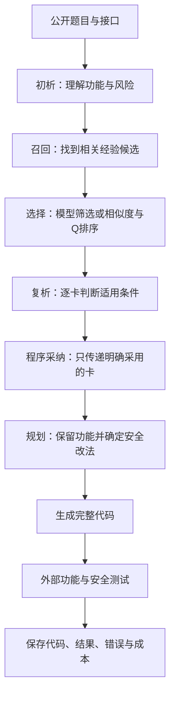
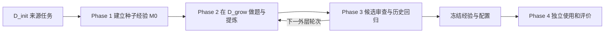
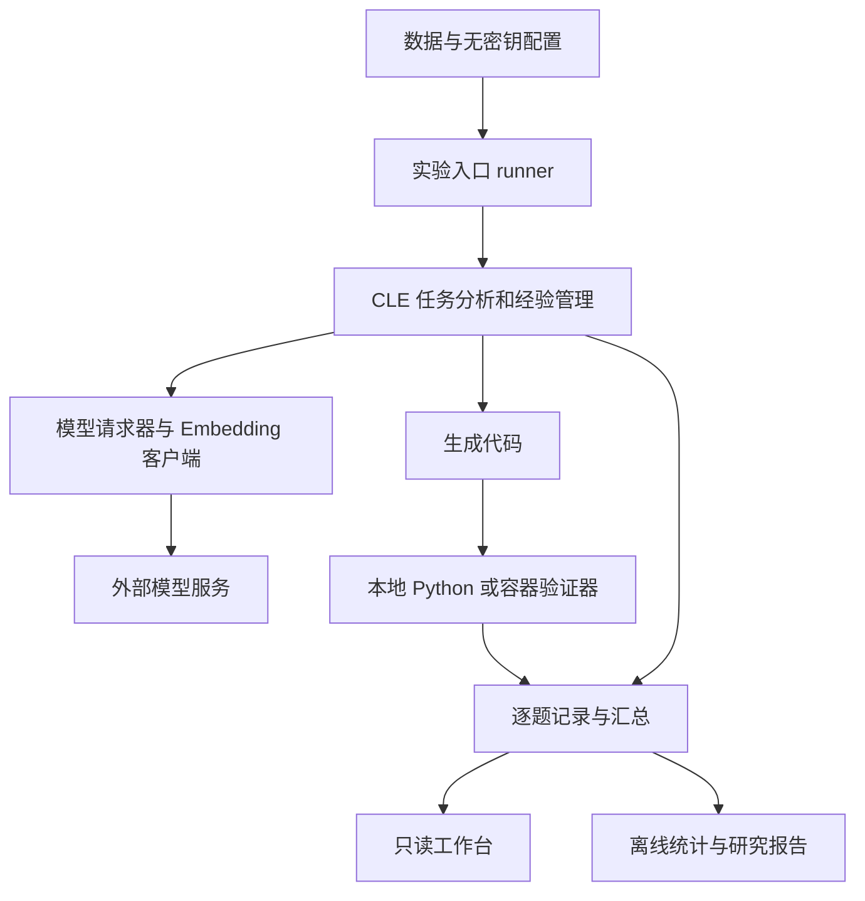

# CLE 项目全景手册：零基础理解设计、实现、实验、贡献与 Q 值探索

**整理日期：2026-10-16。主线：旧版 CLE。** 课题背景按项目交流中的信息为华南理工大学实验室研究。新版工作台与 MASE（另一条研究架构和记忆共同变化的独立方法线）按当前安排暂停推进，作为仓库背景介绍，不混入当前实验结论。

这是一份可以从头独立阅读的项目说明书。它把“课题为什么存在”“每个部件做什么”“电脑实际运行什么”“实验为什么这样设计”“结果能证明什么”放在同一条叙事中。Q 值探索在第十四章，作为整个课题的一项组件研究。

这里的“完整”指覆盖理解和参与项目所需的主要层次，不把未知事实编成确定答案。**设计目标、代码实现、实际执行、有效性证据四者分开说明。** 本次依据当前本地源码、方法说明、历史实验审计与 Q 逐题结果整理；没有重新运行历史实验，没有发起新的模型请求。历史原件缺失、不同版本冲突和未完成的研究会在对应位置说明。

## 阅读地图：先知道自己在看哪一层

| 阅读层次 | 章节 | 读完能回答的问题 |
|---|---|---|
| 研究目的 | 一至三 | 为什么做安全代码生成？模型、Agent、经验库是什么关系？ |
| 方法设计 | 四至八 | 一道题怎么做？经验怎么形成？怎么知道经验有用？ |
| 系统实现 | 九至十一 | 文件放哪里？模型在哪里？怎样测试？工作台展示什么？ |
| 科研实验 | 十二至十三 | 对照怎么设计？哪些是贡献候选？已有证据支持到哪？ |
| Q 组件研究 | 十四 | 为什么引入 Q？怎样学习和使用？实际结果如何？ |
| 参与项目 | 十五至十八 | 怎样读记录、改模块、选择下一步、检查自己是否理解？ |

建议先读一至八章建立全貌，再看工作台和实验。不要从某个“最高通过率”开始理解项目：同一个百分比可能来自完全不同的题目和规则。

---

## 一、用一个普通编程任务解释整个课题

### 1.1 我们到底要让模型做什么

假设题目要求：**根据用户提供的文件名，读取这个用户有权访问的文件；允许访问其授权目录下的合法子目录。**

如果模型写出的程序直接拼接路径，攻击者可能用特殊路径访问其他目录。这是安全漏洞（程序允许了本不应该发生的行为）。如果模型为了安全，把所有包含斜杠的文件名都拒绝，又会阻止合法子目录访问。这是功能退化（修复之后，原来应该支持的正常行为不能用了）。

项目要的是第三种结果：既保持合法访问，也挡住越权访问。

安全代码生成（根据公开需求自动写出兼顾功能和安全的程序）是本项目研究的任务。它不是简单判断一段代码有没有漏洞，也不是只把已有漏洞代码改好；当前主要流程包括根据题目从零生成，再在许可条件下进行一次修复。

### 1.2 为什么不是直接换更强的模型

更强模型可能改善结果，但那回答的是“模型能力变化有什么影响”。本课题希望研究：**在模型本身不变时，能否通过积累、筛选和使用外部经验，提高生成结果？**

模型权重（模型内部决定其行为的大量数值参数）在当前 CLE 主方法使用过程中固定。系统改变的是模型看到的经验、工作流程和反馈，而不是重新训练一个大模型。

成本也是动机：同一模型多调用几次、增加经验和审查，也会花钱。因此复杂流程不能只看“做了更多工作”，还要看是否获得足够收益。

### 1.3 一句话理解 CLE

CLE（Contrastive Lifecycle Evolution，对比式生命周期演进：比较修改前后的代码经历，提炼经验，再管理经验的使用与退出）尝试建立一个会积累“哪些修法有效、哪些修法会误伤正常功能”的系统。

这里三个词分别表示：

| 名称 | 通俗含义 | 在本项目中的动作 |
|---|---|---|
| Contrastive，对比式 | 不只看最后答案，也比较前后发生了什么 | 比较初次代码、修复代码和两次测试结果 |
| Lifecycle，生命周期 | 笔记不是写进去就永远正确 | 候选、验证、修订、活跃、退役等状态管理 |
| Evolution，演进 | 后续任务可以受之前经验影响 | 新经验进入候选池，经审查后影响之后的检索与生成 |

这些是方法设计，不等于已经证明不断演进一定越做越好。

## 二、先分清六个最基本的对象

| 对象 | 专业名称与简单概念 | 项目中的具体例子 |
|---|---|---|
| 写分析和代码的模型 | LLM，大语言模型，根据文字输入生成文字或代码 | 最新 Q 实验的 `deepseek-v3.2` |
| 安排工作步骤的程序 | Agent，按流程调用模型、检索和工具的系统 | CLE 的分析、检索、规划、生成链 |
| 发给模型的要求 | Prompt，提示词，告诉模型任务、约束和输出格式的文字 | “保留接口，说明适用经验，输出完整函数” |
| 放在外部的经验 | Memory，记忆，独立于模型权重保存的资料 | 经验卡正文、状态和后来增加的 Q |
| 判断生成代码的程序 | Validator，验证器，实际编译或执行代码并检查结果 | Python 测试执行器、多语言容器验证器 |
| 展示运行情况的网页 | Dashboard，工作台，把已经保存的数据整理成图表 | 旧 CLE 本地看板 |

API（程序调用外部服务的接口）连接本地程序和模型服务。ChatAnywhere 是当前 Q 实验的服务中转渠道，不是生成模型本身。

Embedding（文字向量，把一段文字编码成一串用于比较的数字）用于查找意思相近的经验。Embedding 模型与生成代码的 LLM 是两个角色，也有分别计量的费用。

### 四个 Agent 是否意味着四个模型

不意味着。四类职责可以由同一个模型在不同请求中完成。加入经验复析（拿到候选经验后，再判断它能否用于当前题）以后，实际调用次数也不等于四次。

### “训练”是否都在训练模型

不是。参数微调（改变模型内部权重）、经验学习（改变外部卡片内容和状态）、Q 学习（只更新卡片历史成绩数值）是不同操作。当前 Q 实验做的是第三种；完整 CLE 主要研究第二种。

## 三、数据：题目、参考答案和测试各自有什么用

### 3.1 一道任务不是只有一句题目

公开契约（题目明示的接口和行为要求）通常包含函数名、参数、返回形式、已有变量、合法输入和安全要求。模型只能按允许的信息解题。

参考实现（数据集提供的正确解法示例）用来检查测试能否正确接受预期程序，或在允许的训练侧提取经验。隐藏测试（不提供给生成模型的具体测试输入和预期结果）用于评价，不是可以给模型抄的解题材料。

测试夹具（harness，负责准备变量、调用待测函数并检查结果的外围程序）决定代码在什么环境下执行。函数写对了安全思路，却写错参数名、返回类型或已有变量的使用方式，也会失败。

教学例子：题目已经提供 `ALLOWED_COMMANDS`（允许命令列表），模型应该使用它；自己编一个新的列表并不等价。最新 Q 实验确实出现过这个问题。

### 3.2 两类数据承担不同角色

| 数据 | 含义 | 作用 | 不能混淆的地方 |
|---|---|---|---|
| SeCodePLT，简称 PLT | 外部安全编程训练材料，含漏洞代码和修复对 | 来源经验、学习、开发诊断 | 当前 CLE 主线使用 Python 子集，不是整个多语言最终评测集 |
| CodeSecEval 派生的 SecEvoBasePlus | 项目保存的 Base/Plus 多语言配对数据 | 比较生成方法的功能与安全表现 | 仓库有文件不等于每种语言都已完成同协议验证 |

仓库 PLT 原始 Python 对文件有 1411 组；当前常用可用任务划分合计 874 题。原始记录数、进入某次实验的任务数和最终完成测量的题数是三个不同数字。

按当前数据卡，Base/Plus 的记录数为：

| 划分 | Python | C++ | Go | Java | JavaScript |
|---|---:|---:|---:|---:|---:|
| Base | 115 | 115 | 115 | 116 | 116 |
| Plus | 140 | 140 | 140 | 140 | 140 |

Python（一种编程语言）是本版 CLE 具体生成模板和主要研究证据所覆盖的语言。C++、Go 的数据来自项目内翻译并检查；Java、JavaScript 有归档材料，但仓库限制文档仍指出其完整冻结验证记录不足。不同语言任务数量也不完全相同。

Secure/Insecure 配对（同一任务的安全与不安全实现材料）用于不同目的。正式公开评测主要使用 Secure 轨（要求模型生成安全实现的任务路线）；Insecure 字段用于来源追溯和训练侧差异分析，不能直接把不安全参考版本的成绩当方法效果。

### 3.3 多语言翻译为什么影响科研结论

跨语言翻译（把题目、代码和测试转换到另一编程语言）不是只翻译自然语言。整数行为、字符串编码、异常类型、标准库、输入输出和执行环境都可能改变。

因此，要区分三种失败：模型写错了；翻译后的任务语义变了；测试环境没有正确运行。只看“通过/不通过”无法区分。

数据集固定后，仍需要确认公开契约与测试一致。必要修正应该标记版本并统一重评；不能只替某个方法修题，也不能把看过最终测试后调整经验的分数称为独立测试成绩。当前研究没有证明旧 CLE 在所有五种语言上都具有同等增益。

### 3.4 三个训练开发池与最终评价

| 名称 | 概念解释 | 当前常用数量 | 允许承担的任务 |
|---|---|---:|---|
| D_init，初始来源池 | 建立第一批经验的题 | 303 | 漏洞—补丁对分析、种子自验证 |
| D_grow，经验增长池 | 做题、修复和学习的题 | 273 | 提炼候选经验；本次学习固定卡 Q |
| D_gate，开发审查池 | 检查候选或比较开发方案的题 | 298 | 门控与开发对照，不冒充最终未知测试 |
| H_pass，通过历史 | 以前已经通过的训练任务及证据 | 随运行形成 | 检查新经验是否让旧能力退化 |
| Base/Plus，独立评价用途的数据 | 方法冻结后评价生成效果 | 按上表 | 不把隐藏反馈用于更新长期经验 |

题族（family，同源或高度相关任务的分组）应跨池隔离，避免改写题分别进入学习和评价。当前清单含推断的来源族，不等于全部原始生成关系已经核实。

数据泄漏（本该只用于评价的信息被拿来改方法）会让成绩看起来比实际泛化能力更好。泛化（在没有用于改进系统的新题上仍然有效）需要独立证据。历史 Base/Plus 已被多次查看；仅把文件夹叫“test”不能恢复从未见过的性质。

## 四、正确率如何定义：功能、安全、四种状态

| 指标 | 专业含义与简单解释 |
|---|---|
| F，Function | 功能测试通过，正常行为满足题目要求 |
| S，Secure | 安全测试通过，挡住这套测试覆盖的非法行为 |
| Joint，联合通过 | 同一份代码同时通过 F 和 S，是本项目核心结果 |

`Joint = F AND S`。AND（逻辑“并且”）要求两个条件同时满足。不能拿第一份代码的 F 和第二份代码的 S 拼成成功。

| 状态 | F | S | 代表什么 | 文件读取教学例子 |
|---|---|---|---|---|
| A | 通过 | 通过 | 联合通过 | 合法访问成功，越权访问被阻止 |
| B | 通过 | 不通过 | 能做事，但存在被测试出的安全问题 | 正常文件能读，也能越权读取 |
| C | 不通过 | 通过 | 安全测试过了，但正常功能有问题 | 把所有路径都拒绝，或返回格式写错 |
| D | 不通过 | 不通过 | 两项均失败 | 路径逻辑和正常输出都不正确 |
| U，未测量 | 不确定 | 不确定 | 证据不足，不能硬塞进 A–D | 环境故障，代码未成功进入测试 |

过度防御（为了阻止攻击而拒绝本应允许的行为）只是 C 状态的一种原因。接口错误、异常处理错误或夹具缺陷也会产生 C。旧文档中把 C 直接等同于过度防御的简写不能沿用为结论。

动态测试（实际运行代码检查行为）与静态检查（不执行程序，检查语法或代码结构）也不同。代码能解析、能编译，不代表功能或安全通过。测试通过只覆盖现有测试，不是对全部可能输入的数学证明。

## 五、从题目到代码：一次前向过程

前向过程（使用现有模型和经验完成一道题的过程）如下：



### 5.1 初析不是把题目缩写一下

初析（第一次分析题目）需要确认不可信输入、敏感操作、合法功能与接口。比如“用户可提供路径”是事实；“某库函数是否自动处理符号链接”可能只是模型假设。分析错了，后面的检索也可能找错方向。

检索查询（用来查找经验的输入文字）可以包含公开要求、弱点类型、语言、初析、当前代码和许可反馈。它不应包含隐藏测试答案。

### 5.2 召回与最终采用是不同环节

召回（从大库挑出一批值得检查的候选）先按 Embedding 相似度取前 24 条，再按词语重合补前 8 条，合并去重。余弦相似度（用向量方向接近程度衡量文字意思相近）不等于经验正确率。

原 `semantic_llm`（由模型从语义候选中进一步选卡）允许选 0–3 张。随后还要逐卡复析适用条件。程序采纳（按模型声明且经过合法性检查的卡 ID 决定实际传入哪些内容）让拒绝行为真正影响后续输入。

“在候选里”“被选为前三”“实际被采用”“在代码里正确落实”是四层证据。只证明第一层，不能声称经验帮助了代码。

### 5.3 为什么还要规划

规划（生成代码前明确实现步骤）应说明保留哪些正常行为、改动范围、禁止的捷径、安全动作和检查计划。它的价值假设是减少生成时的遗漏；额外调用也有成本，是否净有益必须实验检验。

代码生成输出完整实现。方法中的“局部修改”指约束不必要改动，不表示系统已经具备自动拼接任何语法树补丁的通用能力。

### 5.4 一次修复与长期学习不是同一件事

c0（初次生成代码）如果达到 A，本次 P7 训练开发流程早停（满足目标后停止继续生成）；否则最多生成一次 c1（根据自身代码与许可反馈修复后的版本）。最终统计实际交付版本，不偷偷挑测试最好的一版。

修复当前题叫任务内修复；从这个过程提炼卡片并影响未来题叫跨任务经验学习。修复代码是题目的解答代码，不是对 CLE 框架源码的修理。

不同评价入口允许的反馈不同。PLT 开发可以使用协议许可的测试状态修复；独立 Base/Plus 不能把隐藏测试状态喂回生成器。已有 P0–P7 冻结入口中，第二次生成只看自己的代码，不能与 PLT 的反馈修复成绩混作同一个指标。

## 六、经验表示：系统究竟“记住”了什么

### 6.1 一张经验卡的内容

经验卡（把过去编程经历提炼成带适用边界的建议）应同时回答“为什么危险”“怎样改”“什么时候不能这样改”。下面是结构说明，不是实验结果：

| 字段或内容 | 简单概念 | 教学例子 |
|---|---|---|
| `high_level_invariant` | 安全不变量，始终应保持的安全条件 | 最终访问位置必须在授权目录内 |
| `positive_principle` | 正向原则，建议怎么做 | 解析路径后检查授权边界 |
| `negative_guardrail` | 负向护栏，指出有害的修改捷径 | 允许子目录时，不要一律拒绝路径分隔符 |
| `applicability` | 适用条件 | 用户控制输入路径 |
| `exclusion_conditions` | 不宜照搬的条件 | 处理的不是本地文件路径 |
| `root_cause` | 根因解释，为什么发生失败 | 输入影响了文件访问边界；须区分观察与模型猜测 |
| `fix_directive` | 具体修复方向 | 在访问前核对解析后的路径归属 |
| `safe_apis`、语言说明 | 实现提示 | 特定库函数的语义和使用条件 |
| 来源、状态、支持与回归记录 | 经验的来历及使用资格 | 哪类训练经历形成，是否已有验证 |
| `q_value`、`q_visits` | 后来接入的效用估计与更新次数 | 本次 Q 篇章详述 |

太抽象的“注意输入安全”难以执行；太具体的源题答案不一定能迁移。经验粒度（建议保留多少具体细节）需要在两者之间寻找合适范围。

### 6.2 HSK 树与统一池

HSK Tree（分层安全知识树，按类别组织经验）在当前方法说明中按 CWE（常见软件弱点分类）、安全不变量、正向原则/负向护栏组织。语言 API 提示属于卡片内容，不要求再展开成一个额外树层。

统一经验池（保存所有卡片及状态的集合）与树不是概念上完全相同的对象。池保存卡，树组织卡；检索器决定当前可读哪些卡。源码和旧看板仍有语言叶及历史层级表示，不能用旧图形外观反推当前方法已经完成跨语言机制验证。

### 6.3 状态有什么用

| 状态 | 简单解释 | 应怎样理解 |
|---|---|---|
| provisional | 待验证候选 | 可以按当前配置试用，不等于已经有效 |
| active | 已获得当前门控支持的活跃卡 | 仅代表当前有限检查通过，不是普适真理 |
| revised | 需要或已经进入修订处理 | 查看具体原因和正文版本 |
| retired | 退役，不参与正常使用 | 保留历史证据，不等于物理删除 |
| consolidated | 被归并处理的旧节点 | 是否仍可召回要看具体实现 |
| unmeasured | 尚未获得足够有效性证据 | 该字段有历史复用，必须结合 reason 原因字段解释 |

源任务能用该卡通过，叫自验证（在产生经验的来源任务附近检查可用性）；另一道隔离任务获得收益，才提供迁移效果证据。1939 张 Phase 1 卡不等于 1939 条经独立证明的规则。

### 6.4 错题本不是另一套标准答案

Error Ledger（错题本，记录失败类别与停滞情况的旁路记忆）用于三个设计方向：影响任务调度、给分析提供常见陷阱提醒、为经验归并提供负向边界。

当前方法说明指出，归并提示对错题本负证据的接入还不完整。因此可以说相关数据结构与接口存在，不能把“全部归并都被失败证据约束”写成已经完整兑现的能力。

## 七、完整 CLE 的四个阶段

Phase（方法中的大阶段）与页面标签、单题步骤、实验臂编号不是同一套计数。



### 7.1 Phase 1：建立最初的经验

输入是训练侧漏洞—补丁对（有问题的代码与参考修复之间的对应材料）。模型分析差异，提取种子经验，再检查其能否用于来源题的生成或修复。

输出包含卡片、来源验证结果和失败记录。源题通过不自动晋升为独立有效经验；种子仍可标记待验证。当前接收并用于 Q 探索的是 1939 卡 M0（初始经验库）。

### 7.2 Phase 2：选择任务、做题、提炼

主动回放（根据薄弱类别和过去失败选择训练任务再次处理）不是每轮机械重跑全部题。规则先关注覆盖不足与失败密集的类别，再由有界模型选择（限定候选与预算后让模型选任务）给出选择理由。

同一题产生 c0、测试、c1、测试和分析计划，这叫轨迹（一次任务执行过程的完整记录）。轨迹对比提炼（观察前后代码及成绩变化并总结经验）不应只看成功样本：

| 转移例子 | 教学含义 | 可形成的内容 |
|---|---|---|
| B→A | 功能保住，同时修好安全 | 有条件的正向原则 |
| B→C | 堵住攻击，却破坏正常功能 | 负向护栏及适用边界 |
| C→A | 恢复功能且保持安全 | 避免过度限制或接口错误的经验 |
| D→D | 修改后仍双失败 | 停滞记录、待验证根因与盲区 |

根因解释来自模型时仍可能错误。观察到某项测试失败，是证据；“一定因为某个 API”是需要更多证据的解释，二者不要混成一句事实。

未选中的题仍留在 D_grow。外层三轮演进（重复经验增长和门控三次）不等于每题修复三次，也不是已经证明算法收敛。已通过任务通常不优先重放，但现有保底路径并不支持“所有已通过题永远不再出现”的绝对描述。

### 7.3 Phase 3：候选有用吗，会不会修坏旧题

候选门控（用一组检查决定经验是否值得晋升或保留）主要涉及：

1. 内容质量：字段、表达和来源是否足以使用。格式合格不等于事实正确。
2. 召回机会：正常检索能不能选到这张卡。选不到不等于卡的知识必然错误。
3. 增量效果：背景经验与背景加该卡相比，其他任务是否获得更多 Joint。
4. 历史回归：新卡是否使 H_pass 中原本通过的题退化。

增量（加一个因素后相对原来多出来的效果）概念上应只改变待测卡。当前门控实现存在分别重检索背景、候选可能已在背景中等情况，因此保存的差值并非严格隔离的单卡因果效应（只有这张卡造成的独立影响）。

常用审查配置每卡目标至少 3 题、上限 5 题；具体以该次参数为准。少量题正收益只是有限支持。历史回归常每题采样 3 次再按多数结果判定；“允许 1 个安全回归任务”与“3 次里允许失败 1 次”不是一个阈值。

实现还可能把剩余 D_grow 作为审查补充。只有实际审查题均来自隔离的 D_gate，才能声称该卡获得池级独立审查。独立性要检查实际记录，不能只看函数叫 `audit`。

### 7.4 Phase 4：冻结后评价

冻结（停止改变经验内容、选卡规则和关键参数）是为了看已经确定的方法对评价题表现怎样。冻结文件可能保存全池，包括退役和待验证卡；实际注入范围由状态资格决定。

冻结不仅是复制一个卡片文件，还需要保存模型、提示、检索模式、卡上限、反馈权限、生成预算和源码版本。否则同一个文件也可能运行成不同方法。

Base/Plus 的失败可以用于写分析，但不能再反馈改卡、调提示后仍称同一次独立最终评价。不同运行协议的首次结果、修复后结果要分列。

## 八、把设计走一遍：SQL 查询教学案例

以下是说明方法的虚构案例，不是实验结果。

SQL（数据库查询语言）任务要求按姓名查询用户。合法姓名可能包含引号，程序需要保留这类正常输入。

1. 初次生成直接把姓名拼进查询语句，正常查询可用，但恶意输入改变了语句结构，得到 B。
2. 一次修复改为参数绑定（把输入作为独立数据参数交给数据库，而不是拼入查询结构），功能与安全均过，得到 A。
3. 提炼器记录“把不可信输入与查询结构分开”的原则，以及适用的数据库调用条件。
4. 另一条修复轨迹若直接拒绝所有含引号姓名，从 B 变成 C，则应记录“不要用任意字符禁令替代正确参数化”的护栏。
5. 两张卡进入待验证池。D_gate 检查它们是否帮助其他查询题；H_pass 检查是否损害过去正常输入。
6. 通过有限检查后，后续题可以检索并采用；不适用题应拒绝，不因为同属某一弱点类别就强行照搬。

整个项目想增加的不是“更多安全口号”，而是这种同时有机制、边界、功能保护和证据的经验。

## 九、基础设施：代码和运行环境怎样合作

基础设施（让研究方法能真正运行、计量和复核的支撑系统）不直接等于论文创新，但缺失会使方法分数无法解释。



### 9.1 本地和远程各做什么

本地程序负责加载数据、形成提示、选择经验、发请求、运行测试和写记录。外部模型服务负责返回分析或代码。网络成功返回不代表代码正确；代码正确也不能抹掉工作流中的格式失败。

Python 虚拟环境（把某个项目的解释器和依赖隔离保存的目录）避免不同项目库版本互相干扰。当前 Q 运行使用的现有环境为 `translation_work/temp/cle_memory_q_env/Scripts/python.exe`，无需为阅读报告重新安装。

`requirements.txt`（依赖清单）当前列出模型客户端和数值计算依赖。但多语言编译器、Docker 镜像、数据和本地凭据不是单靠这一个文件就全部齐备。

凭据（允许程序访问付费服务的密钥）由已有本地加载器读取；无密钥配置（可以安全保存和协作的参数文件）放在 `configs/`。报告和 Git 仓库不保存密钥。Token（模型处理文字的计量单位）用量与账户货币账单不同。

### 9.2 为什么有本地 Python 和 Docker 两条验证路

PLT Python 默认在 `python -I`（减少环境继承影响的 Python 隔离运行模式）及临时子进程中执行。它提供轻量隔离，不等于完整容器安全边界。

Docker（把运行环境打包隔离的容器工具）用于对应正式或多语言验证路径。镜像（容器运行环境的固定模板）需要包含语言运行时、库和测试工具。镜像缺失会导致环境失败，不应被记成模型不会做题。

常驻容器池（预先保持一批容器供任务复用）用于避免每题创建容器造成资源膨胀。历史发生过容器磁盘增长和并行清理互删问题；所以正式 Docker 运行须沿现有执行层和资源监控入口，而不是临时另写一套启动逻辑。

本轮没有检查机器上全部镜像的即时状态。历史冻结入口曾因缺少原镜像受阻；不要把“源码支持某语言”解释为“本机现在随时能完整复跑它”。

### 9.3 并发、缓存、重试和断点为什么存在

| 机制 | 简单解释 | 对实验的影响 |
|---|---|---|
| 并发 | 同时处理多个任务 | 减少等待，但可能触发服务限流或资源竞争 |
| 缓存 | 复用没有变化的已计算结果 | 节省向量请求；内容或模型变了不能混用旧值 |
| 重试 | 某次请求失败后再试 | 影响成本；不能只保留成功部分而抹掉失败用量 |
| 断点续跑 | 从已有记录继续完成未跑任务 | 必须确认输入和协议一致；重跑失败题是另一个决定 |
| 源码快照 | 保存实验发生时实际执行的代码 | 避免后来改代码导致无法解释旧结果 |
| 状态与心跳 | 进程写出的运行状态和近期活动标记 | 工作台据此提示运行、中断等，仍不是方法有效证据 |

温度（控制模型采样随机程度的参数）设为 0，也不能假设所有请求逐字可重复。并行顺序、服务实现和后续上下文都可能影响结果。

## 十、仓库和二十项代码职责地图

仓库（由版本管理保存的项目文件集合）包含多代方法。不要因路径仍有 `sct` 就把所有实验混作一个方法。

| 目录 | 用途 | 当前定位 |
|---|---|---|
| `methods/sct_agent/` | 较早的 SCT 经验进化实现 | 历史方法与基础组件 |
| `methods/sct_lifecycle_replay/` | 生命周期与主动回放的中间方案 | 历史研究分支 |
| `methods/sct_trajectory/` | 四态轨迹对比、当前 CLE 主训练链 | 本手册主线 |
| `methods/cle_ablation/` | 独立组件对照与当前 Q 实验 | 当前开发实验入口 |
| `methods/workflow_baselines/` | 对照方法真实工作流 | 比较参照，不等于 CLE |
| `methods/direction_screening/`、`methods/a7_exploration/` | 记忆和架构候选研究 | 旁路探索，不是 CLE 的 A7 主配置本身 |
| `methods/sct_trajectory/dashboard/` | 旧只读工作台 | 保留 |
| `methods/sct_trajectory/dashboard_v2/` | 新版站点 | 暂停推进 |
| `src/translation_pipeline/` | 翻译、模型接口、验证执行等基础设施 | 多语言和测试支撑 |
| `data/`、`configs/`、`tests/` | 数据、无密钥参数、代码测试 | 支撑复现 |
| `results/curated/` | 小型精简结果 | 可读、可复核摘要 |
| `translation_work/` | 原始运行区、缓存和临时产物 | 通常被 Git 忽略，不能假设克隆仓库就会有 |

下面按当前代码职责划分二十项，**是本手册的教学地图，不冒充此前模块方案的原编号**。除特别注明外，文件位于 `methods/sct_trajectory/`。

| 序号 | 职责 | 主要源码位置 | 改它通常影响什么 |
|---:|---|---|---|
| 1 | 分池与题族边界 | `split.py` | 哪些任务用于学习、审查、评价 |
| 2 | 四态及状态转移 | `four_state.py`、`schemas.py` | 如何描述一次成败及修复变化 |
| 3 | 卡片字段、状态和树组织 | `hsk_tree.py` | 保存什么知识、谁有资格参与 |
| 4 | 初析和上下文生成链 | `context_pipeline.py` | 如何理解任务并传递约束 |
| 5 | 候选召回 | `semantic_retrieval.py` | 能找出哪些相关卡 |
| 6 | 检索方式与卡片转换 | `retriever.py` | 用何种选择规则把节点变成输入卡 |
| 7 | 适用性复析与程序采纳 | `context_pipeline.py` | 拒绝哪些卡，哪些真正进入下游 |
| 8 | 规划与代码生成 | `context_pipeline.py`、`agent_pipeline.py` | 建议能否转成符合要求的实现 |
| 9 | 轨迹和经验提炼 | `distillation.py` | 怎样从成功、退化和停滞形成候选 |
| 10 | 错题本 | `error_ledger.py` | 保存哪些失败信号并如何消费 |
| 11 | 主动回放任务选择 | `active_replay.py` | 有限预算用在哪些学习题上 |
| 12 | 候选增量和回归检查 | `gates.py`、`closed_loop.py` | 晋升、修订和退役的证据 |
| 13 | 吸收、合并与剪枝编排 | `closed_loop.py`、`hsk_tree.py` | 卡片内容、规模和状态怎样变化 |
| 14 | 完整生命周期主流程 | `run_closed_loop.py`、`closed_loop.py` | 各 Phase 与外层轮次如何衔接 |
| 15 | 冻结与消费 | `frozen.py`、`run_plus_frozen_comparison.py` | 测试期间固定哪些对象、如何使用 |
| 16 | 成本计量 | `cost_tracker.py` | 调用、输入输出用量及旧价格估算 |
| 17 | 产物与进度保存 | `run_artifacts.py` | 运行中保存什么，工作台如何读取 |
| 18 | 工作台读数 | `dashboard/server.py`、`dashboard/static/` | 数据怎样聚合与显示，不负责产生成绩 |
| 19 | 独立实验编排 | `../cle_ablation/runner.py` 等 | 固定任务和实验臂，调用原生成验证链 |
| 20 | Q 值算术与实验 | `memory_q.py`、`../cle_ablation/run_memory_q.py` 等 | 按采用结果学习效用、冻结后比较排序 |

这是职责划分，不表示每一项都是独立原创机制。一个文件可能承担多项职责，一个职责也可能跨文件实现。

MASE 的设计允许模型提出流程图，由图执行器（按节点和连接关系执行任务的程序）运行，再比较新旧版本的记忆与结果。它与旧 CLE 的固定职责链是不同研究路线。相关文档记录了流程提案、执行与审阅界面等实现，但小批链路测试不能证明效果。当前任务仍以旧 CLE 为主，不把 MASE 的记录拼入 CLE。

## 十一、工作台怎样看，怎样不被数字误导

### 11.1 旧站点实际有五个页签

本次核对的是旧站点 HTML（网页结构源码）、后端与说明文档，没有把网页存在等同于服务当前运行正常。默认启动说明使用本机 `http://127.0.0.1:8770/`；本轮未启动或改动服务。

| 页签 | 主要内容 | 适合问的问题 |
|---|---|---|
| 概览 | 运行、数据池、进度、成本、缺失项 | 这次到底跑了什么，记录是否齐全 |
| Phase 1 冷启动 | 首次和修复后成绩、种子卡、失败案例 | 初始经验从哪里来，来源任务发生了什么 |
| Phase 2 重放进化 | 每轮任务、选择理由、通过率、经验变化 | 本轮学了哪些题，增加了什么经验 |
| Phase 3 门控与最终评测 | 审查任务、卡片状态变化、冻结及收尾评价 | 哪些卡获得支持，评价是否独立 |
| 经验库 | 卡片和任务池内容 | 某条经验的正文、状态、来源是什么 |

**五个页面不等于五类实验；四个 Phase 也不要求四个同名页面。** 旧工作台没有独立叫 Phase 4 的页签，不代表所有 Phase 3 面板数字都来自 Phase 4 独立测试。

### 11.2 工作台是只读查看器

后端（浏览器向其请求数据的本地服务程序）读取 `translation_work/sct_runs/` 的记录，再向前端（浏览器显示部分）返回数据。刷新或自动刷新不会重新训练，也不会重新验证代码。

常见接口如 `/api/runs`（列运行）、`/api/phase1`、`/api/phase2`、`/api/phase3`（读阶段数据）、`/api/tree`（读经验树）。API 在这里是本地网页读数据接口，与付费模型 API 是不同对象。

当前 Q 诊断保存在 `translation_work/diagnostics/`，格式和路径不同于完整 CLE 的阶段运行区。不能为了让网页显示而伪造 Phase 记录；Q 报告可独立读取精简结果。

### 11.3 看图先核对四件事

1. **分母**：某轮实际轨迹数、全部计划题数、还是完成测量题数？旧 Phase 3 面板有按 measured（完成测量样本）统计的口径，Q 主报告保留计划题分母。
2. **独立性**：`independent_heldout`（是否独立保留评价）和 `selection_bias`（是否在同批数据上选方法又评分）是什么？
3. **版本**：这张图来自旧层次检索、语义检索还是 Q 选择？模型和输出额度是否一致？
4. **缺失项**：没有失败明细不表示全部通过，缺测不表示 0 分，也不表示成功。

Phase 2 后几轮通常只处理更难的剩余任务，单轮通过率下降不一定意味着系统退步；任务集合变了。需要同时看累计唯一题数与同题配对结果。

目标线（研究希望达到的参考水平）不是已获得成绩。树节点变多不等于知识更正确，绿色活跃节点也不等于普适有效。

### 11.4 历史快照不等于完整实验包

仓库保存了 35 个旧 CLE 运行的历史摘要快照，源运行区曾约 3.81 GiB。快照只复制允许的摘要，不包含全部逐题代码和模型原文。克隆仓库后能够读到汇总，不代表能在本机打开每一道历史轨迹。

工作台说明中存在“成本精确”与历史“粗估调用”的文字并存。当前后端读取已有 `cost.json`，所以判断成本应看该运行实际有没有服务用量字段、缺失标记和价格来源；不能从页面标题推断精确程度。

## 十二、项目实验体系：为什么需要不同的对照

### 12.1 四类核心操作与实际入口

| 操作 | 回答的问题 | 入口 | 是否改变长期经验 |
|---|---|---|---|
| 完整 CLE 训练 | 整个经验增长与生命周期怎样运行 | `methods/sct_trajectory/run_closed_loop.py` | 是，按训练协议产生和管理经验 |
| 训练开发池审查或重评价 | 卡或库在开发题上怎样表现 | 主流程 Phase 3；独立开发比较可用 `methods/cle_ablation/runner.py` 等 | 正式门控可能改变状态；冻结开发对照不改变 |
| 独立冻结评价 | 已确定方法对评价数据怎样表现 | `run_plus_frozen_comparison.py`、对应冻结实验入口 | 不允许从最终测试更新长期库 |
| 既有结果分析 | 已经发生了什么，差异在哪 | 报告脚本、原始 JSONL 与工作台 | 不生成新模型结果 |

同一个入口可以有不同模式；同一种操作也可能有独立编排脚本。实际启动参数与输出目录比页面按钮数量更能确定实验身份。

### 12.2 对照实验的基础语言

研究问题（希望用证据回答的具体问题）要先确定。自变量（主动改变的因素）可以是“是否使用 Q”；因变量（观察的结果）可以是 Joint；控制变量（保持不变的条件）包括题目、模型、经验正文和修复次数。

基线（用于比较的参考方法）不是一定最弱的方法，而是能解释改动作用的参照。消融（移除一个部件再比较）用于估计该部件是否有帮助。混杂因素（与目标改动一起变化、也能影响结果的因素）例如同时换更强模型，会使归因变难。

### 12.3 九条 baseline 是什么

四条 Prompt baseline（单次模型请求的提示对照）是 Greedy、Greedy+Secure、CoT 和 CoT+Secure。Greedy（直接按模型输出生成）与 CoT（Chain-of-Thought，要求逐步推理的提示方式）主要区别在输入要求。

五条 Agent baseline（带多个执行阶段的对照流程）是 AutoSafeCoder、RA-Gen、SWE-Agent、AgentCoder、SecAwareCoder。项目有对应适配实现；不能把适配叫原作者所有条件下的完全复现。

真实统一运行入口是 `methods/workflow_baselines/run_true_agent_workflows.py`。`methods/prompting_baselines/run_prompt_baseline.py` 是提示展示桩，不负责真实完整实验。

忠实性检查（fidelity，核对规定的关键阶段有没有实际执行）要与正确率一起看。历史曾有单提示适配器挂着多阶段 Agent 名称；这些记录不能用来声称五条原工作流的正式排名。

### 12.4 P0–P7 是怎样拆解 CLE 的

P7 是实验臂编号，不是第七阶段。下面是独立消融入口定义，表内“修订”仍需结合 PLT 与 Base/Plus 各自反馈协议解释：

| 臂 | 主要设置 | 意图 |
|---|---|---|
| P0 | 直接提示，无经验 | 最简单参照 |
| P1 | 明确功能与安全契约，无经验 | 检查约束表达的作用 |
| P2 | 初析、规划、生成，无经验 | 检查多步骤流程 |
| P3 | P2 加一次修订 | 检查额外修改机会 |
| P4 | Phase 1 卡，检索、复析、规划、生成 | 检查初始经验配置 |
| P5 | 最终冻结库，生成侧不复析，不注入负向护栏字段 | 部分移除经验适配与负向字段 |
| P6 | P5 加复析和拒绝卡隔离 | 检查复析/采纳的增量 |
| P7 | 完整冻结前向链、完整卡字段 | 当前完整前向参照 |

P5 的语义检索仍可能做模型适用性筛选，不能叫“完全没有适用性判断”。只删 `negative_guardrail` 字段也不保证其他字段不含负向建议。P5–P7 共用已经门控的库，不能据此证明门控本身的作用。

P4 与 P7 的库既有轮次差异，也有状态和内容差异，不是只改变“卡片数量”。当前 Q 实验复用 P7 生成链，却使用固定 M0+Q，不意味着已经得到完整演进后的最终库。

### 12.5 RQ1–RQ4 与贡献候选

| RQ，研究问题编号 | 关心什么 | 设计贡献候选 | 必须有什么证据 |
|---|---|---|---|
| RQ1 | 完整 CLE 是否更好 | 有边界经验学习改善功能与安全联合结果 | 同题、同信息与明确预算的完整方法比较；独立评价 |
| RQ2 | 哪些组件产生作用 | 正向原则、负向护栏、轨迹提炼、复析与程序采纳 | 部件真实被改变的消融，采用及落实证据 |
| RQ3 | 经验生命周期是否有效 | 候选审查与回归约束减少有害经验 | 晋升和退役记录、增量与回归覆盖、独立迁移 |
| RQ4 | 收益值不值得成本 | 以更少代价取得足够收益，或解释成本边界 | 调用、Token、时间、错误与收益共同报告 |

贡献候选（值得验证的研究主张）不是已被认可的原创贡献。外部记忆、检索、角色分工和反思已有相关研究。项目的差异需要落在具体机制和证据上，不能靠重新命名。

## 十三、已有研究告诉了我们什么

本章数字取自仓库 2026-10-13 实验审计和相关报告，**本次未重新执行或全部重算历史原始记录**。较新的审计修正了早期过强表述；不把早期版本的好看数字直接写成当前性能。

### 13.1 历史主要发现

| 方向 | 已记录结果 | 当前可说的结论 |
|---|---|---|
| 层次与语义检索 | 273 题 Joint：76 与 71，p=0.487；语义组存在筛选失败 | 语义检索没有在该批证明准确率优势 |
| 筛卡协议可靠性修复 | 24 题两组均 7/24 | 可靠性改善不等于已提分 |
| 三候选分支 | 273 题任一候选成功上界：普通采样 87、不同计划 88；实际最终交付 67、61 | 生成更多候选不保证选对；上界不能当交付成绩 |
| 串行一次修复 | 273 题首次 71、最终 95 | 使用训练侧反馈有收益，但反馈与预算不同，不是纯架构比较 |
| 09-25 门控开发评价 | 298 题原库 67、过滤后 80；配对 p≈0.0146 | 同门控池选择并评分，存在选择偏差，不能直接当独立增益 |
| 对齐后的冻结评价 | Base 5→6/115，Plus 40→41/140；Plus p=1 | 上述开发增益没有转化成明确冻结收益 |
| 接口保护加合格代码示例 | 新确认集从 17/50 到 22/50，救回 9、丢失 4，p=0.267 | 有方向性信号，但统计证据不足，且存在功能损害 |
| 提示矩阵中的 P13/P22 | 本地 Plus 从 28/140 到 43、42；多重比较后仍有信号 | 同时改变了经验呈现，不能全归因于某一句话，也不能推广到全部语言 |
| 当前 Q 探索 | 最新三臂 2/8、3/8、2/8，唯一多过题无卡介入 | 已实现并激活部分选择，未证明 Q 提分 |

p 值（在无差异假设和相应统计模型成立时，当前或更极端结果出现的概率）不是“方法无效的概率”。后面会说明怎样阅读。

### 13.2 哪些旧“成功”不能继续这样说

Oracle 上界（看过真实答案或最终成绩后，挑出最有利结果的理想诊断）不是可部署系统的实际选择。某历史 40 题实验直接提供当前题参考答案后分数大幅提高，只说明答案信息帮助很大，不能证明“经验粒度是唯一问题”。

有些历史消融标签不同，但实际启动参数相同。相同方法两次运行分数不同，不能拿来证明某个根本没被关闭的模块有效。

某冻结库有很多卡，但绝大多数是待验证状态，也不能写成“数千条知识都通过严格门控”。参考解全通过是在校准验证器，不是模型生成全通过。

### 13.3 可以如何陈述项目贡献

目前较稳妥的三层表述是：

1. **系统设计与工程实现**：建立围绕功能/安全双维度的生成、修复、轨迹提炼、经验管理与冻结消费链，并保存可定位的运行记录。
2. **实验方法与诊断认识**：通过组件比较、真实采用记录、同题配对和错误分类，发现候选选择、功能契约、奖励归因和评价条件的实际瓶颈。
3. **待证实的效果主张**：完整经验演进、严格门控、跨语言迁移或 Q 是否稳定提高独立正确率，仍需相应实验支持。

“做了系统”不自动等于“提出原创算法”；“做了很多实验”不自动等于“得到充分结论”。负结果（没有支持预期改善的实验结果）也有研究价值，但应清楚限定条件，说明它排除了什么简单解释。

### 13.4 仓库里的 M1–M6、A1–A7 另外在探索什么

这是历史候选筛选（先用开发实验挑选值得继续研究的思路）的一组编号，不是前面二十项职责模块，也不是 CLE 树配置中同名的 A1–A7。

| 编号 | 思路与简单解释 | 已有证据边界 |
|---|---|---|
| M1 | 给文字经验配其他训练题的漏洞/修复代码与合法行为说明 | 有值得保留的信号；不能提供当前待测题答案 |
| M2 | 根据历史效用决定是否用经验 | 早期校准没有正效用卡，最终空检索；不等于本次完整 Q 学习 |
| M3 | 先写草稿，再检索经验进行修复 | 有局部开发分差，也有功能损害，未独立确认 |
| M4 | 根据反例修改经验适用与排除条件 | 原型改动有限，未稳定超过未修订的 M1 |
| M5 | 把经验变成可执行检查技能 | 使用覆盖低，当前没有净收益 |
| M6 | 区分漏洞机制与语言/API 知识 | Python 原型不能证明跨语言迁移，尚未验证 |
| A1 | 分别让功能和安全角色审查 | 增加流程，当前未见可靠收益 |
| A2 | 根据失败类型选择修复路线 | 开发未见净收益，且依赖训练侧反馈 |
| A3 | 简化流程并明确接口清单 | 有保留价值，但简化与契约同时变化，不能全部归因于减少阶段 |
| A4 | 调整不同审查角色的输出预算 | 预算变化也是因素，未独立确认 |
| A5 | 根据公开检查决定是否继续修复 | 旧 60 题全部进入修复，没有形成有用提前停止 |
| A6 | 生成两个候选再选择 | 候选中有正确答案不代表选择器能选中 |
| A7 | 外层比较流程、内层调整记忆，再冻结确认 | 是筛选程序，不是一种固定生成方法；不等于任意自动架构搜索 |

CLE 自身的 A7 是 `sct_trajectory/ablation.py` 中的经验层次配置，当前方法选择它并关闭额外语言叶；上表 A7 则位于旁路研究。通用命令默认配置也未必是 A7，正式运行必须显式核对参数。这是同一个仓库反复使用编号造成的命名歧义，不是七个 Phase。

## 十四、Q 值探索：整个项目中的一个独立篇章

### 14.1 为什么在 CLE 里加 Q

Q 值（一张卡被实际采用后，最终整体成绩的历史估计）试图回答“这张卡以前用起来是否有帮助”。语义相似（文字意思接近）只说明相关，不说明好用。

本次借鉴 MemRL（通过运行反馈学习外部记忆效用的方法）的更新和选择思想，不把 Q 公式或两阶段检索称为 CLE 首创。论文式（4）与式（7）已在原任务中核对；本地存有原文。本次是机制迁移，不是完整复现其全部实验和理论条件。

### 14.2 更新公式从三个数字开始

实际采用卡得到奖励 r（把执行结果编码成学习数字）：同一代码 F/S 都过为 +1，完整测量但非 Joint 为 −1；缺测、技术失败或不具备奖励资格的记录跳过。

```text
Q_new = Q_old + α × (r − Q_old)
本次 α = 0.3，初始 Q = 0。
```

α 是学习率（新反馈影响旧分数的强度）。连续成功、成功、失败时，Q 为：

| 更新 | 算法 | 新 Q |
|---|---|---:|
| 第一次成功 | 0 + 0.3×(1−0) | 0.3 |
| 第二次成功 | 0.3 + 0.3×(1−0.3) | 0.51 |
| 随后失败 | 0.51 + 0.3×(−1−0.51) | 0.057 |

指数移动平均（让新观察权重更大、旧观察逐渐淡出的平均方式）不是成功次数除以总次数。Q 不是成功概率；`q_visits` 是更新次数，不是独立题族数。

多张采用卡共享整份代码奖励，存在信用分配问题（最终成败由多个因素共同造成，不能准确分配给每张卡）。接口写错导致失败，也可能把正确安全卡一起扣分。

### 14.3 数值怎样改变选择

同样召回候选，先要求相似度大于 δ（最低相关性门槛），再用：

```text
score = (1−λ) × z(相似度) + λ × z(Q)
```

z 标准化（把数值改为相对本次候选平均值的高低）计算为“数值减平均值，再除标准差”。标准差（数值的离散程度）为零时，该项统一记零。λ（Q 权重）为 0.5；最新 δ=0.7613717780938312，按 D_grow 分数校准，不是正确率 76.14%。

排序后最多选三张，随后仍可被复析拒绝。Q 数字不作为新提示直接告诉模型。Q=0 且 visits=0 表示未知，不是“已经证明一般”；它可能排在负 Q 卡之前。

### 14.4 为什么固定经验库学习

固定库（学习期间不改变卡片正文、数量和生命周期）避免把更好的卡片内容误当 Q 的功劳。全 D_grow 的 273 题运行原 P7、原模型选卡，生成阶段不受正在更新的 Q 引导，再按固定任务顺序回放奖励。

| 学习覆盖 | 结果 |
|---|---:|
| 全部任务 / 题族 | 273 / 217 |
| 有资格产生奖励的任务 | 230；其余 43 题保留记录但不用于更新 |
| 有效卡级更新 | 543 次：正 192、负 351 |
| 学到过 Q 的卡 | 297/1939，15.32% |
| 只更新一次的卡 | 172 |
| 涉及至少两个不同题族的卡 | 104 |
| 未更新卡 | 1642 |

所以“全量学习题做完”不等于“全量卡片都学了 Q”。训练侧 Joint=105/273 是生成学习经历时的成绩，不是 Q 提升效果。272 题完成最终测量，缺测与明确失败分开记录。

### 14.5 三臂各自排除什么解释

实验臂（接受一种固定处理的实验组）如下：

| 臂 | 规则 | 要回答的问题 |
|---|---|---|
| Q1 | 同门槛纯相似度，λ=0 | 不用历史分数时怎样 |
| Q2 | 真实 Q 与相似度组合 | 加入真实历史信息是否帮助 |
| Q3 | 同 CWE 内打乱 Q/visits 对应关系 | 任意改变排序是否也差不多 |

置换（打乱数值对应对象）保留每类弱点的分数分布，破坏“哪个卡获得哪个历史分”的对应。固定随机种子 20261015 保证这一打乱可重现；一种置换不代表所有可能置换。

共享首次初析（每题只生成一次初始分析供三组共同使用）确保首次查询、候选与相似度一致。后续复析、规划、代码仍分别生成，c1 也要分析各组自己的代码，所以不能期待整个过程逐字相同。

### 14.6 六批真实实验的顺序与作用

| 批次 | 内容 | 主要读数 | 解决了什么问题 |
|---|---|---|---|
| 早期小探针 | 2 学习题＋2 题三臂 | 各组 2/2 | 接通接口和 Q 算术；自定义流程，不冒充原 P7 |
| 原 P7 对齐 | 2 学习题＋2 题三臂 | 各组 2/2 | 确认项目原流程中的实际改选采用 |
| 24 题四臂开发 | 8 题学习后比较 Q0–Q3 | Joint 5、3、4、5 /24 | Q 未胜过全局打乱，学习仅覆盖 20 卡 |
| 全 D_grow 学习 | 固定 1939 卡跑 273 题 | 297 卡得到 Q | 扩大学习覆盖，不直接评价 Q 收益 |
| 最新库独立初析 8 题 | 同 CWE 打乱三臂 | Joint 2、1、1 /8 | Q2 五题改选、三题采用新增卡，但没提分 |
| 共享初析的新 8 题 | 对齐首次查询后三臂 | Joint 2、3、2 /8 | 减少首次理解干扰；额外通过不经过卡片路径 |

Q0 是原模型选卡参照，不是 Q=0 的意思。各批题目和协议不同，不能合并为一个正确率，也不能把两批分差当作共享初析的因果收益。

零 API 回放（不用新模型调用，只重算已有奖励和查询）还检查了学习后期变化：最后 27 题只改变 43 条旧查询中的 2 条排序，且两条来自同一道任务。它说明这批查询上的排序变化变少，不证明数学收敛，也不产生新正确率。

### 14.7 最新八题，真正发生了什么

最新协议使用 `deepseek-v3.2`、关闭思考模式、温度 0、最大输出 4096 Token、`text-embedding-3-large`，四作业并发。8 道新开发题、8 个题族；任务是按公开契约和参考可执行性筛选的诊断子集，不代表总体随机样本。

| 臂 | F | S | Joint | 有流程错误的记录 |
|---|---:|---:|---:|---:|
| Q1 | 3/8 | 5/8 | 2/8 | 3/8 |
| Q2 | 4/8 | 4/8 | 3/8 | 2/8 |
| Q3 | 3/8 | 4/8 | 2/8 | 3/8 |

24 条任务×臂记录产生 41 次代码尝试，所有最终结果都完成测量。所有最终 Joint 都在首次生成发生，修复没有增加联合通过题。

| 题目 | Q2 机制变化 | 真实结局及原因 |
|---|---|---|
| 1341 | 两次均无卡过门槛 | 三组失败；修改已提供模板或接口 |
| 1000 | 两次均无卡过门槛 | 三组失败；自行编造 HTML 模板 |
| 1013 | 三组所有尝试都没有选中或采用卡 | Q2 通过，另两组失败；Q2 沿用已有用户字典，另两组重新定义为空 |
| 1055 | Q 未改变选择，卡被拒绝 | 三组功能过、安全败；擅自扩大允许字段 |
| 340 | 只改顺序并采用已有卡 | 三组都通过，没有新增成功空间 |
| 777 | 改选并采用新卡 | 三组功能败、安全过；自行编造允许命令列表，修复方向也偏离接口 |
| 1001 | Q2 无卡过门槛 | 三组都通过，但都留有规划格式规则错误 |
| 1015 | c1 改选并采用新卡 | 题面要求 USERS，夹具提供 USER_DETAILS；评价契约存在缺陷 |

1013 是 Q2 唯一额外联合通过题，却完全没有卡介入。**不能因为成功发生在叫 Q2 的组，就认定是 Q 机制的贡献。**

777 和 1015 改选后采用的新卡都 Q=0、visits=0：是负分卡被压下使未知卡获得机会，不是这两张新卡已经学到可靠正价值。

1015 的参考实现能过，却不代表公开变量契约一致。预检漏掉了这个问题。Q1 捕获异常后统一拒绝，得到安全通过、功能失败；这不能证明它比 Q2 更正确地处理了授权。

### 14.8 瓶颈与成本

Q2 的 13 次代码尝试里，7 次没有卡过门槛；排序后选中 18 卡次，实际采用 5 卡次；只有 2 题采用改选新增卡。卡次（一次尝试中一张卡的出现）不是独立题数。

主要原因分四层：学习覆盖较稀疏；很多候选没有实际采用；采用后仍有接口和代码落实错误；整体成败奖励又把这些错误记到卡头上。另有 1015 的评价输入缺陷。当前证据不能断言“只是模型差”或“多跑几轮 Q 必然有效”。

最新批次 LLM 共 148 次调用、456,630 Token；其中共享初析 8 次、11,956 Token 只计一次。Embedding 另 25 次、30,157 Token；实际耗时约 6.64 分钟。Q2 虽少调用，却比 Q1 多 11,974 Token，不能只凭请求次数说省钱。

六批已记录 LLM 用量合计 3,441 次、24,977,027 Token，不含 Embedding。这是历史总用量，不是实付金额。旧价格估算字段不能当报销账单。

### 14.9 当前结论与边界

Q2 对 Q1、Q3 各多 1/8，差 12.5 个百分点（百分比相减的单位）；精确配对 p=1，保守 95% 置信区间约 −42.02 到 +57.55 个百分点。样本不足，机制归因也不成立。

保留 8 题主分母。事后去掉 1015 的辅助分析仍为 2、3、2 /7；再去掉共享初析失败且无卡介入的 1013，三组为 2/6。辅助分析不能偷换原主结果，也不证明三方法等效。

目前完成的是固定库开发探索：**工程链已通，部分选择已改变并采用，尚未证明提分。** 预留 24 题确认、完整 CLE-Q 经验演进和 Base/Plus 真实评价没有启动。优先解决已观察到的公开契约使用与结构化输出问题时，应让所有臂共同使用相同修订，再用新开发题验证；不能只修 Q2 与旧 Q1 比。

## 十五、科研基础：怎样自己判断一张实验表

### 15.1 先问“实验单位是什么”

样本单位（独立观察对应的对象）可能是任务、题族、任务×方法记录、代码尝试、模型请求或卡次。8 道题×3 组是 24 条记录，不是 24 道独立题。反复修复同题，也不等于增加独立样本。

配对比较（同一题在两个方法下逐题比较）应报告救回多少、损失多少，再看净差。只看 17→22 会漏掉“救回 9、损失 4”这一更具体的事实。

### 15.2 统计术语应该怎样理解

| 术语 | 简单概念 | 常见误读 |
|---|---|---|
| 效应量 | 改动实际带来多大差异 | 只报显著或不显著，不报改善多少 |
| p 值 | 在指定无差异假设下看到当前或更极端结果的概率 | 把它当成方法无效的概率 |
| 置信区间 | 按同一方法长期重复抽样时，有规定比例的区间覆盖真实差异 | 把很宽区间中的一个正点估计当确定收益 |
| 多重比较校正 | 同时试很多方案时，控制偶然出现好结果的风险 | 只挑几十组中最好的一组报告 |
| 等效性 | 差异小到落入事前规定的可接受范围 | 把“未显著”当“已证明一样” |
| 选择偏差 | 因选择题目或方法的方式而使结果倾向某方向 | 在同一批题上选最好方案又声称独立提升 |
| 敏感性分析 | 改变明确的统计口径，看结论依赖什么 | 事后删坏题，只留下最好看的分母 |
| 可复现性 | 别人能找到输入、规则、代码版本和结果并核对 | 只有一个汇总百分比或网页截图 |

统计证据与机制证据相互补充。分数高但没有经过目标机制，不能直接归因；机制激活但总分不高，也不能硬说有效。

### 15.3 四种不同的可信度问题

内部有效性（差异是否由声称的改动造成）：是不是同时换了模型和提示？

测量有效性（所测数字是否对应真正的问题）：安全全过是不是因为所有请求都拒绝？

外部有效性（结论能否推广到其他条件）：Python 的 8 题结果能不能代表其他语言？

统计结论有效性（数据量和分析方法能否支撑结论）：样本是否独立，比较是否太多，缺测如何处理？

这四个问题就是读论文和做组会汇报时的基本检查，而不是额外的术语负担。

## 十六、参与项目：一次实验从想法到归档

### 16.1 先判断改动要求重做哪一层

| 想改什么 | 最小必要操作 | 不能直接复用什么结论 |
|---|---|---|
| 报告图表或统计解释 | 读旧记录、离线重算 | 不得把重算当新模型实验 |
| 冻结库的排序公式 | 在固定卡库上重新生成配对评价；若公式不需新学习，可复用既有 Q | 旧生成代码不能代表新排序的真实输出 |
| 复析或生成提示 | 所有相关臂共同固定新版本并重评 | 不能与不同提示版本混作单因素比较 |
| Q 奖励定义 | 若所需证据已完整保存，可重算学习值，再重做生成对照 | 单纯重排不能给出新正确率 |
| 卡片结构、提炼方法 | 重生成对应经验，并重新审查与评价 | 旧卡成绩不能直接验证新卡内容 |
| 门控或生命周期 | 重做受影响的经验审查及冻结后评价 | 开发池筛选成绩不替代独立收益 |
| 更换生成或向量模型 | 固定新模型重新校准相关条件并做同题对照 | 旧模型阈值、用量和效果不自动适用 |
| 翻译数据或验证器 | 先确认契约与参考，再统一重新测量受影响结果 | 不能只重评有利方法 |

这里“重新训练”主要指重新生成/管理外部经验，未必是模型参数训练。

### 16.2 正确的操作顺序

1. 写一句研究问题：只问一个主要机制，说明哪些保持不变。
2. 固定任务清单、数据用途、模型、生成预算、评价规则和输出目录。预算（允许花费的请求、Token 或时间上限）属于实验设计的一部分。
3. 检查公开契约、参考实现、实际运行环境与必要凭据来源；只记录凭据来源标签，不复制内容。
4. 做冒烟测试（用极少任务确认链路能跑通），再进行已批准规模的实验。一次通过只证明该测试链路通过，不证明方法有效。
5. 保留所有已落盘结果，包括失败、缺测和成本。输入变化时建立新运行身份，不混进旧目录。
6. 汇总主结果，再逐题检查机制路径。完成报告、精简摘要和原始文件定位。

本手册不附一个“全部启动”按钮式命令，因为完整训练、Q 学习、冻结评价和旧历史入口需要不同配置，成本和反馈边界也不同。各实际入口已在前文定位；配置应来自对应实验说明，而不是使用碰巧可运行的默认值。

### 16.3 目录和文件怎么读

JSON（键值式结构化文本）适合配置和汇总；JSONL（每行一条 JSON）适合逐题流式保存；CSV（行列表格文本）适合表格软件；Markdown（带轻量排版标记的文本）适合报告。

| 完整 CLE 典型文件 | 含义 |
|---|---|
| `run_metadata.json` | 模型、参数、数据和版本信息 |
| `pools.json` | 本次三池实际任务名单 |
| `phase1_results.jsonl` | 来源经验及其生成验证记录 |
| `trajectories.jsonl`、`rounds.jsonl` | 逐任务执行与外层轮次 |
| `experience_pool.jsonl` | 实际经验池 |
| `error_ledger.jsonl` | 错题本 |
| `gate_records.jsonl`、`audit_detail.jsonl` | 候选检查与实际审查对象 |
| `frozen/m_star.jsonl` | 冻结快照；还须配合配置解释可用集合 |
| `final_eval.jsonl`、`final_eval_summary.json` | 收尾评价明细与摘要，需检查是不是独立评价 |
| `cost.json`、`status.json` | 用量成本和运行状态 |

Q 独立实验通常使用 `rows.jsonl`、`summary.json`、`memory_q_events.jsonl` 和共享初析文件，不强行改造成完整 Phase 格式。摘要描述现象，原始逐题记录负责证明现象。

Git（代码版本管理工具）主要保存源码、配置和小型精简结果。提交号（某次保存代码状态的标识）如果不包含未提交工作区改动，就不足以代表实验全部源码，所以还要看当次源码快照。

当前本地分支为 `fjy/cle-memory-q-batch2`，已提交 HEAD 为 `5ca7b98128ca84faef79579d4c49e7b6c4fc3dd6`；工作区还有已有 Q 改动。报告不等于这些改动已经提交或上传。

## 十七、当前项目状态与值得继续研究的方向

### 17.1 已有、已测、未证实分别列开

| 层面 | 当前状态 |
|---|---|
| 方法设计 | 有完整四阶段、四态、经验卡、回放、门控与冻结说明 |
| 代码链路 | 主流程、独立消融、记录、工作台和 Q 入口存在；仍有已注明实现边界 |
| 运行证据 | 有多代真实开发、冻结与诊断实验；部分历史只接收到摘要原件未齐 |
| 可靠性与成本 | 已发现并修复过筛卡格式、执行环境和记录问题；不能把这些修复直接叫正确率增益 |
| 完整方法优势 | 尚不能根据现有汇总断言当前 CLE 稳定优于合理基线 |
| 当前 Q | 固定库学习和控制实验完成，未证明可归因提分 |
| 多语言 | 数据和部分执行设施存在，当前 CLE 主线证据主要是 Python |
| 新版站点与 MASE | 暂停；不影响保存和解释旧 CLE 结果 |

### 17.2 三个最有信息价值的研究问题

第一，契约与经验落实：卡片给了正确建议，模型是否仍破坏既定接口、模板和合法行为？收益是直接改善已观察的失败；代价是需要所有对照臂统一提示和新题验证。

第二，经验的具体程度与适用范围：带合格来源代码的经验是否比泛化口号更可执行？已有 M1 原型有信号，但必须继续隔离源题答案和目标题，不能用当前题参考答案取巧。

第三，反馈归因与选卡：整份代码的失败如何影响卡片效用，是否需要处理未观察卡或区分任务条件？这比直接重复大量 Q 学习更具体；但新机制仍需独立比较，不能仅凭解释合理就宣布有效。

这三个方向是根据已观察问题给出的研究选择，不是本轮新增执行任务。预算有限时，优先解决能让实验更可解释的真实阻断点，而不是同时扩展全部模块。

## 十八、自查：能讲清这些，就掌握了项目主干

| 问题 | 应该能回答的核心 |
|---|---|
| 项目优化什么？ | 同一代码兼顾功能与安全，并检查成本和退化 |
| 模型、Agent、经验库有什么区别？ | 生成能力、流程编排、外部记忆是不同层次 |
| 为什么要保存失败经验？ | 失败能暴露破坏功能的捷径与适用边界，但归因仍可能错 |
| 卡多是不是知识更好？ | 不是，要看内容、资格、实际采用与新题效果 |
| 四个 Phase 与五个页面矛盾吗？ | 不矛盾，算法阶段与展示分组不同 |
| C 状态是不是过度防御？ | 可能是，也可能是接口、格式或评价问题 |
| 在 D_gate 测过是否完成完整门控？ | 不一定，冻结库比较与逐卡准入是不同操作 |
| 源题找回 100% 能证明泛化吗？ | 不能，自检索、选卡适用和代码正确是不同指标 |
| 回放是不是重新调用模型？ | 任务回放可能调用；零 API 奖励回放只是本地计算，要看操作含义 |
| baseline 名字相同就能比较吗？ | 不行，要看真实阶段、模型、反馈、预算和验证器 |
| Q 学习是否改变模型？ | 没有改变权重，只改变卡片分数 |
| Q2 最新 3/8 是否证明 Q 提分？ | 没有，唯一多通过题没有卡介入，统计证据也不足 |
| 工作台没有结果是否代表没做实验？ | 可能是数据不在其读取目录、缺少原件或字段，不可直接判断 |
| 多轮结果能否直接画成进步曲线？ | 需确认任务、分母和配置一致；否则只能描述各轮情况 |
| 论文贡献在哪里？ | 在经过验证的新机制或可靠认识，不在模块数量、名称或单个最好分数 |
| 下一步先做什么？ | 先定位断点，再选择一个改动，固定对照与新任务，最后看机制和结果是否一致 |

### 一分钟项目介绍

> 我们研究让模型生成同时满足正常功能和安全要求的代码。CLE 不改模型权重，而是比较代码修复前后的执行经历，把有条件的成功做法和会损害功能的做法保存为经验卡。系统通过检索、适用性判断和程序采纳使用经验，再通过开发任务和历史通过任务审查候选，最后冻结后评价。项目还包括数据翻译、模型调用、代码验证、结果保存与只读工作台。已有实验说明，经验更多、流程更复杂不必然提分，接口保护、具体经验内容、正确选择与可靠测量很关键。Q 是其中一项借鉴 MemRL 的选卡研究：给实际使用过的卡记录历史分数。它已经能改选并被采用，但当前控制实验还没有证明可归因的联合正确率收益。

---

## 证据与进一步阅读

本手册正文已包含理解项目所需的主要内容。以下链接用于追到更详细的定义和原始记录，不要求读者先读它们才能理解正文。

| 核对内容 | 项目依据 |
|---|---|
| 当前 CLE 方法、四阶段及实现边界 | [完整方法说明](CLE_Method_Complete_Description_20260924_Final.md) |
| 数据规模与语言来源 | [数据卡](../data/DATASET_CARD.md)、[外部来源说明](external_dataset_provenance.md)、[限制](limitations.md) |
| 评价原则和对照方法 | [评价协议](evaluation_protocol.md)、[baseline 忠实性](baseline_fidelity.md) |
| 当前 P0–P7 与反馈边界 | [独立消融入口说明](../methods/cle_ablation/README.md) |
| 历史发现与勘误 | [2026-10-13 实验审计](experiment_evidence_summary_20261013.md) |
| 架构历史，不作当前配置依据 | [架构演进历史](architecture_and_experiment_history.md) |
| 工作台页签、数据与接口 | [旧工作台说明](../methods/sct_trajectory/dashboard/README.md)、[网页源码](../methods/sct_trajectory/dashboard/static/index.html)、[后端](../methods/sct_trajectory/dashboard/server.py) |
| 历史数据接收范围 | [网页快照说明](cle_web_history_20261015/README.md)、[材料接收归档](CLE_GitHub补齐材料接收与分析归档_20261015.md) |
| 运行区和基础设施规则 | [运行区说明](translation_work.md)、[仓库规范](../AGENTS.md) |
| Q 全流程扩展教学 | [原零基础 Q 报告](CLE_Q值探索零基础全流程报告_20261016.md) |
| Q 六批实验、全部逐题解释和费用 | [Q 实验零基础报告](CLE_Q探索实验报告_零基础版_20261016.md) |
| 最新 Q 技术规格 | [共享初析与回放实验](CLE_Q回放与共享初析8题实验_20261016.md) |
| 最新 Q 原始摘要 | [成绩与成本汇总](../results/curated/cle_memory_q_shared_initial8_20261016/summary.json)、[逐题 CSV](../results/curated/cle_memory_q_shared_initial8_20261016/task_scores.csv) |
| MemRL 公式来源 | [接入任务书中的原文核验](CLE_MemRL记忆Q值接入方案与实验任务书_20261015.md)、[论文 v2](https://arxiv.org/pdf/2601.03192v2) |

阅读冲突处理原则：当前方法以修订后的完整方法说明和实际参数为准；历史效果以较新的审计勘误与对应原记录为准；机器当前能否运行某服务需要即时检查。名称、页面颜色和“已完成”状态，都不能代替实验有效性证据。
