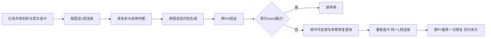

# L0–L4五档记忆：离线实现与原P7接线

日期：2026-10-23。协议`cle-memory-granularity-source-bound-v1`。工作分支`fjy/cle-contract-conditional-q-20261023`；HEAD仍为`21d21c0`，新增实现尚未提交。本批零模型API、零Embedding、零Q更新。

这里“渲染”指把卡片组装成模型实际看到的文本；“公开绑定”指把建议对应到题目已给的参数和对象；“离线检查”用固定替身回复验证程序流程，不调用真实模型。

**结论：五档渲染及调用原P7的函数已经实现；两张实际选中卡、两个公开题卡绑定已准备，4份共享起点导出20份预览。15项新增离线检查通过。真实粒度对照、分类器标签和付费编排尚未完成，不能把预览或测试夹具的通过率当成模型成绩。**

## 1. 每档究竟给什么

| 档位 | 当前固定规则 | 未提供的内容 |
|---|---|---|
| L0 | 空记忆；完整公开题面及原P7仍保留 | 首次和修复轮都不注入卡 |
| L1 | 审过的一条原文子句，去分号并补句号，作为一句提醒 | 不追加机制段、目标模板或完整来源代码 |
| L2 | 固定抽取原卡high_level_invariant、positive_principle、negative_guardrail、applicability、exclusion_conditions中的现有内容 | 不额外追加root_cause/fix_directive或完整来源轨迹 |
| L3 | L2加题卡专属的公开对象对应及操作模板，未知前提保留未知 | 不读目标题参考答案、隐藏测试、当前成绩或其他臂代码 |
| L4 | L2加完整合法来源：种子参考与真实尝试分别标识；真实尝试保留失败/缺测 | 不将来源测试通过升级为目标题正确性证明 |

这些是五种预先定义的**呈现策略**，不是简单截断，也不是严格逐层包含：L3增加目标绑定，L4增加来源具体例子。未来若某档有收益，首先支持该表示策略；不能把差异全部归因于字数或纯抽象程度。

L4保留原代码和原注释，不静默翻译或删除。部分来源代码有中文注释；原样来源的语言也是该策略的组成。当前没有把它伪装成等语言、等信息量的消融实验。其他档位的原卡摘录及新操作模板为英文。

## 2. 两个真实题卡例子

### 1394：把HTML正则经验绑定到括号匹配

L1原文提醒为：

> When using regular expressions to process user-controllable input, quantifiers must have explicit upper bounds to prevent ReDoS attacks.

它是该卡的原建议，不代表已经证明所有无界量词均不安全。L2保留其余机制和适用条件，不替原卡修正观点。

L3对应公开的`match_strings`、`text`、tuple/None及不抛异常要求；来源HTML标签结构与数字长度上限保持“尚未绑定”。没有把来源的100或2000变成目标题上限。L4才加入题67真实`{1,2000}`代码及原状态A。

### 102：把字段处理提醒绑定到布尔键校验

L1摘取过度规范化的风险提醒。L2保留原卡机制和前提。L3绑定公开的`key_name`、`unquote`、`valid_key_pattern.match`和True/False；把来源字典更新、可写字段列表标成不属于该公开接口的内容。

操作模板要求区分题面明确的URL解码与没有公开依据的额外清洗，保留已有正则策略。它没有读取正则的隐藏定义或目标题答案。L4则原样展示来源题1063的两次B状态尝试，未用标准修复代码替代失败轨迹。

两份L3材料各制作一次，两重复共用。操作的卡片原文依据、公开题面引用和公开快照保存在`target_bindings.json`；自动检查引用存在，内容映射由Codex审查。它不是914对检索适用性人工标签。

## 3. 原P7哪里保持、哪里新增



使用`context_pipeline.experience_text`既有显式payload接点，没有改变默认卡片序列化。渲染发生在选卡之后；L1–L4不改变选入ID、顺序或检索向量，L0只取消注入。Q不参与排序，也不更新。仍为PLT、原P7、δ=−1、最多3张、一次修复、首次Joint早停和末次交付。

首次材料缺失在进入原P7前报错；修复新卡缺材料时，保留已选原卡、修复查询和选择trace到`pending_materials`，拦住后续模型请求。原流水线仍保留技术错误/缺测记录，不能静默把L3降成L2或空卡。本函数尚未组成付费断点恢复编排器，不能声称生产续跑已完成。

## 4. 实际导出的20份预览

沿用1394/102各2份共享初析与首次原CLE选卡，共4份；每份渲染5档，共20份。每题两重复恰好选同一张卡，所以本次同题同档的正文长度相同。

| 题目 | L0 | L1 | L2 | L3 | L4 |
|---|---:|---:|---:|---:|---:|
| 102 | 2 | 321 | 1929 | 2769 | 6113 |
| 1394 | 2 | 318 | 1615 | 2419 | 4113 |

单位是**记忆序列化字符串的字符数**，不是Token、完整提示长度或费用。L0的2个字符为`[]`。未由这些长度挑选更优档位，未生成任何模型代码。

预览逐份与当前渲染函数重算核对，20份一致。来源例子可按索引读取1939张卡，但已审L1规范和L3绑定只有当前2张卡/2对；其他入选卡仍需准备，不能批量标为已审。

## 5. 验证与已修正问题

15项新增离线检查覆盖：五档不改原卡、隐藏字段/Q不进入模型正文、公开契约/绑定变更、来源/目标族隔离、参考种子与生成轨迹区分、来源末次缺测及全空代码、原P7新修复卡保持档位、L0修复无卡、首次Joint早停、三张上限及材料失败后的网络停止。

其中P7检查使用合成题和确定性回复，调用原验证器。它们证明执行逻辑，不是deepseek-v3.2的实验成绩。预览v1在免费准备阶段暴露CSV BOM及原节点/运行期卡字段差异，已按真实接口修正；v1失败记录保留，正式预览在v2，没有覆盖付费结果。

另对1939张卡的L4来源结构逐一核对：553是代码保存位置数，实际546份非空、7空；五道来源题没有任何生成代码，对应15张非种子卡的L4暂不可用，原索引的`episode_available`仅说明有记录。当前两个真实选中卡都有非空来源，不受此缺项影响。15张缺项不能以标准修复替代、不等于15道实验题失败，也不许据此删改固定名单。可用的1924张只通过来源结构检查，未自动获得内容审核标签。

## 6. 入口、产物与下一门

- `methods/sct_trajectory/memory_granularity.py`：五档呈现和公开/来源边界。
- `methods/cle_ablation/memory_granularity_study.py`：`GranularityProvider`、`run_one_level`及离线preview命令。当前CLI没有付费子命令，也没有分类器训练命令。
- `configs/cle_memory_mechanisms_20261023/prepare_granularity_views.py`：两张来源规范、两个公开绑定、1939卡来源索引的读取。
- E盘运行区`C01_granularity_materials_v1/`：`card_specs.json`、`target_bindings.json`、准备状态。
- 同运行区`C01_granularity_preview_v2/`：20份`granularity_previews.jsonl`、`summary.json`、`verification.json`。
- 精简结果：[granularity_preview.json](../../results/curated/cle_memory_mechanisms_20261023/granularity_preview.json)。
- 来源可用性：[granularity_source_availability.json](../../results/curated/cle_memory_mechanisms_20261023/granularity_source_availability.json)；原始目录`C01_source_availability_v1/`保留逐卡缺项。

```powershell
# 本机已完成，已有输出拒绝覆盖；以下仅用于新空输出位置复现
& $clePython -B -X utf8 -m configs.cle_memory_mechanisms_20261023.prepare_granularity_views
& $clePython -B -X utf8 -m methods.cle_ablation.memory_granularity_study preview
```

本批新增API/Token/Q更新均0。服务的代码控制仍未通过；B02未取得合格配对，也未冻结有收益的消费者。后续可离线完善C02编排与统计门，但不能据此启动粒度付费测试、扩大标签或训练分类器。1348公开政策、914对人工确认、Notion原始配对分别待补；旧学习、全D_gate、Base/Plus继续暂停。
