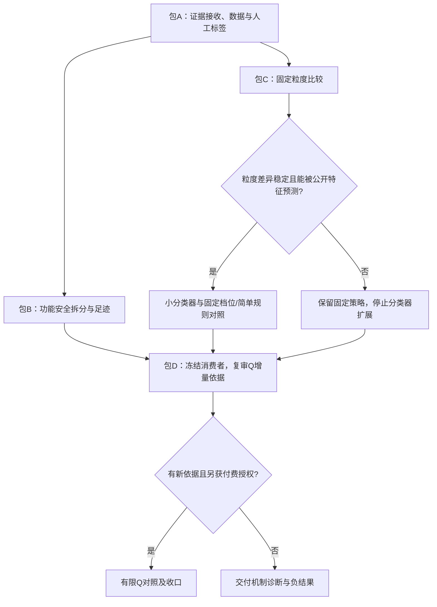

# CLE 功能安全记忆、粒度选择与 Q 探索：联合实验任务包

**2026-10-26研究管理更新**：[当前总览](../research/README.md)与[升级及全量方案](../research/CLE-PLAN-20261026-research-upgrade-v01.md)是新的研究导航；本目录保留原编号、任务书与历史快照。当前v4.1固定清单持续执行，实时见[动态执行记录](../CLE_v41迁移基础实验完整执行记录_20261026.md)，不能将下文旧“暂停/0次”当成当前状态。新老师任务全量验证与模型×经验库交叉已登记为规划，尚未新增付费派发。

**最新离线集成**（2026-10-26）：[执行规则与计划复核报告](../CLE_v41关系提醒执行规则与计划复核离线报告_20261026.md)。时段、物理预算、日志、前4门、复核及8格收口通过36项流程＋5项日志回归。旧首次计划2明确2含糊，另2修复明确；新四份真实计划尚未生成。真实0/8，付费暂停。

**2026-10-26当前更新**：[文件—签名关系落实规格](../CLE_v41文件签名关系落实最小实验规格_20261026.md)及[共享前缀离线接线](../CLE_v41关系提醒共享前缀离线接线报告_20261026.md)完成。17项检查通过，8格合成响应回放一致；两份初析、四份生成前缀，同层只差生成末尾提醒。真实0/8、API0，预算100万保守Token/150总HTTP/30向量HTTP未启用；HOLD、付费启动器未连接。任务表仍27项，原16次结果与停止决定保留。

**16次实际执行更新**（2026-10-25）：三阶段薄包装接线和14项检查已完成，16/16真实P7与回放完成。Joint A2/B2/C4/D3（各/4）；C−A单项有信号，D−B净+1且新增安全损失，综合门未过，停止扩样。下文“未接线/未执行”是本次运行前的设计历史；当前见[执行分析报告](../CLE_v41公开绑定保护四臂实验报告_20261025.md)和tasks.csv。

**当前入口（2026-10-26）**：[v4.1迁移复审与清单更新](25_v41迁移复审与任务清单更新.md)、[6 Pro完整原文](26_6Pro迁移综合审阅原文.md)、[当前执行清单](07_当前执行清单与决策门.md)。P3全298、S1全48和B03全16完成；热迁移与B03综合收益门未过。B03R仅离线接线通过，真实未执行；旧v3.2服务阻塞属于下文历史快照。付费保持暂停。

下文保留原任务包背景与历次事实，当前状态以上述入口和tasks.csv为准。

日期：2026-10-23。性质：研究方案、执行任务书与增量进展。工作仓库：`D:/Agent/sct-security-generation`，核对分支：`fjy/cle-contract-conditional-q-20261023`，HEAD：`21d21c0`，同时读取了尚未提交的契约与条件 Q 工作文件。最初交付为零API规划；后续完成4份共享初析/选卡，并开始真实P7技术探针。首个条件因格式和API故障停止，产生1份非空首次代码、末次缺测，尚无合格的新配对成绩。见[技术停止报告](08_B02技术探针停止报告.md)。

**当前执行进展**：[首批执行结果](06_首批执行结果.md)。96题已锁定，v2参考预检96/96通过；914对盲审、1939卡来源索引、303题原生配对及Q账本影子分析已落盘。语义契约、人工标签和新机制生成对照尚未完成；不是所有任务均已执行。

10月24日最新：[粒度分阶段入口与成本接续](18_粒度技术入口与成本接续实现.md)已完成20/120/480格原P7编排、逐格分账及材料补齐后的接续，最终85项相关离线检查通过，其中30项新增。默认入口零API，实际付费仍关闭，真实C结果尚未完成。

随后完成[官方备用接入点验证](19_官方备用接入点验证与当前阻塞.md)：在原预算内对`.org`发送1次同模型代码控制，0.890秒返回403，第二个控制未发。已知Token196291不变，未知操作7；未运行P7，当前开关关闭，服务技术阻塞未解除。

最新零API推进：[Q奖惩归因复盘](10_Q奖惩归因与覆盖率复盘.md)、[粒度来源核对](11_记忆粒度来源核对.md)后，已完成[五档渲染和原P7函数接线](12_五档记忆离线实现.md)，准备两张实际卡/两个公开绑定、20份离线预览。完整其他卡材料、粒度付费编排、真实效果及分类器仍未完成。

随后完成[粒度先导排程与C1判定](13_粒度先导排程与判定.md)：固定480格、其中前20格技术探针及前120格先导；新增14项手算/格式检查，与五档接线共29项通过。真实C02结果0，C1尚未评估，付费保持关闭。

最新[18题历史损失逐题复核](14_历史18题交付损失逐题复核.md)：12题外部配置替换、150另有类重定义、4题格式/资源政策问题及885技术缺测已分开；新增30次本地诊断并复用6次。303对中297对末次均可测，另报137→139的敏感性结果；旧303题138→140交付表保留。这不是Q独立收益证明。

随后完成[20题救回对称复核](15_历史20题交付救回对称复核.md)，新增44次本地诊断：7题外部对象恢复，999/1063仍有公开配置缺陷，1382/1174定位普通运算实现错误；1150是交付恢复，1158虽Joint通过但未完成流程、Q跳过。38道成绩改变题现已复核，265道同成绩对照仍未全面审查，不能据此训练或启用门控。

最新[同成绩对照复核](16_同成绩对照与Joint盲区.md)完成固定9道标记失败题与6道无标记通过题，新增44次本地检查；141道可测的两次失败题中13道F/S仍有变化。现有[303行复核索引](../../results/curated/cle_memory_mechanisms_20261023/current_case_review_index.csv)链接53道有限证据，250道明确未知，未据此扩张或训练检测器。

B01视图接点已实现，两题五条件离线控制完成；六张历史首选卡及两张实际首选卡完成来源分区，339张草稿并非全部已审。B02真实探针保留1条技术故障终态，后续19个条件未启动。用户要求适应不可修改的中转，新增单次长等待、流式接收和有限JSON合并，84项相关离线检查通过；实际控制与成本见[中转适配接续](09_中转适配与探针接续.md)。控制未全通过，不能报告方法新收益；1348公开政策、人审和Notion原件仍待补。

## 1. 这次到底新增什么任务

建议把研究问题改写为：**经验在什么条件下、以什么表达形式，能够修复安全问题而不破坏任务功能？Q 排序在这个条件下还有多少额外帮助？**

这不要求立即重做 CLE 框架。先复用现有检索、选卡、复析、规划和验证流程，改动经验呈现及其使用边界。

| 来源 | 明确任务 | 最小可检验实现 | 不应直接作出的结论 |
|---|---|---|---|
| 王老师意见一、截图一 | 功能与安全经验分开，解释功能为什么挂掉 | 同一卡保留“安全动作”和“必须保持的功能”两个关联视图，核对对象绑定、返回、副作用和异常；分别消融 | 安全测试通过不等于功能正常；所有功能失败也不都由记忆引起 |
| 王老师意见二、截图二 | 不同题目适合不同记忆程度，考虑分类器 | 先固定比较 L0–L4，再用公开任务特征预测合适档位 | 不能先凭难度印象生成分类标签，再用同一印象验证分类器 |
| Notion 汇报 | 代码影响足迹 φ、允许的影响边界 ρ、生成后接受/拒绝 | 先复核已有配对并离线回放；复杂足迹与简单契约检查比较 | 代码差异不全是记忆导致；变化多不等于错误多；回退无记忆也不保证安全 |
| 既有 Q 探索 | 排序会改选，收益未建立；归因与奖励污染未解决 | 固定消费者、正文、候选、预算与 Q 快照，最后才比较 Q 增量 | 刷高 Q 覆盖率不是成功指标，Q=0 也不等于未学习 |

这里“记忆程度”专指**表达粒度（给模型多少细节）**，不等于选卡数量、Q 访问次数、Q 数值大小，也不是 HSK 树层级。

## 2. 已核对的项目事实

| 对象 | 本次核对结果 | 实验含义 |
|---|---|---|
| PLT 三池 | D_init 303题/217族；D_grow 273题/217族；D_gate 298题/217族 | 合计874题、651个不同 family ID；三池 family 集合两两交集为0。不是三池合计217族 |
| family / CWE | family 是项目划分的同源或近似题族；CWE 是漏洞类型分类 | 同 CWE 不代表接口、业务或适用前提相同 |
| 1939张冻结卡 | 主 `source.task_id` 覆盖303道 D_init 题，1939张全部来自 D_init | 来源题单卡回测只能先说明自验证；D_grow、D_gate用于跨题族迁移 |
| 当前指定 Q 快照 | 972/1939张 `q_visits>0`，覆盖率50.13% | 是历史各轮反馈的累积；不是每张已证明有效，也不是本次新学习 |
| 最近在线学习 | D_init 303/303；D_grow 23/273，Joint 11/23 | D_grow还有250题未做；新快照的全 D_gate 四臂未完成 |
| 旧全 D_gate 四臂 | Q0/Q1/Q2/Q3 Joint 为97/104/102/100，计划分母均298；Q2有2条缺测 | 用的是更早466张有反馈的快照，不是972张快照；预定收益门未过 |
| 检索标注 | 914对已有AI标签，人工确认0；2对 insufficient | 正式人工四指标仍待完成 |
| 10月23日接续 | 条件 Q 路由关闭；48题修复URL夹具后参考实现48/48通过 | 这不是模型Joint=100%；192次契约双臂仍暂停 |

本地依据、Notion 数据边界和文献核对见 [资料与研究依据](05_资料与研究依据.md)。不覆盖用户指定为最新版的 [10月22日Word报告](../CLE项目本周Q值选卡探索实验报告_20261022.docx)。

## 3. 新旧任务合并后的取舍

| 工作 | 当前状态 | 接下来如何处理 |
|---|---|---|
| 选卡重复实验160次、旧298题四臂、D_init各轮学习 | 已完成历史证据 | 复用，不为“补全流程”重复花费 |
| Notion 的6726份代码/5817对及AST门控 | 网页给出结果；本次在工作区相关目录与E盘归档索引未定位原件 | 优先接收原生配对、代码、验证与门控记录；不重新生成这批数据 |
| 18损失/20救回、公开契约和奖励归因 | 已有诊断，但因果解释不完整 | 纳入包A/B，补相同成绩对照、来源影响和模型波动区分 |
| 914对人工复核、候选池四指标 | 待人工 | 包A继续；Agent可整理证据，不能代签人工标签 |
| 原题/初析查询比较与检索门槛校准 | 正式人审门未完成 | 先复用已有召回和标签；人审完成后再按原协议选择R*，不同时混入新粒度/Q实验 |
| 48题旧P7与契约-only、各重复2次 | 输入和预检已完成，付费未执行 | 包D保留为独立“消费者整体包”对照，优先级低于本次针对性机制诊断；不冒充单一记忆改动 |
| 功能/安全拆分及粒度分类器 | 视图、五档原P7函数及离线判定已实现；技术门未过；付费粒度编排和分类器未实现 | 包B/C按门槛推进；不将本次技术故障当方法负结果 |
| 条件Q、功能/安全分项Q、同CWE异family信用冲突 | 条件Q关闭，其余未证实 | 包D先零API审查；有独立新依据后才申请新的Q比较 |
| D_grow剩余250题、更多学习轮、最新Q全298题对比 | 暂停 | 不作为本路线必经项；没有新机制依据时不靠增加覆盖率继续投入 |
| 三张上限必要性完整消融 | 仅部分历史对照，专门的干净对照尚未完成 | 本轮固定最多三张，暂缓此独立变量，防止与粒度混淆 |
| Base/Plus、完整CLE演化、新版CLE、MASE | 未开展或暂停 | 本任务不恢复；Base/Plus原Docker验证环境也尚未就绪 |

## 4. 三条研究主线及执行顺序

1. **功能—安全协调**：经验究竟提出了什么安全修法，又是否明确要求保留功能？包括代码影响足迹与公开契约检查。
2. **记忆粒度选择**：同一来源的经验，给一句提醒、机制解释、目标模板还是完整来源例子，是否存在可预测的差异？
3. **Q增量与收口**：在已经固定的有效消费者下，历史 Q 是否优于无Q、纯相似度和打乱Q？不预设必须挽救Q路线。

“先测量→列竞争解释→最小对照→固定方案→确认→停止”采用顺序实验设计；小实验用于改变下一步决策，不把所有模块一次铺满。依据见 [NIST实验设计步骤](https://www.itl.nist.gov/div898/handbook/pri/section1/pri14.htm)。

## 5. 任务包入口

| 包 | 内容 | 具体文件 |
|---|---|---|
| A | 资料、分池、契约、914对复核、历史错误分类 | [01_证据与测量](01_证据与测量.md) |
| B | 功能/安全双视图、影响足迹、边界与最小干预 | [02_功能安全与影响边界](02_功能安全与影响边界.md) |
| C | L0–L4、训练标签、小分类器、固定策略比较 | [03_记忆粒度与分类器](03_记忆粒度与分类器.md) |
| D | 旧Q未完成工作、条件Q、最终比较与收尾 | [04_Q接续与执行总规](04_Q接续与执行总规.md) |
| 支撑材料 | 本地证据、文献、贡献边界 | [05_资料与研究依据](05_资料与研究依据.md) |
| 可直接交给Agent | 带依赖、状态和验收的任务表 | [tasks.csv](tasks.csv) |
| 先读的执行单 | 当前可做项、各阶段判据、未完成Q事项及规模 | [07_当前执行清单与决策门](07_当前执行清单与决策门.md) |
| 本次技术停止 | 原生格式、API、采用与代码错误逐层定位 | [08_B02技术探针停止报告](08_B02技术探针停止报告.md) |
| 中转本地适配 | 传输与有限格式修订、小任务控制及接续状态 | [09_中转适配与探针接续](09_中转适配与探针接续.md) |
| 当前阻塞交接 | 本地请求核对、各门槛的实际作用范围、恢复次序 | [17_执行门核对与阻塞交接](17_执行门核对与阻塞交接.md) |
| 403原因核对 | Cloudflare客户端拦截对照、密钥鉴权及余额查询边界 | [20_HTTP403原因核对](20_HTTP403原因核对.md) |
| 客户端修正控制 | 一次代码请求、误拒绝原文、两项本地检查及成本 | [21_客户端修正后最小代码测试](21_客户端修正后最小代码测试.md) |
| 角色与映射诊断 | 同题增加中性system后代码通过、原始HTTP证据、上游待核项 | [22_普通代码误拒绝与中转角色处理核查](22_普通代码误拒绝与中转角色处理核查.md) |
| 当前模型与时段 | v4.1 Flash 1017、北京时间工作日禁用窗口、换模结果隔离 | [23_切换v41Flash1017与调用时段限制](23_切换v41Flash1017与调用时段限制.md) |
| 单次加法监控 | 每15分钟检查允许时段、一次HTTP、代码运行与Token记录、完成后停用 | [24_新模型单次加法探针监控任务](24_新模型单次加法探针监控任务.md) |
| Q信用复盘 | 尝试/卡片分母、共同奖惩、跨族差异、覆盖率与公开绑定 | [10_Q奖惩归因与覆盖率复盘](10_Q奖惩归因与覆盖率复盘.md) |
| 粒度来源 | 标准修复种子与真实训练尝试分离、L4材料状态 | [11_记忆粒度来源核对](11_记忆粒度来源核对.md) |
| 五档离线实现 | L0–L4呈现、公开目标绑定、原P7接线与材料停止门 | [12_五档记忆离线实现](12_五档记忆离线实现.md) |
| 先导排程与判定 | 20/120/480嵌套排程、原生结果与C1、成本缺项标签规则 | [13_粒度先导排程与判定](13_粒度先导排程与判定.md) |
| 历史损失逐题复核 | 18题实现/契约/技术问题、公开诊断、逐轮采用和Q记账 | [14_历史18题交付损失逐题复核](14_历史18题交付损失逐题复核.md) |
| 历史救回对称复核 | 20题改善与残留缺陷、正奖路径、完整流程及Q归属 | [15_历史20题交付救回对称复核](15_历史20题交付救回对称复核.md) |
| 同成绩对照 | 9+6固定参照、F/S组件变化、足迹资格与303行复核索引 | [16_同成绩对照与Joint盲区](16_同成绩对照与Joint盲区.md) |

## 6. 当前建议与停止线

当前先消费B02的技术停止证据，核对控制接口，再推进不依赖付费的来源/粒度材料及信用归因。L0–L4先证明存在有用差异，再训练分类器。**目前最值得解决的是经验使用方式和功能约束，不是再做一轮全库Q覆盖学习。**

以下数字是工程门槛，不是统计证明。旧实验的“保持暂停”继续有效；B02因技术门失败已停用后续付费条件，不更新Q、不自动重跑或上传仓库。研究目标仍未完成，下一阶段不得绕过当前技术与数据门。
