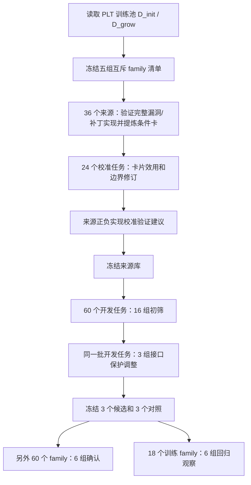

# M1–M6、A1–A7 实验源码审计与结果解释（2026-10-09）

本次只审计已有源码、冻结快照和结果，不修改方法、不重新请求模型、不重新执行候选。用户已明确允许其他训练任务的漏洞/修复代码示例，但要求验证来源质量和 family 隔离。本文把研究设想、实际实验版本和结果分开说明；实验成绩表见 [联合初筛记录](memory_architecture_screening_20261009.md)。

## 1. 先纠正此前汇报的三处表述

1. 确实做了真实模型生成和 PLT 功能/安全测试，主要矩阵有 1608 条任务×方法记录。但不是 13 个完整研究方法全部得到验证：M6 未实现跨语言实验，A7 是筛选程序，M2/M4/A5 等只实现了有限原型。
2. 记忆实验没有统一运行完整 CLE。M1/M2/M4 是单次生成，M3/M5 是草稿后处理；只有 `staged_*` 对照直接运行现有四阶段生成模块。结果不能用来宣布新方向打败或不如完整 CLE。
3. “架构外环＋记忆内环”没有实现每种架构下反复优化记忆的嵌套搜索。当前是有限配置比较、开发侧调整、冻结、独立确认；没有证据证明 A7 本身具有很高成功概率。

## 2. 从入口到评分的完整流程

入口为 `methods/direction_screening/run.py`，调整版本为同目录 `adjustment.py`。本轮方向编号与历史 CLE 消融中的 A1–A6 编号不是同一套命名，不能相互对应。

### 2.1 数据划分与隔离

`prepare()`（`run.py:91`）读取现有训练池清单，仅从 `D_init` 和 `D_grow` 抽样。抽样函数按 CWE 轮转、每个 family 选择一个代表任务，并在选择下一组时排除所有之前使用的 family。

| 用途 | 任务/family 数 | 原训练池 | 使用方式 |
|---|---:|---|---|
| 来源 | 36 | D_init | 读取这些训练任务的漏洞与补丁 |
| 效用与反例校准 | 24 | D_init | 比较空记忆与文字规则 |
| 回归观察 | 18 | D_init | 观察旧通过任务是否丢失 |
| 初筛及调整 | 60 | D_grow | 比较配置并作一次开发调整 |
| 冻结后确认 | 60 | D_grow | 确认已选配置，不反馈调参 |

本次重查清单的十个组间交集均为零，主要结果记录中的来源 family 与目标 family 也无相同项。不过 `retrieve()` 自身没有“目标 family 不得等于来源 family”的运行时断言，隔离依赖清单构造；A5 的来源记录还有下文说明的偏差。因此当前检查支持既有清单隔离，不等于任意新数据接入都自动安全，也不等于已完成更强的语义近重复审计。

没有使用 `D_gate`、正式 `H_pass` 或 CodeSecEval Base/Plus 的反馈生成经验。18 题回归组没有预先筛选成全通过集，不能称为正式 H_pass。PLT 曾被历史实验使用，本轮独立配置确认也不能称为历史完全未见的数据。

### 2.2 什么信息给模型，什么信息只给评分器

`protocol.public_task()`（`protocol.py:38`）只放入函数名、描述、安全策略、上下文、参数、返回、异常，以及任务 ID、CWE、语言。目标任务的正确代码和官方测试不进入生成提示。

本轮模型能看到目标 CWE 标签，检索也用这个标签硬筛选来源。这是已知漏洞类别条件下的检索实验，不能推广成自动识别未知漏洞类别的能力。

`retrieve()`（`run.py:122`）先选同 CWE 的卡，再计算公开题面/草稿与来源描述、规则的英文词重叠，取一张最高分卡；没有相关性下限。它没有使用完整 CLE 的分层或语义检索。

`generate()`（`run.py:150`）拼接公开任务、条件记忆、当前代码、许可反馈和策略说明。所有生成组都复用了 CLE 的 `CONTRACT_POLICY`，即保留合法功能、接口和异常行为的通用要求。角色和修复仍是同一个 `deepseek-v3.2`，temperature=0；通常生成输出上限 3072 token，其他角色使用 1024/1536，预算调整组使用 4096。

`evaluate()`（`run.py:160`）调用 PLT 本地验证器，以 `python -I`、临时目录和超时执行。功能与安全分别测量，Joint 要求同一代码语法、功能、安全均通过。这是轻量运行隔离，未启动 Docker。

初筛先为每道题生成并保存 `direct` 草稿。M3、M5、A1、A2、A4、A5、A6 共用这个草稿，再运行自己的后续流程；这是控制初稿差异的实验安排。独立部署这些方法时，必须把初稿的一次调用也算入成本。

官方测试在候选形成后评分，通常不把分数反馈给模型。A2 的 `route` 是例外：它读取训练测试的脱敏状态来路由，必须作为“训练反馈可见”诊断单列。A5/A6 和调整版的候选选择不使用官方 Joint 分数。

## 3. M1 为什么提供修复代码，为什么仍然失败

### 3.1 它提供的是另一道训练任务的补丁

`source_bank()`（`run.py:203`）只读取 36 个训练来源的 `ground_truth`。用 `code_before + patched_code + code_after` 拼接完整来源补丁进行验证，漏洞实现也分别验证。随后存储：

- 条件规则、适用条件、排除条件、需要保留的合法行为、验证建议；
- 来源任务 ID、family、CWE、描述和来源测量证据；
- 原始 `vulnerable_code` / `patched_code` 字段组成的前后示例。

这里的“补丁切片”只是读取数据字段，并没有实现 AST 或数据流切片。字段可能缺少完整函数接口和依赖上下文。`memory_view()`（`run.py:133`）注入规则和前后代码，却没有把来源描述、family、完整依赖和来源测量证据一并交给目标生成模型。

所以模型看到的是“别的任务如何修复某个机制”，需要把机制迁移到目标函数。直接给当前目标的正确代码并测试会泄露答案；用户允许的是其他隔离训练任务的示例，这与本轮目标一致。

### 3.2 来源补丁正确，只能说明来源上下文中成立

目标函数的参数、外部对象、敏感字段、合法输入、错误处理与来源可能不同。学习了安全操作，仍可能破坏目标接口或编造运行环境。尤其当前提示要求“完整可运行代码”，如果没有清楚区分谁负责提供外部对象，模型可能把示例对象、类或数据也写进候选。

本轮真实例子：目标 146，来源 `source-137`，两者 family 不同。来源补丁通过 Joint。来源是病人报告中限制敏感属性参与模板格式化；目标是员工目录中限制敏感属性参与格式化。

目标生成代码确实借用了限制属性访问的包装思路，但又重定义 `Employee`，并在函数中创建示例 `employees_db`，附带演示内容。目标功能、安全均失败。这说明“学会了安全包装操作”与“完整满足目标运行契约”是两件事。可观察到的环境/接口漂移是明确风险；本次没有逐个用例证明它是该任务唯一失败原因。

### 3.3 本轮来源质量没有被严格门控

36 张来源卡中，完整补丁 Joint 通过 31 张，失败 5 张：5 张均功能失败，其中 2 张安全也失败。当前主入口仅过滤“是否成功提炼出 rule”，没有过滤“来源补丁是否 Joint 通过”。因此这 5 张仍能进入 M1/M4 等召回。

M1 初筛 6/60、确认 8/60 召回了这类卡，均未 Joint 通过；对应任务的直接生成也均失败，不能只凭相关性断言失败由这些卡造成。不过这些卡显然不满足用户现在提出的来源质量要求。记录了验证结果而没有据此禁止注入，是本轮实现的实质缺口。

后续需要在独立版本中重验证并隔离失败来源，明确显示来源证据，检查来源漏洞对照是否确实触发所声称的风险，并补充可迁移的接口/上下文。不得按确认成绩直接重写本轮冻结源库，否则会污染已有确认结论。

## 4. M 系列实际由什么架构驱动

表中分数都是初筛 Joint/60；“未确认”表示没有该原版本的第二批实验。

| 方向与代码臂 | 真实运行流程 | 结果 | 需要纠正的理解 |
|---|---|---|---|
| M1 规则＋漏洞/修复示例，`slice` | 公共题目→检索一张卡→一次生成→评分 | 18；文字规则对照 `rule` 为 14；确认 16 | 不是四阶段 CLE，也没有修复循环；不是自动代码切片 |
| M2 效用门控与空检索，`utility` | 校准单卡收益→收益为正才注入→一次生成 | 11；与直接生成复用相同代码；未确认 | 没有在线 Q 学习或 MemRL 更新；只验证了全空检索路径 |
| M3 草稿驱动检索与修复，`draft_memory` | 共用直接生成草稿→用题面和草稿检索→带示例完整重生成一次 | 12；无记忆同流程 10；未确认 | “局部修复”只是提示要求，没有 AST/diff 限制，可改写整个程序 |
| M4 反例修订条件技能，`skill` | 开发校准修订卡片边界→冻结→检索→一次生成 | 14；未修订示例组 18；原版本未确认 | 只有一张卡实际修订；不是可执行技能或持续进化系统 |
| M5 验证建议记忆，`verification` | 草稿→检索已校准验证建议→生成/审查内部测试→执行→修复一次 | 10；无验证记忆同流程 10；未确认 | 传递的是验证目的，目标测试重新生成；没有直接移植经验证的可执行测试 |
| M6 机制/API 跨语言分层 | 没有对应跨语言实验分支 | 未测 | Python 单语言结果不能验证跨语言方向 |

### 4.1 M2 的负结果不能用来否定 MemRL

`calibrate()`（`run.py:425`）在 24 个校准任务上比较 `direct` 与文字 `rule`，将召回卡的 Joint 差取平均，只有平均值大于零才注入。

36 张卡中，16 张没有配对测量、17 张只有一对、3 张只有两对；没有正效用卡。代码把没有测量的卡也记为效用零并拒绝。未测量不等于已经证明无效。效用来自文字规则版本，也未直接测量代码示例版本的收益。不存在在线探索、迭代更新或随目标结构变化的效用学习。

### 4.2 M4 的“反例进化”覆盖有限

边界修订只对校准中“文字 rule 使原 Joint 通过变成失败”的卡触发，实际只有 `source-1244` 被修订。修订边界再用于含示例的 `skill`，校准形式与使用形式不完全一致。因此 14 对 18 的差异不能直接解释成“反例进化不好”，更不能称为完整技能进化实验。

### 4.3 M5 的测试与反馈链路有局限

来源校准要求测试能通过正确实现并让漏洞实现断言失败，逐用例过滤后只有 5 张卡得到验证建议。60 个目标中只有 16 个实际使用这类记忆。

来源内部执行时拼入了来源 setup、前后文；目标 `execute_checks()`（`internal_checks.py:150`）只加载生成代码，没有由公开上下文恢复调用方外部依赖。官方 PLT 评分则先恢复 setup 再加载代码。两种执行环境不一致，内部异常可能来自缺依赖或错误测试，不能自动判断目标实现有漏洞。

重查 M5 的 295 个内部用例：197 通过、42 断言失败、54 运行异常、2 超时，其中出现 1 个 NameError。这个计数支持需要逐项归因，不支持把全部运行异常归为环境问题；很多还涉及输入、类型和异常语义。

修复反馈只提供是否测量、通过数和用例 ID/状态/阶段，没有用例代码、预期与实际行为或具体失败原因。修复模型难以从这些状态定位问题。后续可提供经过脱敏的、来自公开自生成测试的具体证据；这仍不能回流官方隐藏测试。

## 5. A 系列实际实现与成绩

| 方向与代码臂 | 真实运行流程 | 初筛 Joint/60 | 实现边界或审计问题 |
|---|---|---:|---|
| A1 功能/安全双角色审查，`review` | 草稿→功能审查＋安全审查→修复一次→取修复结果 | 9 | 同模型不同请求；即便审查无问题也会修复，没有保证修复不破坏初稿 |
| A2 故障分类路由，`route` | 草稿→读训练官方状态→停止或按功能/安全状态修复一次 | 11 | 使用官方训练反馈；缺测判断先于语法判断，典型语法失败会停止而不是进入语法修复 |
| A3 简化阶段与接口交接 | 初筛用一次生成对照现有四阶段；之后加入公开接口/依赖清单 | 一次生成 11，四阶段空记忆 10；接口保护空记忆 12 | 计划中的独立“分析＋生成”两阶段未实现；后续接口保护是另一项调整 |
| A4 按角色分配输出预算，`role_budget` | A1 流程，审查 1024→1536，修复 3072→4096 | 10 | 没有更换角色模型，不是模型组合架构；收益与成本同时变化 |
| A5 证据控制器，`controller` | 草稿→合并审查→有问题则重新检索技能、修复、复审→公开分数选择 | 10 | 实际没有内部动态测试；60 题全部修复；9/60 条修复来源与记录的 `card_id` 不一致 |
| A6 两候选分支与选择器，`branch` | 草稿＋另一提示生成候选→分别审查→公开分数选一个 | 10 | 任一候选成功为 13，实际漏选 3；没有显式不同修复假设的分支规划 |
| A7 架构外环与记忆内环 | 比较有限实验配置→开发调整→冻结→另批确认 | 无独立分数 | 无自动搜索器，无每个架构下的记忆内循环优化 |

### 5.1 A2 的语法路由问题

`run_one()`（`run.py:256`）先检查 `not first['measured']`，后检查语法状态。`measured` 要求功能和安全都有 pass/fail；语法失败时它们通常未测量，因而提前落到 `environment_or_unmeasured_stop`。这是执行顺序问题，不能把 `route` 的 11/60 看作完整故障诊断闭环的结论。这里应区分候选语法失败、执行环境事故、测试缺失，而不是共同停止。

### 5.2 A5 的证据与来源记录问题

公开分数主要是语法得分减审查问题数，虽然函数支持内部测试项，但 A5 调用没有传入内部测试证据。审查问题减少不等于功能、安全得到修复；所有 60 题进入修复，也未证明有效的自适应停止。

初始 `card_id` 在看到草稿前记录。控制器修复阶段重新检索 `skill`，却没有更新这项记录。重查发现 9/60 条实际修复卡与已记录卡不同。该问题不改变已保存代码的 PLT 得分，但会影响“哪张记忆有用/有害”的归因。后续应分别记录初始检索、实际注入、修复检索的来源 ID；不应覆盖原始结果来掩盖问题。

### 5.3 A6 先解决选择，再讨论增加候选

分支没有使用官方分数挑答案。实际选择分数为 AST 语法状态和同模型审查问题数，平分时保留先前候选。13/60 是事后观察的“任一分支正确”上限，10/60 才是方法实际成绩。增加分支可能产生正确候选，也可能增加选择错误和成本；不能把上限当作成功率。

## 6. “契约交接”到底改了什么

建议在汇报中改用“公开接口与运行环境保护”，减少术语负担。`contract_manifest()`（`adjustment.py:55`）把公开题面的函数名、参数、外部类/全局对象、返回和异常整理成清单，明确要求外部值由调用方提供，不能用示例数据覆盖，不能增加必填参数或演示代码。

`audit_code()`（`adjustment.py:78`）用 AST 检查语法、入口函数、部分参数约束、外部名称重新绑定。生成后有违约信号才修复一次；只有修复后 AST 违约数量严格减少才选修复候选，不使用官方功能/安全成绩选择。

它没有完整检查运行时环境、业务逻辑、类型或安全机制。公开清单使用有限正则提取，也可能漏掉或误识别依赖；违约更少不保证程序正确。三个组合实际都是这条流程，只有注入记忆不同：

| 实际配置 | 开发 Joint/60 | 确认 Joint/60 | 回归 Joint/18 |
|---|---:|---:|---:|
| 单次生成，无记忆 `direct` | 11 | 13 | 2 |
| 现有四阶段＋条件文字卡 `staged_memory` | 12 | 14 | 2 |
| M1 来源示例 `slice` | 18 | 16 | 3 |
| 接口保护，无记忆 `contract_direct` | 12 | 14 | 2 |
| 接口保护＋M1 `contract_slice` | 19 | 18 | 4 |
| 接口保护＋M4 原型 `contract_skill` | 20 | 16 | 6 |

开发最高配置是接口保护＋M4，确认最高是接口保护＋M1。这支持独立确认的必要性，不支持开发最高就是稳定最优。

接口保护＋M1 在确认是 30%，直接生成是 21.7%，现有四阶段文字卡是 23.3%。没有显著配对优势；18 题回归还丢掉直接生成原通过两题中的一题。与同架构空记忆比较，确认救回 9、伤害 5，净增 4。这可以作为候选价值，不能说已经有很高成功概率。

AST 修复本身贡献有限：`contract_slice` 开发 8 次修复中选用 2 次，确认 15 次中选用 3 次，两批各救回 1 个 Joint。组合成绩不能主要归因于修复循环，也不能证明完整动态证据控制器有效。

## 7. 与原 CLE 的关系

完整 CLE 由 `methods/sct_trajectory/closed_loop.py` 中 `CleRunner`（第 662 行）驱动，包含来源经验建立、树和经验池、检索 rollout、错误记录、回放/蒸馏、候选门控、吸收合并/剪枝与冻结等阶段。

本轮独立 runner 没有实例化 `CleRunner`，也没有运行这些长期进化机制。复用的主要是：

- 数据加载及现有训练池划分；
- 响应正文、JSON 和代码围栏提取工具；
- 通用契约保护提示 `CONTRACT_POLICY`；
- PLT 验证器；
- 只有 `staged_*` 对照直接调用 `run_context_pipeline()` 四阶段生成。

四阶段对照为初步分析、结合经验复析/采用判断、规划、生成。本轮在分析前就以简单检索固定来源卡，没有传入 `cards_provider` 回调，不是完整 CLE 中分析后检索的全部流程；注入的是文字条件卡，也没有 M1 原始代码示例。因此“原四阶段＋文字卡”和“M1 单次生成”的差异同时涉及阶段、检索与记忆表达，不能全部归因于架构。

用户允许跳出 CLE，这是后续设计的有效边界。当前坏结果不能简单归咎于“受到 CLE 限制”，因为多数原型本来就没有运行完整 CLE；它们的测试深度、来源质量、修复保护和证据选择不足更直接。后续独立架构可把 CLE 作为明确对照，同时保持数据、模型、预算和评价口径可比较。

## 8. A7 的设想与本轮实现必须分开

真正的两层优化可以理解为：外层选“如何组织生成、检索、工具执行、验证、修复和停止”，内层针对选定架构优化“保存什么、何时检索、哪张记忆可用、何时拒绝”。两者可能交互：同一张记忆在直接生成和验证后修复中未必有相同效用。

本轮只建立一次来源库，做一次通用校准并冻结；各配置共用它。`selection.json` 固定候选、对照、代码/记忆哈希，再运行另一批确认。没有在每个架构下训练各自记忆策略，也没有架构图修改、控制策略学习或嵌套优化器。

因此 A7 当前应称“有限配置筛选与冻结确认程序”。它能降低依赖单次开发排名选错配置的风险，但不能由这次流程推导完整架构搜索会取得高成功率。

## 9. 已发现错误与后续验证前提

| 问题 | 已有证据 | 后续应满足的条件 |
|---|---|---|
| 来源验证失败仍被注入 | 36 张有 5 张补丁 Joint 失败，主入口只筛 rule | 来源质量门控、失败隔离、来源正负证据与完整上下文 |
| 同类标签被当成足够相关 | 同 CWE 词重叠 top-1，无拒绝阈值 | 校验目标操作与来源修复机制匹配；支持证据不足时不注入 |
| “局部修复”实际可重写全程序 | 返回完整代码，无结构差异限制 | 界定可修改位置和必须保留的接口/依赖；记录救回与伤害 |
| 未测效用被当作零效用 | 16/36 卡无校准配对 | 区分未测量与无效；在实际注入形式和驱动架构下校准 |
| 内部测试环境与正式调用环境不同 | 来源拼 setup，目标只加载生成代码 | 根据公开契约恢复依赖；测试错误与候选错误分开归因 |
| A2 语法错误提前停止 | 缺测分支位于语法分支前 | 候选语法失败优先分类；环境事故不计模型失败 |
| A5 证据不足、来源记录不准 | 无动态检查；9/60 次修复来源记录偏差 | 真实执行证据、停止规则、分别记录检索与注入来源 |
| A6 有正确分支却选不中 | 上限 13，实际 10 | 验证选择器能否辨别候选；先评估选择损失再扩分支 |
| 把局部原型写成完整方法 | M6 未测；A7 无内环；M4 一张修订 | 研究名称与实际实现层级逐项对应 |

这些是下一版实验前提，并非本轮已修复项。用户目前已明确允许隔离训练代码示例；架构没有必须保留 CLE 的限制。具体独立架构、角色/工具预算和记忆是否在线更新，应在实现前说明清楚，再按用户意见推进。

## 10. 审计证据与本轮改动范围

主矩阵初筛 960、调整 180、确认 360、回归 108，共 1608 条。本次重新汇总已保存最终候选，结果与此前报告一致；十个组间 family 交集为零；36 张来源质量、效用测量覆盖、单卡边界修订、A5 来源偏差和 M5 内部状态均重新读取核查。

原始围栏提取事故此前已用统一提取规则重验证：不重新请求模型、不改变候选选择索引、不覆盖原始行；只有初筛四阶段记忆组一题 Joint 从失败变通过。本文采用相同的重验证后口径。

审计使用的主要源码：`run.py`、`protocol.py`、`adjustment.py`、`report.py`、`revalidate.py`、`context_pipeline.py`、`internal_checks.py`、`validation_evidence.py`，并对照 `agent_pipeline.py`、`run_closed_loop.py` 和 `closed_loop.py`。主要实验源码与留存快照一致的检查见已有审计产物；结构审计不能替代完整复现。

产物目录为 `translation_work/diagnostics/20261009/memory_architecture_screening/`，重点证据是 `manifest.json`、`verification_bank_case_filtered.json`、各阶段 `rows.jsonl`、`selection.json` 和三个 `*_combined/analysis.json`。原始结果和失败证据全部保留。本轮仅新增本文及文档导航，不修改源码、不调模型、不清理产物，也不把旧测试通过记录称为本次新运行的测试。
