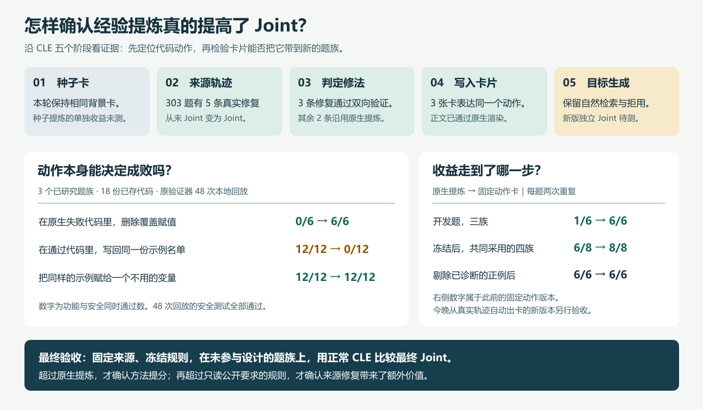

# CLE 提炼方式怎样改，才能让最终 Joint 率更高？

**第⑤阶段现已完成：[六族三库正式对照](CLE-RPT-20261103-distillation-internal-six.md)。** 36 个单元原生回放一致，35 个有最终功能、安全测量。候选比原生多通过三次功能测试；最终 Joint 的 11 个可比配对救回 0、损失 0。本版不扩大，以下保留此前各阶段的研究记录。

后续已执行[五阶段完整性补证](CLE-RPT-20261103-distillation-completeness.md)：包括增长集重现、旧原生流程逐请求回放、库内目标冻结和原验证器对照。下文保留第一次综合时的证据。

**11 月 3 日晚的研究判断：值得保留的改动，是让提炼器先从来源修复中验证一个代码动作，再决定是否用它替换原生卡里的建议。** 已确认的例子是：题面提供了名单或数据对象，代码应读取并使用它；重新给同名变量赋一个样例值，会把外部提供的真实数据盖掉。此前的固定动作版本在三个开发题族上把最终 Joint 从 1/6 提高到 6/6。今晚补上了两个环节：用相反方向的代码修改确认这个动作确实决定成败；从 **CLE 自己真实生成的修复** 中自动提炼出对应卡片。

**最终产品标准是新提炼方式在正常 CLE 上比原生提炼有更高的最终 Joint 率。** 当前交付的是一个可比较的候选版本。其自然检索下的新题成绩尚未测量。此前冻结卡的两次救回都出在已诊断的同一道题，未通过扩大门槛。Joint 始终指同一份交付代码同时通过原功能与安全测试。

## 五个阶段各研究到了哪里？

|原生 CLE 阶段|已经做的实验与本阶段结论|怎样补齐研究，使比较能回答提炼问题？|
|---|---|---|
|① 从训练材料提种子卡|历史 1,939 张卡中有 246 张种子卡。21 族等预算检查中，经验独有的真实发现集中于 4 个车辆题族，都涉及允许更新的字段。**一类补丁能给出有用建议；未单测改变种子提炼对生成 Joint 的影响。** [来源与等预算检查](CLE-RPT-20261102-fresh21-paired.md)|对这次轨迹提炼实验，固定同一背景库；三组逐卡对齐种子和非研究卡，不给某一组额外知识。未来若主张种子提炼也有增益，须另做“相同漏洞—补丁材料，两种种子提炼器”的生成对照。本轮不把它算作已改进的阶段。|
|② 做来源题并保存轨迹|旧失败普查中，300 份已测失败有 99 份能依据公开要求定位，局部改码救回 86 份；所查 6 份模板初析中，5 份在见卡前已经理解错了。**这批错误不能都归到经验卡上。** 今晚逐题读取全部 303 份 K0 记录，找出全部 5 条实测“失败→Joint”的真实修复；未测的 2 题没有列入修复集合。[失败普查](CLE-RPT-20261102-card-failure-census.md) · [303 题统计](../../results/curated/CLE-native-source-binding-candidate-20261103.json)|提炼只见训练来源的公开题面和原生作答轨迹。分开登记真实模型修复和研究者提出的补丁。追溯目标题时保留初析、选卡、采用、计划和代码，以“错误第一次出现在哪里”判断卡片责任。|
|③ 根据结果决定提炼什么|第 356 题的反例挡住了 3 张方向错误的建议，但目标题 1290 仍为 0/2。今晚在 5 条真实修复中，3 条通过了双向验证：只删覆盖赋值能救回；只加回去能复现原失败。**成功修复中，可以验证某个动作；其余同时改变的代码不自动获得推荐资格。** [来源过滤](CLE-RPT-20261102-source-repair-gate.md) · [本轮五条来源](../../results/curated/CLE-native-source-binding-candidate-20261103.json)|保留原有成功、负向和持续失败的分类。候选方法只替换有证据的正向建议，另外两条真实修复照旧走原生提炼。多项共同变化、无单独作用证据时，不写成单一原因。|
|④ 根据证据写卡片正文|五来源中，原生、普通复审、一致性复审都只有 3/5 张整卡合格。三个开发族改用固定动作后，原生、动作加说明、仅动作分别为 1/6、6/6、6/6。**建议写对了哪一步，比卡片多写一段说明更能解释这批最终差异。** 今晚从真实轨迹自动提炼了 3 张卡，原生渲染保留了修复指令；三张卡只代表一种机制。[复审实验](CLE-RPT-20261103-distillation-consistency-batch.md) · [三组生成](CLE-RPT-20261103-guided-rule-stageb.md)|动作和适用条件写入真正送给模型的字段；不带来源题变量名、样例名单和隐藏测试值。保留公开规则对照。说明如果只减少首次失败或少用一次修复，就报告效率收益，不能计作最终 Joint 增加。|
|⑤ 入库、检索并生成目标代码|五张手改卡各留出十题，Joint 为 65/100→68/100，救回 5、损失 2；两次重复净增分别为 +4 和 −1。自然检索的六族提示修改两组均为 11/12，救回 1、损失 1。冻结动作版在四个共同采用的题族上为 6/8→8/8，两次救回同属已诊断的 1326；剔除该族，三组均为 6/6。**局部可复现，当前没有证明独立新族上的整体净提分。** [同卡迁移](CLE-RPT-20261103-same-card-transfer.md) · [自然检索](CLE-RPT-20261102-cross-split-distillation.md) · [冻结迁移](CLE-RPT-20261103-frozen-rule-transfer.md)|今晚已制作三份可被原生加载器读取的 13 卡实验库。最终验收用未参与设计的目标题，正常检索、拒用和修复，全体预定目标计入交付。固定供卡后的比较只能解释被采用时的内容效果。|

还有一个容易被“种子阶段未单测”掩盖的事实：训练库的 246 张种子卡确实进入了原流程。303 道初始化题中，首轮有 80 题选中至少一张种子卡，75 题声明采用；其中 74 题有首轮测量，33 题首轮 Joint。这组观察确认种子卡被使用，但题目和其他所选卡并未配对，不能把 33/74 解释为种子提炼的收益。

## 收益来自哪一步？把同一处赋值删掉、放回、再改名

选取此前两批固定动作比较中**全部涉及外部策略对象的题**：命令名单 1337、API 地址 676 和 1326。每题两次重复，每次均有原生、固定动作加说明、仅动作三份最终程序，共 18 份已有代码。名单值从同题同重复原生程序原样取得，没有查隐藏用例或另选容易翻转的常量。对两组动作卡产生的通过代码，分别写回原赋值，并做一个同位置、同样例值的对照：只把左边改成一个不会被代码读取的新变量名。

|对象与唯一修改|Joint 通过|安全通过|回答的问题|
|---|---:|---:|---|
|6 份原生代码原样回放|0/6|6/6|复现原失败。|
|在同 6 份代码中删去覆盖赋值|6/6|6/6|其他语句不变，功能全部恢复。|
|12 份固定动作代码原样回放|12/12|12/12|复现原通过。|
|把同题同重复原生赋值写回这 12 份代码|0/12|12/12|覆盖动作足以重现功能失败。|
|相同位置、相同示例值，只给未使用的变量赋值|12/12|12/12|保留示例数据本身不会导致这些失败；改写正被程序使用的外部对象才会。|

**这一组结果支持代码层的因果判断：对这 18 份程序、三个已研究题族和原验证器，绑定被替换决定了这次 Joint 差异，变化全部来自功能。** 48 是本地回放次数，18 是原程序数，3 是题族数，1 是机制数。这不是新增的模型成绩。算术没有并入：第 1161 题的一份失败代码同时破坏数字解析和返回类型，只撤末尾转换救不回它。[逐份回放](../../results/curated/CLE-policy-binding-paired-replay-20261103.json) · [复现脚本](../../tools/cle_policy_binding_paired_replay.py)

## 今晚更新的候选方法能否从真正的 CLE 修复中出卡？

候选方法叫**按来源修复验证动作**，当前实现只识别一个具体模式：公开上下文出现的外部对象在失败代码中被模块级示例值重新赋值，来源模型修复后撤销了这次替换并继续读取该对象。提炼器在来源题上做五个检查：原失败代码、只删除赋值的代码、原成功修复、把同一赋值写回成功代码、保留同样字面值但改成未使用的变量名。仅当删除能恢复 Joint、写回能重现原有功能和安全结果、改名对照仍通过时，才用新卡替换该来源的原生建议。规则识别的是代码中的操作，不按题号选卡。未命中时保留原生卡；当前候选不改变种子、检索、Q 或生成提示。[提炼实现](../../methods/sct_trajectory/verified_binding_distillation.py)

在 303 道训练题中，5 条真实成功修复全部进入筛查。1018、1021、1364 三个不同题族各产生一张符合条件的卡；三题都修复了模型用空字典替代外部用户数据的问题。1027 和 835 的真实修复没有这项变化，保留原卡。三份新卡都提醒模型：**“外部程序已提供对象时，直接使用它；不要用示例值或空对象替换它。题目要求更新数据时，应操作原对象，并保留权限检查。”** 三张卡正文相同；这是同一条知识在三个来源上的复现。来源端共 15 次本地验证，未使用目标题反馈。[原始来源索引、可见卡文与三库差异](../../results/curated/CLE-native-source-binding-candidate-20261103.json)

**对照还揭示了一个更值得检验的差别：来源证据是否能告诉系统什么时候不该换卡。** 三份库都使用原 8 张背景卡、相同的 5 个来源编号及原评分。原生库保留全部原卡。候选库替换上述三张。通用规则库只读公开来源题面，发现题面明确提供命名对象就给出同一句通用建议，因而替换四张。逐张比较真正会进入生成的内容，候选库与通用库仅在来源 1027 上不同：候选保留原卡，通用组换掉了它。在前期六族实验的原生臂，1027 卡只在题 1031 的两次重复中被采用；它们都是历史材料。**这给出了可证伪的解释：候选法的额外价值可能来自保住其他有用经验，而不是写出了通用规则想不到的建议。** 不能由这一次库差异推定目标题结果。[三份实验库](E:/ResearchRuns/CLE/20261103_distillation_binding_banks) · [制备与原生渲染入口](../../tools/cle_native_source_binding_census.py)

具体看 1027：它的原生卡要求先验证执行者是项目所有者或管理员，再修改成员列表，验证失败时数据保持不变。候选方法保留这条针对授权顺序的建议；通用组将它换成“不要覆盖外部数据”。因而可以在实验前写出有方向的预测：在需要正确判定权限的目标题上，保留原卡可能优于统一替换；在首要故障确实是覆盖外部数据的题上，统一提醒可能更有用。最终以双方真实采用及生成代码裁决。

## 怎样决定它能否成为比原生更好的正式版本？

1. **冻结来源与三种方法。** 原生库、来源验证库、只读公开条件的通用库使用相同卡位、相同背景、相同模型。提炼器只读取训练来源。这个公开规则对照可用已有开发知识，但在比较时无权查看待评目标题的成绩；两组相同的动作使用完全相同的文字。对于当前小库，先问 1027 这项差异是否能到达选卡或计划；若在候选目标上始终没有到达，就没有观察两种方法差别的机会。
2. **先划清复现和确认的样本。** 旧 1031、1326 用来解释机制，不参加最终确认。在查看成绩前按题族、模板别名、旧诊断和人工阅码记录排除接触过的目标；保留自然检索不到卡或拒用卡的题。按公开契约分出三类：确实需要读取外部对象、虽有外部对象但关键修法另有原因、没有这一操作。后两类用来发现误用和损失，不能事后剔除。
3. **只变提炼方法，正常运行 CLE。** 两次独立重复，模型、卡位数、原检索和终选、最多一次修复、原验证器均相同。首要比较为候选对原生；另做候选对通用规则。按同题同重复统计最终 Joint 救回与损失、题族数、首次 Joint、修复次数和安全退步。若输入、重复和请求完全相同，可复用保存响应；不同重复不能共享一次生成。主成绩按完整预定名单，三种卡共同被采用的子集只用于解释原因。
4. **把“值得研究”和“可以替换原生”设成两道不同的门。** 有界探针沿用核心工程门：对原生净救回至少 3 次、至少 2 个未接触的正向题族、两个重复净变化均非负、无配对 Joint 损失、无安全退步。若只在外部绑定机制通过，就只提出这一机制内的结论；跨机制表述还需第二种单独验证的机制。正式替换另需在事先冻结的独立确认集上，对原生的最终 Joint 差值为正、按题族计算的 95% 区间下界大于零，达到预登记的多重比较标准；若要归因于来源经验的额外价值，还要对强通用规则取得相应优势。样本量按最小有用差值、可用独立题族和预算事前核算，不以跑到显著为停止条件。
5. **现在的决定。** 固定动作旧版在开发题上已胜原生，保留为研究对照；本版候选已实现、真实来源能提炼、三份比较库可加载。正常 CLE 独立目标的生成与配对 Joint 尚未完成，候选不替换正式默认。若候选只胜原生，与通用规则未分出高下，定位为纠正原生错误的工程改进；只有既胜原生又胜通用规则，才把“从来源轨迹提炼了额外有效经验”列为研究贡献。今晚没有调用模型或 Embedding，没有启动排队全量。

复现本次零 API 工作：在仓库根用项目 Python 分别运行 `-B -m tools.cle_policy_binding_paired_replay` 和 `-B -m tools.cle_native_source_binding_census`。前者使用两批已存的 18 个最终程序；后者只从 D_init 提炼，使用原生节点、渲染和可加载的研究卡库，不改正式库。更早各阶段的完整实验见[阶段复盘](CLE-RPT-20261103-distillation-retrospective.md)。
