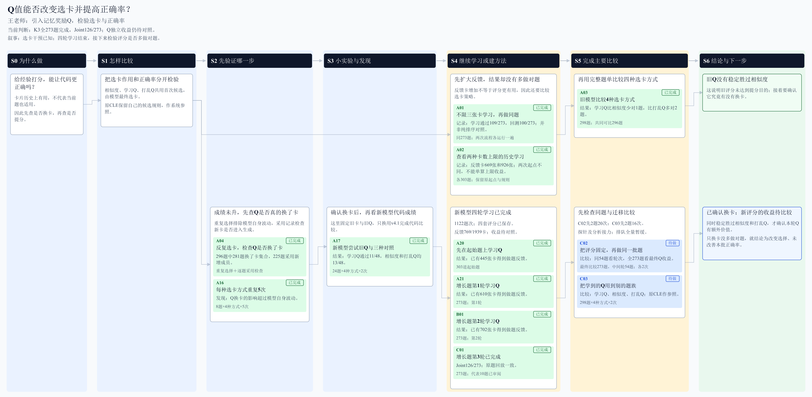
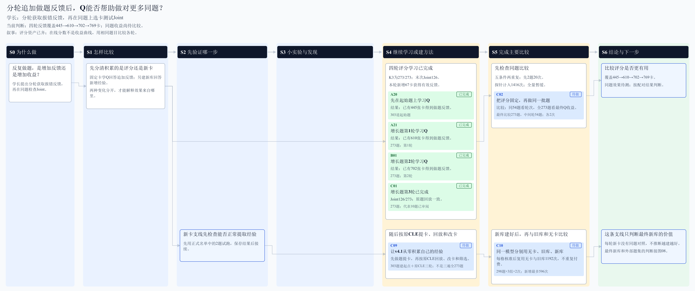
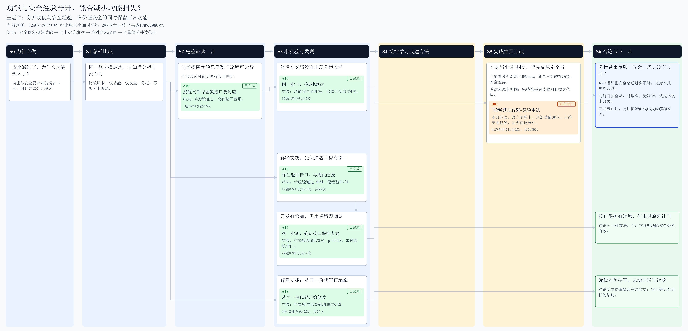
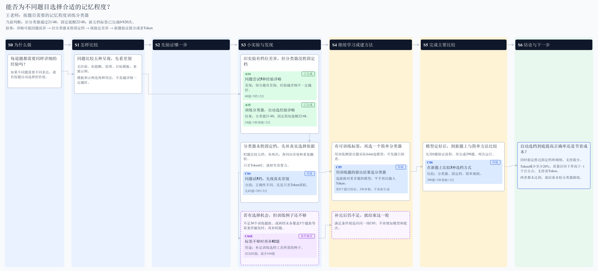
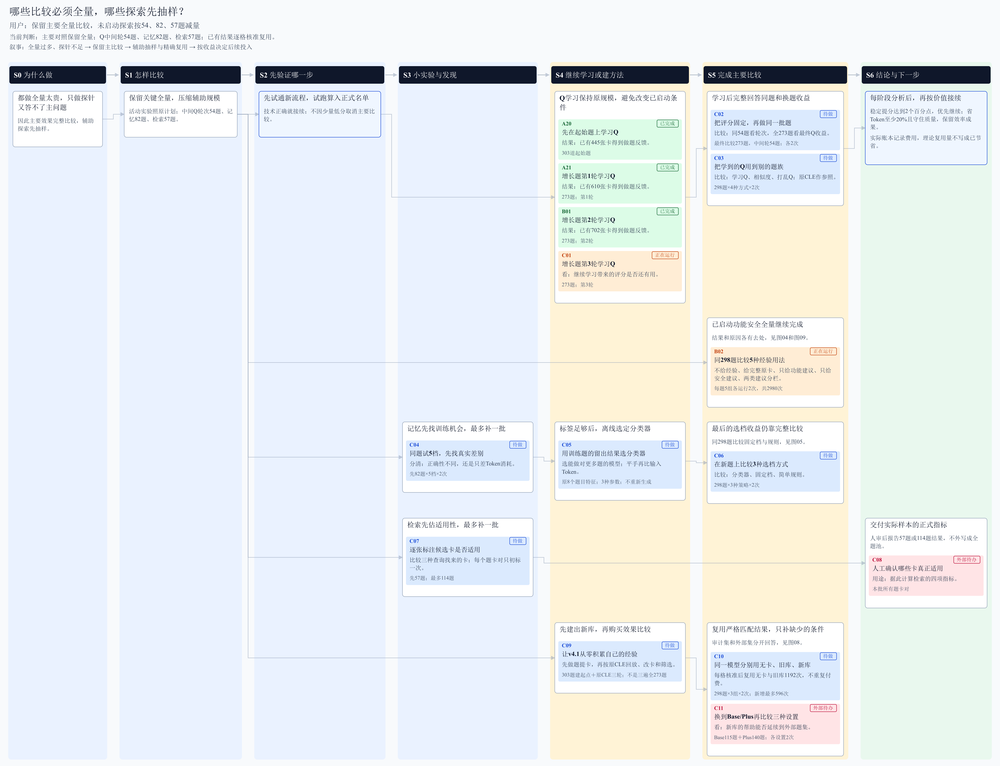
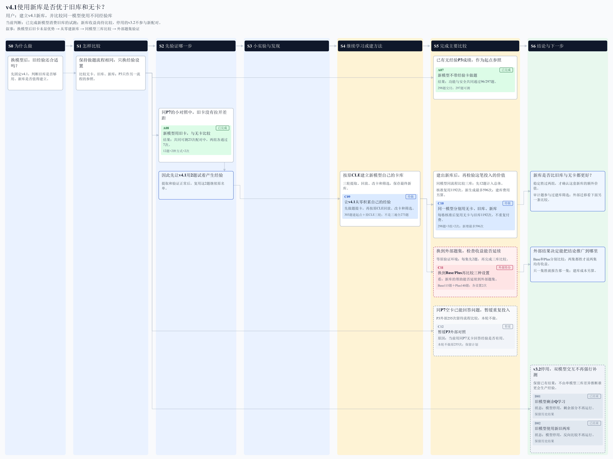

# CLE各条研究思路图汇总

汇总已有九张完整阶段思路图；Word每张独立一页，目录可跳转。原图中的节点、阶段、状态、结果和连线原样保留。

[下载Word图册](CLE各条研究思路图汇总.docx)

## I01 Q值能否改变选卡并提高正确率？

[打开可点击原图](../../diagrams/ideas_horizontal/01_Q值选卡.svg)

## I02 分轮积累后，同题表现是否改善？

[打开可点击原图](../../diagrams/ideas_horizontal/02_分轮积累.svg)

## I03 同种CWE、不同题族上还能获益吗？

[打开可点击原图](../../diagrams/ideas_horizontal/03_跨题族迁移.svg)

## I04 功能与安全经验分开，能否减少功能损失？

[打开可点击原图](../../diagrams/ideas_horizontal/04_功能安全分开.svg)

## I05 能否为不同题目选择合适的记忆程度？

[打开可点击原图](../../diagrams/ideas_horizontal/05_记忆程度分类.svg)

## I06 检索找到了多少真正适用的经验？

[打开可点击原图](../../diagrams/ideas_horizontal/06_检索质量.svg)

## I07 哪些比较必须全量，哪些探索先抽样？

[打开可点击原图](../../diagrams/ideas_horizontal/07_全量与抽样安排.svg)

## I08 v4.1使用新库是否优于旧库和无卡？

[打开可点击原图](../../diagrams/ideas_horizontal/08_模型与卡库交叉.svg)

## I09 经验改了哪些代码，为什么会损害功能？

[打开可点击原图](../../diagrams/ideas_horizontal/09_经验代码改动.svg)
