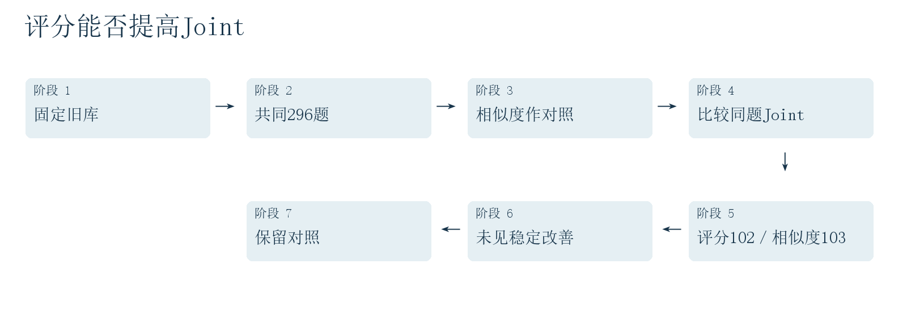
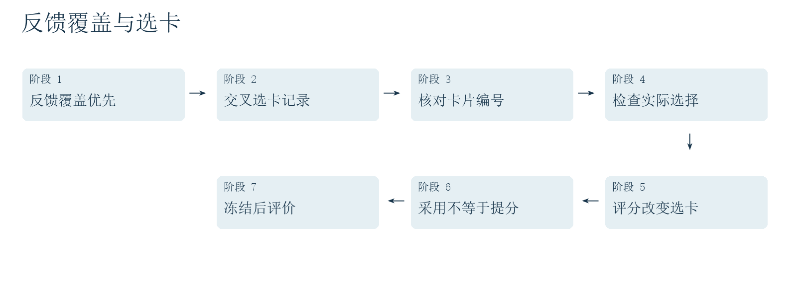
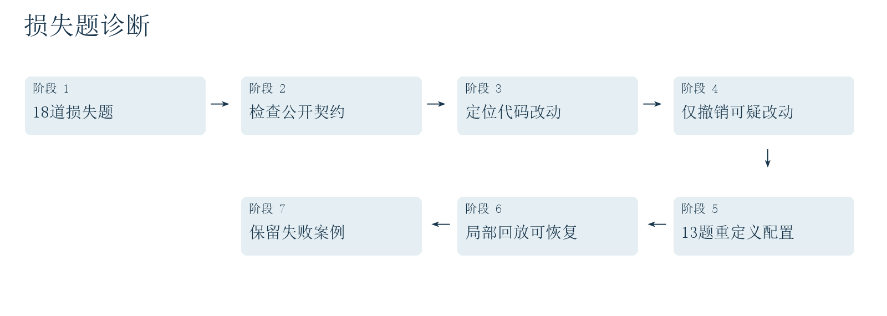
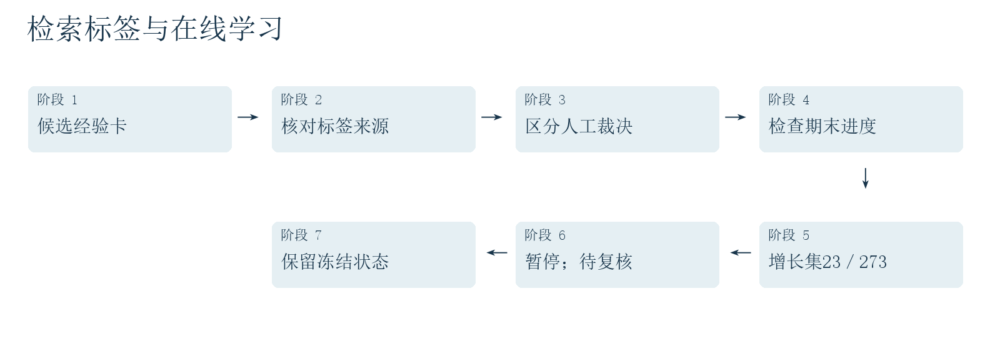

# 10月14日-10月21日研究思路图汇总

## 目录

10月21日22:26的历史快照，11月2日核对起始周。

[1　评分能否提高Joint](#line1)

[2　反馈覆盖与选卡](#line2)

[3　损失题诊断](#line3)

[4　检索标签与在线学习](#line4)

<!-- pagebreak -->

## 评分能否提高Joint

[SVG原图](figures/line1.svg) · [实验数据](10月14日-10月21日实验探索报告.md#a2) · [返回目录](#index)

<!-- pagebreak -->

## 反馈覆盖与选卡

[SVG原图](figures/line2.svg) · [实验数据](10月14日-10月21日实验探索报告.md#a3) · [返回目录](#index)

<!-- pagebreak -->

## 损失题诊断

[SVG原图](figures/line3.svg) · [实验数据](10月14日-10月21日实验探索报告.md#a4) · [返回目录](#index)

<!-- pagebreak -->

## 检索标签与在线学习

[SVG原图](figures/line4.svg) · [实验数据](10月14日-10月21日实验探索报告.md#a6) · [返回目录](#index)
