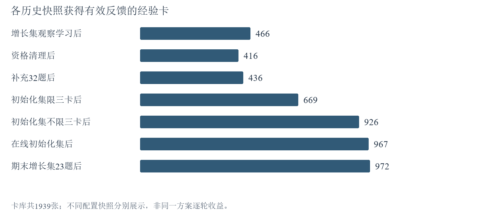
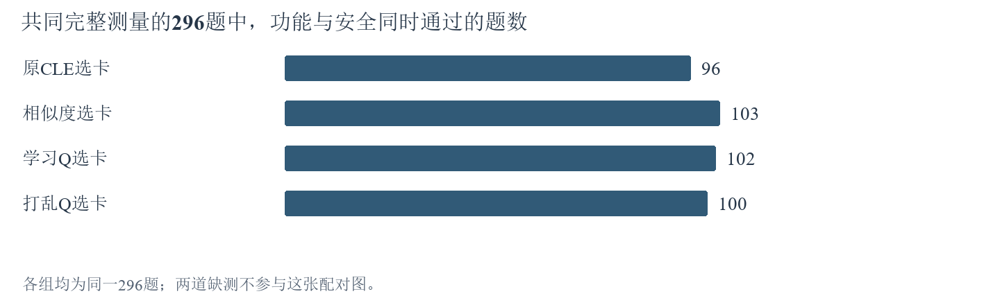
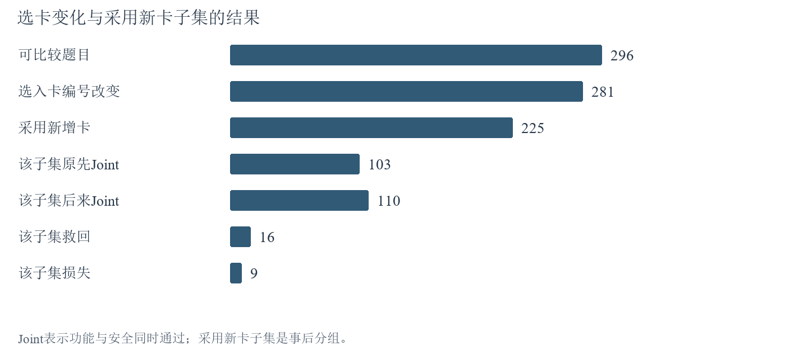
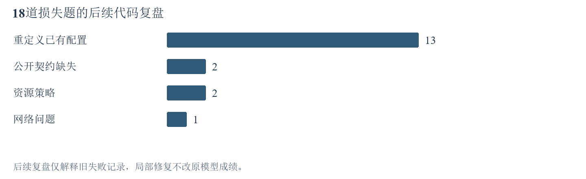
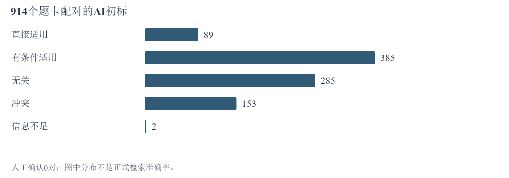

# 10月14日-10月21日实验探索报告

[先看一页结论](10月14日-10月21日本周结论与下一步.md)　[查看横版思路图](10月14日-10月21日思路脉络图.md)

## 一、本周实验主线

本周围绕一个问题展开：模型写代码时，如果参考以前做题积累的经验，能否同时满足功能要求和安全要求？为此，实验给经验卡加入Q值——一种根据历史做题反馈得到的分数——观察它会不会改变选卡、能不能提高代码通过率。还需要弄清覆盖不足、卡片不适用和代码实现错误分别发生在哪里，并为检索效果准备可核对的标签。

本周最明确的发现是：**Q已经改变了模型实际选中的卡，但旧Q在评价题对照中没有表现出稳定优势。** 此外，增加能获得反馈的卡并没有自然带来更好的同题成绩。具体数据和原因分别见下方要求及实验链接。F表示通过功能测试，S表示通过安全测试，Joint表示同一份最终代码同时通过两类测试。

本课题使用PLT代码生成数据集：D_init是303道初始化题，D_grow是273道经验增长题，D_gate是298道评价题。P7是CLE分析题目、检索并选择经验、规划代码、生成代码并在需要时最多修复一次的流程。三类题目的用途不同，学习阶段的成绩不能直接当作评价阶段成绩。

### （一）Q会改变选卡，也能提高正确率吗？

**回答：** 在可比较的题目中，Q改变了实际选入的卡片；但旧冻结Q的全298题对照中，学习Q没有稳定超过相似度和打乱Q。[【A3】选卡变化](#a3)　[【A2】代码成绩](#a2)

### （二）让更多卡获得反馈后，做题是否改善？

**回答：** 历史学习后，有反馈的卡从466/1939张增加到972/1939张，覆盖率从24.03%增加到50.13%；但一次273题同题回测从109题通过降到100题。这些运行的选择方式并不完全相同，因此不能把变化全部归因于Q。[【A1】覆盖与同题回测](#a1)

截至10月21日22:26，本周最后一条在线强化链已完成D_init全303题，并完成D_grow的23/273题，强化后的D_gate评价尚未开始。[【A6】当时进度](#a6)

### （三）代码为什么会从通过变成失败？

**回答（后续复盘）：** 对18道损失题的代码复盘发现，13题重定义已有配置，另有题目涉及公开要求、资源策略或网络问题。这些原因不能直接等同于Q分数有误。[【A4】损失题复盘](#a4)

### （四）检索到的经验是否适用？

**回答：** 已有914个题目与卡片配对的AI初标，但尚未人工确认，因此正式准确率、精确率、召回率和F1尚不能给出。[【A5】检索标签](#a5)

<!-- pagebreak -->
## 二、截至本周期末的待做实验

以下保留10月21日22:26暂停时的任务状态。它们是当周已提出的未完成项，不采用10月26日之后新增的v4.1建库、功能安全拆分和分类器全量计划。历史“待做”不表示现在自动恢复运行。

### 【T1】完成在线强化学习的D_grow剩余任务

当周状态：10月20日至21日安排的在线强化链；D_init已完成303题，D_grow完成23/273题，余250题。10月21日22:26按当时的实验安排暂停，未决请求与旧记录保留。

实验原因：回应[要求二](#r2)。只有完成预定D_grow学习，才能评价这次“先D_init、再D_grow”的强化后状态；当前23题前缀不能代替全273题结果。

实验步骤：

1. 在后续明确恢复时，核对已完成前缀、保存Q状态和未决请求，避免重复执行已完成付费题。
2. 按当时固定顺序继续剩余D_grow题，保持原模型、最多三卡、Q参与排序及实际采用卡更新规则。
3. 完成后保存最终冻结Q，汇总273题Joint、完整测量、反馈覆盖及成本，并在实际完成所属的后续周登记新增部分。

[返回要求二](#r2)　[返回待做实验](#todo)

### 【T2】用强化后的冻结Q完成全D_gate对照

当周状态：已安排在[【T1】](#t1)之后，期末新Q2与新Q3均未执行；已有旧冻结Q四组结果保留为[【A2】](#a2)，不是强化后结果。

实验原因：回应[要求一](#r1)和[要求二](#r2)。学习过程中的表现不能替代冻结后迁移表现，必须检验相同CWE下不同题族是否真正受益。

实验步骤：

1. 固定[【T1】](#t1)完成后的经验正文和Q快照，评价期间不更新经验或Q。
2. 按原计划对全298题比较Q0原CLE、Q1纯相似度、Q2学习Q、Q3同CWE打乱Q；Q0／Q1仅在输入和协议一致时复用。
3. 比较同题Joint救回与损失，核对新卡编号、实际采用和代码落实；报告完整测量、费用及未知用量，区分旧Q成绩与新Q成绩。

[返回要求一](#r1)　[返回要求二](#r2)　[返回待做实验](#todo)

### 【T3】人工复核检索标签并形成正式四指标

当周状态：由10月17日前后检索测量计划形成；AI初标已保存，人工确认未完成。

实验原因：回应[要求四](#r4)。只有明确哪些卡直接适用于哪道题，才能计算选卡是否准确以及遗漏了多少适用卡。

实验步骤：

1. 对照公开题面、上下文和经验正文，复核已有题卡对，隐藏方法名、排名和Q，避免按成绩反推标签。
2. 逐对确认五类标签并裁决信息不足项，保留AI标签与人工标签两份记录。
3. 计算共同候选池内准确率、精确率、召回率和F1，分开报告候选召回与最终选入；全库召回率仍标为未测量。

[返回要求四](#r4)　[返回待做实验](#todo)　[前往详细实验](#experiments)

## 三、实验内容与结果分析

本期以DeepSeek v3.2和既有1939卡库为主体。D_init是冷启动题池303题，D_grow是经验增长题池273题，D_gate是审计题池298题。CWE表示漏洞类别；family表示共享来源或任务结构的题族，同CWE不保证同题型。以下跨配置对比均保留各自规则，不拼接为一条纯Q因果曲线。

实验导航：[【A1】覆盖与学习](#a1)　[【A2】全量迁移](#a2)　[【A3】选卡作用](#a3)　[【A4】失败原因](#a4)　[【A5】检索标签](#a5)　[【A6】期末状态](#a6)。

### 【A1】反馈覆盖扩大后，同题成绩是否提高？

**先看结论：** 反馈覆盖从24.03%扩大到50.13%，同题回测却从109题通过降到100题。扩大覆盖已经实现，提分没有随之实现。

#### 为什么做这项实验

先让模型实际做题并使用经验，再用合格反馈更新采用卡的Q分数；卡片正文保持不变。visits是卡片获得合格反馈的次数，没有反馈不等于卡片质量差。实验还通过解除三卡上限和补充D_init来源题，检查哪些环节限制了反馈覆盖。[返回要求二](#r2)

#### 怎样做

1. 以1939张固定卡作为分母，读取各学习链的初始Q、采用记录和有效奖励资格；原结果保留。
2. 对D_grow全273题进行不限三卡观察学习，Q随合格反馈更新；冻结后再做同题回测，使用学得Q参与选择。
3. 结合32道修复后D_grow题、D_init限三卡及不限三卡学习，登记每次结束时获得反馈的卡数；不同链的清理与继承关系分别保存。
4. 对比Joint、卡片覆盖与实际更新数，不把“检索过”“选中过”直接当作“获得Q反馈”。

#### 看到了什么

| D_grow条件 | 执行／计划 | Joint | 结果含义 |
| --- | --- | --- | --- |
| 不限三卡观察学习 | 273／273 | 109／273 | 做题并积累采用卡反馈 |
| 冻结Q同题回测 | 273／273 | 100／273 | 学得Q参与选择，停止更新 |

主要覆盖快照为466/1939、清理后416/1939、补32题后436/1939、D_init限三卡后669/1939、不限三卡后926/1939、在线D_init后967/1939，期末D_grow 23题后972/1939。

#### 这些结果说明什么

图1说明增加学习范围与允许更多卡进入解题过程能够扩大反馈覆盖，但不会让所有卡都得到反馈。资格过滤、候选召回、相似度门槛、模型选卡和实际采用共同收窄了更新对象；同类卡竞争也会使反馈集中到少数卡。解除三卡上限只改变其中一环，因此覆盖未达到100%符合这条更新路径。

同题回测由109下降到100，说明覆盖率提高不等于评分更能指导解题。观察阶段和参与阶段的选择策略不同，模型输出也会波动，不能把9题净损失全部归为Q本身。对主线能够确认的是“反馈扩大了”，尚不能确认“扩大反馈已带来收益”。图中的清理后下降属于资格整理，也不是模型能力退化。

原始证据：[10月22日定稿重组版的学习记录](../CLE-RPT-20261022-Q-week-v02/CLE-RPT-20261022-Q-week-v02.md)。本节为历史结果整理，没有重新学习。

[返回要求二](#r2)　[返回实验导航](#experiments)

### 【A2】旧冻结Q能否提高全评价集的通过率？

**先看结论：** 在共同完整测量的296题上，学习Q比相似度少通过1题，比原CLE多6题，比打乱Q多2题。配对差区间均跨过0，本次对照未建立稳定提分。

#### 为什么做这项实验

本实验用同一批任务比较四种选卡方式：原CLE、相似度、学习Q和打乱Q。打乱Q保留同一CWE内的分数分布，但改变分数与具体卡片的对应关系，用于判断历史评分是否比任意换序更有用。最终仍由模型选卡。[返回要求一](#r1)

| 选卡方式 | 给模型的提示顺序是什么 |
| --- | --- |
| Q0 原CLE | 按原有候选方式呈现，再由模型选择经验 |
| Q1 相似度 | 优先呈现与当前题目语义相近的卡，再由模型选择 |
| Q2 学习Q | 排序时加入经验卡的历史反馈分数，再由模型选择 |
| Q3 打乱Q | 在同类漏洞中打乱卡与分数的对应关系，再由模型选择 |

Q0保留原候选路径；对Q排序的解释主要依靠与相似度及打乱Q的比较，Q0作为原流程参照。

#### 怎样做

1. 固定当次旧经验与Q快照，使用同298道D_gate题和原P7最多三卡、最多一次修复及原验证器。
2. 比较Q0原CLE、Q1纯相似度、Q2学习Q、Q3同CWE内打乱Q，评价期间冻结Q。
3. 按计划分母统计F、S、Joint，同时单列缺测；再在共同完整的296题上比较救回与损失。

#### 看到了什么

| 条件 | 完整测量／298 | F通过 | S通过 | Joint通过 |
| --- | --- | --- | --- | --- |
| Q0 原CLE | 298 | 120 | 227 | 97（32.55%） |
| Q1 纯相似度 | 298 | 123 | 230 | 104（34.90%） |
| Q2 学习Q | 296 | 118 | 228 | 102（已测34.46%） |
| Q3 打乱Q | 298 | 119 | 230 | 100（33.56%） |

表中Q0、Q1、Q3通过率的分母为298；Q2已测通过率为102/296。原记录的102/298＝34.23%是已确认通过数占计划量，另2题为缺测，不计作已测失败。图2统一采用共同296题：Q0为96题，Q1为103题，Q2为102题，Q3为100题。

共同296题上，Q2相对Q0救回16题、损失10题；相对Q1救回13题、损失14题；相对Q3救回14题、损失12题。对应配对差区间均跨过0。

#### 这些结果说明什么

图2显示，在同一批可比较题上，学习Q的收益与损失大幅抵消，未形成稳定优势。因此，本次结果支持Q能够改变选择，但不支持采用这份旧冻结Q来稳定提分。本次使用的是较早冻结状态，不是期末972张卡有反馈的强化后状态，后者还需要[【T1】](#t1)和[【T2】](#t2)才形成完整比较。

原始证据：[全D_gate汇总](../../../../results/curated/cle_memory_q_full_gate_cap3_20261019/summary.json)。

[返回要求一](#r1)　[返回要求二](#r2)　[返回实验导航](#experiments)

### 【A3】Q是否改变实际卡片编号并进入生成过程？

**先看结论：** 296道可比较题中，281题改变了选入卡编号，225题采用了新增卡。Q的影响到达了实际选卡与生成过程。

#### 为什么做这项实验

先固定候选并反复选卡，测量模型自身会出现多大波动；再检查D_init做题时选入卡片的编号、声明采用和最终Joint，判断影响是否沿“换卡—采用—结果”传递。[返回要求一](#r1)

#### 怎样做

1. 固定8题及候选，对四组各重复选卡5次，共160次，不更新Q、不生成代码。
2. 分别计算同组重复差异与Q条件间差异，避免仅看到一次选择不同就归因于Q。
3. 对齐D_init 303题中可比较的296题，按选入成员是否变化、是否采用新增成员及Joint救回／损失分组。

#### 看到了什么

在160次选择实验的既定样本上，Q差异超过模型内部波动，Holm校正后p约0.0006。D_init的296道可比较题中，281题选入卡集合改变，占94.93%；这281题中225题声明采用新增卡，占80.07%。225题子集Joint从103变为110，包含16题救回和9题损失。

#### 这些结果说明什么

图3区分了“排序变了”和“实际选入的编号变了”：大多数可比较题发生了成员变化，并有新增卡被采用。采用新卡子集中有局部净收益，但这是运行后的分组描述，模型是否采用卡并非随机分配；各次运行的起始Q与策略也不同，不能把7题净增直接称为Q的独立因果收益。对主线而言，干预已触达生成过程，后续关注点应转向经验是否适用、是否保持接口，以及模型能否正确落实建议。

原始证据：[重复选卡汇总](../../../../results/curated/cle_selector_repeat_20261019/summary.json)、[D_init交叉分析](../../../../results/curated/cle_q_dinit_selection_joint_20261021/summary.json)。

[返回要求一](#r1)　[返回要求三](#r3)　[返回实验导航](#experiments)

### 【A4】18道损失题为什么失败？（后续复盘）

**先看结论：** 后续复盘发现，18道损失题中13题重定义已有配置，另5题分属契约、资源和网络问题。本节解释历史失败，不改写首周正式成绩。

#### 为什么做这项实验

这里的“损失题”指旧参照通过、后来一次运行失败的题。通过比较保存的题面、卡片、前后代码与验证结果，定位失败原因；解释来自后续复盘，局部诊断不替代原模型成绩。[返回要求三](#r3)

#### 怎样做

1. 从在线D_init与指定旧参照的配对结果提取原通过、后失败的18题，保留前后代码、卡片和验证日志。
2. 检查是否重定义题目已有配置、替换传入对象、缺少公开要求，或遇到资源与网络问题。
3. 对可定位的问题做零API最小代码或契约诊断，单独保存复验结果；不把人工修复后的代码计作模型正式通过。

#### 看到了什么

13题重定义已有配置，包括1003、1223、1241、1299、1363、1364、150、352、487、488、642、664和670；2题1037、989涉及公开契约缺失；2题874、907涉及资源策略；1题885涉及网络。移除错误重定义后13题在局部诊断中恢复，2道契约题补齐后也在对应诊断中恢复。

#### 这些结果说明什么

图4表明，最大的可定位问题是模型把现有配置覆盖成自己写的示例值，破坏了题目正常功能。卡片可能建议安全检查，却也可能携带来源题假设；模型若把两者一并搬入代码，安全建议便未必改善Joint。契约缺失则意味着模型没有获得验收所依赖的完整公开条件，两类问题不能混为一谈。这里能确认具体代码为何失败，不能从失败类别反推所有卡片评分是否正确。Q作用需要在公开契约与实现边界一致的对照中判断。

原始证据：[已定稿复盘中的损失题及局部诊断](../CLE-RPT-20261022-Q-week-v02/CLE-RPT-20261022-Q-week-v02.md)。本节不改变10月21日原始结果。

[返回要求三](#r3)　[返回实验导航](#experiments)

### 【A5】已有标签能否给出正式检索质量？

**先看结论：** 914个题卡配对已有AI初标，人工确认仍为0；完成标签裁决是形成正式检索四指标的下一步。

#### 为什么做这项实验

以“题目—经验卡”配对为单位，先判断卡能否直接适用于题目，才能识别正确选入、错误选入和漏选。原题找回自己的来源卡，并不能证明它能为新题找到合适经验。当前标签由AI初标，尚未人工确认。[返回要求四](#r4)

#### 怎样做

1. 用原题、初析和组合查询形成共同候选池，保留合法卡过滤并纳入固定抽取的未召回卡。
2. 保存AI五类初标：直接适用、有条件适用、无关、冲突和信息不足，同时保留判断依据。
3. 导出人工复核材料，正式四指标只使用完成裁决的标签；分母为零时写未定义及原因。

#### 看到了什么

直接适用89对，有条件适用385对，无关285对，冲突153对，信息不足2对，合计914对。上述数量是模型辅助标签分布，不能据此直接宣称检索准确率为89/914。

#### 这些结果说明什么

图5反映的是AI初标的分布：模型认为不少卡需要附加前提，也标出了一些可能冲突的候选。这些判断尚未经过人工确认，不能直接当成卡片真实质量。模型选卡和Q排序发生在候选形成之后，因此如果适用卡没有进入候选，后续选卡也无法使用它。即使候选池标注完成，也只能计算候选池内召回率；整个1939卡库未完整标注，全库召回率仍未测量。主线在这一环缺的是有效分母，而不是再增加一个成绩百分比。

原始证据：[检索标签与指标口径](../CLE-RPT-20261022-Q-week-v02/CLE-RPT-20261022-Q-week-v02.md)。

[返回要求四](#r4)　[返回实验导航](#experiments)

### 【A6】期末在线学习实际完成到了哪里？

**先看结论：** 期末在线链完成初始化集303题及增长集23题；增长集余250题，强化后的评价尚未执行。

#### 为什么做这项实验

本节核对10月21日22:26暂停时的实际进度，将完成的题、待做题、未决请求和费用分开。它是资料核对，不是新增代码生成实验。[返回要求二](#r2)

#### 怎样做

1. 读取暂停快照及各阶段保存的summary，核对执行数、完整测量和Q覆盖。
2. 将D_init完成、D_grow部分完成、强化后D_gate未开始分别登记；早期D_gate结果仍归[【A2】](#a2)。
3. 按快照记录已知Token与未决请求，不从未知请求估计实际扣费，不再次发送请求。

#### 看到了什么

| 阶段 | 已执行／计划 | 完整测量 | Joint | 期末有反馈卡 |
| --- | --- | --- | --- | --- |
| 在线D_init | 303／303 | 299 | 140／303 | 967／1939 |
| 在线D_grow | 23／273 | 23 | 11／23 | 972／1939 |
| 强化后D_gate | 0／298 | 未执行 | 未测量 | 尚未使用最终冻结状态 |

D_init有836次有效Q更新，其中正反馈297次、负反馈539次；D_grow前23题有66次有效更新，其中正反馈21次、负反馈45次。暂停快照的阶段summary记载已知Token分别为19,129,914和1,429,867；另列3条未决请求，未知用量不写成0。这是该在线链的阶段汇总口径，不是本期全部实验总费用。

#### 这些结果说明什么

期末能够确认在线D_init全题执行以及D_grow前23题的结果。Q覆盖超过一半，但D_grow仍缺250题，强化后迁移对照缺少新Q2与新Q3，所以没有证据完成判断“这次强化是否有效”。本周期末的实际决定是按当时的实验安排暂停，而不是低分自动终止。10月26日提出的全量验证优先规则属于后一周，不能倒写为本周已经按该新规则完成。

原始证据：[10月21日22:26暂停快照](../../../../translation_work/diagnostics/20261020/cle_q_online_v1/pause_by_user_20261021.json)。

[返回要求二](#r2)　[返回本周实验主线](#main)
