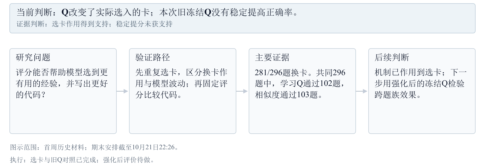
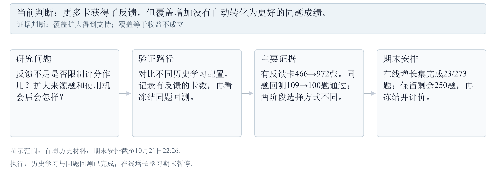
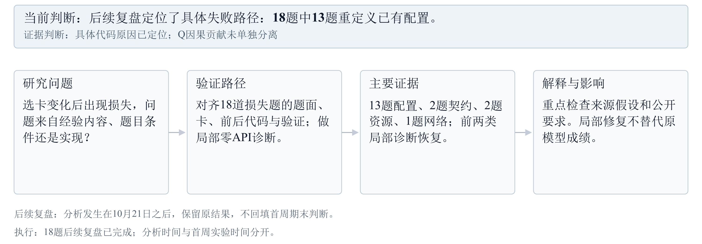
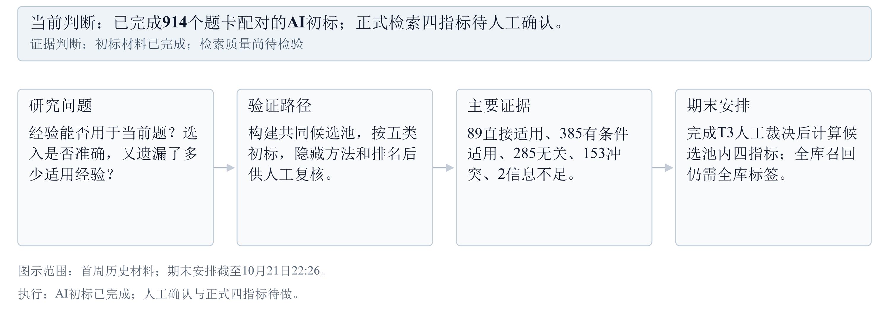

# 10月14日-10月21日思路脉络图

[一页结论](10月14日-10月21日本周结论与下一步.md)　[完整周报](10月14日-10月21日实验探索报告.md)

四张横版图各对应一条问题。点击下方编号可直接进入实验；SVG保留图内链接。图中箭头表示论证路径，执行顺序以当周实验安排为准。

## Q会改变选卡，也能提高正确率吗？

[【A3 选卡变化】](10月14日-10月21日实验探索报告.md#a3)　[【A2 冻结对照】](10月14日-10月21日实验探索报告.md#a2)　[【T2 强化后评价】](10月14日-10月21日实验探索报告.md#t2)　[打开可点击横版图](diagrams/思路1.svg)

[返回一页结论](10月14日-10月21日本周结论与下一步.md)

<!-- pagebreak -->

## 让更多卡获得反馈，做题是否改善？

[【A1 覆盖与回测】](10月14日-10月21日实验探索报告.md#a1)　[【A6 期末状态】](10月14日-10月21日实验探索报告.md#a6)　[【T1 剩余学习】](10月14日-10月21日实验探索报告.md#t1)　[打开可点击横版图](diagrams/思路2.svg)

[返回一页结论](10月14日-10月21日本周结论与下一步.md)

<!-- pagebreak -->

## 代码为什么从通过变成失败？

[【A4 代码与契约复盘】](10月14日-10月21日实验探索报告.md#a4)　[【A2 原始代码成绩】](10月14日-10月21日实验探索报告.md#a2)　[打开可点击横版图](diagrams/思路3.svg)

[返回一页结论](10月14日-10月21日本周结论与下一步.md)

<!-- pagebreak -->

## 检索到的经验是否真正适用？

[【A5 标签与口径】](10月14日-10月21日实验探索报告.md#a5)　[【T3 人工复核】](10月14日-10月21日实验探索报告.md#t3)　[打开可点击横版图](diagrams/思路4.svg)

[返回一页结论](10月14日-10月21日本周结论与下一步.md)
