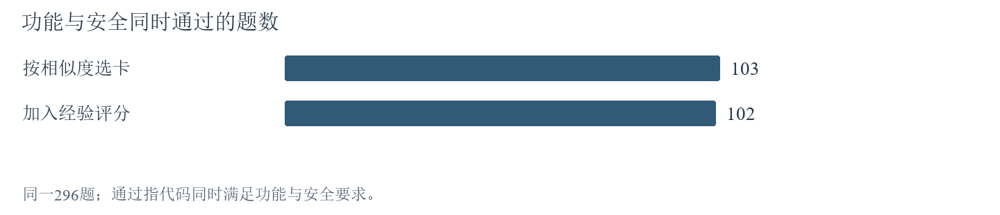

# 10月14日—21日 本周结论与下一步

本周研究：给经验打分，能否帮助模型写出既正确又安全的代码？Q就是根据历史做题反馈形成的经验评分。

**主要发现：** [Q确实改变了实际选用的经验](10月14日-10月21日实验探索报告.md#a3)，但[旧评分没有稳定提高正确率](10月14日-10月21日实验探索报告.md#a2)。在同一批可比较题上，评分选卡通过102题，相似度选卡通过103题。扩大反馈让更多经验获得评分，也没有自动改善同题表现。

**对主线的影响：** 后续判断应落在“哪些经验真正帮助解题”，同时检查经验是否适用、模型是否正确落实；卡片被选中或获得评分，都不能代替代码结果。

**下一步：** 按本周期末安排，先补齐在线学习，再固定评分检验迁移效果；完成适用性标签复核，用于判断检索是否找对经验。

[查看横版思路图](10月14日-10月21日思路脉络图.md)　[查看完整周报](10月14日-10月21日实验探索报告.md)
