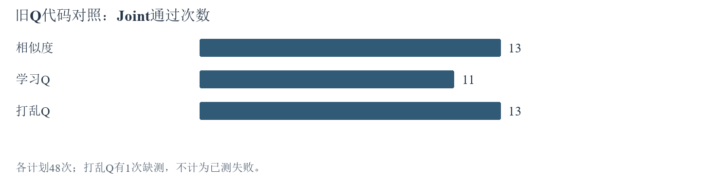

# 10月22日-10月28日本周结论与下一步

本周检验经验选择、表达和来源能否改善功能安全共同通过率。统计截至10月28日23:01。

**主要发现：** Q已改变选卡，旧Q代码对照学习Q为11/48，相似度13/48，未提高正确率。分栏9/24低于原卡13/24；分类器21/48低于固定提醒22/48。[对应实验](10月22日-10月28日实验探索报告.docx#a2)

**主线影响：** 新Q学习1092/1122，反馈覆盖762/1939；功能安全2315/2980。覆盖扩大已经发生，收益仍由同题对照检验。[在线学习](10月22日-10月28日实验探索报告.docx#a9)

**下一步：** 完成两项活动全量并分析；随后54题Q回测、82题标签、57题检索按前置自动接力，排队全量暂缓。[待做安排](10月22日-10月28日实验探索报告.docx#todo)

[完整周报](10月22日-10月28日实验探索报告.docx)　[九条思路图](10月22日-10月28日研究思路图汇总.docx)
