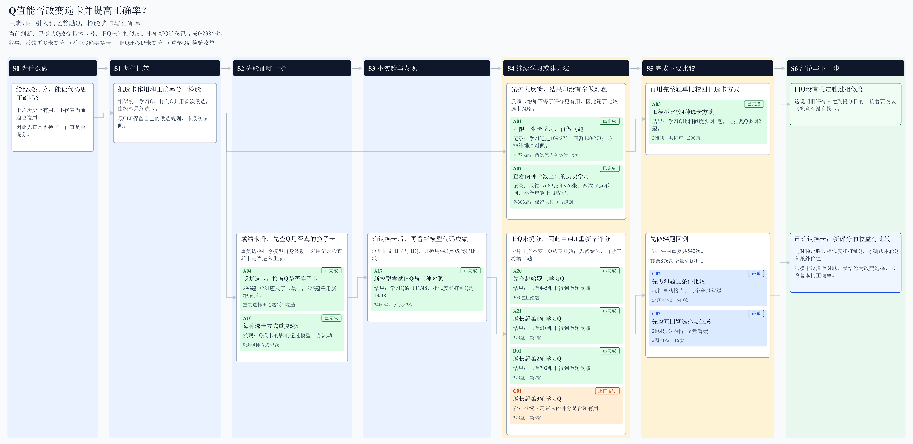
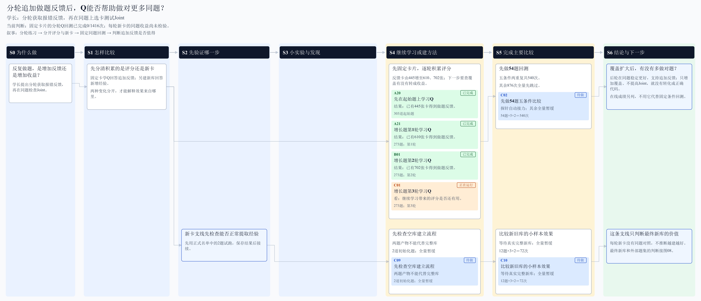
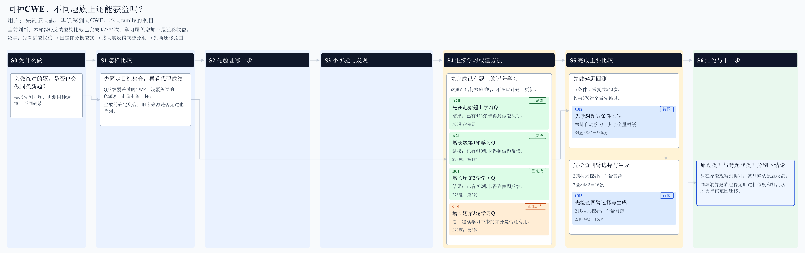
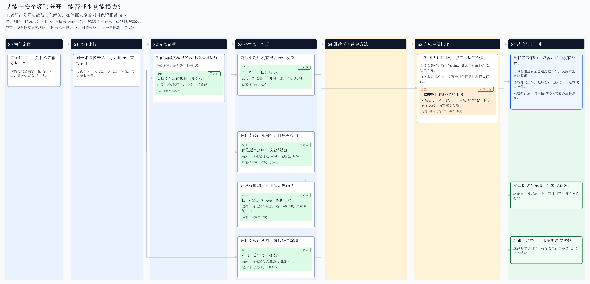
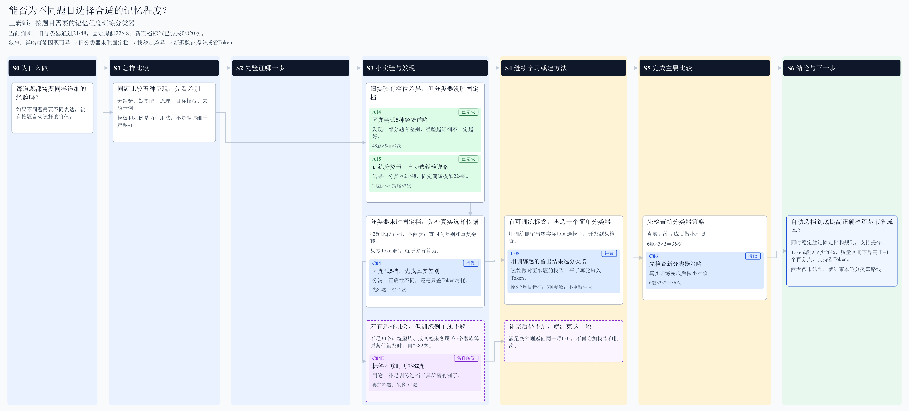
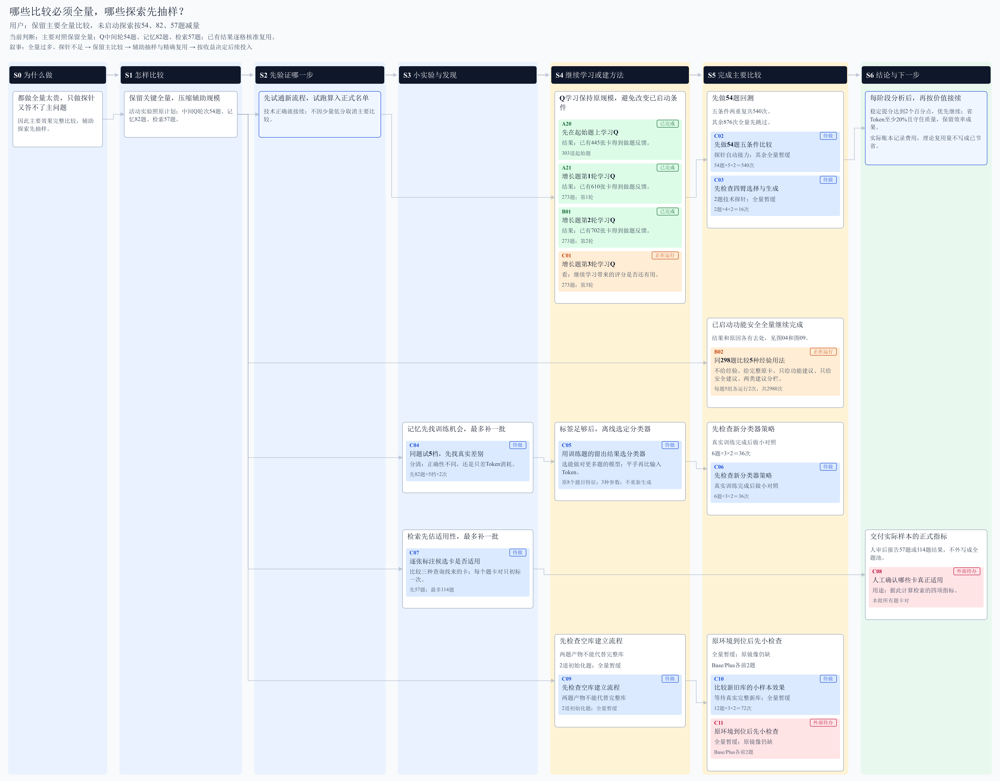
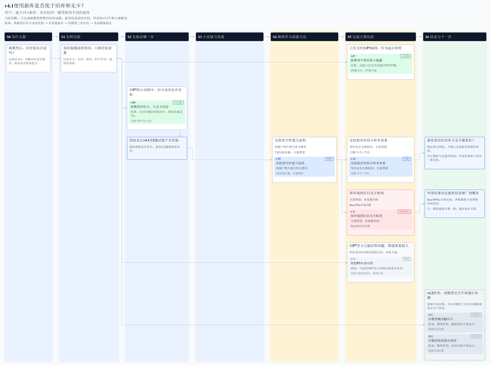

# 10月22日-10月28日研究思路图汇总

统计截至10月28日23:01。与完整周报及一页结论同源。

[I01](#idea01) · [I02](#idea02) · [I03](#idea03) · [I04](#idea04) · [I05](#idea05) · [I06](#idea06) · [I07](#idea07) · [I08](#idea08) · [I09](#idea09)
[完整周报](10月22日-10月28日实验探索报告.docx)

## I01 Q值能否改变选卡并提高正确率？

[SVG原图](figures/ideas/01_Q值选卡.svg)
[返回目录](#index) · [本周证据【A2】](10月22日-10月28日实验探索报告.md#a2)

## I02 分轮追加做题反馈后，Q能否帮助做对更多同题？

[SVG原图](figures/ideas/02_分轮积累.svg)
[返回目录](#index) · [本周证据【A9】](10月22日-10月28日实验探索报告.md#a9)

## I03 同种CWE、不同题族上还能获益吗？

[SVG原图](figures/ideas/03_跨题族迁移.svg)
[返回目录](#index) · [本周证据【A11】](10月22日-10月28日实验探索报告.md#a11)

## I04 功能与安全经验分开，能否减少功能损失？

[SVG原图](figures/ideas/04_功能安全分开.svg)
[返回目录](#index) · [本周证据【A3】](10月22日-10月28日实验探索报告.md#a3)

## I05 能否为不同题目选择合适的记忆程度？

[SVG原图](figures/ideas/05_记忆程度分类.svg)
[返回目录](#index) · [本周证据【A5】](10月22日-10月28日实验探索报告.md#a5)

## I06 检索找到了多少真正适用的经验？

[SVG原图](figures/ideas/06_检索质量.svg)
[返回目录](#index) · [本周证据【A8】](10月22日-10月28日实验探索报告.md#a8)

## I07 哪些比较必须全量，哪些探索先抽样？

[SVG原图](figures/ideas/07_全量与抽样安排.svg)
[返回目录](#index) · [本周证据【A11】](10月22日-10月28日实验探索报告.md#a11)

## I08 v4.1使用新库是否优于旧库和无卡？

[SVG原图](figures/ideas/08_模型与卡库交叉.svg)
[返回目录](#index) · [本周证据【A1】](10月22日-10月28日实验探索报告.md#a1)

## I09 经验改了哪些代码，为什么会损害功能？

[SVG原图](figures/ideas/09_经验代码改动.svg)
[返回目录](#index) · [本周证据【A9】](10月22日-10月28日实验探索报告.md#a9)
