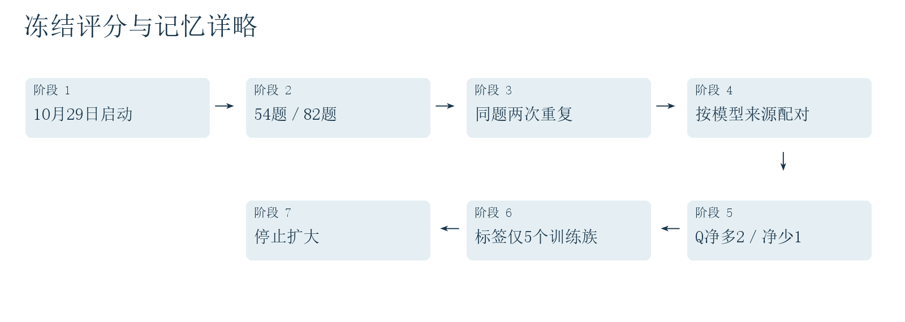
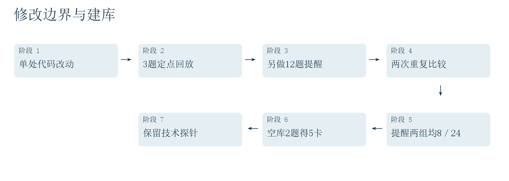
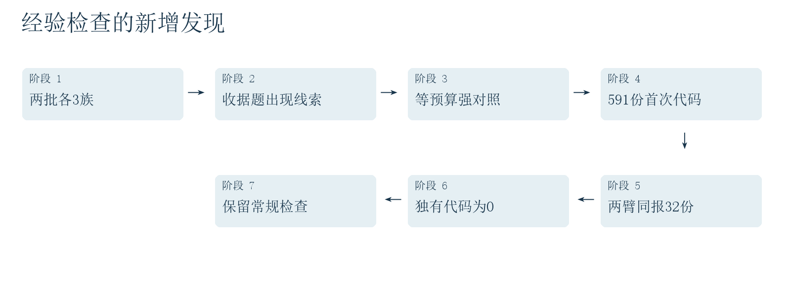
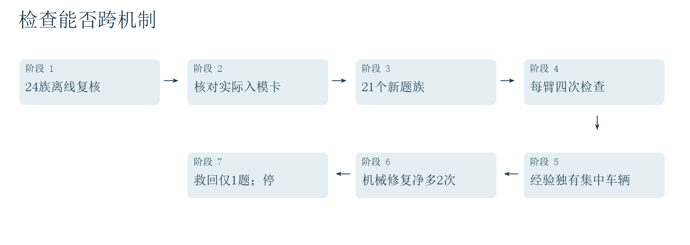
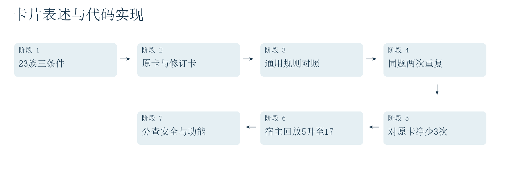
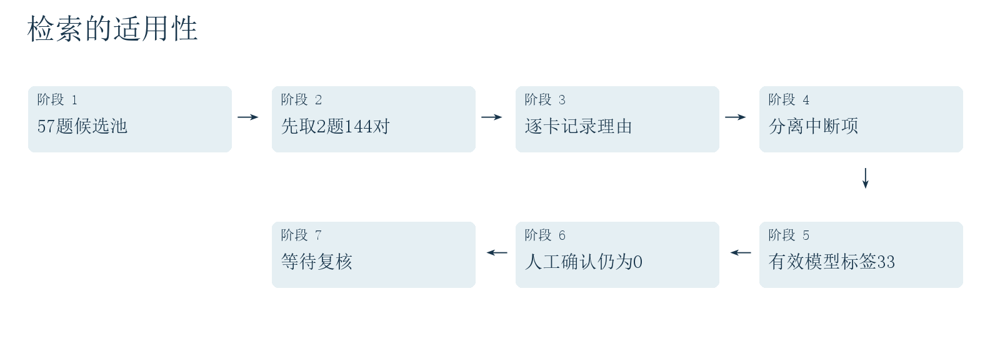

# 10月29日-11月4日研究思路图汇总

## 目录

2026年11月02日 15:33（北京时间，周中稿）。

[1　冻结评分与记忆详略](#line1)

[2　修改边界与建库](#line2)

[3　经验检查的新增发现](#line3)

[4　检查能否跨机制](#line4)

[5　卡片表述与代码实现](#line5)

[6　检索的适用性](#line6)

<!-- pagebreak -->

## 冻结评分与记忆详略

[SVG原图](figures/line1.svg) · [实验数据](10月29日-11月4日实验探索报告.md#e5) · [返回目录](#index)

<!-- pagebreak -->

## 修改边界与建库

[SVG原图](figures/line2.svg) · [实验数据](10月29日-11月4日实验探索报告.md#e2) · [返回目录](#index)

<!-- pagebreak -->

## 经验检查的新增发现

[SVG原图](figures/line3.svg) · [实验数据](10月29日-11月4日实验探索报告.md#e8) · [返回目录](#index)

<!-- pagebreak -->

## 检查能否跨机制

[SVG原图](figures/line4.svg) · [实验数据](10月29日-11月4日实验探索报告.md#e11) · [返回目录](#index)

<!-- pagebreak -->

## 卡片表述与代码实现

[SVG原图](figures/line5.svg) · [实验数据](10月29日-11月4日实验探索报告.md#e14) · [返回目录](#index)

<!-- pagebreak -->

## 检索的适用性

[SVG原图](figures/line6.svg) · [实验数据](10月29日-11月4日实验探索报告.md#e4) · [返回目录](#index)
