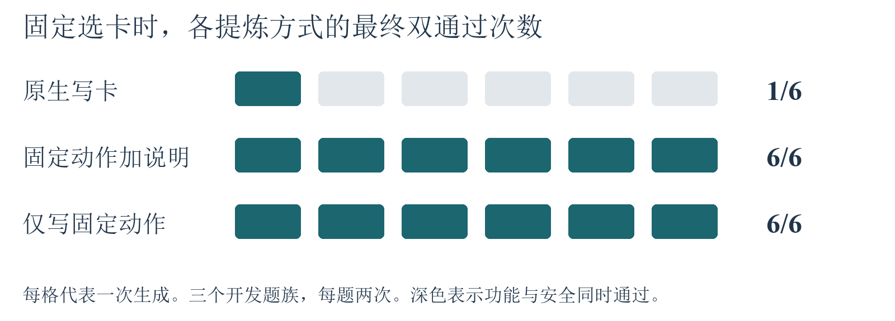

# 10月29日-11月4日 本周结论与下一步

## 把成功修复写进经验卡，能提高代码通过率吗？

原生 CLE 曾把“读取已有权限名单”写成“自建示例名单”。将来源题上验证有效的动作直接写入卡片后，三个参与设计的题族固定选卡、每题独立生成两次，功能与安全双通过率从 **1/6 升至 6/6，提高83.3个百分点**。加说明和仅动作两组各救回同五个题次，其中四次来自权限名单，一次来自数值类型。[【A19】](10月29日-11月4日实验探索报告.md#a19)

**接回正常流程后怎样？** 六个题族按正常流程检索和选卡，11个共同可测题次中，原生通过2次、新版3次。模型没有采纳三张新版卡。仅将成功代码的队列大小上限改回原生组的取值，唯一一次救回就消失。[【A24】](10月29日-11月4日实验探索报告.md#a24)

**本周决定**　固定动作在上述开发题上有效。自然检索结果尚未支持替换默认提炼方式，本周收口，已登记待做为空。

统计截至11月4日18:56（北京时间）。　[完整报告](10月29日-11月4日实验探索报告.md#main)　[思路图册](10月29日-11月4日研究思路图汇总.md#index)
