# 10月29日-11月4日研究思路图汇总

## 目录

统计截至11月4日18:56（北京时间）。每页上方为本周问题和证据。I01至I09下方保留早期原图，每张下栏标出10月28日图文件的保存时刻；包括C01在内的运行与待办状态只属于各图存档。本周已登记待办为空。I10至I12为本周的经验检查、卡文精修和提炼研究。

[一页结论](10月29日-11月4日本周结论与下一步.md#summary)　[完整报告](10月29日-11月4日实验探索报告.md#main)

[I01　Q评分能改变最终选卡并提高正确率吗？](#idea01)

[I02　分轮学习后的评分能在同题上多做对吗？](#idea02)

[I03　同一经验能帮助其他题族吗？](#idea03)

[I04　把功能与安全分开看，能定位哪些退步？](#idea04)

[I05　能否按题目选择适合的记忆详略？](#idea05)

[I06　候选池中的卡片有多少真正适用？](#idea06)

[I07　如何控制探针成本，同时保留有解释力的对照？](#idea07)

[I08　新模型从空库开始能建出经验并胜过旧库吗？](#idea08)

[I09　经验引起的代码改动怎样影响原有功能？](#idea09)

[I10　经验卡能帮助测试发现通用检查遗漏的错误吗？](#idea10)

[I11　手工精修哪些卡片，才能保留题目需要的行为？](#idea11)

[I12　修复动作怎样从来源题进入卡片并影响最终代码？](#idea12)

## I01　Q评分能改变最终选卡并提高正确率吗？

来源：王老师要求检验Q评分对选卡与正确率的作用。

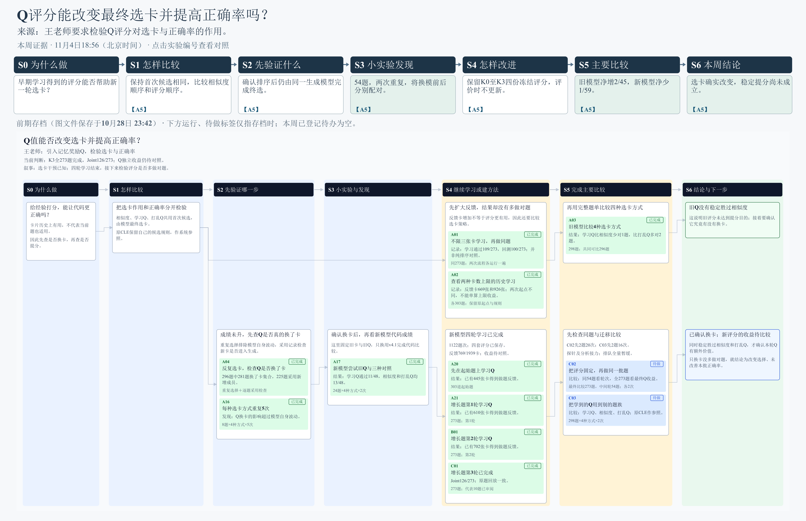

[返回目录](#index)　[打开 SVG 原图](maps/I01.svg)　[【A5】](10月29日-11月4日实验探索报告.md#a5)

## I02　分轮学习后的评分能在同题上多做对吗？

来源：学长提出分轮利用报错，并在原题上回测。

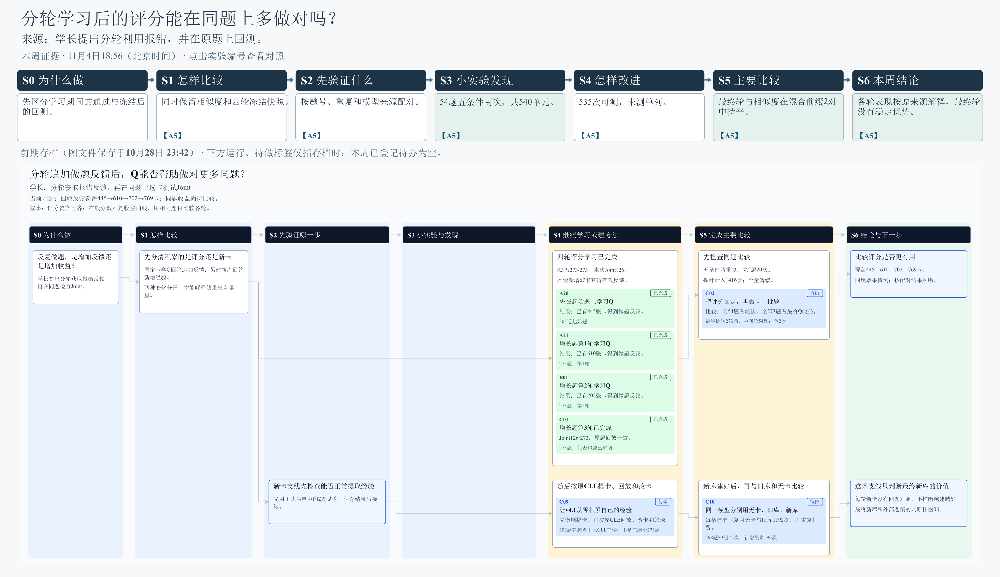

[返回目录](#index)　[打开 SVG 原图](maps/I02.svg)　[【A5】](10月29日-11月4日实验探索报告.md#a5)

## I03　同一经验能帮助其他题族吗？

来源：用户要求先在原题检验，再换题族测试迁移。

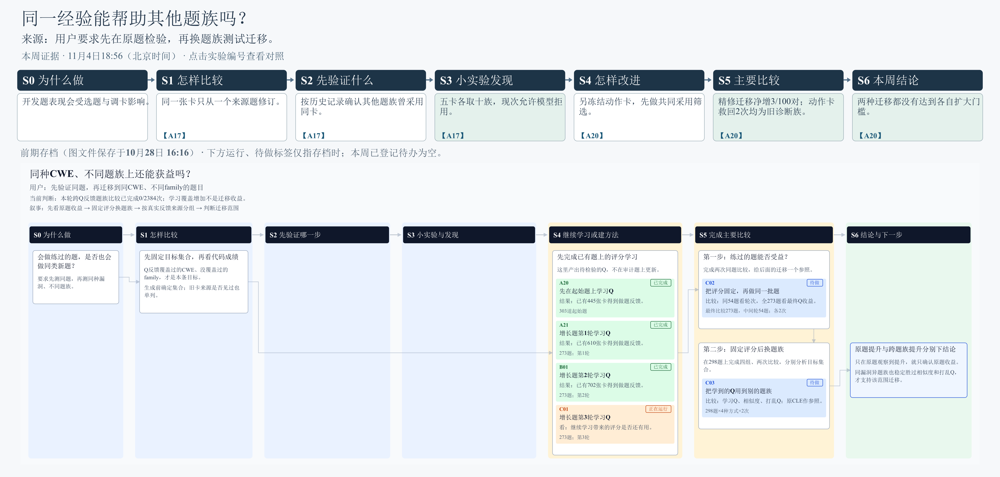

[返回目录](#index)　[打开 SVG 原图](maps/I03.svg)　[【A15】](10月29日-11月4日实验探索报告.md#a15)　[【A16】](10月29日-11月4日实验探索报告.md#a16)　[【A17】](10月29日-11月4日实验探索报告.md#a17)　[【A19】](10月29日-11月4日实验探索报告.md#a19)　[【A20】](10月29日-11月4日实验探索报告.md#a20)

## I04　把功能与安全分开看，能定位哪些退步？

来源：王老师要求拆分功能与安全经验并保留合法行为。

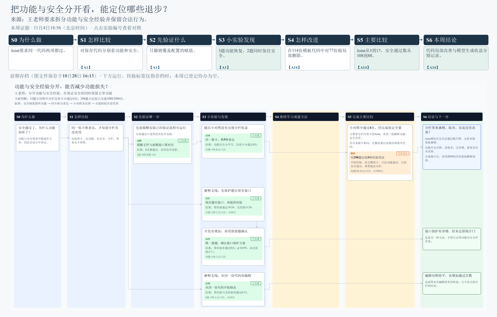

[返回目录](#index)　[打开 SVG 原图](maps/I04.svg)　[【A1】](10月29日-11月4日实验探索报告.md#a1)　[【A2】](10月29日-11月4日实验探索报告.md#a2)　[【A13】](10月29日-11月4日实验探索报告.md#a13)　[【A14】](10月29日-11月4日实验探索报告.md#a14)

## I05　能否按题目选择适合的记忆详略？

来源：王老师提出按题目所需记忆程度训练分类器。

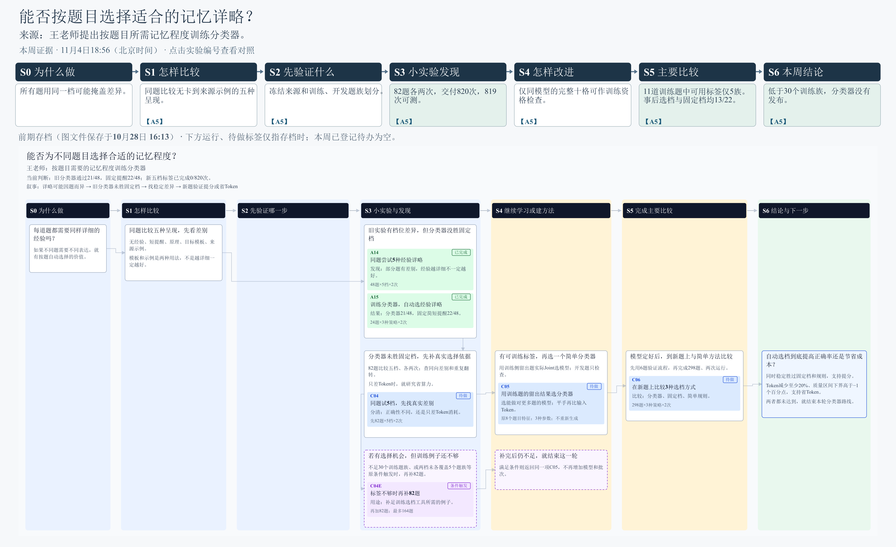

[返回目录](#index)　[打开 SVG 原图](maps/I05.svg)　[【A5】](10月29日-11月4日实验探索报告.md#a5)

## I06　候选池中的卡片有多少真正适用？

来源：王老师要求检索四项指标，学长提出补测召回率。

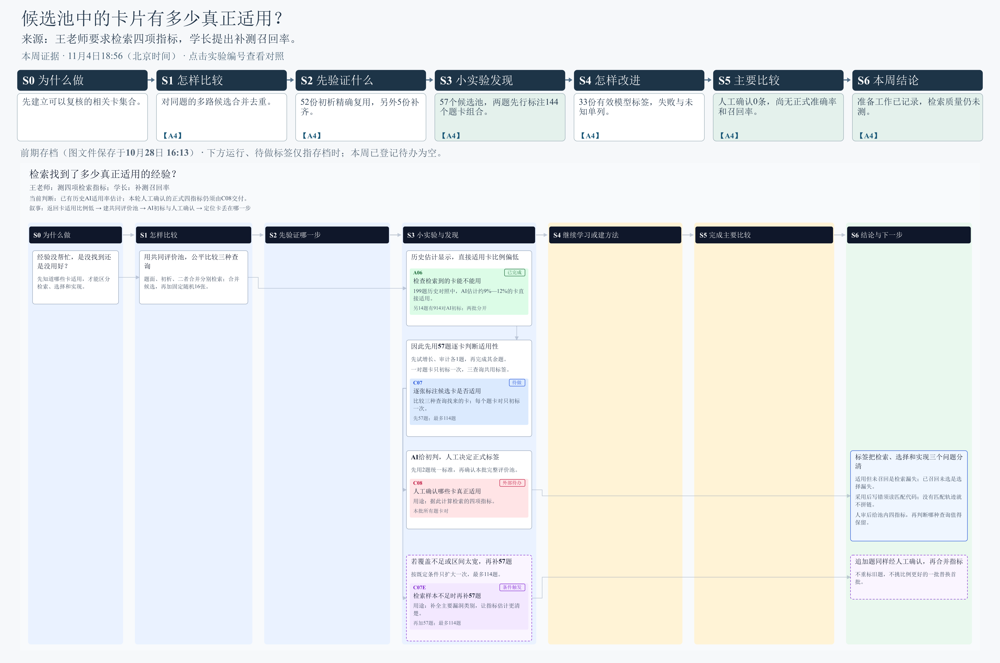

[返回目录](#index)　[打开 SVG 原图](maps/I06.svg)　[【A4】](10月29日-11月4日实验探索报告.md#a4)

## I07　如何控制探针成本，同时保留有解释力的对照？

来源：用户要求先跑有边界的小批，再按事前条件判断是否扩大。

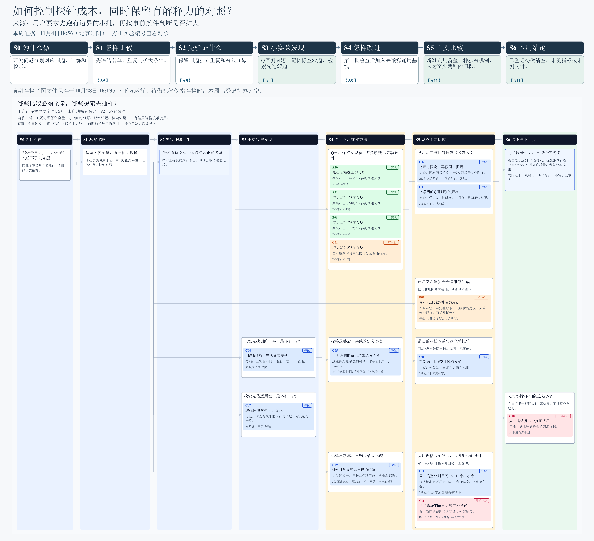

[返回目录](#index)　[打开 SVG 原图](maps/I07.svg)　[【A4】](10月29日-11月4日实验探索报告.md#a4)　[【A5】](10月29日-11月4日实验探索报告.md#a5)　[【A9】](10月29日-11月4日实验探索报告.md#a9)　[【A11】](10月29日-11月4日实验探索报告.md#a11)

## I08　新模型从空库开始能建出经验并胜过旧库吗？

来源：用户提出建新库，并做模型和卡库交叉对照。

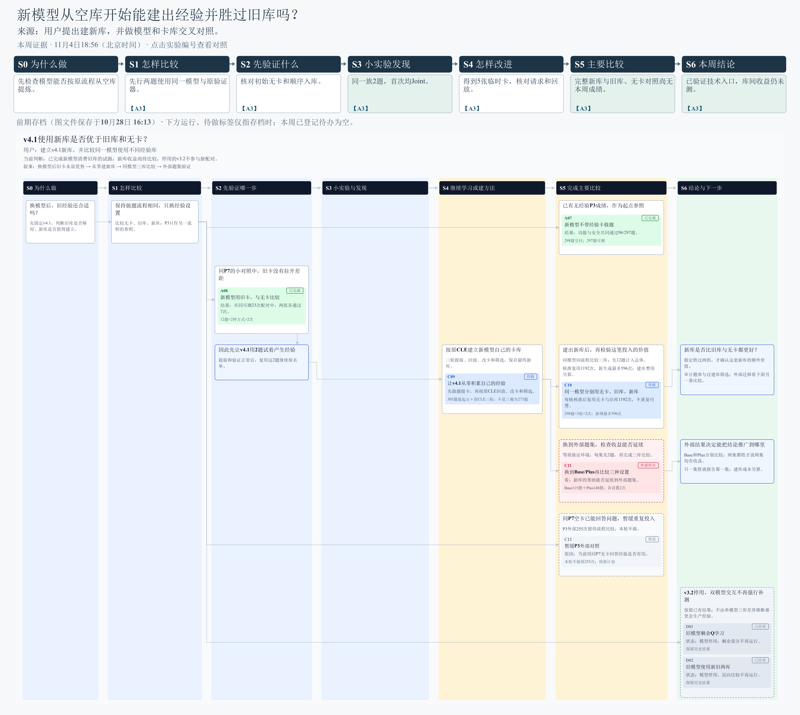

[返回目录](#index)　[打开 SVG 原图](maps/I08.svg)　[【A3】](10月29日-11月4日实验探索报告.md#a3)

## I09　经验引起的代码改动怎样影响原有功能？

来源：10月22日汇报提出追踪经验引起的具体代码改动。

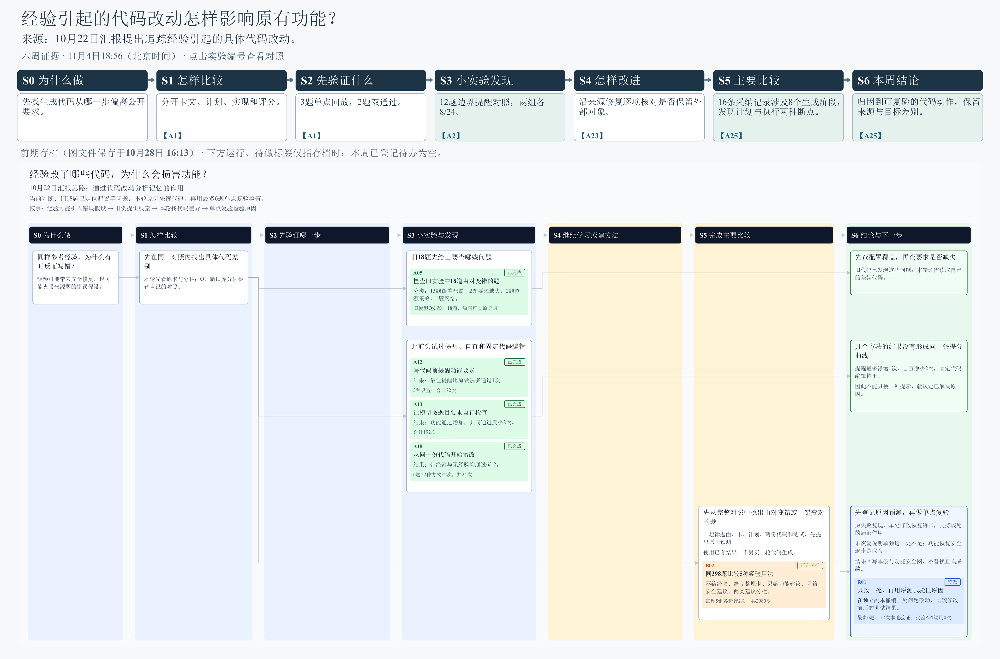

[返回目录](#index)　[打开 SVG 原图](maps/I09.svg)　[【A1】](10月29日-11月4日实验探索报告.md#a1)　[【A2】](10月29日-11月4日实验探索报告.md#a2)　[【A14】](10月29日-11月4日实验探索报告.md#a14)　[【A23】](10月29日-11月4日实验探索报告.md#a23)　[【A25】](10月29日-11月4日实验探索报告.md#a25)　[【A26】](10月29日-11月4日实验探索报告.md#a26)

## I10　经验卡能帮助测试发现通用检查遗漏的错误吗？

来源：用户提出复用代码验证经验检查，并核对误报。

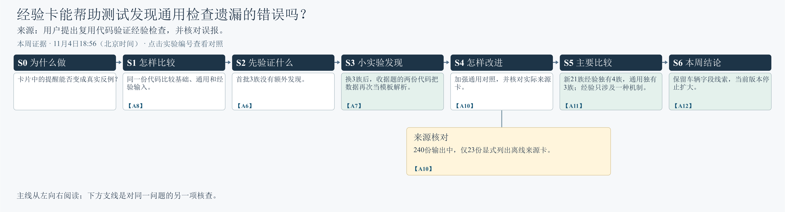

[返回目录](#index)　[打开 SVG 原图](maps/I10.svg)　[【A6】](10月29日-11月4日实验探索报告.md#a6)　[【A7】](10月29日-11月4日实验探索报告.md#a7)　[【A8】](10月29日-11月4日实验探索报告.md#a8)　[【A9】](10月29日-11月4日实验探索报告.md#a9)　[【A10】](10月29日-11月4日实验探索报告.md#a10)　[【A11】](10月29日-11月4日实验探索报告.md#a11)　[【A12】](10月29日-11月4日实验探索报告.md#a12)

## I11　手工精修哪些卡片，才能保留题目需要的行为？

来源：用户要求从题面明确、实际见卡的失败代码中定位改卡目标。

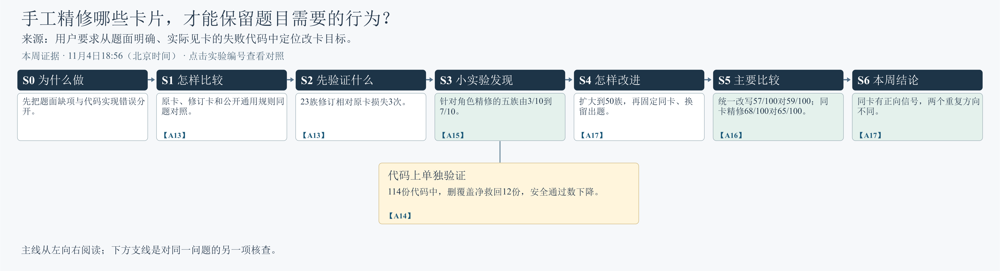

[返回目录](#index)　[打开 SVG 原图](maps/I11.svg)　[【A10】](10月29日-11月4日实验探索报告.md#a10)　[【A13】](10月29日-11月4日实验探索报告.md#a13)　[【A14】](10月29日-11月4日实验探索报告.md#a14)　[【A15】](10月29日-11月4日实验探索报告.md#a15)　[【A16】](10月29日-11月4日实验探索报告.md#a16)　[【A17】](10月29日-11月4日实验探索报告.md#a17)　[【A26】](10月29日-11月4日实验探索报告.md#a26)

## I12　修复动作怎样从来源题进入卡片并影响最终代码？

来源：用户明确研究 CLE 提炼方式的更新及其对 Joint 的影响。

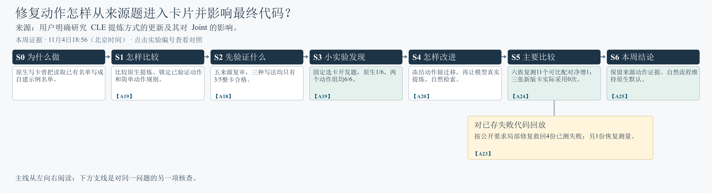

[返回目录](#index)　[打开 SVG 原图](maps/I12.svg)　[【A18】](10月29日-11月4日实验探索报告.md#a18)　[【A19】](10月29日-11月4日实验探索报告.md#a19)　[【A20】](10月29日-11月4日实验探索报告.md#a20)　[【A21】](10月29日-11月4日实验探索报告.md#a21)　[【A22】](10月29日-11月4日实验探索报告.md#a22)　[【A23】](10月29日-11月4日实验探索报告.md#a23)　[【A24】](10月29日-11月4日实验探索报告.md#a24)　[【A25】](10月29日-11月4日实验探索报告.md#a25)
