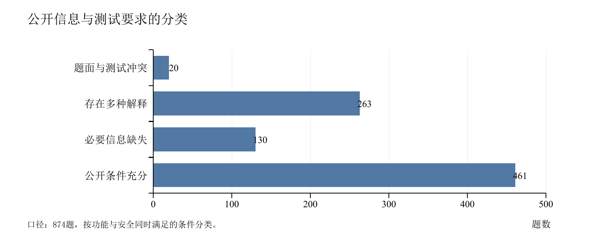

# 11月5日-11月11日本周结论与下一步

本周检查题目、经验来源及代码错误。截至11月9日14:38，874道题中有20道题的公开要求与原测试直接冲突。[【A1】](11月5日-11月11日实验探索报告.md#a1)

86份来源参考代码中，26份出现公开行为反例。[【A3】](11月5日-11月11日实验探索报告.md#a3)对4道失败题的代码按公开接口和已有对象作人工局部修改后，4道均通过原验证器。[【A5】](11月5日-11月11日实验探索报告.md#a5)

图1 874道题的公开信息与测试要求分类

下一步：核对检索字段映射，并比较不同经验内容对代码的影响。

[完整实验周报](11月5日-11月11日实验探索报告.md#main)　[研究思路图](11月5日-11月11日研究思路图汇总.md#index)
