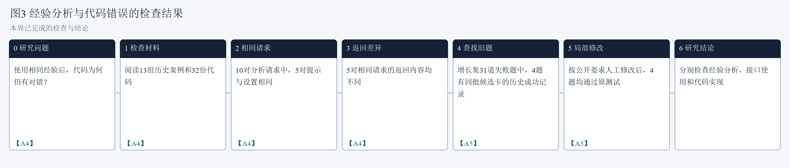

# 11月5日-11月11日研究思路图汇总

本册以截至11月9日14:38的已完成结果，展示题目信息检查和经验与代码检查两条研究思路。每张图的实验编号可进入完整周报。

[题面、检索和参考代码](#idea01)　[经验分析与代码错误](#idea02)　[返回完整周报](11月5日-11月11日实验探索报告.md#main)

## 图2 题面、检索和参考代码的检查结果

[返回目录](#index)　[打开可点击原图](maps/idea_01.svg)　[【A1】题目分类](11月5日-11月11日实验探索报告.md#a1)　[【A2】检索字段](11月5日-11月11日实验探索报告.md#a2)　[【A3】参考代码](11月5日-11月11日实验探索报告.md#a3)

## 图3 经验分析与代码错误的检查结果

[返回目录](#index)　[打开可点击原图](maps/idea_02.svg)　[【A4】经验分析](11月5日-11月11日实验探索报告.md#a4)　[【A5】代码局部修改](11月5日-11月11日实验探索报告.md#a5)
