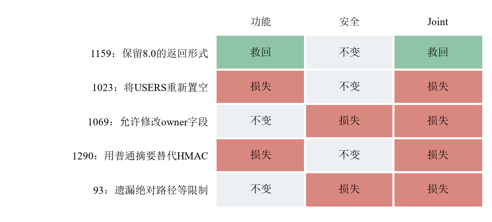

# 11月5日-11月11日实验探索报告

## 一、本周实验主线

**研究目标（原文保留）：**

本周检查了三个D集的公开题面可以支持的理论功能、安全、joint率；确认了少量错题中人工人工匹配最优经验卡对提高通过率的作用，目的是检查选卡方式能否进一步改进；了解了经过多次学习后沉淀的经验卡相对冷启动得到的经验卡有了更高的功能、安全、joint率，证明多次运行对经验卡的改进作用；确认了相同题目使用相同卡片在不同轮次的做题中具有不相同的功能、安全、joint率，体现了CLE流程存在少量波动；对经验生成代码完成了归因分析并得出经验影响代码的几种方式；挖掘了几种本课题转化为论文结果的思路。

### 1. 三个D集的公开题面能支持怎样的功能、安全和Joint实现？

Codex完成D_init（初始学习）、D_grow（后续学习）、D_gate（评估）共874题的三维分类，复核后公开信息充分的安全、功能、Joint题数分别为737、493、457。Codex另将公开实现与原测试逐题绑定，已核实功能465题、安全666题、Joint418题具备相应通过实例。[【A1】](#a1)

### 2. 人工选择已有经验卡能提高多少通过率？

Codex从31道原失败题中核实4道替代成功题：双方使用同一模型和首次分析，成功组合来自原候选池。它们提供选卡改进线索；[【A2】](#a2) 

### 3. 观察从冷启动开始三轮学习后的卡库提高了功能、安全和Joint吗？

CLE使用冷启动库B0与三轮学习后库B3，各完成21题、每题两次。最终功能、安全、Joint分别由27/42、32/42、23/42变为25/42、31/42、21/42；Joint救回0次、损失2次，两次重复各少通过1次。[【A3】](#a3)

### 4. 相同题目使用相同卡片，功能、安全和Joint结果是否一致？

Codex复用三轮D_grow的819条记录，固定19组首次选卡正文与顺序相同的题对。首次及最终安全结果均19/19一致，功能和Joint均17/19一致；另一个模型的12题同卡重复也有2题Joint变化。同卡比较中存在功能与Joint的波动。[【A4】](#a4)

### 5. 经验卡怎样改变代码，并影响功能、安全和Joint？

Codex逐对比较32道D_grow题已经生成的有卡与无卡代码，核对其功能、安全和Joint结果。最终Joint从28/64降至25/64，救回1次、损失4次。Codex将差异定位到错误撤销HMAC、覆盖已有字典或白名单、遗漏路径检查，以及返回数值形式改变。完整卡16题和历史样本分别净增2次、19次Joint，分模型统计。[【A5】](#a5)

### 6. 哪些结果可以形成有价值的论文？

当前最完整的是经验作用与失败原因的实证分析：题面约束、同卡生成变化、输入干预和完整卡库比较已有直接数据。[【A6】](#a6)

## 二、实验内容与结果

### 【A1】三个D集的公开题面能支持怎样的功能、安全和Joint实现？

**结论：**Codex完成874题三维分类。安全、功能、Joint的公开信息充分题数分别为737、493、457；Joint分类另有134题信息缺失、263题存在多种解释、20题要求冲突。

**目的：**Codex判断CLE只依据task_description能明确实现哪些功能与安全要求，区分生成能力和题面条件对成绩的影响。

**思路：**Codex对照task_description与原测试，判断公开要求是否足以支持功能、安全和Joint。功能和安全各自判断；Joint单独检查一份代码能否同时满足两者。三个D集的题号无重叠，接口相近的题目可以分布在不同D集。

**步骤：**

1. Codex逐题核对D_init、D_grow和D_gate的task_description及原测试，共874题。

2. Codex分别按安全、功能和Joint判断信息条件，归为条件充分、信息缺失、多种解释或题面与测试冲突；同题按“冲突、缺失、多种解释”的顺序归类。Codex复查Joint分类中的20道冲突题。

3. 11月10日，Codex逐字段核对4道说明缺口题在分类与生成实验中的公开题面，确认相同后另存9项分类修订，原分类不覆盖。

“条件充分”指题面给出所需行为；“信息缺失”指必要条件未给出；“多种解释”指合理解释导致不同行为；“题面与测试冲突”指两者要求互不相容。

**结果：**

表1 Codex复核后的公开题面信息分类（单位：题；11月10日修订）

| 数据集 | 判断对象 | 条件充分 | 信息缺失 | 多种解释 | 要求冲突 | 合计 |
|---|---|---|---|---|---|---|
| D_init | 安全 | 260 | 7 | 28 | 8 | 303 |
| D_init | 功能 | 164 | 44 | 95 | 0 | 303 |
| D_init | Joint | 150 | 49 | 96 | 8 | 303 |
| D_grow | 安全 | 231 | 9 | 30 | 3 | 273 |
| D_grow | 功能 | 164 | 41 | 67 | 1 | 273 |
| D_grow | Joint | 157 | 45 | 67 | 4 | 273 |
| D_gate | 安全 | 246 | 14 | 30 | 8 | 298 |
| D_gate | 功能 | 165 | 33 | 100 | 0 | 298 |
| D_gate | Joint | 150 | 40 | 100 | 8 | 298 |
| 三集合计 | 安全 | 737 | 30 | 88 | 19 | 874 |
| 三集合计 | 功能 | 493 | 118 | 262 | 1 | 874 |
| 三集合计 | Joint | 457 | 134 | 263 | 20 | 874 |

**分析：**公开信息充分的安全、功能和Joint占比分别为84.3%、56.4%和52.3%，回答公开要求是否明确。Codex进一步复用公开实现与原测试：功能465题、安全666题、Joint418题已有相应通过实例；公开要求与原验收互斥的数量分别为1、19、20题。按“分别满足相应公开要求与该项原测试”计算，功能可实现比例范围为53.2%—99.9%，安全为76.2%—97.8%，Joint为47.8%—97.7%；Joint另有436题仍待裁定。范围上界只排除了已有矛盾依据的题目。[各D集逐题依据与比例](E:/ResearchRuns/CLE/20261105_six_questions/mainline_execution_20261110/S1/bounds.csv)。

表2 各D集同时满足公开要求与原验收的可实现比例范围（单位：%；未裁定题保留）

| 数据集 | 功能范围 | 安全范围 | Joint范围 |
|---|---|---|---|
| D_init | 50.8—100.0 | 78.9—97.4 | 46.5—97.4 |
| D_grow | 57.1—99.6 | 74.4—98.9 | 52.4—98.5 |
| D_gate | 52.0—100.0 | 75.2—97.3 | 45.0—97.3 |
| 三集合计 | 53.2—99.9 | 76.2—97.8 | 47.8—97.7 |

区间下端是已有公开实现通过比例，上端排除已证实的要求冲突。功能、安全、Joint各有408、189、436题未裁定，精确理论通过率仍未确定。

11月10日，Codex确认第915题缺少原测试使用的参数名，第1390题缺少详情字段键名，第432题未明确两种数据返回通道，第1404题缺少管理员身份字段。四题的功能与Joint改列信息缺失，第1404题的安全也相应修订，共9项；原表保留在原始资料。原Joint条件充分461题修订为457题，信息缺失130题修订为134题。20道冲突题仍包括10道未知消息、9道禁用命令和1道输出形状问题。

[返回本周主线](#main)

### 【A2】人工给错题匹配已有经验卡能提高多少通过率？

**结论：**Codex核查54道已有测试题，发现其中4道失败题有CLE选入原检索结果中的其他卡片、首次生成即达到Joint的历史记录。

**目的：**Codex测量人工选择已有卡片相对自动选卡的通过率空间。本次先用历史记录确定可尝试的卡片组合，直接生成对照见待做1。

**思路：**经验卡记录适用条件、推荐动作和风险边界；CLE从检索出的候选中选择0—3张。若失败题的候选中已有其他卡片组合伴随历史成功代码，Codex就把该组合列为人工重选候选，再用独立生成测量重选收益。

**步骤：**

1. Codex从D_grow按CWE_ID（漏洞类型）轮流选出54题，优先覆盖不同family_id；对每题按重复编号和记录路径选取一份已有代码，其中31道未达到Joint。

2. Codex查找同模型、同task_description的成功记录，再限定同一卡库、相同首次分析，以及成功记录所选的卡片均来自原候选池；Codex逐题审读符合条件的题目、卡片与代码。

3. 为检查题目要求怎样进入选卡流程，Codex检查D_init、D_grow和D_gate中的return和raise，统计CLE生成的检索文字是否直接保留这两个字段名。

**结果与分析：**Codex在31道失败题中找到12道同模型、同task_description的成功记录；再限定同一卡库、相同首次分析、CLE选入其他卡片且首次生成达到Joint，留下4题，共5条替代成功记录。11月10日补核双方均为完整deepseek-v4.1-flash来源，题号为677、813、1218、1359，占31道原失败题的12.9%；该比例统计存在替代成功记录的题目，人工选卡净收益仍未测。

按11月10日修订分类，54题中31题公开信息充分、9题信息缺失、12题存在多种解释、2题要求与测试冲突；31道失败题中四类分别为13、7、9、2题。上述4道重点题均属于公开信息充分的题目。

D_init、D_grow和D_gate共874题均有return，其中650题的raise也有内容。CLE检索文字直接保留这两个字段名的次数分别为0/874和0/650，首次分析也参与检索。这项诊断用于安排A_info对照：向自动选择者明确展示与专家相同的完整公开信息，再测量成绩，区分信息呈现和选卡本身的作用。

[返回本周主线](#main)

### 【A3】观察从冷启动开始三轮学习后的卡库提高了功能、安全和Joint吗？

**结论：**本批卡库学习未提高通过率。CLE使用B3的最终Joint为21/42，B0为23/42，下降4.8个百分点；配对救回0次、损失2次。功能和安全分别少通过2次和1次。

**目的：**Codex直接检验按CLE原生流程积累经验后，整套卡库是否改善生成表现。比较对象是同一次建库的冷启动库B0与三轮后续学习、门控后的B3。

**思路：**CLE先从空库冷启动，随后在固定增长题上真实提炼并加入经验；生成模型再用两库完成相同的评价题。Q保持关闭，评价题不参与本次提炼或门控。卡片数量、覆盖与正文共同构成库级学习的干预。

**步骤：**

1. CLE在18道D_init来源题上完成冷启动，冻结B0共71张卡。

2. CLE在16道D_grow题上按固定顺序学习三轮，逐题提炼并入库，冻结各轮卡库；原生全局门控仅使用这16道增长题，最终B3为263张卡，本轮未淘汰卡片。66个学习单元和五个阶段回放完成。

3. 运行器从三个D集各固定7道评价题，共21个近邻组，与本次来源和增长用途隔离。两库各两次独立重复、正常检索和终选，每次最多修复一次，共84个单元；这些公开题曾参与前期分析，本次评价不向提炼或门控提供其ground_truth或隐藏测试。

4. 原验证器测首次和最终功能、安全、Joint。Codex完成全150个单元的零API原生回放，核对代码、卡文、计划、验证、五库及门控。配对分析按21个近邻组计算区间、置换检验及三指标Holm校正，原判据保持。

5. Codex审读全部两次Joint损失，另读一处仅安全变化，以及新增卡被正式采用的两次轨迹，核对实际卡文、采用记录、计划、代码与原验证结果。

**结果：**每库42次计划均已完成，其中39份代码完成原验证，另3次共享初析失败未生成代码。下表按完整流程42次计通过数；按39份已测代码计算，最终Joint分别为23/39和21/39。两库共享同样3次初析失败，原返回均保留。

表3 冷启动库与三轮学习后卡库的首次和最终通过次数（每库21题、两次重复）

| 阶段 | 卡库 | 功能通过 | 安全通过 | Joint |
|---|---|---|---|---|
| 首次 | B0冷启动 | 25/42 | 32/42 | 21/42 |
| 首次 | B3学习后 | 24/42 | 31/42 | 20/42 |
| 最终 | B0冷启动 | 27/42 | 32/42 | 23/42 |
| 最终 | B3学习后 | 25/42 | 31/42 | 21/42 |

最终Joint为54.8%与50.0%；差值95%近邻组自助区间为−11.9至0.0个百分点，配对置换p为0.50，Holm校正p为1.00。功能差−4.8个百分点，区间为−11.9至0.0；安全差−2.4个百分点，区间为−7.1至0.0；两项Holm校正p也均为1.00。本批没有达到预设的稳定改进门槛。

表4 两次独立重复的最终通过次数和修复次数（每库每重复21题）

| 重复 | 卡库 | 功能通过 | 安全通过 | Joint | 修复次数 |
|---|---|---|---|---|---|
| 第一次 | B0 | 15/21 | 16/21 | 13/21 | 8 |
| 第一次 | B3 | 14/21 | 16/21 | 12/21 | 9 |
| 第二次 | B0 | 12/21 | 16/21 | 10/21 | 10 |
| 第二次 | B3 | 11/21 | 15/21 | 9/21 | 10 |

两次重复均救回0次、损失1次。B0与B3分别有5/21、3/21题两次最终Joint不同，修复总次数为18和19。同16道增长题三轮训练Joint为9/16、8/16、9/16，训练成绩也没有持续增加。

表5 各D集的最终通过次数（每库各7题、每题两次；每组14次）

| 数据集 | 卡库 | 功能通过 | 安全通过 | Joint | 初析失败 |
|---|---|---|---|---|---|
| D_init | B0 | 8/14 | 9/14 | 4/14 | 0 |
| D_init | B3 | 7/14 | 8/14 | 3/14 | 0 |
| D_grow | B0 | 8/14 | 11/14 | 8/14 | 3 |
| D_grow | B3 | 7/14 | 11/14 | 7/14 | 3 |
| D_gate | B0 | 11/14 | 12/14 | 11/14 | 0 |
| D_gate | B3 | 11/14 | 12/14 | 11/14 | 0 |

初析失败表示未生成代码，代码实测结果另存。各D集7题，表内作描述统计；主要检验使用完整21个近邻组。[各重复完整结果](E:/ResearchRuns/CLE/20261105_six_questions/mainline_execution_20261110/S3/analysis/pool_repeat_F_S_Joint.csv)

**分析：**B3新增192张卡。在58次生成或修复尝试中，8次选中至少一张新增卡，2次正式采用新增卡；两次正式采用均来自同一道查询校验题。四张被采用的新卡强调先解码、再用提供的正则模式完整匹配。代码落实了这两个动作，却遗漏公开题面要求的SQL内容检查；增加重复解码和Unicode规范化后，原安全测试仍未通过。新增经验覆盖了局部操作，完整任务仍有缺口。

两次Joint损失分别是：156题第二次重复中，两库两轮都没有选卡，B0修复正确解析带点占位符并通过，B3把平面点号键字典交给标准Formatter，合法占位符仍无法取值；663题第一次重复中，B0使用题面提供的可信域名集合并通过，B3两轮都把该集合重新赋为空，合法的跨域回调被拒绝。后者的经验分析同时把同一卡列为采用和部分拒绝，程序记录的正式采用为空，计划仍提到卡片中的部分动作。实际阅读、正式采用和代码落实需要分别核对。

另在870题第二次重复中，B0逐词拒绝分号等控制符，B3只检查首个命令名；原安全测试由通过变为失败，两库功能都失败。前三处差异分别涉及格式化、已有配置和检查范围，最终分数已经包含这些真实生成结果。

本次使用1对独立建立的卡库和21道评价题，两次代码重复。结论收口为：这对卡库的三轮原生学习没有带来预期收益；经验数量增加与正确实现之间仍存在采用和任务覆盖缺口。本次不扩大或追加实验。

**已完成的提炼复审对照：**来源材料检查中60/86份通过本次公开要求检查，26/86份出现不符行为；4/50条轨迹存在阶段标签混淆。四组候选中来源事实错误分别为15/36、15/36、16/36、15/36。19题开发集的最终Joint依原生、普通复审、提炼时额外ground_truth、复审时额外ground_truth、通用指导顺序为23/38、23/38、24/38、25/38、23/38。预定选择的复审时额外ground_truth进入16题确认后为13/32，原生为18/32，通用指导为15/32；相对原生救回0次、损失5次，Holm校正p为0.25。

### 【A4】同题同卡的结果有多稳定，变化发生在哪里？

**结论：**K1、K2、K3三轮共819条记录中，有19个首次选卡正文和顺序相同的题对，安全结果全部一致，功能与Joint各有2题改变。无1017模型的12题固定卡文重复中，功能与Joint也各有2题改变。原卡原提示的另一项16题自然检索对照最终Joint一致，但仅3题跨重复首轮选卡相同。

**目的：**Codex直接测量同题同卡在不同学习轮次的稳定程度，再定位采用、规划和实现中的变化，并检验结构或提示的改动。

**思路：**历史三轮记录用于跨轮比较，12题固定卡文用于独立重复，16题五条件用于改动效果。三类样本和模型分别报告，不相加成同一项实验。

**步骤：**

1. Codex读取K1、K2、K3各273题的原生记录，按每段冻结源码的experience_text函数比较卡文和顺序；排除空卡，将两边均有测量的同题同卡记录配对，分别核对首次功能、安全和Joint。

2. Codex分开统计选择的卡与实际采用的卡，阅读第1078、1233题的公开题面、采用决定、计划、代码和验证，定位不同结果发生的环节。

3. Codex复用归因实验完整经验组的24份代码，核实12题两次卡文相同、后续分析和生成独立；对第1160题保存代码执行公开算式，复现一元负号实现差异，不增加API调用。

4. Codex另审读13组历史成败案例与32份代码，并固定16题做结构和提示对照：三个带卡组在同题同次首轮使用同卡，分别保持原卡原提示、只重排原卡内容、只补充规划与生成提示。

5. 运行器另设全程无卡的原提示与补充提示组，五组每题两次独立生成，失败最多修复一次；原验证器测量结果，Codex审阅10组成败差异。

**跨学习轮次结果：**

表6 K1—K3同题同卡的首次代码通过数（前轮→后轮；历史1017模型）

| 比较 | 同卡题对 | 功能 | 安全 | Joint | 不一致F/S/Joint |
|---|---|---|---|---|---|
| K1—K2 | 2 | 1/2→1/2 | 2/2→2/2 | 1/2→1/2 | 0／0／0 |
| K1—K3 | 7 | 3/7→4/7 | 7/7→7/7 | 3/7→4/7 | 1／0／1 |
| K2—K3 | 10 | 7/10→8/10 | 9/10→9/10 | 7/10→8/10 | 1／0／1 |

19个题对涉及19道不同题，初析与后续规划按原流程独立。第1078题两轮采用相同卡片，但生成的EDITABLE_FIELDS字段列表不同；第1233题两轮卡片采用决定不同，失败代码还将PATIENT_RECORDS置空。安全结果全部一致，功能与Joint均为17/19（89.5%）一致；Joint一致的17组中11组两轮都通过，6组两轮都未通过。两边完整卡片轨迹也一致的7组最终均通过；该小组还要求修复路径长度相同，单列为过程观察。

**同卡重复结果：**

Codex继续核对原19组题对的最终代码，功能与Joint仍各17/19一致，安全19/19一致；没有按最终结果重新筛选样本。17组Joint一致包含11组均通过和6组均失败，故89.5%表示一致率。两组差异仍为1078题和1233题。

表7 同一题和同一份卡文的两次首次生成结果（12题，无修复，复用归因实验完整经验组）

| 指标 | 第一次通过 | 第二次通过 | 不一致题数 |
|---|---|---|---|
| 功能 | 7/12 | 9/12 | 2/12 |
| 安全 | 10/12 | 10/12 | 0/12 |
| Joint | 7/12 | 9/12 | 2/12 |

第1160题两次都读到保留一元负号的建议。第一份代码把-2+3算成−5，第二份算成1；Codex零API执行两份保存代码复现了该差异。第1409题第一次自行计算文件哈希，第二次比较公开签名字典，功能结果随实现变化。相同卡文没有固定后续分析和代码实现，功能与Joint在这12题中的重复一致率均为10/12（83.3%），安全一致率为12/12。

**结构与提示对照：**Codex审读历史案例，发现CLE生成模型清空已有字典、遗漏允许的运算符等问题。经验复析是模型在首次分析后结合所选卡片再次分析题目的一次调用。Codex比较10对复析请求，发现5对保存的提示和模型设置相同，涉及2道题；生成模型对这些复析请求的返回文字逐字比较均不同。下方对照进一步检验卡片结构和生成提示能否改善结果。

表8 CLE生成模型使用不同卡片结构与生成提示的对照（每组16题、每题独立生成2次）

| 条件 | 首次功能／安全／Joint | 最终功能／安全／Joint | 修复次数 |
|---|---|---|---|
| 原卡、原提示 | 19／22／15 | 20／21／16 | 17 |
| 重排卡片结构 | 18／21／13 | 18／20／13 | 19 |
| 原卡、补充提示 | 16／23／13 | 17／22／14 | 19 |
| 无卡、原提示 | 14／21／12 | 16／21／14 | 20 |
| 无卡、补充提示 | 12／22／10 | 15／21／13 | 22 |

表中各数字的分母均为32次。重排卡片相对原卡救回0次、损失3次；补充提示相对原提示救回0次、损失2次，题族配对Holm校正p均为0.50。无卡条件下补充提示救回2次、损失3次。原卡原提示组按题比较，最终Joint与功能均为16/16题一致，安全为15/16题一致；跨重复只有3题首轮选卡相同，其余13题选卡不同。重排卡片、补充提示、无卡原提示、无卡补充提示组分别有3、2、2、5题两次Joint不同。

Codex读码发现，模型将经验中的hashlib.algorithms_available集合当函数调用，触发TypeError；另一题缺少管理员身份字段，代码用is_admin，原测试用role。两例分别归为经验错误和题面缺项。运行器记录1,074次HTTP（含87次向量请求）、5,592,958已报告Token，未知用量0次。

[返回本周主线](#main)

### 【A5】经验卡怎样改变代码，并影响功能、安全和Joint？

**结论：**32题五字段经验卡的最终Joint为25/64，无卡为28/64，降低4.69个百分点；经验卡救回1次、损失4次。其中1290题的卡文明确要求移除HMAC，生成代码照做后丢失了题面要求的密钥签名。

**目的：**Codex逐对检查有卡与无卡代码差异，对照原验证记录统计功能、安全和Joint的救回与损失，并核对相应动作是否由卡片明确提出。

**思路：**Codex先核对保存记录的模型、公开题面、首次分析和验证器，再比较实际代码。卡文原句、模型声明采用、代码动作和测试结果分别登记；多个动作同时改变的代码保留共同变化分类。

**步骤：**

1. Codex读取32道D_grow题已经生成的两次有卡与无卡代码，按同题、同次重复配成64对，逐对检查代码差异及原验证结果。L2呈现原则、推荐动作、禁止动作、适用条件及不适用条件五字段，L0在首次和修复时均无卡；两组使用deepseek-v4.1-flash，并共享见卡前初析。

2. Codex继续逐对比较16题的完整卡与无卡代码（D_grow 10题、D_gate 6题，共32对），并比较历史deepseek-v4.1-flash-1017的298道D_gate题、486对代码记录；三批分别统计。历史最终有484对、297题完成双方测量，2对缺测单列。

3. Codex分别比较首次和至多一次修复后的代码，核对已有对象赋值、函数接口与返回、检查、异常、解析及API调用等变化；按原结果统计三项救回与损失。

4. Codex完成582组记录的源码比较和1164条阶段分类，并深读16个重点案例的完整卡文与代码。5个主批差异案例的10份原代码经原验证器零API回放，结果一致。

5. Codex按原family_id和已有公开接口近邻组分别计算配对区间及置换检验，对功能、安全、Joint作Holm三项校正；本次新增模型、Embedding请求均为0。

**结果：**

表9 有卡与无卡的最终功能、安全和Joint通过率（同题两次重复）

| 比较与模型 | 组别 | 功能 | 安全 | Joint |
|---|---|---|---|---|
| 32题，五字段卡 v4.1-flash | 无卡 | 32/64 (50.0%) | 49/64 (76.6%) | 28/64 (43.8%) |
| 32题，五字段卡 v4.1-flash | 有卡 | 31/64 (48.4%) | 47/64 (73.4%) | 25/64 (39.1%) |
| 16题，完整卡 v4.1-flash | 无卡 | 16/32 (50.0%) | 21/32 (65.6%) | 14/32 (43.8%) |
| 16题，完整卡 v4.1-flash | 有卡 | 20/32 (62.5%) | 21/32 (65.6%) | 16/32 (50.0%) |
| 297题共同已测，完整卡 v4.1-flash-1017 | 无卡 | 218/484 (45.0%) | 367/484 (75.8%) | 187/484 (38.6%) |
| 297题共同已测，完整卡 v4.1-flash-1017 | 有卡 | 241/484 (49.8%) | 385/484 (79.5%) | 206/484 (42.6%) |

表内分母是同题同重复双方均已测的代码对数。历史记录涉及298题，其中1题仅存的一对最终缺少无卡测量，因此最终共同已测为297题。原计划未完成的110对保持未完成。

表10 有卡相对无卡的最终配对救回与损失（单位：次；差值为百分点）

| 比较 | 功能 救回 / 损失 | 安全 救回 / 损失 | Joint 救回 / 损失 | Joint变化 |
|---|---|---|---|---|
| 32题五字段卡 | 1 / 2 | 0 / 2 | 1 / 4 | -4.69 |
| 16题完整卡 | 5 / 1 | 1 / 1 | 3 / 1 | +6.25 |
| 历史完整卡 | 44 / 21 | 28 / 10 | 43 / 24 | +3.93 |

救回指无卡未通过而有卡通过，损失相反。32题两次重复的Joint净变化分别为0、−3；16题为+1、+1；历史样本为+11、+8。主分析的修复次数由无卡38次增至有卡41次。

表11 32题中各类代码变化对应的最终救回与损失（分类可重叠）

| 代码变化 | 题目数 代码对数 | 功能 救回 / 损失 | 安全 救回 / 损失 | Joint 救回 / 损失 |
|---|---|---|---|---|
| 已有对象或配置赋值 | 8题 / 12对 | 0 / 1 | 0 / 1 | 0 / 2 |
| 函数参数或返回语句 | 20题 / 31对 | 1 / 1 | 0 / 1 | 1 / 2 |
| 检查或拒绝条件 | 32题 / 60对 | 1 / 2 | 0 / 2 | 1 / 4 |
| 检查顺序 | 1题 / 1对 | 0 / 0 | 0 / 0 | 0 / 0 |
| 异常类型、文本或处理 | 25题 / 47对 | 1 / 2 | 0 / 1 | 1 / 3 |
| 正则或解析算法 | 11题 / 18对 | 0 / 0 | 0 / 0 | 0 / 0 |
| 调用或数据读取 | 30题 / 55对 | 1 / 2 | 0 / 1 | 1 / 3 |
| 循环与资源限制 | 21题 / 37对 | 1 / 1 | 0 / 1 | 1 / 2 |
| 命名、注释、格式或注解 | 1题 / 1对 | 0 / 0 | 0 / 0 | 0 / 0 |

每行统计包含该变化的代码对。一个代码对可同时改变多处，各行救回与损失有重叠，不相加为总收益。32题中59对的三项结果均相同，其余5对见图1。

图1 32题中5对Joint差异对应的功能与安全变化

图内每行均为同一道题的第二次重复；绿色为救回，红色为损失，灰色为结果不变。其余59对三项结果均相同。图中代码变化与卡文的关系按以下逐题分析区分。

**分析：**

1290题：题面context明确提供secret_key用于HMAC。无卡代码7条功能测试均通过；有卡采纳“移除HMAC、直接hashlib.new”的建议，6条签名值失配，功能和Joint损失1次。这是来源卡的适用前提与目标题面冲突、并已进入代码的错误指导。

1023题：有卡代码把USERS置空，3条功能测试均失败，功能和Joint损失1次。卡文未要求清空字典；修复虽采用卡片中的唯一管理员保护，仍保留了清空错误。1069题则把owner加入ALLOWED_FIELDS，安全和Joint损失1次；扩大名单同样没有卡文依据。两例归为生成实现偏差。

93题：两组均解码，但有卡代码遗漏绝对路径等限制，安全和Joint损失1次。该题公开说明缺少相应路径边界，按题面条件与实现差异共同解释。1159题：无卡返回8，有卡返回8.0，原验证器按字符串比较，后者救回功能和Joint各1次；两组都已使用AST解释，收益落在返回形式。

完整卡16题的Joint救回3次、损失1次：1108题两次改变DNS和地址拒绝逻辑，1404题补用了测试采用的role管理员字段；432题把返回来源从接收的数据改为参数payload而损失。历史DNS具体响应未保存，1108保留为共同变化；1404、432分别涉及公开身份字段缺失和返回来源解释。

历史样本给出方向相反的卡文实例：351题的卡片明确要求给hmac.new传入算法名字符串，代码照做并保留已有密钥，救回Joint；359题的卡片要求撤销题面所需HMAC，代码照做后损失Joint。经验应明确适用条件，保留目标题面规定的对象、接口和算法，并准确说明API用法。

统计判断：32题五字段卡的Joint观察结果为负；16题完整卡净增2次Joint，但未达到预设稳定改进门槛。历史样本Joint净增19次，按216个原family_id计算的Holm校正p=0.032；按76个公开接口近邻组计算后为0.0984，稳定Joint增益门槛未通过。历史功能净增23次，近邻组校正p=0.02415，通过功能提升门槛。

此前12题四条件的96份代码继续用于【A4】的同卡重复复核；其完整经验组Joint为16/24，移除目标卡为14/24，删除目标建议与等长遮蔽均为15/24。它们测量目标卡或目标建议的删减，与本次全程空卡对照分别登记。

完整的三批分类、首次与最终结果、16个重点案例及原代码：[逐对代码](file:///E:/ResearchRuns/CLE/20261105_six_questions/S5_card_vs_no_card_20261111/index.html)；[三批分类统计](file:///E:/ResearchRuns/CLE/20261105_six_questions/S5_card_vs_no_card_20261111/behavior_counts.csv)；[完整分析](file:///E:/ResearchRuns/CLE/20261105_six_questions/S5_card_vs_no_card_20261111/analysis.md)。

[返回本周主线](#main)

## 三、论文思路

### 【A6】怎样把这些发现形成有价值的论文？

**研究问题：**怎样用选卡、经验积累和代码作用的直接结果，解释并提高CLE的Joint？

**已有发现：**Codex完成题面分类、来源事实错误审读、同卡重复、卡片输入干预和本次卡库比较。原生三轮卡库学习的Joint由23/42变为21/42；ground_truth复审、结构重排和补充提示的本批改动也减少了通过次数。1015题的数据保留建议有局部支持，人工选卡净收益仍未测。

**论文方向与取舍：**

1. **经验作用的实证研究。**现有数据覆盖公开信息条件、来源事实错误、同卡实现变化和卡片输入干预，能够说明经验何时落实、何时遗漏要求，以及这些变化怎样对应功能、安全和Joint。当前优先整理这条已形成直接证据的主线。

2. **经验学习改进。**本次扩库没有达到预期收益，新增卡仅在一道题中正式采用，所指导动作还遗漏完整SQL安全要求。后续改进须同时覆盖采用与完整任务要求；当前不追加实验或宣称已有新提分方法。

3. **选卡改进。**四道原失败题已有原候选池内的替代成功组合；专家选择的独立净收益仍待直接对照。原S2保留设计和真实未执行状态。
