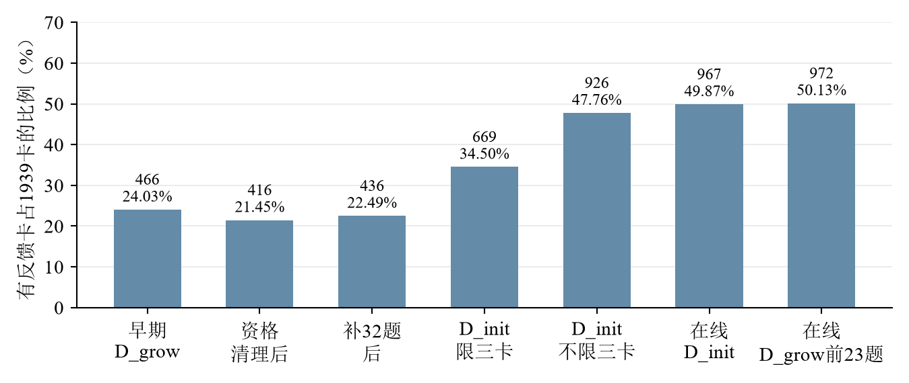
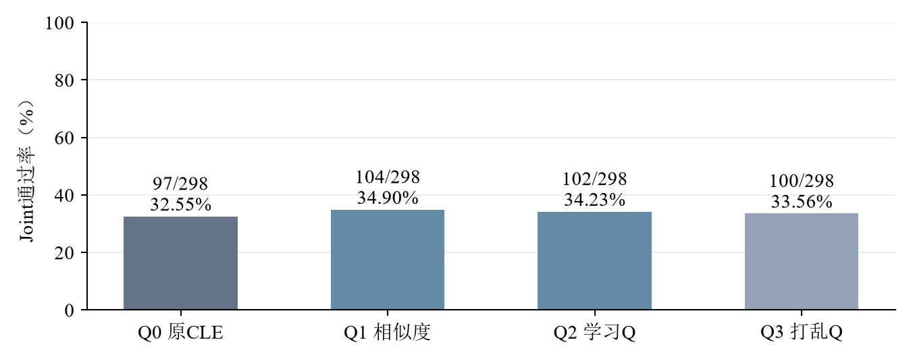
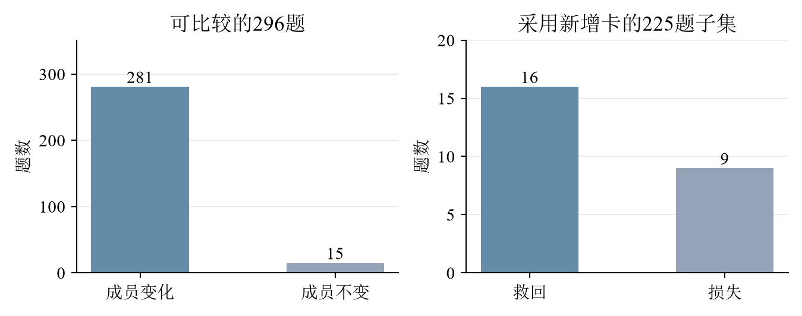
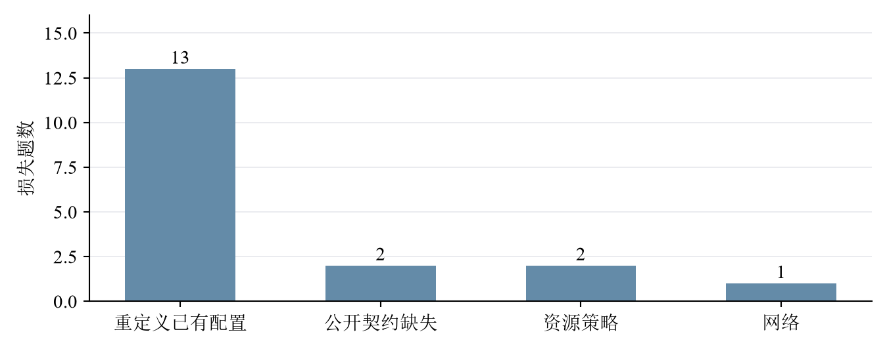
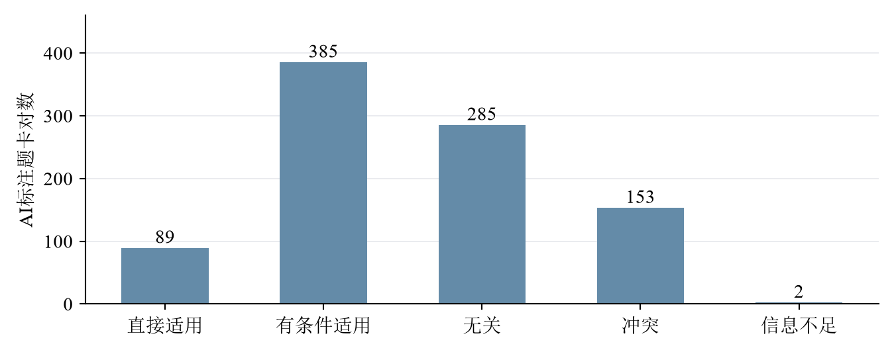

# 10月14日-10月21日实验探索报告

报告周期：2026年10月14日至10月21日　结果统计截至：10月21日22:26（北京时间）

版本状态：历史追溯重写版。首期为一次性的八日周期，实验状态截至10月21日22:26暂停时；报告于10月27日重新整理。部分失败原因来自10月22日之后对已保存结果的复盘，文中单独注明，不改变当时的结果和决定。

## 一、本周实验主线

本期要回答的是：让CLE智能体根据做题反馈给经验卡打分之后，能否选出更有帮助的经验，让代码同时满足功能和安全要求。实验引入记忆奖励Q值，先在经验增长题上积累反馈，再检查同题效果以及同类漏洞下不同题族的迁移。围绕这些要求，本期依次研究Q是否改变选卡、怎样扩大获得反馈的卡片范围，以及代码失败究竟发生在哪里；同时准备检索质量测量。

本期最明确的结果是：Q确实改变了选入的卡片，但旧冻结Q在298题D_gate名单上没有表现出稳定优势，学习Q组其中2题缺测[【A2】](#a2)[【A3】](#a3)。到10月21日暂停时，新的在线强化仍未完成，不能用旧实验代替这次强化后的评价[【A6】](#a6)。主要成绩采用Joint，即同一份最终交付代码同时通过功能和安全测试；选卡与采用记录用来解释成绩如何产生。

### （一）引入Q值，确认它是否改变选卡并改善正确率

Q对具体选卡的影响已有证据：重复选卡对照中，组间差异超过了这组样本上的模型自身波动；D_init可比较的296题中，有281题首次选入的卡片集合改变[【A3】](#a3)。但全298题D_gate旧Q对照中，学习Q的Joint为102/298，介于纯相似度104/298与打乱Q的100/298之间，尚未建立稳定收益[【A2】](#a2)。因此可以确认这一设置下Q参与排序能够改变最终选卡，不能据此确认它稳定提高正确率。

证据对应：[【A3】](#a3)支撑“Q改变了哪些卡被选入”；[【A2】](#a2)支撑“旧冻结Q尚未稳定优于参照组”。两项实验分别回答干预是否发生与结果是否改善。

### （二）通过做题反馈扩大Q覆盖，再区分同题收益与跨题族收益

固定1939张经验卡中，获得过反馈的卡数从早期466张提高到期末972张，覆盖率由24.03%提高到50.13%[【A1】](#a1)。这些学习只更新实际采用且反馈合格的卡，不会给每张检索到的卡都赋值，也不等于新建经验。不限三卡的D_grow观察学习Joint为109/273，冻结后同题回测为100/273，覆盖扩大尚未转化为同题改善[【A1】](#a1)。最后一轮在线强化仅完成D_init 303题及D_grow 23题，强化后的D_gate对照还没有运行[【A6】](#a6)，不能写成分轮强化与迁移验证已全部完成。

证据对应：[【A1】](#a1)支撑“覆盖扩大及同题回测下降”；[【A6】](#a6)给出本周期末实际完成前缀，解释尚未验证的内容。

### （三）解释代码损失，区分题目契约、模型实现与Q机制

对在线D_init相对一项旧参照损失的18题，后续复盘将13题定位到已有配置被重新定义，2题涉及公开契约缺失，另有2题资源策略问题和1题网络问题[【A4】](#a4)。这说明不能把所有损失都直接解释为Q评分错误。局部代码修复是原因诊断，并未改变原始实验成绩；Q引入了不同卡片，卡片内容、模型执行与测试契约仍共同影响最后结果。

证据对应：[【A4】](#a4)支撑这些具体失败原因及局部修复现象；[【A3】](#a3)补充采用新增卡与Joint变化的交叉记录。上述解释来自对本周保存代码的后续复盘，不是新的付费实验。

### （四）测量检索质量，弄清适用经验在哪里被漏掉

已保存914个题卡对的AI适用性标签，其中AI初标89对直接适用、153对冲突，人工确认仍为0[【A5】](#a5)。这些标签可用于准备复核，不能当作正式人工测量。候选池中的召回率只回答“在已标注的候选卡中漏掉多少”，也不等于完整1939卡库的召回率。

证据对应：[【A5】](#a5)支撑“标签已有、正式测量未完成”，不支撑“检索已经准确”或“全库没有合适卡”。

## 二、截至本周期末的待做实验

以下保留10月21日22:26暂停时的任务状态。它们是当周已提出的未完成项，不采用10月26日之后新增的v4.1建库、功能安全拆分和分类器全量计划。历史“待做”不表示现在自动恢复运行。

### 【T1】完成在线强化学习的D_grow剩余任务

当周状态：10月20日至21日安排的在线强化链；D_init已完成303题，D_grow完成23/273题，余250题。10月21日22:26按当时的实验安排暂停，未决请求与旧记录保留。

实验原因：回应[要求二](#r2)。只有完成预定D_grow学习，才能评价这次“先D_init、再D_grow”的强化后状态；当前23题前缀不能代替全273题结果。

实验步骤：

1. 在后续明确恢复时，核对已完成前缀、保存Q状态和未决请求，避免重复执行已完成付费题。
2. 按当时固定顺序继续剩余D_grow题，保持原模型、最多三卡、Q参与排序及实际采用卡更新规则。
3. 完成后保存最终冻结Q，汇总273题Joint、完整测量、反馈覆盖及成本，并在实际完成所属的后续周登记新增部分。

[返回要求二](#r2)　[返回待做实验](#todo)

### 【T2】用强化后的冻结Q完成全D_gate对照

当周状态：已安排在[【T1】](#t1)之后，期末新Q2与新Q3均未执行；已有旧冻结Q四组结果保留为[【A2】](#a2)，不是强化后结果。

实验原因：回应[要求一](#r1)和[要求二](#r2)。学习过程中的表现不能替代冻结后迁移表现，必须检验相同CWE下不同题族是否真正受益。

实验步骤：

1. 固定[【T1】](#t1)完成后的经验正文和Q快照，评价期间不更新经验或Q。
2. 按原计划对全298题比较Q0原CLE、Q1纯相似度、Q2学习Q、Q3同CWE打乱Q；Q0／Q1仅在输入和协议一致时复用。
3. 比较同题Joint救回与损失，核对新卡编号、实际采用和代码落实；报告完整测量、费用及未知用量，区分旧Q成绩与新Q成绩。

[返回要求一](#r1)　[返回要求二](#r2)　[返回待做实验](#todo)

### 【T3】人工复核检索标签并形成正式四指标

当周状态：由10月17日前后检索测量计划形成；AI初标已保存，人工确认未完成。

实验原因：回应[要求四](#r4)。只有明确哪些卡直接适用于哪道题，才能计算选卡是否准确以及遗漏了多少适用卡。

实验步骤：

1. 对照公开题面、上下文和经验正文，复核已有题卡对，隐藏方法名、排名和Q，避免按成绩反推标签。
2. 逐对确认五类标签并裁决信息不足项，保留AI标签与人工标签两份记录。
3. 计算共同候选池内准确率、精确率、召回率和F1，分开报告候选召回与最终选入；全库召回率仍标为未测量。

[返回要求四](#r4)　[返回待做实验](#todo)　[前往详细实验](#experiments)

## 三、实验内容与结果分析

本期以DeepSeek v3.2和既有1939卡库为主体。D_init是冷启动题池303题，D_grow是经验增长题池273题，D_gate是审计题池298题。CWE表示漏洞类别；family表示共享来源或任务结构的题族，同CWE不保证同题型。以下跨配置对比均保留各自规则，不拼接为一条纯Q因果曲线。

实验导航：[【A1】覆盖与学习](#a1)　[【A2】全量迁移](#a2)　[【A3】选卡作用](#a3)　[【A4】失败原因](#a4)　[【A5】检索标签](#a5)　[【A6】期末状态](#a6)。

<!-- pagebreak -->

### 【A1】扩大实际反馈覆盖与D_grow同题回测

#### 1. 实验思路

针对[要求二](#r2)，保持卡片正文不变，让模型实际做题、使用经验，再用测试结果更新采用卡的Q。Q是经验历史作用的数值估计，visits是合格反馈次数；未获得反馈的卡不等于质量差。通过解除三卡上限和补充D_init来源题，观察限制来自选卡数量、覆盖范围还是实际采用资格。

#### 2. 实验步骤

1. 以1939张固定卡作为分母，读取各学习链的初始Q、采用记录和有效奖励资格；原结果保留。
2. 对D_grow全273题进行不限三卡观察学习，Q随合格反馈更新；冻结后再做同题回测，使用学得Q参与选择。
3. 结合32道修复后D_grow题、D_init限三卡及不限三卡学习，登记每次结束时获得反馈的卡数；不同链的清理与继承关系分别保存。
4. 对比Joint、卡片覆盖与实际更新数，不把“检索过”“选中过”直接当作“获得Q反馈”。

#### 3. 实验结果

| D_grow条件 | 执行／计划 | Joint | 结果含义 |
| --- | --- | --- | --- |
| 不限三卡观察学习 | 273／273 | 109／273 | 做题并积累采用卡反馈 |
| 冻结Q同题回测 | 273／273 | 100／273 | 学得Q参与选择，停止更新 |

主要覆盖快照为466/1939、清理后416/1939、补32题后436/1939、D_init限三卡后669/1939、不限三卡后926/1939、在线D_init后967/1939，期末D_grow 23题后972/1939。

#### 4. 实验分析

图1说明增加学习范围与允许更多卡进入解题过程能够扩大反馈覆盖，但不会让所有卡都得到反馈。资格过滤、候选召回、相似度门槛、模型选卡和实际采用共同收窄了更新对象；同类卡竞争也会使反馈集中到少数卡。解除三卡上限只改变其中一环，因此覆盖未达到100%符合这条更新路径。

同题回测由109下降到100，说明覆盖率提高不等于评分更能指导解题。观察阶段和参与阶段的选择策略不同，模型输出也会波动，不能把9题净损失全部归为Q本身。对主线能够确认的是“反馈扩大了”，尚不能确认“扩大反馈已带来收益”。图中的清理后下降属于资格整理，也不是模型能力退化。

原始证据：[10月22日定稿重组版的学习记录](../CLE-RPT-20261022-Q-week-v02/CLE-RPT-20261022-Q-week-v02.md)。本节为历史结果整理，没有重新学习。

[返回要求二](#r2)　[返回实验导航](#experiments)

### 【A2】旧冻结Q在全298题D_gate上的四组对照

#### 1. 实验思路

针对[要求一](#r1)，用原CLE模型选卡、纯相似度、学习Q和打乱Q分别做相同任务。打乱Q保留同CWE内评分分布，破坏评分与具体卡的对应关系，用于判断收益是否来自学得的对应关系，而不只是任意换序。

#### 2. 实验步骤

1. 固定当次旧经验与Q快照，使用同298道D_gate题和原P7最多三卡、最多一次修复及原验证器。
2. 比较Q0原CLE、Q1纯相似度、Q2学习Q、Q3同CWE内打乱Q，评价期间冻结Q。
3. 按计划分母统计F、S、Joint，同时单列缺测；再在共同完整的296题上比较救回与损失。

#### 3. 实验结果

| 条件 | 完整测量／298 | F通过 | S通过 | Joint通过 |
| --- | --- | --- | --- | --- |
| Q0 原CLE | 298 | 120 | 227 | 97（32.55%） |
| Q1 纯相似度 | 298 | 123 | 230 | 104（34.90%） |
| Q2 学习Q | 296 | 118 | 228 | 102（34.23%） |
| Q3 打乱Q | 298 | 119 | 230 | 100（33.56%） |

共同296题上，Q2相对Q0救回16题、损失10题；相对Q1救回13题、损失14题；相对Q3救回14题、损失12题。对应配对差区间均跨过0。

#### 4. 实验分析

图2中学习Q比原CLE和打乱Q略高，比纯相似度略低，且同题救回与损失相互抵消。因此，本次旧对照没有建立学习Q的稳定增益。它覆盖298题名单，但学习Q组有2题缺测，是带缺测的全量名单证据，不能被小样本较好结果替换；也不能证明所有Q学习方法都无效。本次使用的是较早冻结状态，不是期末972张卡有反馈的强化后状态，后者还需要[【T1】](#t1)和[【T2】](#t2)才形成完整比较。

原始证据：[全D_gate汇总](../../../../results/curated/cle_memory_q_full_gate_cap3_20261019/summary.json)。

[返回要求一](#r1)　[返回要求二](#r2)　[返回实验导航](#experiments)

### 【A3】重复选卡与D_init选择变化的交叉分析

#### 1. 实验思路

针对[要求一](#r1)，先暂时不生成代码，只重复选卡以测量模型自身波动；再在D_init真实代码记录中对齐卡片编号、采用声明和Joint，检查影响是否沿“改选—采用—结果”传递。

#### 2. 实验步骤

1. 固定8题及候选，对四组各重复选卡5次，共160次，不更新Q、不生成代码。
2. 分别计算同组重复差异与Q条件间差异，避免仅看到一次选择不同就归因于Q。
3. 对齐D_init 303题中可比较的296题，按选入成员是否变化、是否采用新增成员及Joint救回／损失分组。

#### 3. 实验结果

在160次选择实验的既定样本上，Q差异超过模型内部波动，Holm校正后p约0.0006。D_init的296道可比较题中，281题选入卡集合改变，占94.93%；这281题中225题声明采用新增卡，占80.07%。225题子集Joint从103变为110，包含16题救回和9题损失。

#### 4. 实验分析

图3区分了“排序变了”和“实际选入的编号变了”：大多数可比较题发生了成员变化，并有新增卡被采用。采用新卡子集中有局部净收益，但这是运行后的分组描述，模型是否采用卡并非随机分配；各次运行的起始Q与策略也不同，不能把7题净增直接称为Q的独立因果收益。对主线而言，干预已触达生成过程，后续关注点应转向经验是否适用、是否保持接口，以及模型能否正确落实建议。

原始证据：[重复选卡汇总](../../../../results/curated/cle_selector_repeat_20261019/summary.json)、[D_init交叉分析](../../../../results/curated/cle_q_dinit_selection_joint_20261021/summary.json)。

[返回要求一](#r1)　[返回要求三](#r3)　[返回实验导航](#experiments)

### 【A4】18道损失题的代码与契约复盘

#### 1. 实验思路

针对[要求三](#r3)，比较同题前后代码，解释测试失败究竟发生在哪里。该分析使用本周保存结果，解释文字来自后续定稿复盘；局部修改仅用于验证原因，不替换原模型输出和正式成绩。

#### 2. 实验步骤

1. 从在线D_init与指定旧参照的配对结果提取原通过、后失败的18题，保留前后代码、卡片和验证日志。
2. 检查是否重定义题目已有配置、替换传入对象、缺少公开要求，或遇到资源与网络问题。
3. 对可定位的问题做零API最小代码或契约诊断，单独保存复验结果；不把人工修复后的代码计作模型正式通过。

#### 3. 实验结果

13题重定义已有配置，包括1003、1223、1241、1299、1363、1364、150、352、487、488、642、664和670；2题1037、989涉及公开契约缺失；2题874、907涉及资源策略；1题885涉及网络。移除错误重定义后13题在局部诊断中恢复，2道契约题补齐后也在对应诊断中恢复。

#### 4. 实验分析

图4表明，最大的可定位问题是模型把现有配置覆盖成自己写的示例值，破坏了题目正常功能。卡片可能建议安全检查，却也可能携带来源题假设；模型若把两者一并搬入代码，安全建议便未必改善Joint。契约缺失则意味着模型没有获得验收所依赖的完整公开条件，两类问题不能混为一谈。这里能确认具体代码为何失败，不能从失败类别反推所有卡片评分是否正确。Q作用需要在公开契约与实现边界一致的对照中判断。

原始证据：[已定稿复盘中的损失题及局部诊断](../CLE-RPT-20261022-Q-week-v02/CLE-RPT-20261022-Q-week-v02.md)。本节不改变10月21日原始结果。

[返回要求三](#r3)　[返回实验导航](#experiments)

### 【A5】检索题卡标签与正式测量缺口

#### 1. 实验思路

针对[要求四](#r4)，以“题目—卡片对”为测量对象，判断经验能否直接适用于题目。只有先得到适用性标签，才能区分正确选入、错误选入和漏选；原题能检索回自身来源卡，不代表对新题的检索精度与召回率良好。

#### 2. 实验步骤

1. 用原题、初析和组合查询形成共同候选池，保留合法卡过滤并纳入固定抽取的未召回卡。
2. 保存AI五类初标：直接适用、有条件适用、无关、冲突和信息不足，同时保留判断依据。
3. 导出人工复核材料，正式四指标只使用完成裁决的标签；分母为零时写未定义及原因。

#### 3. 实验结果

直接适用89对，有条件适用385对，无关285对，冲突153对，信息不足2对，合计914对。上述数量是模型辅助标签分布，不能据此直接宣称检索准确率为89/914。

#### 4. 实验分析

图5反映的是AI初标的分布：模型认为不少卡需要附加前提，也标出了一些可能冲突的候选。这些判断尚未经过人工确认，不能直接当成卡片真实质量。模型选卡和Q排序发生在候选形成之后，因此如果适用卡没有进入候选，后续选卡也无法使用它。即使候选池标注完成，也只能计算候选池内召回率；整个1939卡库未完整标注，全库召回率仍未测量。主线在这一环缺的是有效分母，而不是再增加一个成绩百分比。

原始证据：[检索标签与指标口径](../CLE-RPT-20261022-Q-week-v02/CLE-RPT-20261022-Q-week-v02.md)。

[返回要求四](#r4)　[返回实验导航](#experiments)

### 【A6】期末在线强化链的完成范围

#### 1. 实验思路

该项核对回答[要求二](#r2)中“是否已经完成强化和迁移”。以10月21日22:26的实际暂停记录为时间锚点，将已完成题、待做题、未决请求和费用分开，避免把之后的计划写成本周结果。

#### 2. 实验步骤

1. 读取暂停快照及各阶段保存的summary，核对执行数、完整测量和Q覆盖。
2. 将D_init完成、D_grow部分完成、强化后D_gate未开始分别登记；早期D_gate结果仍归[【A2】](#a2)。
3. 按快照记录已知Token与未决请求，不从未知请求估计实际扣费，不再次发送请求。

#### 3. 实验结果

| 阶段 | 已执行／计划 | 完整测量 | Joint | 期末有反馈卡 |
| --- | --- | --- | --- | --- |
| 在线D_init | 303／303 | 299 | 140／303 | 967／1939 |
| 在线D_grow | 23／273 | 23 | 11／23 | 972／1939 |
| 强化后D_gate | 0／298 | 未执行 | 未测量 | 尚未使用最终冻结状态 |

D_init有836次有效Q更新，其中正反馈297次、负反馈539次；D_grow前23题有66次有效更新，其中正反馈21次、负反馈45次。暂停快照的阶段summary记载已知Token分别为19,129,914和1,429,867；另列3条未决请求，未知用量不写成0。这是该在线链的阶段汇总口径，不是本期全部实验总费用。

#### 4. 实验分析

期末能够确认在线D_init全题执行以及D_grow前23题的结果。Q覆盖超过一半，但D_grow仍缺250题，强化后迁移对照缺少新Q2与新Q3，所以没有证据完成判断“这次强化是否有效”。本周期末的实际决定是按当时的实验安排暂停，而不是低分自动终止。10月26日提出的全量验证优先规则属于后一周，不能倒写为本周已经按该新规则完成。

原始证据：[10月21日22:26暂停快照](../../../../translation_work/diagnostics/20261020/cle_q_online_v1/pause_by_user_20261021.json)。

[返回要求二](#r2)　[返回本周实验主线](#main)

## 四、本期判断与跨周结转

本期最明确的结果是Q已经影响实际选卡，增加反馈范围也提高了Q覆盖，但旧冻结Q全量迁移没有建立稳定提分。代码复盘进一步指出，公开契约、来源假设和模型实现是需要分别处理的问题。未完成的在线D_grow、强化后D_gate和人工检索标签按[【T1】](#t1)至[【T3】](#t3)保留期末状态。

下一周期为10月22日至28日。之后的换模、功能安全拆分、记忆程度分类器和两模型交叉要求均应在其提出所属周登记；后续成果不能回填本期未完成项。后一周已有进展见[10月22日至28日周中稿](../CLE-RPT-20261022-20261028-weekly-v03/CLE-RPT-20261022-20261028-weekly-v03.md)。这条跨周链接便于追踪，保留本期当时的结果和任务状态。

## 五、来源与版本说明

本版将10月22日已定稿的历史实验材料按指定首期重新组织，原Word及原导航版完整保留。实验数字沿用原记录，后续解释明确标为复盘；本次未调用模型、未修订正式成绩。日期划分和历史待做处理遵循[周报周期规则](../../weekly_reporting_calendar.md)，当前模板为v03。
