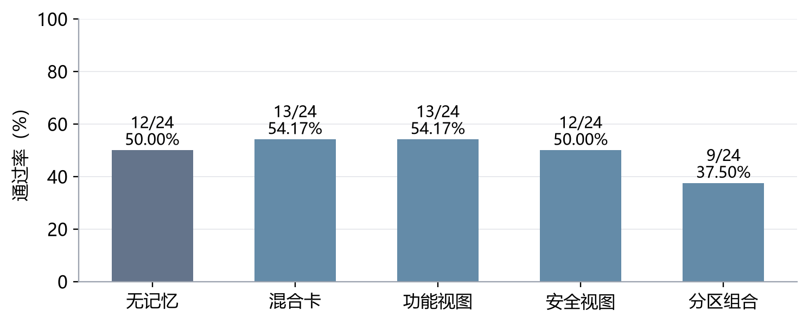
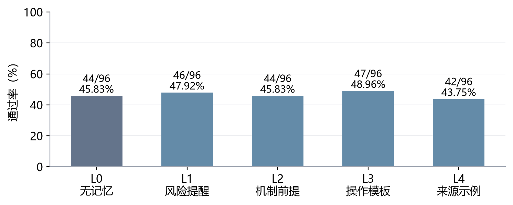
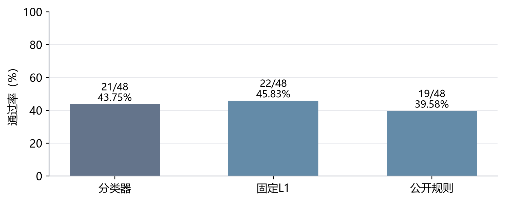
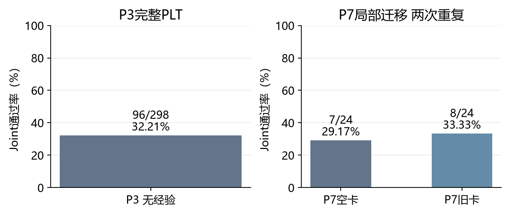

# 10月22日-10月28日实验探索报告

报告周期：2026年10月22日至10月28日　结果统计截至：10月27日01:02（北京时间）

版本状态：周中稿，10月28日周三收尾。安排状态截至10月27日本次修订；本版于10月27日整理。10月28日尚未发生的结果不计入；本周以前的材料仅作为明确标注的历史参照。

## 一、本周实验主线

本周研究围绕一个问题展开：怎样让已有经验真正帮助模型生成同时满足功能和安全要求的代码。根据老师希望引入记忆奖励Q值、区分功能与安全经验、按任务选择记忆详细程度的意见，以及学长提出的分轮积累反馈、同题回测和跨题族迁移思路，实验先检查经验能否改变模型的选择，再检查这种改变能否落实为正确代码。本人进一步要求补齐检索质量测量，采用固定完整名单验证主要问题，并比较DeepSeek v3.2与v4.1使用不同来源经验时的表现。因此，本周将Joint（同一份交付代码同时通过功能和安全测试）作为主要成绩，并结合具体选卡、采用声明和代码实现解释结果。老师、学长的要求归属依据本对话转述。

本周先完成无经验P3的298题基线及原P7空卡／1939卡的48次局部对照[【A8】](#a8)。截至统计时间，后续v4.1基础迁移清单已完成1376个代码实验单元和160次仅选卡实验；这些单元包括同题不同条件、重复运行及精确复用，不能理解为1536道独立新题。本报告汇总本周完成的清单及其沿用的历史材料，尚未结束的一周不预填后续成绩。总体上，Q改变选卡的作用已有证据，稳定提高正确率的作用尚未建立；来源经验方案出现正向信号，但仍需匹配条件下的全量验证。

### （一）引入Q值，判断它是否改善经验选择与最终正确率

Q值已经改变了具体卡片编号，而不只是显示顺序：在代码对照中，学习Q组相对原CLE组有46/48次首次选卡集合变化，32/48次声明采用了新增卡片。但学习Q组的Joint为11/48，与原CLE相同，低于纯相似度和打乱Q的13/48，因此本轮支持“Q影响选择”，尚不支持“Q稳定提分”[【A1】](#a1)。

证据对应：重复选卡实验支撑“影响超过模型自身选卡波动”；四组代码对照支撑“本轮没有对应的成绩改善”，两者均见[【A1】Q的选卡作用与代码结果](#a1)。

### （二）分轮积累反馈，再检查同题收益与跨题族迁移

本周使用的是v3.2历史学习得到的冻结Q，1939张卡中972张曾获得反馈；本周没有在v4.1上新增Q学习。因此，当前结果能够回答旧Q迁移后怎样影响选择，不能回答v4.1按轮学习后是否会改善，也没有完成新模型全量同题回测和298题迁移评价[【A1】](#a1)[【A7】](#a7)。

证据对应：冻结库及实际选卡覆盖说明本轮使用了什么Q，见[【A1】](#a1)；学习次数、卡片生成数和未执行范围说明哪些任务仍未完成，见[【A7】完成范围与测量缺口核对](#a7)。

### （三）分开功能与安全经验，解释为什么安全修复会破坏正常功能

目前的拆分表达没有带来预期改善：混合原卡和仅功能视图均为13/24，功能与安全分区组合为9/24；对同一段既有代码增加经验编辑，也没有改变这组诊断题的Joint。具体代码表明，额外改写白名单、替换现有对象或没有落实边界检查，均可能破坏功能，但不能把全部失败都归为安全要求过强[【A2】](#a2)。另一种来源经验使用方案在保留题上达到28/48，高于无经验的20/48，提示仍有值得完整验证的使用方式[【A6】](#a6)。

证据对应：分区对照与同起点编辑支撑“当前拆分方式未改善”，见[【A2】功能与安全经验的表达和编辑](#a2)；正向信号及代码救回路径来自另一流程，见[【A6】来源经验的开发与保留确认](#a6)，不能归为Q或拆分本身的收益。

### （四）按任务选择合适的记忆程度，并训练分类器

经验越详细并不一定越好。五档记忆中，操作模板为47/96，完整来源示例为42/96，无记忆为44/96，差异尚不足以确认稳定优势[【A3】](#a3)。分类器已经使用真实生成结果训练，但在保留题上仅21/48，未超过固定一句风险提醒的22/48；当前训练题中可可靠区分档位的信号较少，不能宣布分类器已学会“什么题应该用什么记忆”[【A4】](#a4)。

证据对应：五档全对照支撑“详细程度与成绩不是简单递增关系”，见[【A3】五档记忆程度对照](#a3)；训练标签来源与保留题比较支撑“分类器收益未建立”，见[【A4】记忆程度分类器验证](#a4)。

### （五）测量检索准确率、精确率、召回率和F1

当前有检索、选择和采用记录，但尚无完成人工确认的题目—卡片适用性标签，因此本周不能给出正式检索四指标。选中卡片的Q覆盖率和采用率都不能替代召回率；缺少适用卡总数这个分母，就不能判断漏掉了多少有用经验[【A7】](#a7)。

证据对应：现有记录能计算什么、缺失什么标签，以及候选池召回与全库召回的区别，见[【A7】](#a7)。这里支撑的是“测量尚未完成”的判断，不是检索有效或无效的判断。

### （六）完整执行预定实验，不因小样本没有提分就停止验证

本轮固定清单全部完成，11个代码实验包的零API回放均与原记录一致，12个具体案例已查看题面、经验、代码及验证结果。完成清单保证了本轮没有按成绩挑选留下的实验，但各包仍是其预定规模，不能把24题族两重复写成48道独立题，更不能替代全298题评价[【A7】](#a7)。

证据对应：各包完成数、复用关系和回放检查支撑“固定清单完整执行”，见[【A7】](#a7)；[【A1】至【A6】](#experiments)分别给出对应样本上的结果，正常负结果保留，后续主要问题仍按已登记全量计划推进。

### （七）比较两个使用模型与两套来源经验，区分模型能力和经验适配

本周主要完成v4.1使用既有材料的比较，还没有从空库建立v4.1自己的完整经验库，也没有完成两个模型交叉使用两套卡库的匹配实验。来源经验方案的正向信号说明经验的选择和使用方式值得研究，但它采用专门来源材料与另一生成流程，不能当作两模型交叉适配已被证实[【A6】](#a6)[【A7】](#a7)。

证据对应：专门来源经验的使用条件与收益范围见[【A6】](#a6)；新卡库、交叉矩阵及完整评价的缺口见[【A7】](#a7)。

<!-- pagebreak -->

## 二、本周待做实验与结转事项

本节记录10月22日至28日这周截至本版的未完成事项。前周已暂停的v3.2在线学习仍作为历史缺口保存，不把它当成本周已经恢复的任务。10月26日至27日新提出的全量矩阵属于本周新增研究规划，后文单列；它不是10月14日至21日已经安排的实验。

### 【T1】下一批全量验证的共同规格与精确复用核对

当周状态：10月27日已形成七项要求与全量包清单；共同执行规格、逐格抵扣和最终预算尚待落实。本项是本周新安排的零API准备工作，尚未执行的付费包不写成已启动。

实验原因：回应[要求六](#r6)和[要求七](#r7)。只有确认旧结果与新对照使用相同输入和规则，才能完整利用已有工作，同时知道还缺哪些全量实验。

实验步骤：

1. 固定D_init 303题、D_grow 273题、D_gate 298题及题族归属，登记公开题面和契约版本。
2. 对齐模型、P7流程、卡库、Q状态、候选范围、重复编号与验证器，逐格确定直接复用或仅作历史参照。
3. 列出剩余任务、完整规模、执行顺序和累计预算，将其写入对应全量包；本周报告只登记计划，不自动派发。

[返回要求六](#r6)　[返回待做实验](#todo)

### 【T2】检索适用性标签的人工复核与正式四指标

当周状态：前周结转；本版仍未完成人工确认。914个题卡对的AI标签是历史材料，不能写成本周新标注914对，也不能自动当作人工结论。

实验原因：回应[要求五](#r5)。缺少确认后的适用卡分母，无法给出正式召回率，代码通过率和Q覆盖率都不能代替这个判断。

实验步骤：

1. 核对已有题目、卡片正文和标签规则是否仍一致，直接复用一致的AI初标和复核表。
2. 人工逐对确认直接适用、有条件适用、无关、冲突或信息不足；信息不足单独裁决。
3. 在共同候选池内计算四指标，单列空返回、技术失败和冲突率；未完成人审时保留模型辅助估计，不填正式通过。

[返回要求五](#r5)　[返回待做实验](#todo)

### 【T3】Base与Plus原验证环境补齐

当周状态：10月24日至25日换模基线任务遗留。PLT已完成，Base 115题与Plus 140题尚未运行，等待原验证镜像。

实验原因：原三集基线需要使用同一套有效验收规则。没有原镜像，不能用其他后端的成绩冒充已完成外部验证[【A8】](#a8)。

实验步骤：

1. 补齐原safecoder-python-validator:local及其必要父镜像，核对与原项目的对应关系。
2. 完成官方参考实现的正向校准，确认隐藏测试反馈不回传，保持经验和Q边界。
3. 环境满足后再按对应已授权实验协议接续Base／Plus；先记录完成数、缺测、F／S／Joint及成本，不将未运行计为0分。

[返回待做实验](#todo)　[前往基线结果](#a8)

### 本周新增后续规划

10月26日至27日新增或重排了新模型分轮Q学习、同题回测和全D_gate评价、功能安全全量对照、记忆程度与分类器全量验证、新卡库及两模型交叉比较。这些包尚未执行，具体步骤、数量及先后依赖见[七项要求全量任务清单](../../CLE-PLAN-20261027-seven-requirements-v01.md)。本周首先落实【T1】，不把整个未来矩阵列作本周待完成的承诺。10月28日收尾时按当时记录更新本节，再决定哪些任务结转到10月29日至11月4日。

<!-- pagebreak -->

## 三、实验内容与结果分析

本节统一使用F（功能通过）、S（安全通过）与Joint报告交付代码的结果。图表分母为预定实验单元数；缺测不计通过，但与已测失败分列。每个“实验单元”是某题在某一条件、某一次重复中的结果。family（题族）表示同一任务模板衍生的题目，重复及同族样本不能当作独立证据。CWE表示安全弱点类别，同属一类不意味着具体任务要求相同。

各包使用deepseek-v4.1-flash-1017，关闭思考，temperature为0，正式输出预算为4096 Token（模型处理文本的计量单位），保持单条user消息。原P7先分析、选卡、规划再生成，最多三张卡、最多一次修复；首次Joint通过时结束，否则交付末次代码。A6使用A7流程，A2的补充编辑为单步诊断，均在实验内单独说明。

实验导航：[【A8】本周换模基线](#a8)　[【A1】Q作用](#a1)　[【A2】功能安全](#a2)　[【A3】五档记忆](#a3)　[【A4】分类器](#a4)　[【A5】公开约束](#a5)　[【A6】来源经验](#a6)　[【A7】完成范围](#a7)

<!-- pagebreak -->

### 【A1】Q的选卡作用与代码结果

#### 1. 实验思路

针对[要求一](#r1)，必须把“Q改变选择”和“改变后代码更正确”分开检验。前者采用重复选卡，估计模型在条件不变时也会出现的波动；后者在相同题目上生成完整代码，检查Joint。四个条件分别是Q0原CLE候选顺序、Q1纯相似度排序、Q2学习Q排序、Q3同CWE内打乱Q及访问次数。模型仍负责最终选卡，Q2并非直接取Q最高的三张卡。

#### 2. 实验步骤

1. 固定1939张经验正文和历史Q快照。972张卡的visits大于0，即曾获得反馈，覆盖率为50.13%；Q恰好为0但有反馈的卡也计入。这个快照包含v3.2的部分在线学习状态，不是v4.1重新学习的Q。
2. 对8个题族的相同查询、候选和余弦相似度，分别运行四种排序，每种重复5次，共160次选卡。使用排序混合参数λ=0.5、相似度阈值δ=−1和置换种子20261015；这是本轮探索设置，不能写成所有历史CLE实验的默认参数。
3. 在24个预留题族上，每个条件重复2次，共192个代码单元。首次初析和候选共享，模型最多选三张；后续修复依各组代码独立进行，Q和经验始终冻结。
4. 按相同题目及重复编号配对，比较卡号集合、新增卡采用、F/S/Joint与救回损失。统计以题族为单位处理相关性，保留缺测及历史技术失败记录。

#### 3. 实验结果

| 条件 | F通过数 | S通过数 | Joint通过数 | 完整测量 |
| --- | --- | --- | --- | --- |
| Q0 原CLE | 19/48 | 33/48 | 11/48 | 48/48 |
| Q1 相似度 | 19/48 | 35/48 | 13/48 | 48/48 |
| Q2 学习Q | 18/48 | 33/48 | 11/48 | 48/48 |
| Q3 打乱Q | 20/48 | 32/48 | 13/48 | 47/48 |

重复选卡的160次有效记录显示，Q2相对Q0、Q1、Q3的卡号集合差异超过组内波动，Holm校正（同时比较多组时减少误判的方法）后的p值分别为0.006、0.0072和0.00015。代码实验中，Q2对Q0的首次选卡集合变化46/48次，新增卡声明采用32/48次。Q2选中卡片的位置中134/139有过Q反馈，首次声明采用的位置中97/97有过反馈；这些是卡片位置数，不是独立题数。

#### 4. 实验分析

图1中，学习Q组与原CLE组同为22.92%，比相似度和打乱Q各低4.17个百分点。逐题配对后，Q2相对Q1没有救回、损失2次；相对Q3救回1次、损失3次；相对Q0救回和损失各2次。Q2与Q1、Q3的两项成绩比较校正后p值均为1，现有数据未支持学习Q提高Joint。Q3有一格缺测，不能将这一格解释成模型已被测出失败。

这个结果不能再主要解释为“没有接触到有Q的卡”，因为实际选中与声明采用的卡片大多已有反馈。具体失败仍发生在后面的落实环节：1209采用了算术相关建议，但生成代码错误访问AST节点的left/right属性；1065采用了跳过无效字段的建议，却仍然抛出异常；901还存在公开题面未确定阈值的问题。因此，Q的选卡作用已有直接证据，旧Q迁移适配、卡片适用性和代码实现能力则尚未被独立区分。下一步应完成新模型自己的分轮Q学习及冻结全量比较，不能凭本轮负结果宣布Q普遍无效。

对应原实验：D03a、D03b。数据来源：[四臂统计和逐包汇总](../../../../results/curated/cle_v41_completion_20261026/summary.json)、[选卡波动分析](../../../../translation_work/diagnostics/20261026/cle_v41_completion/CLOSEOUT/D03a_selector_noise.json)、[代码与卡片复核](../../../../translation_work/diagnostics/20261026/cle_v41_completion/CLOSEOUT/agent_case_review.json)。

[返回要求一](#r1)　[返回要求二](#r2)　[返回本周实验主线](#main)

<!-- pagebreak -->

### 【A2】功能与安全经验的表达和编辑

#### 1. 实验思路

针对老师在[要求三](#r3)中提出的“保证安全的前提下让功能正常”，本实验先控制经验来源，只改变经验怎样呈现。若将功能和安全建议分开能够避免错误迁移，分区组合应比原混合卡更好。另从相同既有代码出发比较带卡与无卡编辑，用于观察记忆是否能帮助修复，减少起始代码不同带来的干扰。

#### 2. 实验步骤

1. 固定12个题族、每题2次重复和五种条件，共120个代码单元：无记忆B0、原混合卡BM、仅功能视图BF、仅安全视图BS、功能与安全分区组合BFS。
2. 共享首次初析及选卡。分区只读取来源卡正文，不查看目标题答案；分别记录AI分区和规则补全，生成模型接收相同公开任务，按原P7完成生成和最多一次修复。
3. 汇总各条件F、S与Joint，将BFS和BM按同题配对，查明损失是否来自实际采用的建议或额外改写。
4. 补充编辑实验固定6个题族、2次重复，以同一段BM首轮代码作为起点，只比较输入经验与不输入经验的单次编辑，共24个单元；它不是另一轮完整P7成绩。

#### 3. 实验结果

| 条件 | F通过数 | S通过数 | Joint通过数 |
| --- | --- | --- | --- |
| 无记忆B0 | 12/24 | 19/24 | 12/24 |
| 原混合卡BM | 14/24 | 19/24 | 13/24 |
| 功能视图BF | 15/24 | 19/24 | 13/24 |
| 安全视图BS | 13/24 | 18/24 | 12/24 |
| 分区组合BFS | 12/24 | 18/24 | 9/24 |

五组均完成完整测量。BFS相对BM救回0次、损失4次。补充编辑中，无卡与带卡均为F 7/12、S 9/12、Joint 6/12，救回和损失均为0；带卡条件实际有9/12次输入经验，其余起点没有可用的采用卡列表。

#### 4. 实验分析

图2显示，分区组合的Joint为37.50%，低于原混合卡的54.17%。仅功能视图的功能通过数增加1次，但Joint没有增加，这说明改善功能的题目与安全通过的题目不一定重合。研究目标要求同一份代码同时满足两方面，因而不能用F单独增加替代Joint改善。

1326的分区组合代码改写了白名单，破坏原有功能，但没有声明采用相关卡片。这说明“看到了不同的经验文本”和“明确使用某张卡导致错误”仍需区分。另一组编辑没有改变结果，也只说明这6个题族的单步编辑未产生收益；编辑输出格式不包含采用声明，不能把汇总中的采用数0解释为没有记忆输入。当前证据不支持直接推广这一拆分方式，后续全量实验应保留功能保持、来源假设迁移和实际代码改动三类分析，检验老师关心的损失具体发生在哪里。

对应原实验：B02、B05。数据来源：[逐包汇总](../../../../results/curated/cle_v41_completion_20261026/summary.json)、[实际案例复核](../../../../translation_work/diagnostics/20261026/cle_v41_completion/CLOSEOUT/agent_case_review.json)。

[返回要求三](#r3)　[返回本周实验主线](#main)

<!-- pagebreak -->

### 【A3】五档记忆程度对照

#### 1. 实验思路

针对[要求四](#r4)，先测量同一道题在不同记忆详细程度下的结果，再考虑训练分类器。如果大多数题对五档记忆都表现相同，分类器就缺少可学习的差别。五档分别为L0无记忆、L1一句风险提醒、L2机制与适用前提、L3面向目标任务的操作模板、L4完整来源示例。

#### 2. 实验步骤

1. 固定48个D_grow题族，每题五档、每档两次重复，共480个单元；事先分为36个训练题族和12个开发题族。D_grow是用于积累经验和反馈的任务池，不是最终独立测试集。
2. 从相同来源材料形成不同档位，排除同题族来源。15张缺少来源代码的卡在所有档位共同排除，避免只有L4可用卡范围不同。
3. 各档按原P7预算生成和验证，记录真实采用、交付成绩和输入Token。按题族查看两次重复是否支持同一档位，而不根据一次偶然成功指定标签。
4. 先报告五档完整结果，再将训练题族中具有可靠成功证据的记录交给A4；开发题族结果用于检验，不回填训练标签。

#### 3. 实验结果

| 档位 | F通过数 | S通过数 | Joint通过数 | 完整测量 |
| --- | --- | --- | --- | --- |
| L0 无记忆 | 53/96 | 71/96 | 44/96 | 95/96 |
| L1 风险提醒 | 53/96 | 74/96 | 46/96 | 96/96 |
| L2 机制前提 | 53/96 | 74/96 | 44/96 | 96/96 |
| L3 操作模板 | 54/96 | 75/96 | 47/96 | 96/96 |
| L4 来源示例 | 49/96 | 71/96 | 42/96 | 96/96 |

L3相对L0救回6次、损失3次，净增加3次；题族重采样95%区间为−3.125至+10.417个百分点，配对检验p=0.5625。48个题族中31个在五档下成功的重复次数相同，其中17个全部失败、13个全部成功，另1个各档均一次成功；只有2个题族存在某档两次成功、另一档两次失败的稳定强差别，均在训练部分。

#### 4. 实验分析

图3没有呈现记忆越详细、Joint越高的趋势。L3比无记忆高3.125个百分点，而L4低2.083个百分点，说明完整示例可能带来额外来源假设，操作模板也可能更容易与目标要求衔接。不过区间跨过0，当前不能确认L3总体更好，更不能仅凭L4总分较低就认定每个完整示例有害。

从分类器角度看，31/48个题族没有可见的档位差别，意味着大量结果无法告诉模型“该选哪一档”。全部失败的题目也不能自动标成L0最优，因为它们没有证明无记忆更合适。逐题检查还发现1005在L4下成功却没有采用声明，1059有来源四字段白名单与目标三字段要求的差别。这些现象要求后续标签同时考虑真实使用与可重复成绩，以免分类器学到生成波动或来源不匹配。

对应原实验：C02。数据来源：[五档结果](../../../../results/curated/cle_v41_completion_20261026/summary.json)、[案例复核](../../../../translation_work/diagnostics/20261026/cle_v41_completion/CLOSEOUT/agent_case_review.json)。

[返回要求四](#r4)　[返回本周实验主线](#main)

<!-- pagebreak -->

### 【A4】记忆程度分类器验证

#### 1. 实验思路

分类器（根据题目特征预测应该采用哪一档记忆的模型）要回答[要求四](#r4)中的任务适配问题。检验它的价值不能只看是否能够输出标签，还需要与固定简单策略比较。本实验使用A3的实际结果训练，再比较分类器、固定L1和公开规则三种策略，避免用目标题的正确答案选择记忆档位。

#### 2. 实验步骤

1. 仅使用36个训练题族制作标签。某档两次Joint都通过时，按预定规则选平均输入Token最少的合格档；全失败或缺少有效记忆介入的情况标为未解决，不强行指定最佳档位。
2. 最终得到19个有效题族标签：11个L0、7个L1、1个L3；另外17个保留未解决。提取公开题面长度、参数、绑定关系和副作用等特征，用逻辑回归训练，并仅在训练部分用三折划分选择设置。
3. 在12个开发题族查看三种策略，各为两次重复；随后固定分类器及策略，在24个保留题族上比较，每种策略两重复，共144个逻辑单元。
4. 对预测到同一档且协议完全一致的12个单元精确复用已有输出。按同题配对比较Joint，保留实际采用数和缺测，不因某策略较差重新训练或换题。

#### 3. 实验结果

| 策略 | F通过数 | S通过数 | Joint通过数 | 完整测量 |
| --- | --- | --- | --- | --- |
| 分类器 | 24/48 | 37/48 | 21/48 | 48/48 |
| 固定L1 | 25/48 | 38/48 | 22/48 | 48/48 |
| 公开规则 | 25/48 | 34/48 | 19/48 | 47/48 |

开发部分三种策略均为Joint 7/24。保留题中，分类器相对固定L1救回1次、损失2次；相对公开规则救回3次、损失1次，两项比较Holm校正后p均为1。分类器条件有12/48次声明采用，固定L1有45/48次；不同策略可能主动选择L0，因此采用率应结合预测档位解释。

#### 4. 实验分析

图4显示，分类器没有超过最简单的固定L1策略。它比公开规则高2次，却比固定L1少1次，不能据此证明学习型选择优于固定提醒。分类器大多学习到L0或L1，而训练样本只有一个L3、没有可靠的L2或L4标签，当前数据不足以训练出覆盖五档的清晰决策。

这项实验已经落实了“用真实结果训练分类器”的方法步骤，但尚未实现“分类器能帮助提高成绩”的研究目标。问题首先在于标签信息不足，而不是应立即换一个更复杂的分类模型。后续完整比较应扩大预定训练池，保留未解决标签，并在不参与标签生成的题族上验证；不能把同题五档中的最高分直接当作推理时可获得的信息。

对应原实验：C03/C04a、C04b。数据来源：[分类器结果汇总](../../../../results/curated/cle_v41_completion_20261026/summary.json)、[完整分析来源](../../../../translation_work/diagnostics/20261026/cle_v41_completion/CLOSEOUT/agent_synthesis.md)。

[返回要求四](#r4)　[返回本周实验主线](#main)

<!-- pagebreak -->

### 【A5】公开约束提醒与生成流程比较

#### 1. 实验思路

针对[要求三](#r3)中“为什么功能会挂掉”，本组实验检查模型是否忽略了公开契约（题目已经说明的接口、对象和行为要求）。提醒的作用应与经验内容分开测量；利用公开检查反馈修复代码，则是更大范围的流程改变。三组实验分别考察关系提醒、生成模板和公开检查流程，样本及变量不同，结果分别报告。

#### 2. 实验步骤

1. 关系提醒B03R固定1个题族、2次重复，比较无卡/带卡与绑定提醒/关系提醒的四种组合，共8个单元。初析、候选和生成前计划共享，只在预定生成阶段改变提醒；本周精确复用已完成记录。
2. 模板实验固定12个题族、2次重复，比较登记的P00、P13、P22三种生成模板，共72个单元；共享首轮复析和规划，到生成阶段才分叉。
3. 公开检查D02固定48个题族、2次重复，比较原P7与PUBLIC流程，共192个单元。PUBLIC按预定协议使用公开检查和反馈决定修复与交付，隐藏测试不回传给模型；这一对照改变的是完整代码使用流程，不只是一句提示。
4. 分别统计各实验内部的成绩和配对变化，读取公开检查失败案例。已保存响应用于零API回放，回放发现的临时目录差异经修复后复核，不额外生成代码。

#### 3. 实验结果

| 实验与条件 | Joint通过数 | 补充结果 |
| --- | --- | --- |
| 关系提醒四种组合 | 各2/2 | 8/8完整测量，无成绩区分空间 |
| P00／P13／P22模板 | 10/24、10/24、11/24 | 每组24/24完整测量 |
| 原P7 | 30/96 | F 37/96；S 67/96；完整测量95/96 |
| PUBLIC公开检查 | 28/96 | F 42/96；S 64/96；完整测量96/96 |

PUBLIC相对原P7救回4次、损失6次，Joint净减少2次。D02全部192个单元的零API回放最终与原成绩一致；为修复回放临时目录问题完成21项相关离线检查，旧差异现场保留。

#### 4. 实验分析

图5中，公开检查使F从37次增加到42次，但S从67次降至64次，Joint也由30次降至28次。这说明“更多公开检查”未必等于更正确的交付，检查本身若理解错公开要求，也会把正确代码改坏。1001的公开自检在内容已转义的情况下仍拒绝包含onerror的文本，继而促使代码破坏安全输出，是具体可核对的例子。

关系提醒的四种组合全部通过，只能说明接线按预定变量运行，无法证明提醒在总体上有效。模板P22仅多一次通过，也不足以承担整体提分结论。对主线而言，公开契约缺失、模型没有遵守契约、检查器错误扩大契约是三种不同问题；后续应把它们作为完整功能保持实验的解释层，避免把所有功能失败都归到经验卡或Q上。

对应原实验：B03R、S2_P13_P22、D02。数据来源：[逐包统计](../../../../results/curated/cle_v41_completion_20261026/summary.json)、[实际案例复核](../../../../translation_work/diagnostics/20261026/cle_v41_completion/CLOSEOUT/agent_case_review.json)。

[返回要求三](#r3)　[返回实验导航](#experiments)

<!-- pagebreak -->

### 【A6】来源经验的开发与保留确认

#### 1. 实验思路

为进一步回答[要求三](#r3)和[要求七](#r7)，本实验比较同一生成流程有无合格来源经验时的表现。M1使用专门的M1_SOURCE36来源材料，与1939卡库不同；代码处理采用A7 protect流程，两组均封顶一次公开证据修复。因此，它检验的是这一来源经验方案的作用，不能将收益记到Q或原P7头上。

#### 2. 实验步骤

1. 在12个开发题族上，分别使用无经验与M1来源经验，每题2次重复，共48个单元。来源经验排除同题族材料，固定公开题面、模型和A7修复预算。
2. 按确认前登记的开发增量规则选出M1，固定其配置，再在24个保留题族上运行两条件、两重复，共96个单元；不根据中途成绩调整方案。
3. 记录每次实际注入的经验，验证同一交付代码的F/S/Joint，并将两组按题目和重复配对，核对救回、损失以及建议是否落实。
4. 同时报告按题族重采样区间和原协议精确检验，披露保留题此前在D02中的暴露；该组称方案保留确认，不称整个CLE从未见过的最终测试。

#### 3. 实验结果

| 阶段与条件 | F通过数 | S通过数 | Joint通过数 |
| --- | --- | --- | --- |
| 开发：无经验 | 11/24 | 20/24 | 11/24 |
| 开发：M1 | 14/24 | 21/24 | 14/24 |
| 保留：无经验 | 27/48 | 37/48 | 20/48 |
| 保留：M1 | 33/48 | 39/48 | 28/48 |

两部分均完成完整测量。开发阶段M1实际注入17/24次，救回5次、损失2次；保留阶段实际注入37/48次，救回9次、损失1次，Joint净增加8次，即16.67个百分点。保留阶段95%题族重采样区间为+2.083至+33.333个百分点，题族区组精确双侧检验p=0.078125；M1两次重复间没有题族Joint分歧，无经验组有4个。

#### 4. 实验分析

图6显示，M1在开发和保留题上均高于无经验，保留部分同时改善F、S和Joint，是本轮最值得继续完整验证的正向结果。1001中可以追踪到来源经验建议使用html.escape，建议进入输入后在代码中落实，并对应最终救回；唯一损失案例338则涉及公开题面要求字符串、夹具使用字节串的冲突，不能不加区分地记为经验质量问题。

但两个统计方法给出的判断并不完全相同：重采样区间为正，原协议精确检验未达到0.05。报告保留两者，不只挑有利的一项。因此当前结论是有方向性信号，尚未完成统计确认。下一步应在同一A7流程、相同来源资格和固定全量名单上继续比较；如果要解释成模型与卡库的交叉作用，还需单独固定使用模型、来源库及预算，完成真正的交叉矩阵。

对应原实验：S2_M1、S4。数据来源：[开发及保留题统计](../../../../results/curated/cle_v41_completion_20261026/summary.json)、[完整统计与案例分析](../../../../translation_work/diagnostics/20261026/cle_v41_completion/CLOSEOUT/agent_synthesis.md)。

[返回要求三](#r3)　[返回要求七](#r7)　[返回本周实验主线](#main)

<!-- pagebreak -->

### 【A7】完成范围、费用记录与测量缺口核对

#### 1. 复核思路

这一项是零API资料复核，不是新的代码生成实验。它回应[要求二](#r2)、[要求五](#r5)、[要求六](#r6)和[要求七](#r7)：确认本周实际完成了哪些验证，哪些只是已有输入或未来任务。完成数、检索质量与最终代码正确率属于不同问题，需要分别提供证据。

#### 2. 复核步骤

1. 按执行索引读取各包计划、完成数和原生结果，区分代码单元、仅选卡单元、共享前序输出及同档精确复用，不合并成独立题目总数。
2. 检查11个代码包的既有零API回放结果，并读取12个代表案例的题面、卡片、计划、代码和验证记录。案例用于说明具体路径，不用于估计全体失败原因的比例。
3. 汇总已报告Token、物理HTTP（实际发出的网络请求）、未知用量和在途请求。沿用原账本的来源范围，失败未知用量不记为免费，不假设缓存命中率。
4. 查验Q更新、经验生成以及人工检索标签状态。没有执行或缺少必要标签的项目记为尚未验证，不能填入0分或从历史摘要反造记录。

#### 3. 复核结果

| 核对项 | 当前记录 | 能说明什么 |
| --- | --- | --- |
| 代码实验单元 | 1376/1376 | 固定清单完成，含复用及重复 |
| 仅选卡单元 | 160/160 | 只检验选卡，不产生代码成绩 |
| 零API代码包回放 | 11包一致 | 已存响应可重走对应流程 |
| 实际代码案例复核 | 12例 | 提供具体原因证据，不代表总体比例 |
| 本轮Q更新／新经验生成 | 0／0 | 没有完成新模型学习与建库 |
| 已报告Token | 65,186,659 | 累计账本用量，不是本周新增实付 |
| 物理HTTP | 10,338 | 包含记入来源的实际请求与重试 |
| 已结束未知用量HTTP／在途 | 302／0 | 未知部分不能记为零费用 |

这份累计记录包含本轮各包及列入恢复来源的请求，不能等同于整台电脑全部历史用量或本周新支出。当前没有足够账单依据给出人民币实付。关系提醒8格和分类器同档12格等复用均保留在各自逻辑分母中，不应为凑“新实验数”再次调用模型。

#### 4. 复核分析

图7和表格支持“基础清单完整完成”，并不支持“已做完全量新模型验证”。v4.1的新Q学习、全298题Q四臂、从空库建立新经验、两个模型交叉使用两库，以及原验证镜像下的Base/Plus评价，均不在已完成范围内。旧P3、旧Q等结果只有在题面、模型、流程、反馈和预算匹配后才能作为新对照，否则只能保留为背景。

检索方面，准确率衡量题卡对的选入与未选入判断是否正确；精确率衡量选出的卡有多少适用；召回率衡量适用卡有多少被选出；F1综合精确率和召回率。目前缺少人工确认的适用性标签，不能形成正式四指标。即使完成共同候选池标注，也只能先报告“候选池内召回率”；整库适用卡未被完整标注时，全库召回率仍未测量。这是测量缺口，不是已经证明检索差，也不能用Q覆盖率代替它。

数据来源：[清单与成本汇总](../../../../results/curated/cle_v41_completion_20261026/summary.json)、[零API回放](../../../../translation_work/diagnostics/20261026/cle_v41_completion/CLOSEOUT/replay_results.json)、[七项要求与全量任务](../../CLE-PLAN-20261027-seven-requirements-v01.md)。

[返回要求二](#r2)　[返回要求五](#r5)　[返回要求六](#r6)　[返回要求七](#r7)

<!-- pagebreak -->
<!-- pagebreak -->

### 【A8】本周先完成的无经验基线与旧卡库迁移对照

#### 1. 实验思路

本周先回答“换成v4.1后，无记忆Agent能做对多少题；旧1939卡库加入原P7后是否已有明显帮助”。前一个问题采用原P3无经验流程，后一个问题采用原P7空卡与带卡对照，两者生成步骤不同，分别统计，不能直接相减当作记忆收益。这是[要求七](#r7)后续交叉实验的基础材料。

#### 2. 实验步骤

1. 使用deepseek-v4.1-flash-1017，保持原P3初析、规划、生成和最多一次修订，在PLT的298道D_gate题运行；不输入、不生成经验，不更新Q。
2. 保留原43题结果，修复实际TLS传输问题后续跑247题，再依用户授权补跑剩余8题；保留失败请求和未知用量，最终298题保存代码均零API回放。
3. 另外固定12题、每题两次重复，在P7中比较空卡与旧1939卡库；每个题次共享首次初析，最多三卡、最多一次修复，不学习Q。
4. 对48个P7单元逐一回放；将技术缺测与模型答错分开，比较完整配对成绩，而不是把单次多通过一题直接归为经验作用。

#### 3. 实验结果

| 实验与条件 | 执行／计划 | F通过 | S通过 | Joint通过 |
| --- | --- | --- | --- | --- |
| P3 无经验 | 298／298 | 111／298 | 232／298 | 96／298 |
| P7 空卡 | 24／24 | 7／24 | 18／24 | 7／24 |
| P7 1939卡 | 24／24 | 8／24 | 20／24 | 8／24 |

P3完整测量297题，最终Joint为32.21%；P7空卡完整测量23个单元，带卡24个，双方均完整的23对中Joint均为7／23。P3已知Token为3,841,636，30次物理请求用量未知；P7合计2,063,129 Token（其中Embedding 46,461），另15次请求尝试用量未知。两个来源的请求计数口径不同，费用均不写成实付账单，也不与【A7】累计数直接相加。

#### 4. 实验分析

图8左侧给出新模型在无经验完整任务集上的基线；右侧只说明这12题两重复的旧卡迁移表现。P7原始总分带卡多1个通过，但唯一差异涉及空卡生成截断；排除不完整配对后双方相同。因此，这一轮建立了可复用的换模起点，尚未证明旧卡能够稳定提分。它也不能替代后来要求的同P7、同名单、两模型两卡库全量交叉分析。后续【A1】至【A6】是在此后开展的机制比较，不把这些局部单元追加到P3的298题分母。

原始证据：[10月25日P3全量报告](../../../CLE_P3无经验Agent_PLT全量基准报告_20261025.md)、[10月25日P7迁移报告](../../../CLE_v41Flash1017_P7空卡与1939卡迁移实验报告_20261025.md)。原始完成时间分别见各报告；本节属于10月22日至28日这一周。

[返回要求七](#r7)　[返回本周实验主线](#main)　[返回实验导航](#experiments)

## 四、阶段判断与当周后续安排

截至10月27日，已经完成的固定机制清单说明：Q确实影响选卡，但稳定提分仍未建立；功能安全分区和分类器也尚未形成优势；来源经验M1出现值得完整验证的正向信号。全量无经验P3已经完成，不能把P3与P7的流程差异当成卡片收益。这些判断分别由【A1】至【A8】限定在其实际条件内。

本周剩余工作首先是[【T1】共同规格与复用核对](#t1)，为完整实验确定实际缺口；同时保留[【T2】人工标签](#t2)及[【T3】原验证环境](#t3)的未完成状态。10月28日周三再核对当周新增结果与任务状态，完成本期总结。下一周期为10月29日至11月4日；现有全量矩阵的最终排期写入全局任务清单，不提前把下一周实验写成已开展。

## 五、周期与文档映射

本报告覆盖10月22日至28日，当前仍为周中稿。原“10月26日-11月1日”版本的实验数据保留，其周历划分已由本版更正；两版不能作为两次独立实验累计。10月14日至21日的Q结果见[首期历史周报](../CLE-RPT-20261014-20261021-weekly-v01/CLE-RPT-20261014-20261021-weekly-v01.md)。10月22日用户手动定稿和10月26日14:26快照仍保留原件。

每周三总结，日期归属、历史待做及跨周结转按[周报时间规则](../../weekly_reporting_calendar.md)执行。结果、累计用量、写作日期与后续安排分别登记；MD与Word的【A】【T】编号对应同一正文和内部书签。
