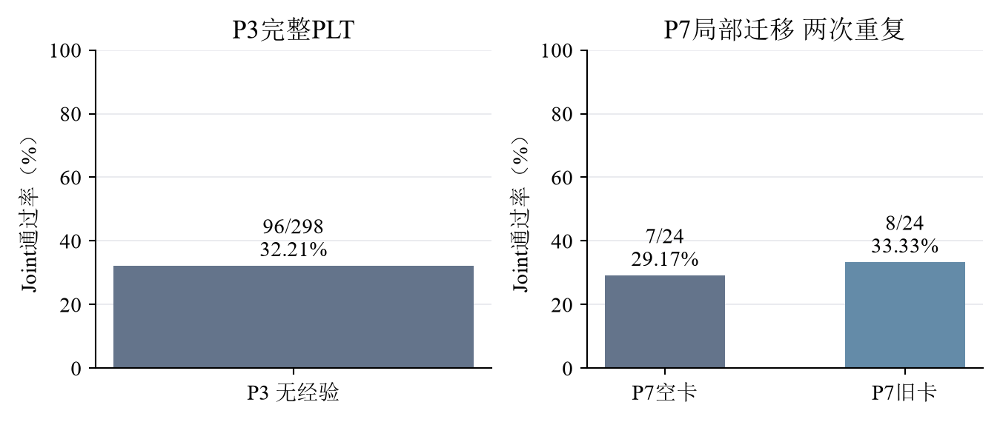
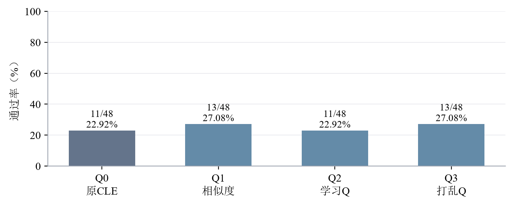
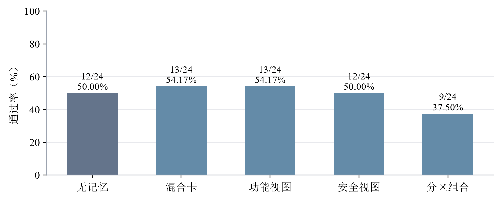
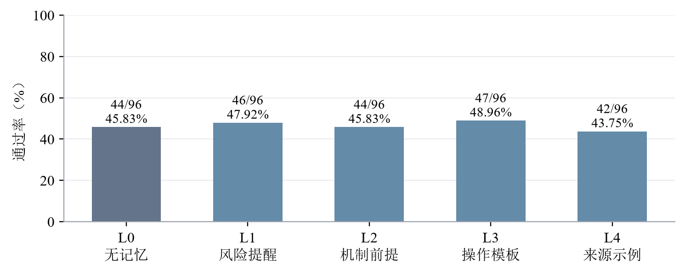
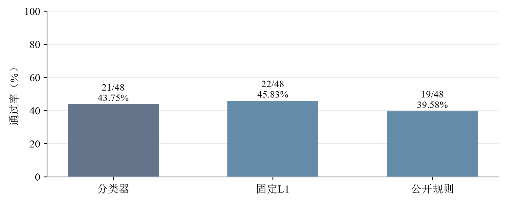
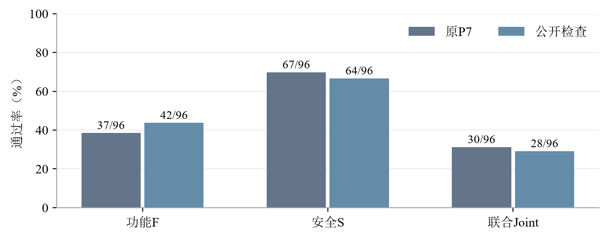
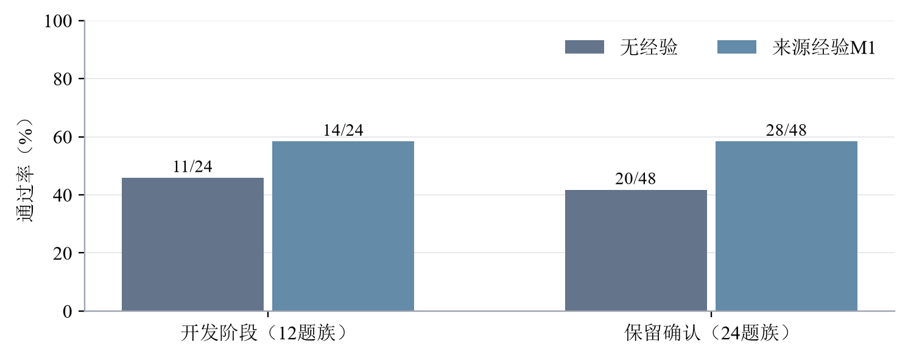
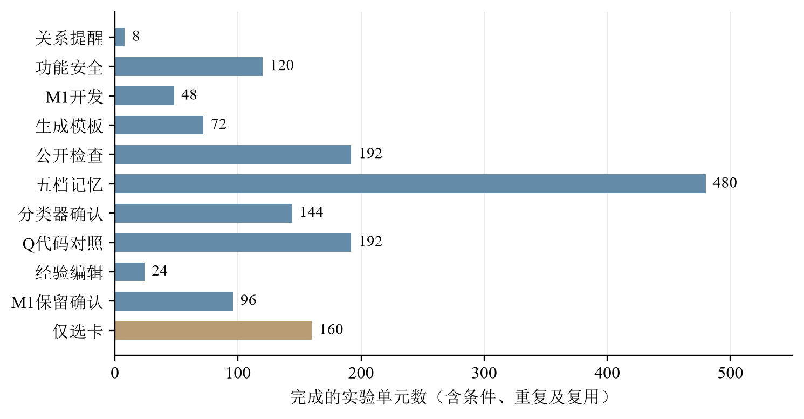
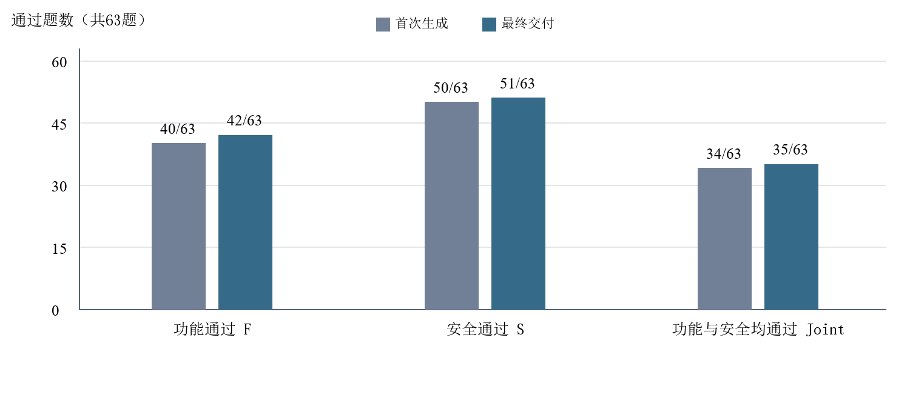

# 10月22日-10月28日实验探索报告

## 一、本周实验主线

本周继续研究：经验能否帮助模型写出既能正常工作、又满足安全要求的代码。换用DeepSeek v4.1后，需要先了解模型不使用经验时的能力，再检验旧经验、Q值、功能和安全经验的不同表达方式，以及按题目选择经验详细程度是否有帮助。后续还要让新模型形成自己的经验，并与旧模型、旧经验进行交叉比较。

截至2026年10月27日15:56（北京时间），主要结论是：**旧Q确实改变了选卡，但在现有对照中没有建立稳定提分；功能与安全分栏、记忆程度分类器也尚未建立优势。另一种来源经验方案出现正向信号，但仍需更大范围确认。** 本周新启动的v4.1 Q学习还在进行中，不能用其部分结果判断最终效果。[【A2】](#a2) [【A3】](#a3) [【A5】](#a5) [【A7】](#a7) [【A9】](#a9)

读数说明：功能通过记为F，安全通过记为S；Joint表示同一份最终代码同时通过两类测试。同一道题在不同条件、不同重复下会产生多个实验单元，不能把单元数当作独立题数。题族是由相同来源或相近任务结构形成的一组题；CWE是漏洞类型，同一CWE下的题目仍可能属于不同题族。

题目来自PLT代码生成数据集，其中D_init是303道初始化题，D_grow是273道经验增长题，D_gate是298道评价题。经验卡记录以前做题中提炼的提示；Q是卡片根据历史反馈得到的分数。P3是这里使用的无经验生成流程，P7则包含经验检索和选卡，因此两种流程的成绩需要分别解释。

### （一）旧Q会不会改善新模型的选卡和代码？

**回答：** 它确实改变了具体选中的卡，也有新卡被声明采用；但在24个题族、每题两次重复的代码对照中，学习Q与原CLE均通过11/48次，相似度与打乱Q各通过13/48次。打乱Q有1次缺测。Q的选卡作用得到支持，稳定提分尚未建立。[【A2】](#a2)

### （二）新模型自己学习Q，能否在新题上受益？

**回答：** 本周已从零开始新一轮Q学习，但截至本版只完成D_init的63/303题；D_grow三轮及其后的冻结回测尚未完成。当前不能用学习阶段的部分成绩判断跨题族效果。[【A9】](#a9) [【T4】](#t4)

### （三）分开功能与安全经验，能否减少功能损失？

**回答：** 在现有12题族两重复的对照中，功能与安全分栏组合通过9/24次，原混合卡通过13/24次；这次拆分方式没有表现出改善。实际代码还显示，改写现有白名单等问题可能破坏功能，需要逐题区分原因。[【A3】](#a3) [【A6】](#a6)

### （四）能否按题目选择经验的详细程度？

**回答：** 五档比较中，经验更详细并不总是更好；训练出来的分类器在保留题上通过21/48次，固定使用一句提醒通过22/48次。已完成方法尝试，但没有证明分类器带来收益。[【A4】](#a4) [【A5】](#a5)

### （五）检索有没有找对适用经验？

**回答：** 当前仍缺少人工确认的题卡适用性标签，正式准确率、精确率、召回率和F1尚未完成；候选池内的召回率也不能冒充全库召回率。[【A8】](#a8) [【T2】](#t2)

### （六）哪些结果已经完成，哪些还需要全量验证？

**回答：** 截至10月27日01:02，已完成的基础清单包含1376个代码单元和160次仅选卡记录，并完成回放；它们有重复和复用，不能写成同样数量的独立题。新一轮完整学习与各全量比较仍在执行或等待执行。[【A8】](#a8) [【A9】](#a9)

### （七）如何区分模型能力与不同来源经验的作用？

**回答：** v4.1无经验基线已完成；另一种来源经验方案在保留题上出现正向信号，但新模型自己的完整卡库和两模型交叉使用两套卡的实验仍未完成，不能提前下交叉收益结论。[【A1】](#a1) [【A7】](#a7) [【T8】](#t8)

## 二、本周待做实验与结转事项

本节记录截至10月27日15:56，这一周已经提出但尚未完成的事项。部分任务已开始或完成零API准备；完整结果尚未产生。前周暂停的v3.2在线学习仍是历史缺口，不写成已经恢复。

### 【T1】下一批全量验证的共同规格与精确复用核对

当周状态：截至10月27日15:56，874题名单与题族隔离已核对，D_gate新契约参考检查298/298通过；Q学习、冻结回测、功能安全与五档等包已分别落实接线和预算。其余包仍待落实，旧结果的正式逐格抵扣仍未确认。

实验原因：回应[要求六](#r6)和[要求七](#r7)。只有确认旧结果与新对照使用相同输入和规则，才能完整利用已有工作，同时知道还缺哪些全量实验。

实验步骤：

1. 固定D_init 303题、D_grow 273题、D_gate 298题及题族归属，登记公开题面和契约版本。
2. 对齐模型、P7流程、卡库、Q状态、候选范围、重复编号与验证器，逐格确定直接复用或仅作历史参照。
3. 列出剩余任务、完整规模、执行顺序和累计预算，将其写入对应全量包；本周报告只登记计划，不自动派发。

[返回要求六](#r6)　[返回待做实验](#todo)

### 【T2】检索适用性标签的人工复核与正式四指标

当周状态：前周结转；本版仍未完成人工确认。914个题卡对的AI标签是历史材料，不能写成本周新标注914对，也不能自动当作人工结论。

实验原因：回应[要求五](#r5)。缺少确认后的适用卡分母，无法给出正式召回率，代码通过率和Q覆盖率都不能代替这个判断。

实验步骤：

1. 核对已有题目、卡片正文和标签规则是否仍一致，直接复用一致的AI初标和复核表。
2. 人工逐对确认直接适用、有条件适用、无关、冲突或信息不足；信息不足单独裁决。
3. 在共同候选池内计算四指标，单列空返回、技术失败和冲突率；未完成人审时保留模型辅助估计，不填正式通过。

[返回要求五](#r5)　[返回待做实验](#todo)

### 【T3】Base与Plus原验证环境补齐

当周状态：10月24日至25日换模基线任务遗留。PLT已完成，Base 115题与Plus 140题尚未运行，等待原验证镜像。

实验原因：原三集基线需要使用同一套有效验收规则。没有原镜像，不能用其他后端的成绩冒充已完成外部验证[【A1】](#a1)。

实验步骤：

1. 补齐原safecoder-python-validator:local及其必要父镜像，核对与原项目的对应关系。
2. 完成官方参考实现的正向校准，确认隐藏测试反馈不回传，保持经验和Q边界。
3. 环境满足后再按对应已授权实验协议接续Base／Plus；先记录完成数、缺测、F／S／Joint及成本，不将未运行计为0分。

[返回待做实验](#todo)　[前往基线结果](#a1)

### 【T4】完成新模型的Q学习、同题回测和迁移对照

当周状态：Q学习已开始，D_init完成63/303题；题437的缺失选卡步骤已获直接补跑授权，仍等待允许的调用时段。旧失败和未知用量保留。[【A9】](#a9)

实验原因：旧Q来自v3.2的历史反馈，不能代替新模型自己的多轮学习。需要分别观察学习题上的变化和不同题族上的迁移。

1. 继续完成D_init 303题，再对D_grow 273题按固定顺序学习三轮，逐轮冻结Q；只给实际采用且反馈合格的卡更新分数。
2. 在D_grow全部273题上比较相似度和四个冻结Q快照，五条件各两次重复，共2730个计划单元。
3. 在D_gate全部298题上比较原CLE、相似度、学习Q和打乱Q，四条件各两次重复，共2384个计划单元；评价时冻结Q。
4. 分别统计通过、缺测、卡号变化、实际采用、代码落实及成本，按题族配对分析；低分不取消固定名单。

[返回要求二](#r2)　[返回待做实验](#todo)

### 【T5】全量比较功能与安全经验的表达方式

当周状态：全298题五条件两重复的执行入口和分析已准备；真实代码实验尚未开始。

实验原因：现有小范围分栏没有改善结果，还需要在完整名单上判断功能损失来自哪里。

1. 固定题目、旧卡库和生成流程，设置无卡、原混合卡、功能视图、安全视图、分栏组合五组。
2. 每题每组运行两次，共2980个计划单元；带卡组首次使用相同选中卡，再改变展示内容。
3. 比较F、S和Joint以及同题救回、损失，逐题检查是否改写了现有对象或引入不适用的来源假设。

[返回要求三](#r3)　[返回待做实验](#todo)

### 【T6】扩大记忆程度比较并验证分类器

当周状态：五档与三策略入口已准备；全量标签、分类器训练和新评价尚未完成。

实验原因：已有分类器的可用训练标签较少，尚不能确认它比固定提醒更好。

1. 在D_grow全273题比较五档经验，各两次重复，共2730个计划单元；来源缺少代码的卡在所有档位共同排除。
2. 按题族隔离训练和开发数据，依据真实结果训练分类器；全失败、缺测或没有真实经验介入的题不强行标成最佳档位。
3. 在D_gate全298题比较固定档、公开规则和分类器，各两次重复，共1788个逻辑单元；同题同重复同档可复用完整轨迹。
4. 比较Joint、选档、实际采用和费用，并复查代码；标签预测正确不能直接等于代码通过。

[返回要求四](#r4)　[返回待做实验](#todo)

### 【T7】扩展检索标注并计算候选池内四指标

当周状态：已锁定D_grow和D_gate共571题的公开契约；完整候选池及新的AI标注仍未完成。

实验原因：需要知道合适的卡是否进入候选池，以及模型最后有没有选到，而不是只统计Q覆盖。

1. 复用公开题面一致的已有初析；对缺失向量按预算与允许时段补充，不为检索评价重复生成代码。
2. 将三种查询的候选和固定抽取的未召回卡合并去重，再补入实际选中但未入池的卡。
3. 对题卡对进行匿名AI初标，导出人工复核材料；人工尚未确认时只报告模型辅助估计。
4. 分别计算候选池内准确率、精确率、召回率和F1，并单列冲突和技术失败；全库召回率仍标未测量。

[返回要求五](#r5)　[返回待做实验](#todo)

### 【T8】建立新卡库并交叉比较两个模型

当周状态：新卡库尚未建成，模型与卡库交叉实验尚未开始。v3.2可用接入和Base/Plus原验证环境仍需核对；未完成的任务按实际进度延续到10月29日开始的下一周期。

实验原因：要区分模型自身能力、经验是否有用，以及不同来源的经验与不同模型是否适配。

1. 让v4.1从空库按原CLE冷启动、主动回放、三轮演化和全局门控建立新卡库，保存来源及每轮结果。
2. 在统一P7流程下，用v3.2和v4.1分别比较无卡、旧卡库、新卡库，在D_gate 298题各两次重复，共3576个计划单元。
3. 原验证环境可用后，在Base和Plus各自比较相同六种条件，共3060个计划单元；隐藏测试反馈不用于学习。
4. 分别分析有卡相对无卡的变化、同一卡库跨模型的变化，以及更换卡库后效果是否随模型变化。

[返回要求七](#r7)　[返回待做实验](#todo)

## 三、实验内容与结果分析

本节统一使用F（功能通过）、S（安全通过）与Joint报告交付代码的结果。图表分母为预定实验单元数；缺测不计通过，但与已测失败分列。每个“实验单元”是某题在某一条件、某一次重复中的结果。family（题族）表示同一任务模板衍生的题目，重复及同族样本不能当作独立证据。CWE表示安全弱点类别，同属一类不意味着具体任务要求相同。

各包使用deepseek-v4.1-flash-1017，关闭思考，temperature为0，正式输出预算为4096 Token（模型处理文本的计量单位），保持单条user消息。原P7先分析、选卡、规划再生成，最多三张卡、最多一次修复；首次Joint通过时结束，否则交付末次代码。[【A7】](#a7)使用A7流程，[【A3】](#a3)的补充编辑为单步诊断，均在实验内单独说明。

实验导航：[【A1】本周换模基线](#a1)　[【A2】Q作用](#a2)　[【A3】功能安全](#a3)　[【A4】五档记忆](#a4)　[【A5】分类器](#a5)　[【A6】公开约束](#a6)　[【A7】来源经验](#a7)　[【A8】完成范围](#a8)　[【A9】新Q学习进度](#a9)

### 【A1】本周先完成的无经验基线与旧卡库迁移对照

#### 为什么做这项实验

本实验回答两个问题：换成v4.1后，不看经验的模型能做对多少题；同一P7流程加入旧1939卡库后，成绩是否改变。P3是无经验基线，P7是另一套包含经验处理的生成流程，两者不能直接相减当作记忆收益。[返回要求七](#r7)

#### 怎样做

1. 使用deepseek-v4.1-flash-1017，保持原P3初析、规划、生成和最多一次修订，在PLT的298道D_gate题运行；不输入、不生成经验，不更新Q。
2. 保留原43题结果，修复实际TLS传输问题后续跑247题，再按原实验规则补跑剩余8题；保留失败请求和未知用量，最终298题保存代码均零API回放。
3. 另外固定12题、每题两次重复，在P7中比较空卡与旧1939卡库；每个题次共享首次初析，最多三卡、最多一次修复，不学习Q。
4. 对48个P7单元逐一回放；将技术缺测与模型答错分开，比较完整配对成绩，而不是把单次多通过一题直接归为经验作用。

#### 看到了什么

| 实验与条件 | 执行／计划 | F通过 | S通过 | Joint通过 |
| --- | --- | --- | --- | --- |
| P3 无经验 | 298／298 | 111／298 | 232／298 | 96／298 |
| P7 空卡 | 24／24 | 7／24 | 18／24 | 7／24 |
| P7 1939卡 | 24／24 | 8／24 | 20／24 | 8／24 |

P3完整测量297题，最终Joint为32.21%；P7空卡完整测量23个单元，带卡24个，双方均完整的23对中Joint均为7／23。P3已知Token为3,841,636，30次物理请求用量未知；P7合计2,063,129 Token（其中Embedding 46,461），另15次请求尝试用量未知。两个来源的请求计数口径不同，费用均不写成实付账单，也不与[【A8】](#a8)累计数直接相加。

#### 这些结果说明什么

图1左侧给出新模型在无经验完整任务集上的基线；右侧只说明这12题两重复的旧卡迁移表现。P7原始总分带卡多1个通过，但唯一差异涉及空卡生成截断；排除不完整配对后双方相同。因此，这一轮建立了可复用的换模起点，尚未证明旧卡能够稳定提分。它也不能替代后来要求的同P7、同名单、两模型两卡库全量交叉分析。后续[【A2】](#a2)至[【A7】](#a7)是在此后开展的机制比较，不把这些局部单元追加到P3的298题分母。

原始证据：[10月25日P3全量报告](../../../CLE_P3无经验Agent_PLT全量基准报告_20261025.md)、[10月25日P7迁移报告](../../../CLE_v41Flash1017_P7空卡与1939卡迁移实验报告_20261025.md)。原始完成时间分别见各报告；本节属于10月22日至28日这一周。

[返回要求七](#r7)　[返回本周实验主线](#main)　[返回实验导航](#experiments)

### 【A2】Q的选卡作用与代码结果

#### 为什么做这项实验

本实验分两步：先通过重复选卡，判断Q有没有改变最终选中的卡，并与模型自身波动比较；再看改变选卡后，功能和安全是否一起通过。Q0至Q3在下表中说明，最终仍由模型选择，不是直接取Q最高的三张。[返回要求一](#r1)

| 选卡方式 | 给模型的提示顺序是什么 |
| --- | --- |
| Q0 原CLE | 按原有候选方式呈现，再由模型选择经验 |
| Q1 相似度 | 优先呈现与当前题目语义相近的卡，再由模型选择 |
| Q2 学习Q | 排序时加入经验卡的历史反馈分数，再由模型选择 |
| Q3 打乱Q | 在同类漏洞中打乱卡与分数的对应关系，再由模型选择 |

Q0的候选边界与其他组可能不同；与Q0比较时，不能把所有差异都归因于Q排序。

#### 怎样做

1. 固定1939张经验正文和历史Q快照。972张卡的visits大于0，即曾获得反馈，覆盖率为50.13%；Q恰好为0但有反馈的卡也计入。这个快照包含v3.2的部分在线学习状态，不是v4.1重新学习的Q。
2. 对8个题族的相同查询、候选和余弦相似度，分别运行四种排序，每种重复5次，共160次选卡。使用排序混合参数λ=0.5、相似度阈值δ=−1和置换种子20261015；这是本轮探索设置，不能写成所有历史CLE实验的默认参数。
3. 在24个预留题族上，每个条件重复2次，共192个代码单元。首次初析和候选共享，模型最多选三张；后续修复依各组代码独立进行，Q和经验始终冻结。
4. 按相同题目及重复编号配对，比较卡号集合、新增卡采用、F/S/Joint与救回损失。统计以题族为单位处理相关性，保留缺测及历史技术失败记录。

#### 看到了什么

| 条件 | F通过数 | S通过数 | Joint通过数 | 完整测量 |
| --- | --- | --- | --- | --- |
| Q0 原CLE | 19/48 | 33/48 | 11/48 | 48/48 |
| Q1 相似度 | 19/48 | 35/48 | 13/48 | 48/48 |
| Q2 学习Q | 18/48 | 33/48 | 11/48 | 48/48 |
| Q3 打乱Q | 20/48 | 32/48 | 13/48 | 47/48 |

重复选卡的160次有效记录显示，Q2相对Q0、Q1、Q3的卡号集合差异超过组内波动，Holm校正（同时比较多组时减少误判的方法）后的p值分别为0.006、0.0072和0.00015。代码实验中，Q2对Q0的首次选卡集合变化46/48次，新增卡声明采用32/48次。Q2选中卡片的位置中134/139有过Q反馈，首次声明采用的位置中97/97有过反馈；这些是卡片位置数，不是独立题数。

#### 这些结果说明什么

图2中，学习Q组与原CLE组同为22.92%，比相似度和打乱Q各低4.17个百分点。逐题配对后，Q2相对Q1没有救回、损失2次；相对Q3救回1次、损失3次；相对Q0救回和损失各2次。Q2与Q1、Q3的两项成绩比较校正后p值均为1，现有数据未支持学习Q提高Joint。Q3有一格缺测，不能将这一格解释成模型已被测出失败。

这个结果不能再主要解释为“没有接触到有Q的卡”，因为实际选中与声明采用的卡片大多已有反馈。具体失败仍发生在后面的落实环节：1209采用了算术相关建议，但生成代码错误访问AST节点的left/right属性；1065采用了跳过无效字段的建议，却仍然抛出异常；901还存在公开题面未确定阈值的问题。因此，Q的选卡作用已有直接证据，旧Q迁移适配、卡片适用性和代码实现能力则尚未被独立区分。下一步应完成新模型自己的分轮Q学习及冻结全量比较，不能凭本轮负结果宣布Q普遍无效。

对应原实验：D03a、D03b。数据来源：[四臂统计和逐包汇总](../../../../results/curated/cle_v41_completion_20261026/summary.json)、[选卡波动分析](../../../../translation_work/diagnostics/20261026/cle_v41_completion/CLOSEOUT/D03a_selector_noise.json)、[代码与卡片复核](../../../../translation_work/diagnostics/20261026/cle_v41_completion/CLOSEOUT/agent_case_review.json)。

[返回要求一](#r1)　[返回要求二](#r2)　[返回本周实验主线](#main)

### 【A3】功能与安全经验的表达和编辑

#### 为什么做这项实验

功能经验帮助代码完成任务，安全经验帮助代码避免风险。本实验使用同一来源卡，比较混合与分栏展示；另从同一段已有代码出发比较有无经验的单次编辑，以减少起始代码不同的影响。分栏展示不等于建立了两套独立卡库。[返回要求三](#r3)

| 条件 | 实际给模型的经验内容 |
| --- | --- |
| B0 无记忆 | 不提供经验卡 |
| BM 原混合卡 | 采用原卡中混合的功能与安全建议 |
| BF 功能视图 | 只呈现整理出的功能相关建议 |
| BS 安全视图 | 只呈现整理出的安全相关建议 |
| BFS 分区组合 | 分栏呈现功能和安全建议 |

#### 怎样做

1. 固定12个题族、每题2次重复和五种条件，共120个代码单元：无记忆B0、原混合卡BM、仅功能视图BF、仅安全视图BS、功能与安全分区组合BFS。
2. 共享首次初析及选卡。分区只读取来源卡正文，不查看目标题答案；分别记录AI分区和规则补全，生成模型接收相同公开任务，按原P7完成生成和最多一次修复。
3. 汇总各条件F、S与Joint，将BFS和BM按同题配对，查明损失是否来自实际采用的建议或额外改写。
4. 补充编辑实验固定6个题族、2次重复，以同一段BM首轮代码作为起点，只比较输入经验与不输入经验的单次编辑，共24个单元；它不是另一轮完整P7成绩。

#### 看到了什么

| 条件 | F通过数 | S通过数 | Joint通过数 |
| --- | --- | --- | --- |
| 无记忆B0 | 12/24 | 19/24 | 12/24 |
| 原混合卡BM | 14/24 | 19/24 | 13/24 |
| 功能视图BF | 15/24 | 19/24 | 13/24 |
| 安全视图BS | 13/24 | 18/24 | 12/24 |
| 分区组合BFS | 12/24 | 18/24 | 9/24 |

五组均完成完整测量。BFS相对BM救回0次、损失4次。补充编辑中，无卡与带卡均为F 7/12、S 9/12、Joint 6/12，救回和损失均为0；带卡条件实际有9/12次输入经验，其余起点没有可用的采用卡列表。

#### 这些结果说明什么

图3显示，分区组合的Joint为37.50%，低于原混合卡的54.17%。仅功能视图的功能通过数增加1次，但Joint没有增加，这说明改善功能的题目与安全通过的题目不一定重合。研究目标要求同一份代码同时满足两方面，因而不能用F单独增加替代Joint改善。

1326的分区组合代码改写了白名单，破坏原有功能，但没有声明采用相关卡片。这说明“看到了不同的经验文本”和“明确使用某张卡导致错误”仍需区分。另一组编辑没有改变结果，也只说明这6个题族的单步编辑未产生收益；编辑输出格式不包含采用声明，不能把汇总中的采用数0解释为没有记忆输入。当前证据不支持直接推广这一拆分方式，后续全量实验应保留功能保持、来源假设迁移和实际代码改动三类分析，检验功能损失具体发生在哪里。

对应原实验：B02、B05。数据来源：[逐包汇总](../../../../results/curated/cle_v41_completion_20261026/summary.json)、[实际案例复核](../../../../translation_work/diagnostics/20261026/cle_v41_completion/CLOSEOUT/agent_case_review.json)。

[返回要求三](#r3)　[返回本周实验主线](#main)

### 【A4】五档记忆程度对照

#### 为什么做这项实验

要训练分类器，先要看同一道题在不同经验详细程度下是否真的有差别。如果大多数题各档表现相同，就缺少选择档位的学习信号。五档从不提供经验，到提供风险提醒、原理、任务模板或来源示例。[返回要求四](#r4)

| 档位 | 模型能看到什么 |
| --- | --- |
| L0 无记忆 | 不提供经验 |
| L1 风险提醒 | 一句话指出需要注意的风险 |
| L2 机制前提 | 解释安全机制及适用条件 |
| L3 操作模板 | 提供面向当前任务的操作模板 |
| L4 来源示例 | 提供来源任务中的完整示例 |

#### 怎样做

1. 固定48个D_grow题族，每题五档、每档两次重复，共480个单元；事先分为36个训练题族和12个开发题族。D_grow是用于积累经验和反馈的任务池，不是最终独立测试集。
2. 从相同来源材料形成不同档位，排除同题族来源。15张缺少来源代码的卡在所有档位共同排除，避免只有L4可用卡范围不同。
3. 各档按原P7预算生成和验证，记录真实采用、交付成绩和输入Token。按题族查看两次重复是否支持同一档位，而不根据一次偶然成功指定标签。
4. 先报告五档完整结果，再将训练题族中具有可靠成功证据的记录交给[【A5】](#a5)；开发题族结果用于检验，不回填训练标签。

#### 看到了什么

| 档位 | F通过数 | S通过数 | Joint通过数 | 完整测量 |
| --- | --- | --- | --- | --- |
| L0 无记忆 | 53/96 | 71/96 | 44/96 | 95/96 |
| L1 风险提醒 | 53/96 | 74/96 | 46/96 | 96/96 |
| L2 机制前提 | 53/96 | 74/96 | 44/96 | 96/96 |
| L3 操作模板 | 54/96 | 75/96 | 47/96 | 96/96 |
| L4 来源示例 | 49/96 | 71/96 | 42/96 | 96/96 |

L3相对L0救回6次、损失3次，净增加3次；题族重采样95%区间为−3.125至+10.417个百分点，配对检验p=0.5625。48个题族中31个在五档下成功的重复次数相同，其中17个全部失败、13个全部成功，另1个各档均一次成功；只有2个题族存在某档两次成功、另一档两次失败的稳定强差别，均在训练部分。

#### 这些结果说明什么

图4没有呈现记忆越详细、Joint越高的趋势。L3比无记忆高3.125个百分点，L4低2.083个百分点；结合具体案例，一种可能解释是完整示例带入来源任务的假设，而操作模板与目标任务更容易衔接，但总分本身不能证明这一机制。不过区间跨过0，当前不能确认L3总体更好，更不能仅凭L4总分较低就认定每个完整示例有害。

从分类器角度看，31/48个题族没有可见的档位差别，意味着大量结果无法告诉模型“该选哪一档”。全部失败的题目也不能自动标成L0最优，因为它们没有证明无记忆更合适。逐题检查还发现1005在L4下成功却没有采用声明，1059有来源四字段白名单与目标三字段要求的差别。这些现象要求后续标签同时考虑真实使用与可重复成绩，以免分类器学到生成波动或来源不匹配。

对应原实验：C02。数据来源：[五档结果](../../../../results/curated/cle_v41_completion_20261026/summary.json)、[案例复核](../../../../translation_work/diagnostics/20261026/cle_v41_completion/CLOSEOUT/agent_case_review.json)。

[返回要求四](#r4)　[返回本周实验主线](#main)

### 【A5】记忆程度分类器验证

#### 为什么做这项实验

分类器根据公开题目特征预测应该使用哪一档经验。本实验用[【A4】](#a4)的真实成绩训练，再与固定一档和公开规则比较；目标题的正确答案不能用于选择档位。只有最终代码成绩改善，才能说明选档对任务有帮助。[返回要求四](#r4)

| 选择方式 | 如何决定使用哪一档经验 |
| --- | --- |
| 分类器 | 根据公开题目特征预测 |
| 固定L1 | 所有题都使用一句风险提醒 |
| 公开规则 | 根据预先写好的公开规则选择 |

#### 怎样做

1. 仅使用36个训练题族制作标签。某档两次Joint都通过时，按预定规则选平均输入Token最少的合格档；全失败或缺少有效记忆介入的情况标为未解决，不强行指定最佳档位。
2. 最终得到19个有效题族标签：11个L0、7个L1、1个L3；另外17个保留未解决。提取公开题面长度、参数、绑定关系和副作用等特征，用逻辑回归训练，并仅在训练部分用三折划分选择设置。
3. 在12个开发题族查看三种策略，各为两次重复；随后固定分类器及策略，在24个保留题族上比较，每种策略两重复，共144个逻辑单元。
4. 对预测到同一档且协议完全一致的12个单元精确复用已有输出。按同题配对比较Joint，保留实际采用数和缺测，不因某策略较差重新训练或换题。

#### 看到了什么

| 策略 | F通过数 | S通过数 | Joint通过数 | 完整测量 |
| --- | --- | --- | --- | --- |
| 分类器 | 24/48 | 37/48 | 21/48 | 48/48 |
| 固定L1 | 25/48 | 38/48 | 22/48 | 48/48 |
| 公开规则 | 25/48 | 34/48 | 19/48 | 47/48 |

开发部分三种策略均为Joint 7/24。保留题中，分类器相对固定L1救回1次、损失2次；相对公开规则救回3次、损失1次，两项比较Holm校正后p均为1。分类器条件有12/48次声明采用，固定L1有45/48次；不同策略可能主动选择L0，因此采用率应结合预测档位解释。

#### 这些结果说明什么

图5显示，分类器没有超过最简单的固定L1策略。它比公开规则高2次，却比固定L1少1次，不能据此证明学习型选择优于固定提醒。分类器大多学习到L0或L1，而训练样本只有一个L3、没有可靠的L2或L4标签，当前数据不足以训练出覆盖五档的清晰决策。

这项实验已经落实了“用真实结果训练分类器”的方法步骤，但尚未实现“分类器能帮助提高成绩”的研究目标。现有标签数量少且档位分布不均，是需要优先检查的可能原因；仅凭这次对照还不能排除分类特征或模型选择等其他原因。后续完整比较应扩大预定训练池，保留未解决标签，并在不参与标签生成的题族上验证；不能把同题五档中的最高分直接当作推理时可获得的信息。

对应原实验：C03/C04a、C04b。数据来源：[分类器结果汇总](../../../../results/curated/cle_v41_completion_20261026/summary.json)、[完整分析来源](../../../../translation_work/diagnostics/20261026/cle_v41_completion/CLOSEOUT/agent_synthesis.md)。

[返回要求四](#r4)　[返回本周实验主线](#main)

### 【A6】公开约束提醒与生成流程比较

#### 为什么做这项实验

公开契约是题目已经说明的接口、对象和行为要求。本实验分别检查关系提醒、生成模板和公开检查能否帮助模型遵守要求。三项对照改变的内容和样本不同，结果需要分别解释。[返回要求三](#r3)

#### 怎样做

1. 关系提醒B03R固定1个题族、2次重复，比较无卡/带卡与绑定提醒/关系提醒的四种组合，共8个单元。初析、候选和生成前计划共享，只在预定生成阶段改变提醒；本周精确复用已完成记录。
2. 模板实验固定12个题族、2次重复，比较登记的P00、P13、P22三种生成模板，共72个单元；共享首轮复析和规划，到生成阶段才分叉。
3. 公开检查D02固定48个题族、2次重复，比较原P7与PUBLIC流程，共192个单元。PUBLIC按预定协议使用公开检查和反馈决定修复与交付，隐藏测试不回传给模型；这一对照改变的是完整代码使用流程，不只是一句提示。
4. 分别统计各实验内部的成绩和配对变化，读取公开检查失败案例。已保存响应用于零API回放，回放发现的临时目录差异经修复后复核，不额外生成代码。

#### 看到了什么

| 实验与条件 | Joint通过数 | 补充结果 |
| --- | --- | --- |
| 关系提醒四种组合 | 各2/2 | 8/8完整测量，无成绩区分空间 |
| P00／P13／P22模板 | 10/24、10/24、11/24 | 每组24/24完整测量 |
| 原P7 | 30/96 | F 37/96；S 67/96；完整测量95/96 |
| PUBLIC公开检查 | 28/96 | F 42/96；S 64/96；完整测量96/96 |

PUBLIC相对原P7救回4次、损失6次，Joint净减少2次。D02全部192个单元的零API回放最终与原成绩一致；为修复回放临时目录问题完成21项相关离线检查，旧差异现场保留。

#### 这些结果说明什么

图6中，公开检查使F从37次增加到42次，但S从67次降至64次，Joint也由30次降至28次。这说明“更多公开检查”未必等于更正确的交付，检查本身若理解错公开要求，也会把正确代码改坏。1001的公开自检在内容已转义的情况下仍拒绝包含onerror的文本，继而促使代码破坏安全输出，是具体可核对的例子。

关系提醒的四种组合全部通过，只能说明接线按预定变量运行，无法证明提醒在总体上有效。模板P22仅多一次通过，也不足以承担整体提分结论。对主线而言，公开契约缺失、模型没有遵守契约、检查器错误扩大契约是三种不同问题；后续应把它们作为完整功能保持实验的解释层，避免把所有功能失败都归到经验卡或Q上。

对应原实验：B03R、S2_P13_P22、D02。数据来源：[逐包统计](../../../../results/curated/cle_v41_completion_20261026/summary.json)、[实际案例复核](../../../../translation_work/diagnostics/20261026/cle_v41_completion/CLOSEOUT/agent_case_review.json)。

[返回要求三](#r3)　[返回实验导航](#experiments)

### 【A7】来源经验的开发与保留确认

#### 为什么做这项实验

本实验在同一A7代码生成与修复流程中，比较不提供经验和提供M1专门来源经验。M1_SOURCE36与旧1939卡库不同；两组均最多一次公开证据修复。结果用于判断这套来源经验方案，不能单独归为Q或原P7的收益。[返回要求三](#r3)　[返回要求七](#r7)

#### 怎样做

1. 在12个开发题族上，分别使用无经验与M1来源经验，每题2次重复，共48个单元。来源经验排除同题族材料，固定公开题面、模型和A7修复预算。
2. 按确认前登记的开发增量规则选出M1，固定其配置，再在24个保留题族上运行两条件、两重复，共96个单元；不根据中途成绩调整方案。
3. 记录每次实际注入的经验，验证同一交付代码的F/S/Joint，并将两组按题目和重复配对，核对救回、损失以及建议是否落实。
4. 同时报告按题族重采样区间和原协议精确检验，披露保留题此前在D02中的暴露；该组称方案保留确认，不称整个CLE从未见过的最终测试。

#### 看到了什么

| 阶段与条件 | F通过数 | S通过数 | Joint通过数 |
| --- | --- | --- | --- |
| 开发：无经验 | 11/24 | 20/24 | 11/24 |
| 开发：M1 | 14/24 | 21/24 | 14/24 |
| 保留：无经验 | 27/48 | 37/48 | 20/48 |
| 保留：M1 | 33/48 | 39/48 | 28/48 |

两部分均完成完整测量。开发阶段M1实际注入17/24次，救回5次、损失2次；保留阶段实际注入37/48次，救回9次、损失1次，Joint净增加8次，即16.67个百分点。保留阶段95%题族重采样区间为+2.083至+33.333个百分点，题族区组精确双侧检验p=0.078125；M1两次重复间没有题族Joint分歧，无经验组有4个。

#### 这些结果说明什么

图7显示，M1在开发和保留题上均高于无经验，保留部分同时改善F、S和Joint，是本轮最值得继续完整验证的正向结果。1001中可以追踪到来源经验建议使用html.escape，建议进入输入后在代码中落实，并对应最终救回；唯一损失案例338则涉及公开题面要求字符串、夹具使用字节串的冲突，不能不加区分地记为经验质量问题。

但两个统计方法给出的判断并不完全相同：重采样区间为正，原协议精确检验未达到0.05。报告保留两者，不只挑有利的一项。因此当前结论是有方向性信号，尚未完成统计确认。下一步应在同一A7流程、相同来源资格和固定全量名单上继续比较；如果要解释成模型与卡库的交叉作用，还需单独固定使用模型、来源库及预算，完成真正的交叉矩阵。

对应原实验：S2_M1、S4。数据来源：[开发及保留题统计](../../../../results/curated/cle_v41_completion_20261026/summary.json)、[完整统计与案例分析](../../../../translation_work/diagnostics/20261026/cle_v41_completion/CLOSEOUT/agent_synthesis.md)。

[返回要求三](#r3)　[返回要求七](#r7)　[返回本周实验主线](#main)

### 【A8】完成范围、费用记录与测量缺口核对

#### 为什么做这项实验

本节核对基础清单完成了多少、费用记录覆盖什么，以及检索、Q学习和建库还缺什么证据。它是零API资料复核，不产生新的代码成绩。完成数、检索质量和代码正确率需要分别判断。[返回要求五](#r5)

#### 怎样做

1. 按执行索引读取各包计划、完成数和原生结果，区分代码单元、仅选卡单元、共享前序输出及同档精确复用，不合并成独立题目总数。
2. 检查11个代码包的既有零API回放结果，并读取12个代表案例的题面、卡片、计划、代码和验证记录。案例用于说明具体路径，不用于估计全体失败原因的比例。
3. 汇总已报告Token、物理HTTP（实际发出的网络请求）、未知用量和在途请求。沿用原账本的来源范围，失败未知用量不记为免费，不假设缓存命中率。
4. 查验Q更新、经验生成以及人工检索标签状态。没有执行或缺少必要标签的项目记为尚未验证，不能填入0分或从历史摘要反造记录。

#### 看到了什么

| 核对项 | 当前记录 | 能说明什么 |
| --- | --- | --- |
| 代码实验单元 | 1376/1376 | 固定清单完成，含复用及重复 |
| 仅选卡单元 | 160/160 | 只检验选卡，不产生代码成绩 |
| 零API代码包回放 | 11包一致 | 已存响应可重走对应流程 |
| 实际代码案例复核 | 12例 | 提供具体原因证据，不代表总体比例 |
| 基础清单Q更新／新经验生成 | 0／0 | 10月26日基础清单未进行新模型学习与建库 |
| 已报告Token | 65,186,659 | 累计账本用量，不是本周新增实付 |
| 物理HTTP | 10,338 | 包含记入来源的实际请求与重试 |
| 已结束未知用量HTTP／在途 | 302／0 | 未知部分不能记为零费用 |

这份累计记录包含本轮各包及列入恢复来源的请求，不能等同于整台电脑全部历史用量或本周新支出。当前没有足够账单依据给出人民币实付。关系提醒8格和分类器同档12格等复用均保留在各自逻辑分母中，不应为凑“新实验数”再次调用模型。

#### 这些结果说明什么

图8和表格支持“基础清单完整完成”，并不支持“已做完全量新模型验证”。10月26日基础清单没有完成v4.1的新Q学习、全298题Q四臂、从空库建立新经验、两个模型交叉使用两库，以及原验证镜像下的Base/Plus评价。10月27日新Q学习已开始，但尚未完成，最新前缀见[【A9】](#a9)。旧P3、旧Q等结果只有在题面、模型、流程、反馈和预算匹配后才能作为新对照，否则只能保留为背景。

检索方面，准确率衡量题卡对的选入与未选入判断是否正确；精确率衡量选出的卡有多少适用；召回率衡量适用卡有多少被选出；F1综合精确率和召回率。目前缺少人工确认的适用性标签，不能形成正式四指标。即使完成共同候选池标注，也只能先报告“候选池内召回率”；整库适用卡未被完整标注时，全库召回率仍未测量。这是测量缺口，不是已经证明检索差，也不能用Q覆盖率代替它。

数据来源：[清单与成本汇总](../../../../results/curated/cle_v41_completion_20261026/summary.json)、[零API回放](../../../../translation_work/diagnostics/20261026/cle_v41_completion/CLOSEOUT/replay_results.json)、[七项要求与全量任务](../../CLE-PLAN-20261027-seven-requirements-v01.md)。

[返回要求二](#r2)　[返回要求五](#r5)　[返回要求六](#r6)　[返回要求七](#r7)

### 【A9】新模型Q学习的当前进度

#### 为什么做这项实验

旧Q由v3.2的历史做题反馈形成。本次从零开始，让v4.1在固定的1939张旧经验卡上积累自己的反馈，目的是之后比较新模型学得的Q是否帮助选卡和代码生成。学习期间卡片正文不变，实际采用且反馈合格的卡才更新Q。

#### 怎样做

1. 在D_init的303题上顺序做题并更新Q，完成后冻结第一份快照。
2. 再在D_grow的273题上按原计划学习三轮，分别保存每轮快照。
3. 对冻结后的Q进行同题回测和D_gate四组对照。完整对照尚未运行，详见[【T4】](#t4)。

#### 目前看到了什么

| 截至10月27日15:56的项目 | 已保存结果 |
| --- | --- |
| D_init完成题数 | 63/303 |
| 首次生成：F / S / Joint | 40 / 50 / 34，共63题完整测量 |
| 最终交付：F / S / Joint | 42 / 51 / 35，共63题完整测量 |
| 获得Q反馈的卡 | 105/1939，约5.42% |
| 有效反馈事件 / 声明采用卡位置 | 150 / 153 |
| 已报告Token / 物理HTTP | 3,961,696 / 563 |
| 用量未知的物理请求 | 5次，不能当作零费用 |

第437题的修复轮选卡请求曾因TLS连接中断而没有返回。已完成的63题和该题前6段成功响应可以复用；缺失步骤已获补跑授权，等待允许时段。它尚不是一条已完成题目，不能计入通过数或Q反馈。

#### 这些结果说明什么

这63题说明新模型学习流程已经产生实际反馈，但只是303题的部分结果，没有相同阶段的完整对照，也不能与历史旧Q成绩直接拼接。覆盖率还会随后续做题变化；目前不能判断多轮学习是否有效，也不能判断对新题的迁移效果。

原始证据：[D_init阶段摘要快照](evidence/d_init_63_summary.json)、[本周执行记录](../../CLE-RUN-20261027-full-requirements-v01.md)。

[返回要求二](#r2)　[返回本周实验主线](#main)　[返回实验导航](#experiments)
