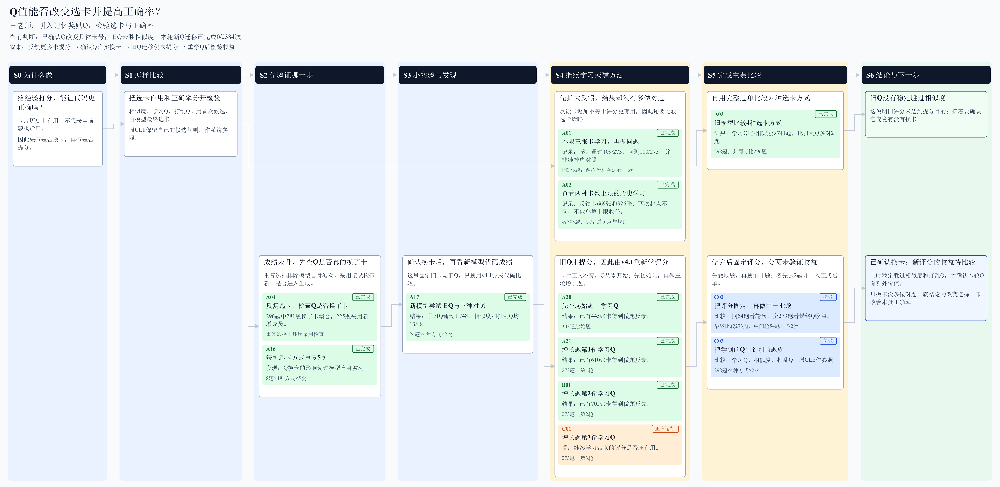
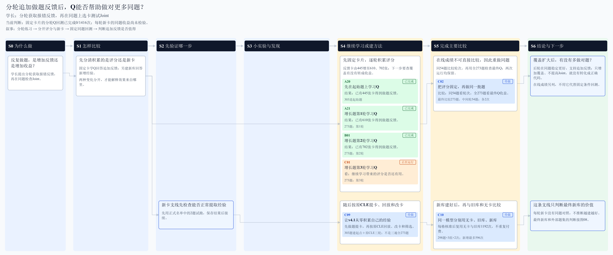
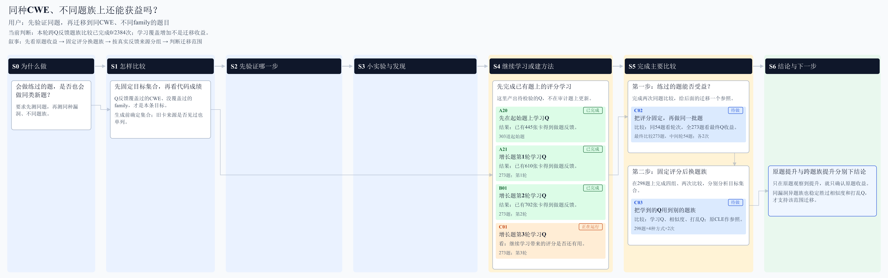
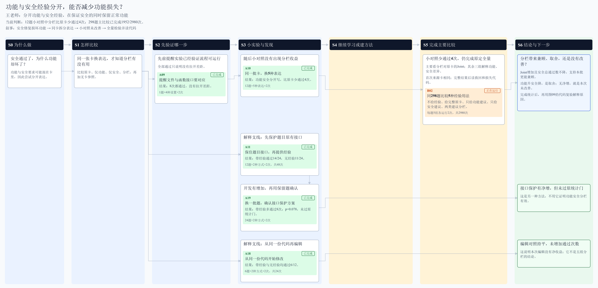
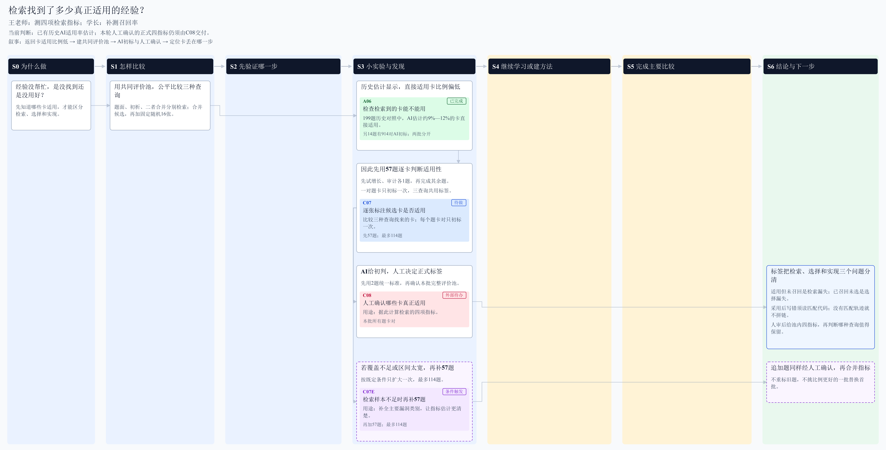
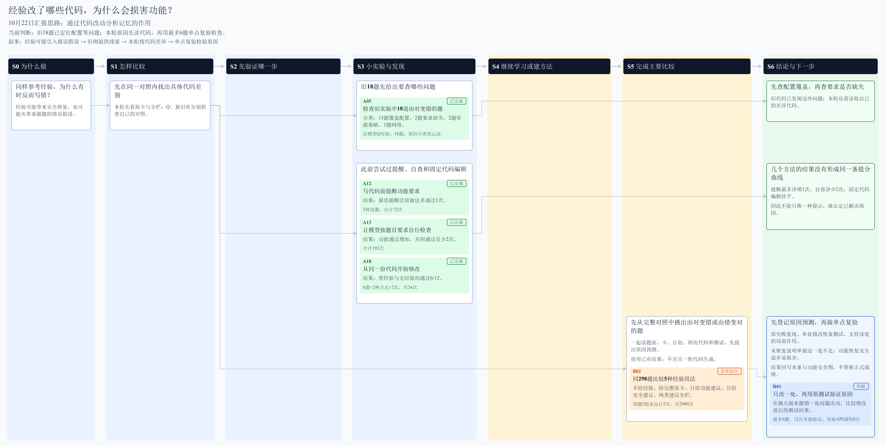

# 10月22日-10月28日研究思路图汇总

九图采用10月28日18:10保存的状态。原始已确认图保留，本册为本周副本。

## I01 Q值能否改变选卡并提高正确率？

[打开可跳转SVG](figures/ideas/01_Q值选卡.svg)

## I02 分轮追加做题反馈后，Q能否帮助做对更多同题？

[打开可跳转SVG](figures/ideas/02_分轮积累.svg)

## I03 同种CWE、不同题族上还能获益吗？

[打开可跳转SVG](figures/ideas/03_跨题族迁移.svg)

## I04 功能与安全经验分开，能否减少功能损失？

[打开可跳转SVG](figures/ideas/04_功能安全分开.svg)

## I05 能否为不同题目选择合适的记忆程度？

[打开可跳转SVG](figures/ideas/05_记忆程度分类.svg)

## I06 检索找到了多少真正适用的经验？

[打开可跳转SVG](figures/ideas/06_检索质量.svg)

## I07 哪些比较必须全量，哪些探索先抽样？

[打开可跳转SVG](figures/ideas/07_全量与抽样安排.svg)

## I08 v4.1使用新库是否优于旧库和无卡？

[打开可跳转SVG](figures/ideas/08_模型与卡库交叉.svg)

## I09 经验改了哪些代码，为什么会损害功能？

[打开可跳转SVG](figures/ideas/09_经验代码改动.svg)
