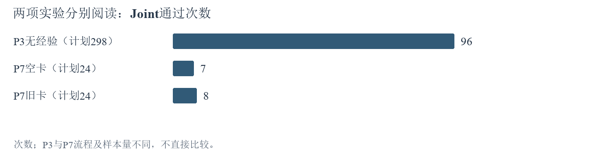
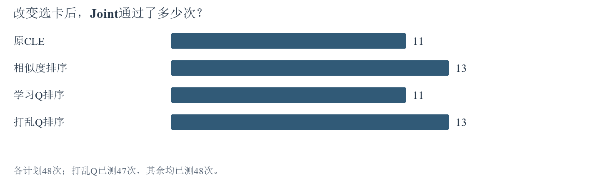
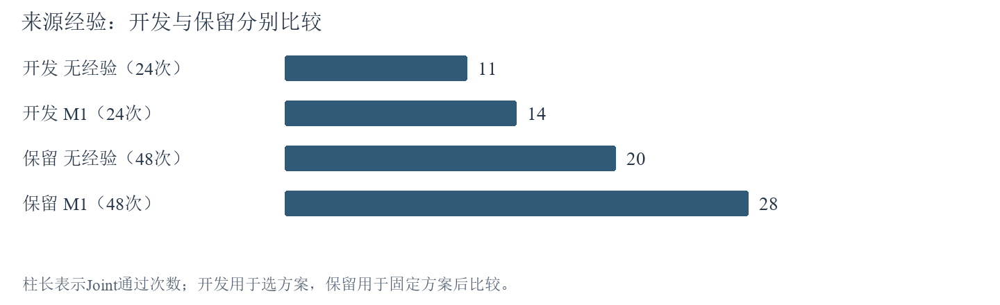
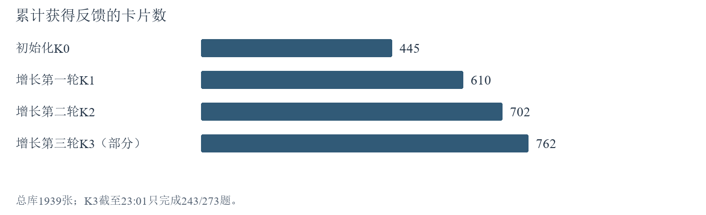
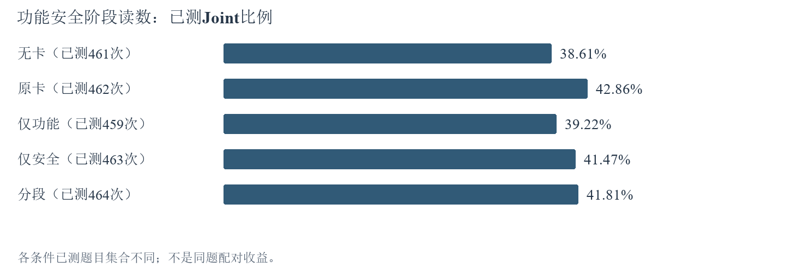

# 10月22日-10月28日实验探索报告

## 一、本周实验主线

本周研究经验如何帮助代码同时满足功能与安全要求：先确认旧经验和Q评分在新模型上是否有用，再检验追加反馈、经验表达和自动选档，最后比较新旧卡库。检索测量负责查明适用经验在哪里遗漏，代码复盘负责解释选到经验以后为何仍然出错。已启动全量继续，其他思路先做探针和分析，排队全量暂缓。

本报告统计截至10月28日23:01。**确定的进展是Q反馈覆盖持续提高；本周已完成小对照的结论是改变选卡并未提高Joint，按功能与安全分段表达和旧分类器也未胜过其对照。** 本轮学习完成1092/1122次，功能安全对照完成2315/2980次；已完成结果、正在运行结果和待做方案分别列出。

Joint指同一份代码同时通过功能和安全测试，F、S分别表示功能、安全通过。初始化集303题建立学习起点，增长集273题用于追加反馈，审计集298题检验使用效果。CWE是漏洞类型，family是同来源或相近结构的题族。两次重复是独立运行，不是两道新题。P3无经验流程与P7空卡对照分别统计。

经验卡是可复用的解题建议；Q是根据解题反馈更新的卡片评分。这里的“学习”只更新卡片评分，不训练生成模型的参数。“反馈覆盖”是获得过反馈的卡数除以总卡数，不代表这些卡已经被证明有效。旧卡与旧Q来自v3.2；本周生成模型为deepseek-v4.1-flash-1017。

一次代码运行＝一道题在一个条件下的一次生成与验证。同一道题重复两次，仍只算一道独立题。配对比较固定题目及重复编号，再比较两个条件：“救回”指原来Joint不通过、换条件后通过；“损失”指相反变化。“保存完成”表示记录已经落盘，“已测”表示功能和安全结果均可获得，缺测不当作已测失败。

CLE是本项目使用经验辅助生成代码的Agent系统。PLT是本项目使用的代码安全题集，D_init、D_grow、D_gate分别对应初始化集、增长集和审计集。P3和P7是两套不同的解题流程：P3不使用经验；P7保留经验处理流程，空卡条件只是不输入卡片。两流程的分数不能直接相减当作经验收益。公开契约指题面已经说明的接口、输入输出和行为要求；测试夹具指执行验证所用的环境、辅助对象和测试代码。

下文按“问题→待做实验→已完成实验”阅读，点击【A】可跳到证据，点击【T】可跳到后续安排。统计中的置信区间表示差值的估计范围；跨过0时，数据仍容许正、负两种方向。p值用于按预定规则判断差异，不是“结论正确的概率”。Holm校正用于同时做多项比较时控制误判。

### （1）旧Q能否改善新模型的代码？

旧Q改变了实际卡号，但代码对照中学习Q与原CLE同为11/48，相似度为13/48。这次实验没有显示学习Q的正确率收益。 [【A2】](#a2)

证据对应：选卡变化及代码对照，见[【A2】](#a2)。

### （2）追加学习是否让更多经验卡获得反馈？

初始化和前两轮增长学习已经完成，获得反馈的卡依次为445、610、702张。第三轮已完成243题，覆盖达到762/1939。覆盖提高已经发生；是否变成更多正确代码，由固定同题回测回答。 [【A9】](#a9)

证据对应：各轮覆盖、在线成绩及实际代码复盘，见[【A9】](#a9)。

### （3）Q收益能否迁移到同漏洞类型的不同题族？

旧结果不能代替本轮新Q迁移检验。本轮先完成学习与同题回测，先做2题四组两重复的技术探针；298题四组两重复暂缓，单独分析事先固定的同CWE、不同反馈题族集合。 [【A11】](#a11)

证据对应：本轮比较范围和执行依赖，见[【A11】](#a11)。

### （4）分开功能与安全经验是否更好？

小对照按功能与安全分段9/24，原卡13/24，未改善。全量对照现完成2315/2980次；原卡阶段读数198/462，按功能与安全分段194/464。当前各条件已测集合不同，最终按全部同题配对结果判定。 [【A3】](#a3)

证据对应：已完成小对照；全量阶段读数见[【A10】](#a10)，小对照见[【A3】](#a3)。

### （5）自动选择记忆程度值得继续吗？

既有分类器21/48，固定提醒22/48，分类器没有胜出。新安排先用82题判断能否学到稳定的档位选择，再决定追加一批或进入6题策略探针。 [【A5】](#a5)

证据对应：已完成分类器与固定策略比较，见[【A5】](#a5)。

### （6）检索遗漏发生在找卡还是选卡？

历史AI标签不能替代本轮人工确认。新安排先做57题共同候选池，分开计算候选漏失和最终选卡漏失；只对本批候选池作出判断。 [【A8】](#a8)

证据对应：历史测量范围和四指标定义，见[【A8】](#a8)。

### （7）新模型自己的卡库是否优于旧库？

旧卡迁移共同可测23次，两组各通过7次，没有表现出优势。接下来比较v4.1的无卡、旧库、新库；v3.2已停用，其新交叉臂结束。单模型结果不用于声称两模型的交互作用。 [【A1】](#a1)

证据对应：已完成迁移对照及后续建库问题，见[【A1】](#a1)。

### （8）如何用更少成本得到有用结论？

保留已启动全量，其余先接探针；排队全量先跳过；技术检查计入正式名单，已返回结果按精确条件复用。新的安排已经进入工作台执行队列。 [【A11】](#a11)

证据对应：规模、扩大条件和实际接线，见[【A11】](#a11)。

### （9）具体代码改动真的造成了退步吗？

现有代码复盘已区分题目要求缺项、把来源题的对象、配置或约束误搬到当前题和实现错误。下一步从功能安全差异题中选最多6题，预先写出单处修改的预测，再作最多12次本地验证，检验局部原因。 [【A9】](#a9)

证据对应：已完成案例证据；新局部复验见【T5】，见[【A9】](#a9)。

## 二、本周待做实验

下列安排承接本周已完成结果。正在运行的学习和功能安全全量保持原规则；尚未开始的批次采用新规模。所有技术检查都计入正式名单，重复运行相互独立。工作台按已经完成的必要前置任务接续探针和分析；排队全量暂缓，不能因探针通过自动启动。

### 【T1】共同协议和执行接续如何落实？

实验原因：让计划中的条件、名单和实际执行一致。

1. 保留活动学习、功能安全输入及已保存响应。
2. 后续评价统一使用修订后的298题公开契约；原验证器参考预检298/298通过，该数字不是模型成绩。
3. 每包完成后回放、统计、实际阅读差异代码，再更新叙事和图，满足交付条件后接续。

预测结果分析：探针接力规则v09已安装；40项离线调度验证通过。成功标准是原生结果、回放和案例分析均有实际产物；入口准备完成不算实验完成。

[返回本周主线](#main)

### 【T2】检索标签怎样经过人工确认？

实验原因：把模型估计变成可解释的适用性判断。

1. 用2题统一“直接适用、附加条件、冲突、不适用”的定义。
2. 人工裁决本批共同候选池中的标签，不只复核被选中的卡。
3. 汇总池内精确率、召回率等四指标，保留争议和裁决记录。

预测结果分析：人工确认后才给正式池内指标；只有AI初标时交付估计和复核材料。该结果不等于1939张全库召回率。

[返回本周主线](#main)

### 【T3】外部数据集还需什么环境？

实验原因：使用独立外部任务检验卡库效果。

1. 补齐原safecoder-python-validator:local镜像及原正向校准。
2. 新库与原环境就绪后先登记各集2题的有界检查；1530次全量（Base 115题＋Plus 140题，三条件各重复两次）保持暂缓。
3. 每集前2题计入正式名单，常驻Docker和原watchdog执行，隐藏测试不回传。

预测结果分析：环境未就绪就保持未执行。两集分别判断新库相对旧库和无卡的收益。原P3外部255次暂缓，不随镜像到位自动恢复。

[返回本周主线](#main)

### 【T4】怎样判断追加Q反馈和迁移是否有效？

实验原因：把“覆盖增多”与“正确代码增多”分开验证。

1. 完成K3，冻结Q，做原生回放与实际案例分析。
2. 同54题比较K0、K1、K2、K3及相似度，两重复；五条件合计540次；原1416次计划（273×2×2＋54×3×2）中的其余876次暂缓。
3. 完成前置分析后先2题四组两重复，共16次技术探针；2384次计划中的其余部分暂缓，异反馈题族子集事先固定。

预测结果分析：同54题比较回答追加学习效果，全273题最终比较仍待后续启动决定。新Q相对相似度和打乱Q的两项主要比较经Holm校正p≤0.05、题族95%差值区间下界>0，且两重复净收益均非负，才称本轮稳定收益；未过门则写本轮未建立稳定收益。达到2个百分点优先继续投入，正收益不足2个百分点记小幅收益。

[返回本周主线](#main)

### 【T5】分段表达未提分，能否定位到具体改动？

实验原因：既检验按功能与安全分段总体效果，也检验具体退步原因。

1. 完成298题五条件两重复的2980次对照，回放并比较按功能与安全分段与原卡。
2. 阅读救回、损失题的题面、来源卡、计划、代码及原验证证据。
3. 选最多6道不同题，预先记录一处改动及预测，用独立副本完成最多12次本地原验证，不调用实验API。

预测结果分析：Joint增加且安全总通过数不降，支持本批兼顾；功能上升而安全下降说明取舍；Joint无净增则本次未改善。原失败复现且单处修改恢复目标测试才支持该处局部原因，未恢复则单因预测未成立；不得把少数案例比例推广到所有失败。

[返回本周主线](#main)

### 【T6】82题能否训练出有价值的选档器？

实验原因：先验证训练机会，再支付全量策略比较费用。

1. 先82题五档两重复，共820次；L0无卡，L1一句提醒，L2机制前提，L3加目标模板，L4加来源示例。
2. 按既定训练数据门槛判断：至少30个训练题族、至少两档各有5个训练题族等条件；必要时只追加82题，最多164题。
3. 满足门槛后用既有8特征、逻辑回归和三种参数，按题族留出题的实际Joint选模，再先做6题三策略两重复，共36次；全量298题×3策略×2重复＝1788次，其中先做36次，其余1752次暂缓。

预测结果分析：最多164题仍不满足训练数据门槛，结束分类器支线。稳定胜过固定档和规则才支持提分；Joint差值95%下界>−1个百分点且完整流程已知Token减少≥20%、未知用量不足以推翻比较，才支持保质省Token。两门均未过就结束本轮，不增加分类器复杂度。

[返回本周主线](#main)

### 【T7】57题能否找到检索的主要漏失？

实验原因：以较少标注定位检索瓶颈。

1. 固定增长集27题、审计集30题；各取1题检查后接续，共57题。
2. 三种查询使用共同池：每种查询取语义最相近的24张卡、关键词最相近的8张卡，合并后加入固定随机抽取的16张卡；同题同卡去重，每对AI初标一次。
3. 主要CWE未覆盖、至少有一张已判定适用卡的有效题不足20，或召回率区间的半宽大于0.10（估计范围向任一侧延伸超过10个百分点）时，追加固定57题，最多114题，再交付人工复核。

预测结果分析：查询差值在人工确认池内成立才支持本批查询改进；无差异保留低成本原查询。缺向量不记空返回，不为拼接采用链追加代码生成，不扩大为全库标注。

[返回本周主线](#main)

### 【T8】新模型建立的新库比旧库好吗？

实验原因：把模型本身和经验来源的作用分开。

1. 从空库先做2道初始化题验证建库流程；完整初始化、三轮主动回放和全局门控暂缓，两题产物不冒充完整库。
2. 真实完整新库到位后，先12题三条件两重复，共72次；48次精确核准复用，新生成最多24次，全298题暂缓。
3. 新库生成、冻结回放和分析完成后才做三库对照，再按T3进入外部集。

预测结果分析：新库稳定胜过旧库与无卡才确认该集额外收益；审计集参与决定哪些新经验可以入库，因此之后在同一审计集上的成绩属于已参与筛选的数据，不能当作完全独立的泛化检验。Base和Plus是另外两套外部代码任务集，分别115题和140题，用于检验跨集使用效果。v3.2后续臂因模型停用结束，不替换模型，也不把单模型三库称为两模型交互。

[返回本周主线](#main)

## 三、实验内容与结果分析

### 【A1】无经验基线和旧卡迁移说明了什么？

#### 为什么做这项实验

本实验回答两个问题：换成v4.1后，不看经验的模型能做对多少题；同一P7流程加入旧1939卡库后，成绩是否改变。P3是无经验基线，P7是另一套包含经验处理的生成流程，两者不能直接相减当作记忆收益。[返回要求七](#r7)

#### 怎样做

1. 使用deepseek-v4.1-flash-1017，保持原P3初析、规划、生成和最多一次修订，在PLT的298道D_gate题运行；不输入、不生成经验，不更新Q。
2. 保留原43题结果，修复实际TLS传输问题后续跑247题，再按原实验规则补跑剩余8题；保留失败请求和未知用量，最终298题保存代码均零API回放。
3. 另外固定12题、每题两次重复，在P7中比较空卡与旧1939卡库；每个题次共享首次初析，最多三卡、最多一次修复，不学习Q。
4. 对48个P7单元逐一回放；将技术缺测与模型答错分开，比较完整配对成绩，而不是把单次多通过一题直接归为经验作用。

#### 看到了什么

| 实验与条件 | 执行／计划 | F通过 | S通过 | Joint通过 |
| --- | --- | --- | --- | --- |
| P3 无经验 | 298／298 | 111／298 | 232／298 | 96／298 |
| P7 空卡 | 24／24 | 7／24 | 18／24 | 7／24 |
| P7 1939卡 | 24／24 | 8／24 | 20／24 | 8／24 |

上表以计划次数为分母，表示交付通过占比；缺测另列。P3完整测量297题，按298题计划计算Joint为32.21%（96/298），按已测计算为32.32%（96/297）；P7空卡完整测量23个单元，带卡24个，双方均完整的23对中Joint均为7／23。P3已知Token为3,841,636，30次物理请求用量未知；P7合计2,063,129 Token（其中Embedding 46,461），另15次请求尝试用量未知。两个来源的请求计数口径不同，费用均不写成实付账单，也不与[【A8】](#a8)累计数直接相加。

#### 这些结果说明什么

图1第一项给出新模型在无经验完整任务集上的基线；后两项只说明这12题两重复的旧卡迁移表现。P7原始总分带卡多1个通过，但唯一差异涉及空卡生成截断；排除不完整配对后双方相同。因此，这一轮建立了可复用的换模起点，尚未证明旧卡能够稳定提分。后续采用同P7、同名单的v4.1三库对照；v3.2停用后的新增交叉臂已经结束。后续[【A2】](#a2)至[【A7】](#a7)是在此后开展的机制比较，不把这些局部单元追加到P3的298题分母。

原始证据：[10月25日P3全量报告](../../../CLE_P3无经验Agent_PLT全量基准报告_20261025.md)、[10月25日P7迁移报告](../../../CLE_v41Flash1017_P7空卡与1939卡迁移实验报告_20261025.md)。原始完成时间分别见各报告；本节属于10月22日至28日这一周。

[返回要求七](#r7)　[返回本周实验主线](#main)　[返回实验导航](#experiments)

### 【A2】Q改变选卡后，代码是否更正确？

#### 为什么做这项实验

本实验分两步：先通过重复选卡，判断Q有没有改变最终选中的卡，并与模型在相同条件下多次选卡的波动比较；再看改变选卡后，功能和安全是否一起通过。Q0至Q3在下表中说明，最终仍由模型选择，不是直接取Q最高的三张。[返回要求一](#r1)

| 选卡方式 | 给模型的提示顺序是什么 |
| --- | --- |
| Q0 原CLE | 按原有候选方式呈现，再由模型选择经验 |
| Q1 相似度 | 优先呈现与当前题目语义相近的卡，再由模型选择 |
| Q2 学习Q | 排序时加入经验卡的历史反馈分数，再由模型选择 |
| Q3 打乱Q | 在同类漏洞中打乱卡与分数的对应关系，再由模型选择 |

Q0的候选边界与其他组可能不同；与Q0比较时，不能把所有差异都归因于Q排序。

#### 怎样做

1. 固定1939张经验正文和历史Q快照。972张卡的反馈次数（visits）大于0，即曾获得反馈，覆盖率为50.13%；Q恰好为0但有反馈的卡也计入。这个快照包含v3.2的部分在线学习状态，不是v4.1重新学习的Q。
2. 对8个题族的相同查询、候选和余弦相似度，分别运行四种排序，每种重复5次，共160次选卡。使用排序混合参数λ=0.5（混合排序分数，不是模型一半时间看Q）、相似度阈值δ=−1（本设置不以相似度分数排除候选）和置换种子20261015（固定打乱结果，便于重复核对）；这是本轮探索设置，不能写成所有历史CLE实验的默认参数。
3. 在24个事先留出的题族上，每个条件重复2次，共192个代码运行。首次题意分析和候选卡列表共享，模型最多选三张；后续修复依各组代码独立进行，Q和经验始终冻结。
4. 按相同题目及重复编号配对，比较卡号集合、新增卡采用、F/S/Joint与救回损失。统计以题族为单位处理相关性，保留缺测及历史技术失败记录。

#### 看到了什么

| 条件 | F通过数 | S通过数 | Joint通过数 | 已测/计划 |
| --- | --- | --- | --- | --- |
| Q0 原CLE | 19/48 | 33/48 | 11/48 | 48/48 |
| Q1 相似度 | 19/48 | 35/48 | 13/48 | 48/48 |
| Q2 学习Q | 18/48 | 33/48 | 11/48 | 48/48 |
| Q3 打乱Q | 20/48 | 32/48 | 13/48 | 47/48 |

上表各组以48次计划为分母；Q3只完成47次测量，13/48不是已测成功率，其已测成功率为13/47。

重复选卡的160次有效记录显示，Q2相对Q0、Q1、Q3的卡号集合差异超过组内波动，Holm校正（同时比较多组时减少误判的方法）后的p值分别为0.006、0.0072和0.00015。代码实验中，Q2对Q0的首次选卡集合变化46/48次，新增卡声明采用32/48次。Q2选中卡片的位置中134/139有过Q反馈，首次声明采用的位置中97/97有过反馈；这些是累计卡片出现次数：同一张卡在不同运行中出现会重复计数，不是去重卡数或独立题数。

#### 这些结果说明什么

图2中，学习Q组与原CLE组同为22.92%，比相似度和打乱Q各低4.17个百分点。逐题配对后，Q2相对Q1没有救回、损失2次；相对Q3救回1次、损失3次；相对Q0救回和损失各2次。Q2与Q1、Q3的两项成绩比较校正后p值均为1，现有数据未支持学习Q提高Joint。Q3有一格缺测，不能将这一格解释成模型已被测出失败。

这个结果不能再主要解释为“没有接触到有Q的卡”，因为实际选中与声明采用的卡片大多已有反馈。具体失败仍发生在后面的落实环节：1209采用了算术相关建议，但生成代码错误访问AST节点的left/right属性；1065采用了跳过无效字段的建议，却仍然抛出异常；901还存在公开题面未确定阈值的问题。因此，同候选边界下Q2与Q1、Q3的重复选卡差异支持Q改变了选择；Q2对Q0的46/48变化还包含候选路径差异，旧Q迁移适配、卡片适用性和代码实现能力则尚未被独立区分。下一步应完成新模型自己的分轮Q学习及54题冻结探针；排队全量暂缓，不能凭本轮负结果宣布Q普遍无效。

本节对应的原实验编号：D03a、D03b。数据来源：[四臂统计和逐包汇总](../../../../results/curated/cle_v41_completion_20261026/summary.json)、[选卡波动分析](../../../../translation_work/diagnostics/20261026/cle_v41_completion/CLOSEOUT/D03a_selector_noise.json)、[代码与卡片复核](../../../../translation_work/diagnostics/20261026/cle_v41_completion/CLOSEOUT/agent_case_review.json)。

[返回要求一](#r1)　[返回要求二](#r2)　[返回本周实验主线](#main)

### 【A3】拆分或编辑经验能否兼顾功能与安全？

#### 为什么做这项实验

功能经验帮助代码完成任务，安全经验帮助代码避免风险。本实验使用同一来源卡，比较混合与按功能与安全分段展示；另从同一段已有代码出发比较有无经验的单次编辑，以减少起始代码不同的影响。按功能与安全分段展示不等于建立了两套独立卡库。[返回功能安全问题](#r4)

| 条件 | 实际给模型的经验内容 |
| --- | --- |
| B0 无记忆 | 不提供经验卡 |
| BM 原混合卡 | 采用原卡中混合的功能与安全建议 |
| BF 功能视图 | 呈现整理出的功能建议及适用上下文 |
| BS 安全视图 | 呈现整理出的安全建议及适用上下文 |
| BFS 功能安全分段组合 | 分别以功能、安全和适用上下文段落呈现同一来源卡 |

#### 怎样做

1. 固定12个题族、每题2次重复和五种条件，共120个代码运行：无记忆B0、原混合卡BM、仅功能视图BF、仅安全视图BS、功能安全分段组合BFS。
2. 各条件共享首次题意分析；只有四个带卡条件共享来源卡编号，B0始终没有卡输入。整理时把同一张卡的文字分成功能建议、安全建议和适用上下文；不是另建功能卡库和安全卡库。分区只读取来源卡正文，不查看目标题答案；分别记录模型整理和按既定规则补全文段的处理方式，生成模型接收相同公开任务，按原P7完成生成和最多一次修复。
3. 汇总各条件F、S与Joint，将BFS和BM按同题配对，查明损失是否来自实际采用的建议或额外改写。
4. 补充编辑实验固定6个题族、2次重复，以同一段BM首轮代码作为起点，只比较输入经验与不输入经验的单次编辑，共24个单元；它不是另一轮完整P7成绩。

#### 看到了什么

| 条件 | F通过数 | S通过数 | Joint通过数 |
| --- | --- | --- | --- |
| 无记忆B0 | 12/24 | 19/24 | 12/24 |
| 原混合卡BM | 14/24 | 19/24 | 13/24 |
| 功能视图BF | 15/24 | 19/24 | 13/24 |
| 安全视图BS | 13/24 | 18/24 | 12/24 |
| 功能安全分段组合BFS | 12/24 | 18/24 | 9/24 |

五组均完成完整测量。BFS相对BM救回0次、损失4次。补充编辑中，无卡与带卡均为F 7/12、S 9/12、Joint 6/12，救回和损失均为0；带卡条件实际有9/12次输入经验，其余起点没有可用的采用卡列表。

#### 这些结果说明什么

图3显示，功能安全分段组合的Joint为37.50%，低于原混合卡的54.17%。仅功能视图的功能通过数增加1次，但Joint没有增加，这说明改善功能的题目与安全通过的题目不一定重合。研究目标要求同一份代码同时满足两方面，因而不能用F单独增加替代Joint改善。

1326的功能安全分段组合代码改写了白名单，破坏原有功能，但没有声明采用相关卡片。这说明“看到了不同的经验文本”和“明确使用某张卡导致错误”仍需区分。另一组编辑没有改变结果，也只说明这6个题族的单步编辑未产生收益；编辑输出格式不包含采用声明，不能把汇总中的采用数0解释为没有记忆输入。当前证据不支持直接推广这一拆分方式，后续全量实验应保留功能保持、来源假设迁移和实际代码改动三类分析，检验功能损失具体发生在哪里。

本节对应的原实验编号：B02、B05。数据来源：[逐包汇总](../../../../results/curated/cle_v41_completion_20261026/summary.json)、[实际案例复核](../../../../translation_work/diagnostics/20261026/cle_v41_completion/CLOSEOUT/agent_case_review.json)。

[返回功能安全问题](#r4)　[返回本周实验主线](#main)

### 【A4】提醒、原理、目标模板和来源示例，哪种经验表达更有用？

#### 为什么做这项实验

要训练分类器，先要看同一道题在不同经验详细程度下是否真的有差别。如果大多数题各档表现相同，就缺少选择档位的学习信号。五档分别是不提供经验、风险提醒、原理、目标模板和来源示例。L3与L4改变的不只是长度，也改变了内容类型：目标模板面向当前题，来源示例来自另一道题。[返回记忆选择问题](#r5)

| 档位 | 模型能看到什么 |
| --- | --- |
| L0 无记忆 | 不提供经验 |
| L1 风险提醒 | 一句话指出需要注意的风险 |
| L2 机制前提 | 解释安全机制及适用条件 |
| L3 操作模板 | 提供面向当前任务的操作模板 |
| L4 来源示例 | 提供来源任务中的完整示例 |

#### 怎样做

1. 固定48个D_grow题族，每题五档、每档两次重复，共480个单元；事先分为36个训练题族和12个开发题族。D_grow是用于积累经验和反馈的任务池，不是最终独立测试集。
2. 从相同来源材料形成不同档位，排除同题族来源。15张缺少来源代码的卡在所有档位共同排除，避免只有L4可用卡范围不同。
3. 各档按原P7预算生成和验证，记录真实采用、交付成绩和输入Token。按题族查看两次重复是否支持同一档位，而不根据一次偶然成功指定标签。
4. 先报告五档完整结果，再将训练题族中具有可靠成功证据的记录交给[【A5】](#a5)；开发题族结果用于检验，不回填训练标签。

#### 看到了什么

| 档位 | F通过数 | S通过数 | Joint通过数 | 已测/计划 |
| --- | --- | --- | --- | --- |
| L0 无记忆 | 53/96 | 71/96 | 44/96 | 95/96 |
| L1 风险提醒 | 53/96 | 74/96 | 46/96 | 96/96 |
| L2 机制前提 | 53/96 | 74/96 | 44/96 | 96/96 |
| L3 操作模板 | 54/96 | 75/96 | 47/96 | 96/96 |
| L4 来源示例 | 49/96 | 71/96 | 42/96 | 96/96 |

上表按96次计划计算比例，L0有1次缺测；其已测Joint为44/95。以下差值和检验沿用原报告口径，缺测本身不证明模型失败。

L3相对L0救回6次、损失3次，净增加3次；题族重采样95%区间为−3.125至+10.417个百分点，配对检验p=0.5625。48个题族中31个在五档下成功的重复次数相同，其中17个全部失败、13个全部成功，另1个各档均一次成功；另有2个题族出现某档两次成功、另一档两次失败，均在训练部分；剩余15个题族存在档位差别，但没有达到这种两次全成功对两次全失败的对比。17个全失败题族只能说明本次没有成功档，不能说明各档作用相同。

#### 这些结果说明什么

图4没有呈现记忆越详细、Joint越高的趋势。L3比无记忆高3.125个百分点，L4低2.083个百分点；结合具体案例，一种可能解释是完整示例带入来源任务的假设，而操作模板与目标任务更容易衔接，但总分本身不能证明这一机制。不过区间跨过0，当前不能确认L3总体更好，更不能仅凭L4总分较低就认定每个完整示例有害。

从分类器角度看，31/48个题族没有可见的档位差别，意味着大量结果无法告诉模型“该选哪一档”。全部失败的题目也不能自动标成L0最优，因为它们没有证明无记忆更合适。逐题检查还发现1005在L4下成功却没有采用声明，1059有来源四字段白名单与目标三字段要求的差别。这些现象要求后续标签同时考虑真实使用与可重复成绩，以免分类器学到生成波动或来源不匹配。

本节对应的原实验编号：C02。数据来源：[五档结果](../../../../results/curated/cle_v41_completion_20261026/summary.json)、[案例复核](../../../../translation_work/diagnostics/20261026/cle_v41_completion/CLOSEOUT/agent_case_review.json)。

[返回记忆选择问题](#r5)　[返回本周实验主线](#main)

### 【A5】自动选择记忆档位胜过固定提醒了吗？

#### 为什么做这项实验

分类器根据公开题目特征预测应该使用哪一档经验。本实验用[【A4】](#a4)的真实成绩训练，再与固定一档和公开规则比较；目标题的正确答案不能用于选择档位。只有最终代码成绩改善，才能说明选档对任务有帮助。[返回记忆选择问题](#r5)

| 选择方式 | 如何决定使用哪一档经验 |
| --- | --- |
| 分类器 | 根据公开题目特征预测 |
| 固定L1 | 所有题固定使用L1档；提醒内容随题目及检索到的经验变化，不是所有题复制同一句话 |
| 公开规则 | 无候选卡选L0；题面出现外部绑定标记或写入等操作词选L3，否则选L2 |

#### 怎样做

1. 仅使用36个训练题族制作标签。某档两次Joint都通过时，按预定规则选平均输入Token最少的合格档；全失败或缺少有效记忆介入的情况标为未解决，不强行指定最佳档位。
公开规则只检查题面：外部绑定标记是至少3字符的大写名称；操作词为write、delete、modify、update、execute、open、send、save。它们是程序用于选档的文字特征，不代表已经证明存在副作用。分类器的8项输入是公开文本长度、参数词数、上下文长度、大写绑定名称数、是否说明返回值、是否说明异常、上述操作词数、安全要求长度。

2. 最终得到19个有效题族标签：11个L0、7个L1、1个L3；另外17个保留未解决。提取公开题面长度、参数、绑定关系和副作用等特征，用逻辑回归训练，并仅在训练部分用三折划分选择设置。
3. 在12个开发题族查看三种策略，各为两次重复；随后固定分类器及策略，在24个保留题族上比较，每种策略两重复，共144个逻辑运行。这24个确认题族由独立的确认名单提供，不是把36个训练题族和12个开发题族再拆成24个；完整题号名单见原实验记录。
4. 对预测到同一档且协议完全一致的12个单元精确复用已有输出。按同题配对比较Joint，保留实际采用数和缺测，不因某策略较差重新训练或换题。

#### 看到了什么

| 策略 | F通过数 | S通过数 | Joint通过数 | 已测/计划 |
| --- | --- | --- | --- | --- |
| 分类器 | 24/48 | 37/48 | 21/48 | 48/48 |
| 固定L1 | 25/48 | 38/48 | 22/48 | 48/48 |
| 公开规则 | 25/48 | 34/48 | 19/48 | 47/48 |

上表以48次计划为分母，公开规则有1次缺测，已测Joint为19/47。

开发部分三种策略均为Joint 7/24。保留题中，分类器相对固定L1救回1次、损失2次；相对公开规则救回3次、损失1次，两项比较Holm校正后p均为1。分类器条件有12/48次声明采用，固定L1有45/48次；不同策略可能主动选择L0，因此采用率应结合预测档位解释。

#### 这些结果说明什么

图5显示，分类器没有超过最简单的固定L1策略。它比公开规则高2次，却比固定L1少1次，不能据此证明学习型选择优于固定提醒。分类器大多学习到L0或L1，而训练样本只有一个L3、没有可靠的L2或L4标签，当前数据不足以训练出覆盖五档的清晰决策。

这项实验已经落实了“用真实结果训练分类器”的方法步骤，但尚未实现“分类器能帮助提高成绩”的研究目标。现有标签数量少且档位分布不均，是需要优先检查的可能原因；仅凭这次对照还不能排除分类特征或模型选择等其他原因。后续先执行82题标签批，按训练数据门槛决定是否追加82题，保留未解决标签，并在独立题族上验证；不能把同题五档中的最高分直接当作推理时可获得的信息。

本节对应的原实验编号：C03/C04a、C04b。数据来源：[分类器结果汇总](../../../../results/curated/cle_v41_completion_20261026/summary.json)、[完整分析来源](../../../../translation_work/diagnostics/20261026/cle_v41_completion/CLOSEOUT/agent_synthesis.md)。

[返回记忆选择问题](#r5)　[返回本周实验主线](#main)

### 【A6】公开约束提醒能解决哪些实现问题？

#### 为什么做这项实验

公开契约是题目已经说明的接口、对象和行为要求。本实验分别检查关系提醒、生成模板和公开检查能否帮助模型遵守要求。三项对照改变的内容和样本不同，结果需要分别解释。[返回功能安全问题](#r4)

#### 怎样做

1. 关系提醒B03R固定1个题族、2次重复，比较无卡/带卡与绑定提醒/关系提醒的四种组合，共8个单元。初析、候选和生成前计划共享，只在预定生成阶段改变提醒；本周精确复用已完成记录。
2. 模板实验固定12个题族、2次重复，比较三种生成模板：P00保留原提示；P13增加保持正常行为和检查安全风险的要求；P22再加入三个通用示例及最小必要改动要求，共72个单元；共享首轮分析和规划，到生成阶段才分叉。
3. 公开检查D02固定48个题族、2次重复，比较原P7与PUBLIC流程，共192个单元。PUBLIC按预定协议使用公开检查和反馈决定修复与交付，隐藏测试不回传给模型；这一对照改变的是完整代码使用流程，不只是一句提示。
4. 分别统计各实验内部的成绩和配对变化，读取公开检查失败案例。已保存响应用于零API回放，回放发现的临时目录差异经修复后复核，不额外生成代码。

#### 看到了什么

| 实验与条件 | Joint通过数 | 补充结果 |
| --- | --- | --- |
| 关系提醒四种组合 | 各2/2 | 8/8完整测量，无成绩区分空间 |
| P00／P13／P22模板 | 10/24、10/24、11/24 | 每组24/24已测/计划 |
| 原P7 | 30/96 | F 37/96；S 67/96；完整测量95/96 |
| PUBLIC公开检查 | 28/96 | F 42/96；S 64/96；完整测量96/96 |

原P7有1次缺测：30/96是计划分母口径，已测Joint为30/95。

PUBLIC相对原P7救回4次、损失6次，Joint净减少2次。D02全部192个单元的保存响应回放与原终态一致（含1次缺测状态；回放一致不把缺测变成测量成功）；为修复回放临时目录问题完成21项相关离线检查，旧差异现场保留。

#### 这些结果说明什么

图6中，PUBLIC整套流程下，F从37次增加到42次，但S从67次降至64次，Joint也由30次降至28次。这说明“更多公开检查”未必等于更正确的交付，检查本身若理解错公开要求，也会把正确代码改坏。1001的公开自检在内容已转义的情况下仍拒绝包含onerror的文本，继而促使代码破坏安全输出，是具体可核对的例子。

关系提醒的四种组合全部通过，只能说明接线按预定变量运行，无法证明提醒在总体上有效。模板P22仅多一次通过，也不足以承担整体提分结论。该比较同时改变检查、反馈、修复和交付，不能把净变化单独归到某一句检查提示。对主线而言，公开契约缺失、模型没有遵守契约、检查器错误扩大契约是三种不同问题；后续应把它们作为完整功能保持实验的解释层，避免把所有功能失败都归到经验卡或Q上。

本节对应的原实验编号：B03R、S2_P13_P22、D02。数据来源：[逐包统计](../../../../results/curated/cle_v41_completion_20261026/summary.json)、[实际案例复核](../../../../translation_work/diagnostics/20261026/cle_v41_completion/CLOSEOUT/agent_case_review.json)。

[返回功能安全问题](#r4)　[返回实验导航](#experiments)

### 【A7】来源经验在另一批事先留出的题目上仍然有效吗？

#### 为什么做这项实验

本实验在同一A7代码生成与修复流程中，比较不提供经验和提供M1专门来源经验。M1_SOURCE36是这项实验专用的来源经验集合，与旧1939卡库不同；两组均最多一次公开证据修复。结果用于判断这套来源经验方案，不能单独归为Q或原P7的收益。[返回功能安全问题](#r4)　[返回要求七](#r7)

#### 怎样做

这里的“保留题”是没有用于挑选M1方案的另一批题，不是把通过Joint的代码拿走经验后再测试。开发题用于选择方案，保留题用于固定方案后的比较；每个条件都独立生成代码。

1. 在12个开发题族上，分别使用无经验与M1来源经验，每题2次重复，共48个单元。来源经验排除同题族材料，固定公开题面、模型和A7修复预算。
2. 按确认前登记的开发增量规则选出M1，固定其配置，再在24个保留题族上运行两条件、两重复，共96个单元；不根据中途成绩调整方案。
3. 记录每次实际注入的经验，验证同一交付代码的F/S/Joint，并将两组按题目和重复配对，核对救回、损失以及建议是否落实。
4. 同时报告按题族重采样区间和原协议精确检验，说明这批保留题此前已用于D02实验；该组称方案保留确认，不称整个CLE从未见过的最终测试。

#### 看到了什么

| 阶段与条件 | F通过数 | S通过数 | Joint通过数 |
| --- | --- | --- | --- |
| 开发：无经验 | 11/24 | 20/24 | 11/24 |
| 开发：M1 | 14/24 | 21/24 | 14/24 |
| 保留：无经验 | 27/48 | 37/48 | 20/48 |
| 保留：M1 | 33/48 | 39/48 | 28/48 |

两部分均完成完整测量。表内主成绩包含所有分配到该条件的运行，包括未注入经验的运行；没有把分母缩小为17或37来提高通过率。是否注入取决于来源资格和当次检索，不代表每次都能找到可用来源卡。开发阶段M1实际注入17/24次，救回5次、损失2次；保留阶段实际注入37/48次，救回9次、损失1次，Joint净增加8次，即16.67个百分点。保留阶段95%题族重采样区间为+2.083至+33.333个百分点，题族区组精确双侧检验p=0.078125；M1中每个题族的两次重复Joint结果一致，无经验组有4个。

#### 这些结果说明什么

图7中，开发部分用于挑选M1方案，不能再当作一次独立确认；固定方案后，保留题部分的M1高于无经验，保留部分同时改善F、S和Joint，是本轮最值得继续完整验证的正向结果。1001中可以追踪到来源经验建议使用html.escape，建议进入输入后在代码中落实，并对应最终救回；唯一损失案例338则涉及公开题面要求字符串、夹具使用字节串的冲突，不能不加区分地记为经验质量问题。

但两个统计方法给出的判断并不完全相同：重采样区间为正，原协议精确检验p=0.078125，大于预定0.05门槛。报告保留两者，不只挑有利的一项。因此当前结论是在已测保留题上净增加8次Joint通过；原协议精确检验未通过0.05门槛，因此尚不能宣布稳定提分。后续比较须固定A7流程、来源资格与名单；当前先按v09做探针，排队全量暂缓；如果要解释成模型与卡库的交叉作用，还需单独固定使用模型、来源库及预算，完成真正的交叉矩阵。由于v3.2已经停用，新安排只执行v4.1三库比较，结论限于该模型。

本节对应的原实验编号：S2_M1、S4。数据来源：[开发及保留题统计](../../../../results/curated/cle_v41_completion_20261026/summary.json)、[完整统计与案例分析](../../../../translation_work/diagnostics/20261026/cle_v41_completion/CLOSEOUT/agent_synthesis.md)。

[返回功能安全问题](#r4)　[返回要求七](#r7)　[返回本周实验主线](#main)

### 【A8】哪些结果已经完成，成本和检索测量还缺什么？

#### 为什么做这项实验

本节核对10月26日基础清单完成了多少、费用记录覆盖什么，以及检索、Q学习和建库还缺什么证据。它是零API资料复核，不产生新的代码成绩。完成数、检索质量和代码正确率需要分别判断。[返回检索问题](#r6)

#### 怎样做

1. 按执行索引读取各包计划、完成数和原生结果，区分代码运行、仅选卡单元、共享前序输出及同档精确复用，不合并成独立题目总数。
2. 检查11个代码包的既有零API回放结果，并读取12个代表案例的题面、卡片、计划、代码和验证记录。案例用于说明具体路径，不用于估计全体失败原因的比例。
3. 汇总已报告Token、物理HTTP（实际发出的网络请求）、未知用量和在途请求。沿用原账本的来源范围，失败未知用量不记为免费，不假设缓存命中率。
4. 查验Q更新、经验生成以及人工检索标签状态。没有执行或缺少必要标签的项目记为尚未验证，不能填入0分或从历史摘要反造记录。

#### 看到了什么

| 核对项 | 当前记录 | 能说明什么 |
| --- | --- | --- |
| 代码实验运行 | 1376/1376 | 固定清单完成，含复用及重复 |
| 仅选卡单元 | 160/160 | 只检验选卡，不产生代码成绩 |
| 零API代码包回放 | 11包一致 | 已存响应可重走对应流程 |
| 实际代码案例复核 | 12例 | 提供具体原因证据，不代表总体比例 |
| 基础清单的学习范围 | Q更新0次、新经验生成0张 | 10月26日基础清单未进行新模型学习与建库 |
| 已报告Token | 65,186,659 | 累计账本用量，不是本周新增实付 |
| 物理HTTP | 10,338 | 包含记入来源的实际请求与重试 |
| 已结束未知用量HTTP／在途 | 302／0 | 未知部分不能记为零费用 |

这份账本仅对应10月26日基础清单及其列入恢复来源的请求；【A11】另报10月27日起的新Q学习和功能安全运行。两表按各自来源保留，不拼成全项目总费用。这份累计记录包含本轮各包及列入恢复来源的请求，不能等同于整台电脑全部历史用量或本周新支出。本表记录用量，不换算实付人民币。关系提醒8格和分类器同档12格等复用均保留在各自逻辑分母中，不应为凑“新实验数”再次调用模型。

1376次代码运行的组成如下；P3的298次和P7旧卡迁移的48次属于更早的换模起步实验，不在这1376次内。160次选卡只比较卡号，不生成代码，也不加进1376。

| 基础清单原编号 | 本文位置 | 计划及保存次数 |
|---|---|---:|
| B03R 关系提醒 | A6 | 8 |
| B02 功能安全表达 | A3 | 120 |
| S2_M1 来源经验开发 | A7 | 48 |
| S2_P13_P22 生成模板 | A6 | 72 |
| D02 公开检查流程 | A6 | 192 |
| C02 五档表达 | A4 | 480 |
| C04b 分类器确认 | A5 | 144 |
| D03b 四组Q代码对照 | A2 | 192 |
| B05 单次编辑 | A3 | 24 |
| S4 来源经验确认 | A7 | 96 |
| 合计 | 保存运行，不是去重题数 | 1376 |

分类器拟合及开发读数复用C02结果，不再加一批生成次数。关系提醒8次和同档策略12次复用已经返回的结果：它们算设计中的逻辑运行，但不算新的模型请求。已保存1376次也不等于全部可测，缺测在各实验表中另列。

#### 这些结果说明什么

图8和表格支持“基础清单完整完成”，并不支持“已做完全量新模型验证”。10月26日基础清单没有完成v4.1的新Q学习、全298题Q四臂、从空库建立新经验、两个模型交叉使用两库，以及原验证镜像下的Base/Plus评价。10月27日新Q学习已开始，但尚未完成，最新前缀见[【A9】](#a9)。旧P3、旧Q等结果只有在题面、模型、流程、反馈和预算匹配后才能作为新对照，否则只能保留为背景。

检索方面，准确率衡量题卡对的选入与未选入判断是否正确；精确率衡量选出的卡有多少适用；召回率衡量适用卡有多少被选出；F1综合精确率和召回率。目前缺少人工确认的适用性标签，不能形成正式四指标。即使完成共同候选池标注，也只能先报告“候选池内召回率”；整库适用卡未被完整标注时，全库召回率仍未测量。这是测量缺口，不是已经证明检索差，也不能用Q覆盖率代替它。

数据来源：[清单与成本汇总](../../../../results/curated/cle_v41_completion_20261026/summary.json)、[零API回放](../../../../translation_work/diagnostics/20261026/cle_v41_completion/CLOSEOUT/replay_results.json)、[七项要求与全量任务](../../CLE-PLAN-20261027-seven-requirements-v01.md)。

[返回要求二](#r2)　[返回检索问题](#r6)　[返回成本安排问题](#r8)　[返回要求七](#r7)

### 【A9】反馈覆盖增加后，在线正确率怎样变化？

**结果：K0、K1、K2完成；K3完成243/273题。反馈覆盖从445张升至762张，但在线Joint没有随覆盖单调上升。**

#### 为什么做这项实验？

旧Q在新模型上没有提分，需要让v4.1按自己的解题反馈重新学习。固定1939张卡正文，从Q和访问次数为零开始，保证观察到的是评分学习，不是换了一套卡。

#### 怎样做？

1. 顺序完成303道初始化题，按实际采用且具备奖励资格的卡更新Q，冻结为K0。
2. 在同273道增长题上继续三轮，分别冻结K1、K2、K3；学习保持单worker逐题更新。
3. 每轮完成后回放保存响应和原验证结果，分析反馈卡、题族和主要代码差异；冻结回测按【T4】另行执行。

| 学习阶段 | 已完成/计划 | 已测次数 | 首次代码Joint | 修复后交付Joint | 已获反馈卡/1939 |
|---|---:|---:|---:|---:|---:|
| K0 | 303/303 | 301 | 143 | 148（49.17%） | 445（22.95%） |
| K1 | 273/273 | 272 | 128 | 133（48.90%） | 610（31.46%） |
| K2 | 273/273 | 273 | 123 | 124（45.42%） | 702（36.20%） |
| K3 | 243/273 | 243 | 104 | 109（44.86%） | 762（39.30%） |

| 阶段 | 首次功能通过 | 首次安全通过 | 最终功能通过 | 最终安全通过 | 评分更新次数 | 声明采用卡次 |
|---|---:|---:|---:|---:|---:|---:|
| K0 | 159 | 244 | 163 | 247 | 837 | 878 |
| K1 | 147 | 203 | 149 | 207 | 646 | 770 |
| K2 | 145 | 204 | 146 | 206 | 611 | 748 |
| K3部分 | 124 | 179 | 125 | 182 | 662 | 835 |

上表四个通过数都是次数，彼此不构成分数。例如K0首次功能通过159次、安全通过244次。声明采用与评分更新按不同规则累计，不能相减后直接解释成“未落实卡数”；无奖励资格等情况不会获得Q反馈。

“首次”指第一版生成代码；“最终”指允许修复后交付的代码。同一卡片可多次更新评分，因此更新次数不等于去重卡数。表中百分比分母为本阶段已测次数。

#### 这些结果说明什么？

K1比K0新增165张反馈卡，K2再新增92张，说明追加解题确实扩大了Q的反馈范围。K1与K2使用同一增长题集，最终Joint分别为133和124，在线读数下降；两轮重新生成了代码，而且每做一道题都会更新评分，这个差值不能单独归因为Q。54题共同回测负责隔离轮次评分差异，全273题最终Q与相似度比较用于后续总体检验，目前暂缓。K3只完成243题，不与完整273题均值拼成收益曲线。

当前学习仍使用冻结的原奖励资格：增长集232题允许Q反馈，41题照常解题但不记奖励。新标签实验修订后的增长集契约没有追溯写入学习。声明采用只是模型输出记录，是否真正落实到代码还需阅读实现。

| 实际阅读的题目 | 代码与验证发现 | 对主线的判断 |
|---|---|---|
| K2：1289、1298 | 类型或异常行为的公开要求与验收存在差异 | 负反馈含契约因素，不能全部解释为卡片不适用 |
| K2：675、1301 | 生成代码覆盖外部配置；1301另有URL夹具问题 | 需要区分实现错误与题目条件，选卡正确不保证实现正确 |
| K2：108 | IDNA实现修订后通过，但该题不具备Q奖励资格 | 这次救回不是Q记账收益证据 |
| K2：883、1139 | 采用记录缺失或自述采用与实现不一致 | 采用字段不足以证明代码落实 |

保存响应回放是读取过去的模型响应和验证反馈来重走流程，不发新模型请求，也不重新执行代码；代码重验则是在本地再次运行同一代码和验证器。两者检查的对象不同。K0已完成保存验证反馈的精确回放，303行结果、Q和卡库一致；另行重新执行代码时，1107出现同代码结果变化，1111出现提示分歧，所以代码重验并非全部一致；本表仍保留原始测量值，不用复验结果静默替换成绩。K1、K2已完成各自原生回放和案例分析；K3尚在运行。K0、K2分别实际审查12题、9题，以上为其中代表性证据，不作为全体原因比例。

[返回追加学习要求](#r2)　[查看冻结回测安排](#t4)

### 【A10】全量功能安全对照目前支持按功能与安全分段表达吗？

**阶段结果：已保存2315/2980次，其中2309次完成测量。原混合卡198/462，按功能与安全分段194/464，当前没有显示按功能与安全分段优于原卡。**

#### 为什么做这项实验？

小对照中按功能与安全分段少通过4次。全量实验检验这一现象是否持续，并区分仅保留功能、仅保留安全以及两者按功能与安全分段表达的作用。

#### 怎样做？

1. 固定298道评价题，分别使用无卡、原混合卡、仅功能、仅安全、功能安全分段组合五种条件，各独立运行两次。
2. 四个带卡条件首次使用相同来源卡编号，再改变表达；各条件的修复过程独立，Q和卡正文不更新。
3. 完整后比较同题同重复的救回与损失、功能通过/失败与安全通过/失败形成的四种组合、题族区间和代码落实，再执行【T5】的单处改动复验。

| 条件 | 已完成 | 已测次数 | F通过 | S通过 | Joint |
|---|---:|---:|---:|---:|---:|
| B0 无卡 | 462 | 461 | 208 | 349 | 178（38.61%） |
| BM 原混合卡 | 463 | 462 | 231 | 367 | 198（42.86%） |
| BF 仅功能 | 462 | 459 | 219 | 347 | 180（39.22%） |
| BS 仅安全 | 464 | 463 | 225 | 362 | 192（41.47%） |
| BFS 功能安全分段组合 | 464 | 464 | 229 | 364 | 194（41.81%） |

#### 这些结果说明什么？

表中原卡的已测Joint比例最高；这只是不同已测集合的阶段读数，不是同题比较结论。各条件的已完成题目集合不完全一致，表中相减不等于已完成的配对效应；正式主比较将在五组固定名单完成后计算。当前保留全部实验继续执行，不按阶段排名挑选条件。功能、安全、Joint分别报告，是为了判断按功能与安全分段究竟恢复了功能、损失了安全，还是没有改变实现，而不是只看一个总分。

[返回功能安全要求](#r4)　[查看差异原因复验](#t5)

### 【A11】怎样用探针接力控制成本？

**结论：已启动Q学习和功能安全全量继续；其他研究先做探针，排队全量先跳过。** v09取代白天v08的自动接续方式，40项调度离线验证通过。这是执行规则验证，不是科学收益结果。

#### 为什么这样安排？

旧Q、功能安全分段表达和分类器小实验均未胜过对照。当前先用有限样本确认新机制和训练机会，把后续全量投入留给最有价值的问题；已经产生大量数据的两项全量保持规则完成。

#### 怎样执行？

1. 完成活动学习和功能安全，回放保存结果并阅读实际代码。
2. 有已经完成的必要前置任务且入口已验证的探针自动接续，普通负结果按既定固定样本收口；条件追加只执行登记的小批。
3. 遇到排队全量先跳过，继续其他独立探针。跳过不解除真实完整卡库、分类器或原镜像依赖。

| 研究任务 | 本次自动范围 | 全量状态 |
|---|---|---|
| Q同题回测 | 54题×5条件×2＝540次 | 其余876次暂缓 |
| Q审计 | 2题×4条件×2＝16次技术探针 | 其余2368次暂缓 |
| 记忆标签 | 82题×5档×2＝820次；条件满足才追加82题 | 不直接扩到273题 |
| 自动选档 | 真实新标签训练后6题×3策略×2＝36次 | 其余1752次暂缓 |
| 检索 | 57题；条件满足才追加57题 | 不直接扩到增长集273题＋审计集298题＝571题 |
| 新库 | 2道初始化题技术探针 | 完整建库暂缓 |
| 卡库交叉 | 真实完整新库到位后12题×3×2＝72次 | 全298题暂缓 |
| 局部原因复验 | 最多6题、12次本地验证 | 无实验模型请求 |

新增限定题数的执行入口仍需离线验证后才能实际派发；队列名称不等于已做实验。截止时这些后续探针没有真实完成行。

#### 已经投入多少？

| 本轮包或阶段 | 已报告Token | 物理HTTP | 未知用量或在途HTTP |
|---|---:|---:|---:|
| Q：K0 | 20,055,303 | 2,809 | 44 |
| Q：K1 | 18,378,470 | 2,530 | 28 |
| Q：K2 | 18,639,471 | 2,616 | 79 |
| Q：K3 | 16,325,744 | 2,373 | 81 |
| 功能安全 | 101,406,792 | 17,598 | 425 |
| 两包合计 | 174,805,780 | 27,926 | 657 |

本表为23:01累计物理账本，未知用量不计为零；基础实验65,186,659 Token在【A8】单列，Codex分析用量另记。没有当前账单就不折算实付人民币。

#### 对主线有什么影响？

覆盖增加证明反馈触达更多卡，不证明代码更正确。下一步54题配对回测先区分学习轮次的影响；功能安全完整对照回答经验拆分能否兼顾两个目标。82题标签和57题检索负责判定是否存在可训练规律、遗漏发生在哪里，不替代完整迁移结论。

[返回本周主线](#main)　[返回待做安排](#todo)　[当前执行规则](../../CLE-TODO-20261022-20261028-v09.md)　[本次保存快照](evidence/runtime_snapshot.json)
