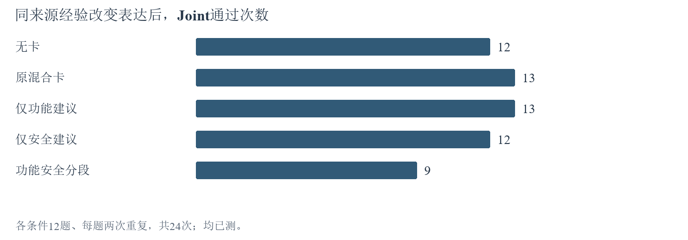
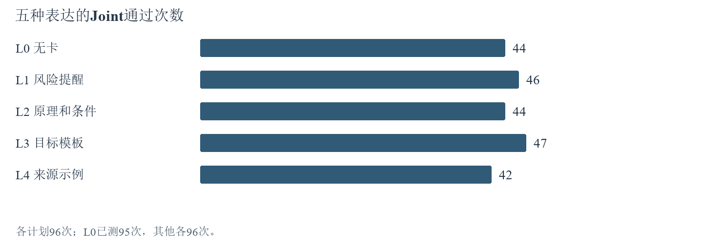
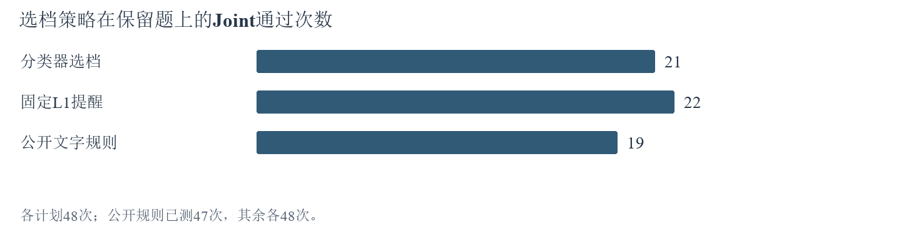
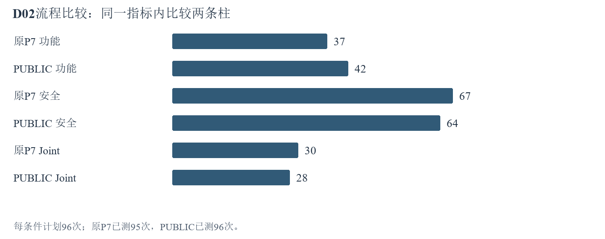
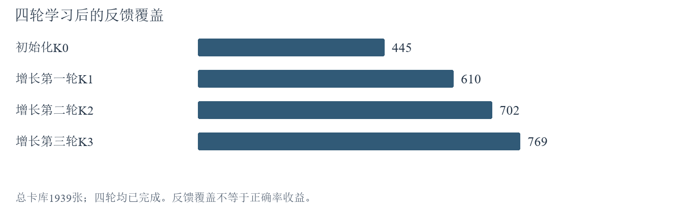

# 10月22日-10月28日实验探索报告

## 一、本周实验主线

本周研究经验如何帮助代码同时满足功能与安全要求：先确认旧经验和Q评分在新模型上是否有用，再检验追加反馈、经验表达和自动选档，最后比较新旧卡库。检索测量负责查明适用经验在哪里遗漏，代码复盘负责解释选到经验以后为何仍然出错。截至本次补充，四轮Q学习已完成，Q后续对照与记忆标签暂停；功能安全剩余全量暂缓，检索测量可以继续。

本报告按特殊安排并入10月29日已完成的实验和分析，内容核对截至10月29日15:45。按本次特殊要求，10月29日补充归入这一份报告；保留原标题，不另设本周周报。各实验仍注明实际发生时间。核心进展是：Q反馈覆盖达到769/1939；功能安全拆分在486组有效配对中净少5次Joint通过；单处代码修改让3题中的2题恢复Joint；新增边界提醒的24对结果完全不变。下文保留历史实验，更新相关结论与待做清单；累计运行数不作为今日新增数量。

Joint指同一份代码同时通过功能和安全测试，F、S分别表示功能、安全通过。初始化集303题建立学习起点，增长集273题用于追加反馈，审计集298题检验使用效果。CWE是漏洞类型，family是同来源或相近结构的题族。两次重复是独立运行，不是两道新题。P3无经验流程与P7空卡对照分别统计。A1—A7的旧图表保留原计划分母，缺测及已测分母在相邻文字或表格注明；A9—A10通过数使用明确列出的完成测量数，不能跨表直接比较百分比。

经验卡是可复用的解题建议；Q是根据解题反馈更新的卡片评分。这里的“学习”只更新卡片评分，不训练生成模型的参数。“反馈覆盖”是获得过反馈的卡数除以总卡数，不代表这些卡已经被证明有效。旧卡与旧Q来自v3.2；旧Q快照972/1939张卡已有反馈（50.13%），本轮v4.1评分从0重新学到769/1939（39.7%），这是两个独立评分起点，不能相减解释成覆盖下降。本周生成模型为deepseek-v4.1-flash-1017。

一次代码运行＝一道题在一个条件下的一次生成与验证。同一道题重复两次，仍只算一道独立题。配对比较固定题目及重复编号，再比较两个条件：“救回”指原来Joint不通过、换条件后通过；“损失”指相反变化。“保存完成”表示记录已经落盘，“已测”表示功能和安全结果均可获得，缺测不当作已测失败。

CLE是本项目使用经验辅助生成代码的Agent系统。PLT是本项目使用的代码安全题集，D_init、D_grow、D_gate分别对应初始化集、增长集和审计集。P3和P7是两套不同的解题流程：P3不使用经验；P7保留经验处理流程，空卡条件只是不输入卡片。两流程的分数不能直接相减当作经验收益。公开契约指题面已经说明的接口、输入输出和行为要求；测试夹具指执行验证所用的环境、辅助对象和测试代码。

各实验中的“12题”或“24题”只表示该实验名单规模，不表示名单彼此独立；来源经验确认题此前还用于D02。A2的24题称为Q对照名单，A5的24题称为分类器确认名单，A7的24题称为来源经验确认名单；本报告不把三份名单宣称为彼此独立。不同实验不能按题数直接累加或当作多次独立确认，本文只在同一实验内部按题号与重复配对。

下文按“问题→待做实验→已完成实验”阅读，点击【A】可跳到证据，点击【T】可跳到后续安排。统计中的置信区间表示差值的估计范围；跨过0时，数据仍容许正、负两种方向。p值用于按预定规则判断差异，不是“结论正确的概率”。Holm校正用于同时做多项比较时控制误判。

### （1）旧Q能否改善新模型的代码？

旧Q改变了实际卡号，但代码对照中学习Q与原CLE同为11/48，相似度为13/48。与候选范围一致的相似度组相比，学习Q少通过2/48次，没有提高正确率；原CLE候选范围不同，与它的同分不能单独解释为纯Q效应。 [【A2】](#a2)

证据对应：选卡变化及代码对照，见[【A2】](#a2)。

### （2）追加学习是否让更多经验卡获得反馈？

四轮学习已完成1122次，累计去重反馈卡数依次为445、610、702、769张，最终覆盖39.7%。反馈范围扩大已经确认；冻结Q收益对照只保存16/540次，按要求暂停。[【A9】](#a9)

### （3）Q收益能否迁移到同漏洞类型的不同题族？

本轮新Q迁移对照尚未执行，当前暂停。旧Q的小对照已经完成，但不能代替新Q在不同题族上的迁移检验。[【A2】](#a2) [待做安排](#t2)

### （4）分开功能与安全经验是否更好？

小批探索见【A3】，扩大后的另一批运行见【A10】，两批分开统计。当前扩大批的分开写法没有改善配对结果。486组有效比较救回27组、损失32组，净少5组；五条件共同479组中，原卡Joint为203/479，分开写为198/479。剩余547次全量暂缓，转向具体代码原因分析。[【A10】](#a10) [【A12】](#a12)

### （5）自动选择记忆程度值得继续吗？

既有分类器21/48，固定提醒22/48，分类器没有胜出。新82题标签批只保存5/820次，标签和分类器当前均暂停；不能据这5次判断新分类器效果。[【A5】](#a5) [待做安排](#t2)

### （6）检索遗漏发生在找卡还是选卡？

57题的题意初析和候选池已完成，2题先行标注共144个题卡组合，当前处理34条，其中33条有效、1条失败。人工确认0条，正式检索指标尚未形成；检索测量按原范围继续。[【A15】](#a15)

### （7）新模型自己的卡库是否优于旧库？

从空库建经验的2题技术探针通过，产出5张临时卡；完整新库尚未建成，不能比较新库与旧库孰优。旧卡迁移共同可测23次，两组均通过7次；v3.2停用后的新跨模型臂不再执行。[【A1】](#a1) [【A14】](#a14)

### （8）如何用更少成本得到有用结论？

已完成结果和成功响应复用。当前边界提醒在24对比较中救回0、损失0，没有达到扩大门槛，因此不执行后续96次确认和1192次全量。检索继续，Q与记忆实验维持暂停。[【A13】](#a13) [【A16】](#a16)

### （9）具体代码改动真的造成了退步吗？

本地撤销3题中的配置覆盖后，3题都恢复功能，其中2题同时保留安全通过。这3个案例中的具体错误改动已得到验证；但随后新增边界提醒未改变24对中的任何测试结果。原因成立不等于一句提醒就能解决问题。[【A12】](#a12) [【A13】](#a13)

## 二、补充更新后的待做实验

### 【T1】先完成检索标签，再判断漏卡发生在哪里

原因：候选池已建立，但还不能据此判断卡片是否适用于题目。

1. 处理固定2题的144个题卡组合（第1184题69张卡，第500题75张卡），逐条保留模型给出的适用性理由。
2. 对照公开题面与卡片，检查标签与公开题面及卡片是否一致：直接适用＝无需额外假设；需要附加条件＝满足注明前提才可用；冲突＝按卡做会违反本题要求；不适用＝与本题所需操作无关；证据不足时保留信息不足，不强行归类；网络失败记录为未标注，不算不适用。
3. 这2题的先行检查完成后，按原57题范围接续其余标注；输出人工复核清单，人工确认后再计算候选池内的检索指标。

当前状态：这2题的先行标签检查未完成，存在网络中断；不补发已执行过一次的题卡标注请求。检索是否有用要区分两步：先看系统找回的卡中有多少适用，再看最终选中的卡是否保留这些适用经验。标签必须经人工确认；若相关经验在前一步就遗漏，则先改检索，若进入候选池却被排除，则先改选卡。这里的指标只覆盖本批候选池，不代表整个卡库。

### 【T2】Q与经验详细程度实验保留结果，等待明确恢复

原因：需要分别验证评分收益和经验详细程度的作用。详细程度有五档：不用经验、一句风险提醒、机制与适用前提、机制加目标题操作模板、机制加来源题示例；分类器就是为题目自动选择档位的程序，当前按要求暂停。

1. 保留54题Q回测已保存16/540次运行，以及82题×5档×2次重复的经验详细程度标注已保存5/820次运行。
2. 暂停期间只整理已有证据，不调用模型补齐，也不训练分类器。
3. 后续恢复仍沿用已登记名单、重复次数和实验规则；先完成各自小批比较，再按[已登记的探针计划](../../CLE-TODO-20261022-20261028-v09.md)逐项检查扩大条件；本报告不另设新门槛。

当前状态：Q回测、Q迁移、记忆标签、分类器及标签追加均暂停。当前结果不足以计算预定小批对照的正确率差异，不能判成成功或失败。

### 【T3】只保留能解释问题的后续实验

原因：边界提醒在24组成对比较中没有改善测试结果；完整建库和大规模卡库比较暂缓，跨模型与外部评测另有下述依赖。

1. 当前边界提醒版本停止扩大，保留48次完整结果与回放。
2. 功能安全对照剩余547次暂缓；完整新库、交叉比较及外部评测继续跳过。
3. 后续若改变干预方式，先写清要改变哪一种代码行为、怎样在成对结果中验证；没有新干预不重复跑同一负结果。

当前状态：旧模型DeepSeek v3.2不可用，不能开展新的跨模型对照；Base和Plus是两套外部评测集，目前缺少原Docker验证环境，因此外部评测不能执行。本文的新模型均为deepseek-v4.1-flash-1017。这些未执行项不记作失败；当前v4.1结果也不代替跨模型比较。

[返回本周主线](#main)

## 三、实验内容与结果分析

本次补充导航：[【A9】Q学习及回放](#a9)　[【A10】功能安全配对](#a10)　[【A12】单处修改](#a12)　[【A13】边界提醒](#a13)　[【A14】建库探针](#a14)　[【A15】检索检查](#a15)　[【A16】最新用量](#a16)

### 【A1】无经验基线和旧卡迁移说明了什么？

#### 为什么做这项实验

本实验回答两个问题：换成v4.1后，不看经验的模型能做对多少题；同一P7流程加入旧1939卡库后，成绩是否改变。P3是无经验基线，P7是另一套包含经验处理的生成流程，两者不能直接相减当作记忆收益。[返回要求七](#r7)

#### 怎样做

1. 使用deepseek-v4.1-flash-1017，保持原P3初析、规划、生成和最多一次修订，在PLT的298道D_gate题运行；不输入、不生成经验，不更新Q。
2. 保留原43题结果，修复实际TLS传输问题后续跑247题，再按原实验规则补跑剩余8题；保留失败请求和未知用量，最终298题保存代码均零API回放。
3. 另外固定12题、每题两次重复，在P7中比较空卡与旧1939卡库；每个题次共享首次初析，最多三卡、最多一次修复，不学习Q。
4. 对48个P7单元逐一回放；将技术缺测与模型答错分开，比较完整配对成绩，而不是把单次多通过一题直接归为经验作用。

#### 看到了什么

| 实验与条件 | 保存／计划 | F通过／计划 | S通过／计划 | Joint通过／计划 |
| --- | --- | --- | --- | --- |
| P3 无经验 | 298／298 | 111／298 | 232／298 | 96／298 |
| P7 空卡 | 24／24 | 7／24 | 18／24 | 7／24 |
| P7 1939卡 | 24／24 | 8／24 | 20／24 | 8／24 |

上表以计划次数为分母，表示交付通过占比；未测记录不计通过，也不称为测试失败。完整测量口径另列：P3为297/298，F为111/297、S为232/297、Joint为96/297；P7空卡为23/24，F为7/23、S为18/23、Joint为7/23；P7带卡为24/24。P3完整测量297题，按298题计划计算Joint为32.21%（96/298），按已测计算为32.32%（96/297）；P7空卡完整测量23个单元，带卡24个，双方均完整的23对中Joint均为7／23。P3已知Token为3,841,636，30次物理请求用量未知；P7合计2,063,129 Token（其中Embedding 46,461），另15次请求尝试用量未知。两个来源的请求计数口径不同，费用均不写成实付账单，也不与[【A8】](#a8)累计数直接相加。

#### 这些结果说明什么

图1第一项给出新模型在无经验完整任务集上的基线；后两项只说明这12题两重复的旧卡迁移表现。P7原始总分带卡多1个通过，但唯一差异涉及空卡生成截断；排除不完整配对后双方相同。因此，这一轮建立了可复用的换模起点，尚未证明旧卡能够稳定提分。后续采用同P7、同名单的v4.1三库对照；v3.2停用后的新增交叉臂已经结束。后续[【A2】](#a2)至[【A7】](#a7)是在此后开展的机制比较，不把这些局部单元追加到P3的298题分母。

原始证据：[10月25日P3全量报告](../../../CLE_P3无经验Agent_PLT全量基准报告_20261025.md)、[10月25日P7迁移报告](../../../CLE_v41Flash1017_P7空卡与1939卡迁移实验报告_20261025.md)。原始完成时间分别见各报告；本节属于10月22日至28日这一周。

[返回要求七](#r7)　[返回本周实验主线](#main)　[返回实验导航](#experiments)

### 【A2】Q改变选卡后，代码是否更正确？

#### 为什么做这项实验

本实验分两步：先通过重复选卡，判断Q有没有改变最终选中的卡，并与模型在相同条件下多次选卡的波动比较；再看改变选卡后，功能和安全是否一起通过。Q0至Q3在下表中说明，最终仍由模型选择，不是直接取Q最高的三张。[返回要求一](#r1)

| 选卡方式 | 给模型的提示顺序是什么 |
| --- | --- |
| Q0 原CLE | 按原有候选方式呈现，再由模型选择经验 |
| Q1 相似度 | 优先呈现与当前题目语义相近的卡，再由模型选择 |
| Q2 学习Q | 排序时加入经验卡的历史反馈分数，再由模型选择 |
| Q3 打乱Q | 在同类漏洞中打乱卡与分数的对应关系，再由模型选择 |

Q0的候选边界与其他组可能不同；与Q0比较时，不能把所有差异都归因于Q排序。

#### 怎样做

1. 固定1939张经验正文和历史Q快照。972张卡的反馈次数（visits）大于0，即曾获得反馈，覆盖率为50.13%；Q恰好为0但有反馈的卡也计入。这个快照包含v3.2的部分在线学习状态，不是v4.1重新学习的Q。
2. 对8个题族的相同查询、候选和余弦相似度，分别运行四种排序，每种重复5次，共160次选卡。使用排序混合参数λ=0.5（混合排序分数，不是模型一半时间看Q）、相似度阈值δ=−1（本设置不以相似度分数排除候选）和置换种子20261015（固定打乱结果，便于重复核对）；这是本轮探索设置，不能写成所有历史CLE实验的默认参数。
3. 在24个事先留出的题族上，每个条件重复2次，共192个代码运行。首次题意分析和候选卡列表共享，模型最多选三张；后续修复依各组代码独立进行，Q和经验始终冻结。
4. 按相同题目及重复编号配对，比较卡号集合、新增卡采用、F/S/Joint与救回损失。统计以题族为单位处理相关性，保留缺测及历史技术失败记录。

#### 看到了什么

| 条件 | F通过数 | S通过数 | Joint通过数 | 已测/计划 |
| --- | --- | --- | --- | --- |
| Q0 原CLE | 19/48 | 33/48 | 11/48 | 48/48 |
| Q1 相似度 | 19/48 | 35/48 | 13/48 | 48/48 |
| Q2 学习Q | 18/48 | 33/48 | 11/48 | 48/48 |
| Q3 打乱Q | 20/48 | 32/48 | 13/48 | 47/48 |

上表各组以48次计划为分母；Q3只完成47次测量，13/48不是已测成功率，其已测成功率为13/47。

重复选卡的160次有效记录显示，Q2相对Q0、Q1、Q3的卡号集合差异超过组内波动，Holm校正（同时比较多组时减少误判的方法）后的p值分别为0.006、0.0072和0.00015。代码实验中，Q2对Q0的首次选卡集合变化46/48次，新增卡声明采用32/48次。“卡位”指一次运行中一张卡的出现，同一张卡在不同运行重复出现会重复计数；运行数与卡位数分别统计。Q2选中卡片的位置中134/139有过Q反馈，首次声明采用的位置中97/97有过反馈。32/48统计“采用了相对Q0新增卡的运行”，97统计Q2全部48次首次生成中声明采用的卡，包括新选入和两组共有的卡，因此不能用32×3检验97；这些是累计卡片出现次数：同一张卡在不同运行中出现会重复计数，不是去重卡数或独立题数。

#### 这些结果说明什么

图2中，学习Q组与原CLE组同为22.92%，按48次计划分母计算，比相似度和打乱Q各低4.17个百分点；若仅描述已测成功率，Q3为13/47，与Q2的11/48相差4.74个百分点。逐题配对后，Q2相对Q1没有救回、损失2次；相对Q3救回1次、损失3次；相对Q0救回和损失各2次。Q2与Q1、Q3的两项成绩比较校正后p值均为1，现有数据未支持学习Q提高Joint。Q3有一格缺测，不能将这一格解释成模型已被测出失败。

这个结果不能再主要解释为“没有接触到有Q的卡”，因为实际选中与声明采用的卡片大多已有反馈。具体失败仍发生在后面的落实环节：1209采用了算术相关建议，但生成代码错误访问AST节点的left/right属性；1065采用了跳过无效字段的建议，却仍然抛出异常；901还存在公开题面未确定阈值的问题。因此，同候选边界下Q2与Q1、Q3的重复选卡差异支持Q改变了选择；Q2对Q0的46/48变化还包含候选路径差异，旧Q迁移适配、卡片适用性和代码实现能力则尚未被独立区分。后续已完成新模型自己的四轮Q学习，见【A9】；54题冻结探针已启动后暂停，见【T2】；排队全量暂缓，不能凭本轮负结果宣布Q普遍无效。

本节对应的原实验编号：D03a、D03b。数据来源：[四臂统计和逐包汇总](../../../../results/curated/cle_v41_completion_20261026/summary.json)、[选卡波动分析](../../../../translation_work/diagnostics/20261026/cle_v41_completion/CLOSEOUT/D03a_selector_noise.json)、[代码与卡片复核](../../../../translation_work/diagnostics/20261026/cle_v41_completion/CLOSEOUT/agent_case_review.json)。

[返回要求一](#r1)　[返回要求二](#r2)　[返回本周实验主线](#main)

### 【A3】小批对照中，拆分或编辑经验能否兼顾功能与安全？

#### 为什么做这项实验

功能经验帮助代码完成任务，安全经验帮助代码避免风险。本实验使用同一来源卡，比较混合与按功能与安全分段展示；另从同一段已有代码出发比较有无经验的单次编辑，以减少起始代码不同的影响。按功能与安全分段展示不等于建立了两套独立卡库。[返回功能安全问题](#r4)

| 条件 | 实际给模型的经验内容 |
| --- | --- |
| B0 无记忆 | 不提供经验卡 |
| BM 原混合卡 | 采用原卡中混合的功能与安全建议 |
| BF 功能视图 | 呈现整理出的功能建议及适用上下文 |
| BS 安全视图 | 呈现整理出的安全建议及适用上下文 |
| BFS 功能安全分段组合 | 分别以功能、安全和适用上下文段落呈现同一来源卡 |

#### 怎样做

1. 固定12个题族、每题2次重复和五种条件，共120个代码运行：无记忆B0、原混合卡BM、仅功能视图BF、仅安全视图BS、功能安全分段组合BFS。
2. 各条件共享首次题意分析；只有四个带卡条件共享来源卡编号，B0始终没有卡输入。整理时把同一张卡的文字分成功能建议、安全建议和适用上下文；不是另建功能卡库和安全卡库。分区只读取来源卡正文，不查看目标题答案；分别记录模型整理和按既定规则补全文段的处理方式，生成模型接收相同公开任务，按原P7完成生成和最多一次修复。
3. 汇总各条件F、S与Joint，将BFS和BM按同题配对，查明损失是否来自实际采用的建议或额外改写。
4. 补充编辑实验固定6个题族、2次重复，以同一段BM首轮代码作为起点，只比较输入经验与不输入经验的单次编辑，共24个单元；它不是另一轮完整P7成绩。

#### 看到了什么

| 条件 | F通过数 | S通过数 | Joint通过数 |
| --- | --- | --- | --- |
| 无记忆B0 | 12/24 | 19/24 | 12/24 |
| 原混合卡BM | 14/24 | 19/24 | 13/24 |
| 功能视图BF | 15/24 | 19/24 | 13/24 |
| 安全视图BS | 13/24 | 18/24 | 12/24 |
| 功能安全分段组合BFS | 12/24 | 18/24 | 9/24 |

五组均完成完整测量。BFS相对BM救回0次、损失4次。补充编辑中，无卡与带卡均为F 7/12、S 9/12、Joint 6/12，救回和损失均为0；带卡条件实际有9/12次输入经验，其余起点没有可用的采用卡列表。

#### 这些结果说明什么

图3显示，功能安全分段组合的Joint为37.50%，低于原混合卡的54.17%。仅功能视图的功能通过数增加1次，但Joint没有增加，这说明改善功能的题目与安全通过的题目不一定重合。研究目标要求同一份代码同时满足两方面，因而不能用F单独增加替代Joint改善。

1326的功能安全分段组合代码改写了白名单，破坏原有功能，但没有声明采用相关卡片。这说明“看到了不同的经验文本”和“明确使用某张卡导致错误”仍需区分。另一组编辑没有改变结果，也只说明这6个题族的单步编辑未产生收益；编辑输出格式不包含采用声明，不能把汇总中的采用数0解释为没有记忆输入。当前证据不支持直接推广这一拆分方式，后续全量实验应保留功能保持、来源假设迁移和实际代码改动三类分析，检验功能损失具体发生在哪里。

本节对应的原实验编号：B02、B05。数据来源：[逐包汇总](../../../../results/curated/cle_v41_completion_20261026/summary.json)、[实际案例复核](../../../../translation_work/diagnostics/20261026/cle_v41_completion/CLOSEOUT/agent_case_review.json)。

[返回功能安全问题](#r4)　[返回本周实验主线](#main)

### 【A4】提醒、原理、目标模板和来源示例，哪种经验表达更有用？

#### 为什么做这项实验

要训练分类器，先要看同一道题在不同经验详细程度下是否真的有差别。如果大多数题各档表现相同，就缺少选择档位的学习信号。五档分别是不提供经验、风险提醒、原理、目标模板和来源示例。L3与L4改变的不只是长度，也改变了内容类型：目标模板面向当前题，来源示例来自另一道题。[返回记忆选择问题](#r5)

| 档位 | 模型能看到什么 |
| --- | --- |
| L0 无记忆 | 不提供经验 |
| L1 风险提醒 | 一句话指出需要注意的风险 |
| L2 机制前提 | 解释安全机制及适用条件 |
| L3 操作模板 | 提供面向当前任务的操作模板 |
| L4 来源示例 | 提供来源任务中的完整示例 |

#### 怎样做

1. 固定48个D_grow题族，每题五档、每档两次重复，共480个单元；事先分为36个训练题族和12个开发题族。D_grow是用于积累经验和反馈的任务池，不是最终独立测试集。
2. 从相同来源材料形成不同档位，排除同题族来源。15张缺少来源代码的卡在所有档位共同排除，避免只有L4可用卡范围不同。
3. 各档按原P7预算生成和验证，记录真实采用、交付成绩和输入Token。按题族查看两次重复是否支持同一档位，而不根据一次偶然成功指定标签。
4. 先报告五档完整结果，再将训练题族中具有可靠成功证据的记录交给[【A5】](#a5)；开发题族结果用于检验，不回填训练标签。

#### 看到了什么

| 档位 | F通过数 | S通过数 | Joint通过数 | 已测/计划 |
| --- | --- | --- | --- | --- |
| L0 无记忆 | 53/96 | 71/96 | 44/96 | 95/96 |
| L1 风险提醒 | 53/96 | 74/96 | 46/96 | 96/96 |
| L2 机制前提 | 53/96 | 74/96 | 44/96 | 96/96 |
| L3 操作模板 | 54/96 | 75/96 | 47/96 | 96/96 |
| L4 来源示例 | 49/96 | 71/96 | 42/96 | 96/96 |

上表按96次计划计算比例，L0有1次缺测；其已测Joint为44/95。以下差值和检验沿用原报告口径，缺测本身不证明模型失败。

L3与L0双方均完成测量的95对中，共同通过41对、共同不通过45对，L3救回6对、损失3对；L3为47/95，L0为44/95，净提高3/95＝3.158个百分点。原统计仍保留如下：以96个计划位置计算净增3次，包含1个未测位置；题族重采样95%区间为−3.125至+10.417个百分点，按题族整体交换比较条件的双侧置换检验p=0.5625（原统计以48个题族、96个计划位置计算，包含1个缺测位置；这是历史计划口径，不作为95对完整测量的检验结果）。48个题族中31个在五档下成功的重复次数相同，其中17个全部失败、13个全部成功，另1个各档均一次成功；另有2个题族出现某档两次成功、另一档两次失败，均在训练部分；剩余15个题族存在档位差别，但没有达到这种两次全成功对两次全失败的对比。17个全失败题族只能说明本次没有成功档，不能说明各档作用相同。

#### 这些结果说明什么

图4没有呈现记忆越详细、Joint越高的趋势。按图4的96次计划口径，L3比无记忆高3.125个百分点，L4低2.083个百分点；这些不是剔除缺测后的配对差值。结合具体案例，一种可能解释是完整示例带入来源任务的假设，而操作模板与目标任务更容易衔接，但总分本身不能证明这一机制。不过区间跨过0，当前不能确认L3总体更好，更不能仅凭L4总分较低就认定每个完整示例有害。

从分类器角度看，31/48个题族没有可见的档位差别，意味着大量结果无法告诉模型“该选哪一档”。全部失败的题目也不能自动标成L0最优，因为它们没有证明无记忆更合适。逐题检查还发现1005在L4下成功却没有采用声明，1059有来源四字段白名单与目标三字段要求的差别。这些现象要求后续标签同时考虑真实使用与可重复成绩，以免分类器学到生成波动或来源不匹配。

本节对应的原实验编号：C02。数据来源：[五档结果](../../../../results/curated/cle_v41_completion_20261026/summary.json)、[案例复核](../../../../translation_work/diagnostics/20261026/cle_v41_completion/CLOSEOUT/agent_case_review.json)。

[返回记忆选择问题](#r5)　[返回本周实验主线](#main)

### 【A5】自动选择记忆档位胜过固定提醒了吗？

#### 为什么做这项实验

分类器根据公开题目特征预测应该使用哪一档经验。本实验用[【A4】](#a4)的真实成绩训练，再与固定一档和公开规则比较；目标题的正确答案不能用于选择档位。只有最终代码成绩改善，才能说明选档对任务有帮助。[返回记忆选择问题](#r5)

| 选择方式 | 如何决定使用哪一档经验 |
| --- | --- |
| 分类器 | 根据公开题目特征预测 |
| 固定L1 | 所有题固定使用L1档；提醒内容随题目及检索到的经验变化，不是所有题复制同一句话 |
| 公开规则 | 无候选卡选L0；题面出现外部绑定标记或写入等操作词选L3，否则选L2 |

#### 怎样做

1. 仅使用36个训练题族制作标签。某档两次Joint都通过时，按预定规则选平均输入Token最少的合格档；全失败或缺少有效记忆介入的情况标为未解决，不强行指定最佳档位。
公开规则只检查题面：外部绑定标记是至少3字符的大写名称；操作词为write、delete、modify、update、execute、open、send、save。它们是程序用于选档的文字特征，不代表已经证明存在副作用。分类器的8项输入是公开文本长度、参数词数、上下文长度、大写绑定名称数、是否说明返回值、是否说明异常、上述操作词数、安全要求长度。

2. 最终得到19个有效题族标签：11个L0、7个L1、1个L3；另外17个保留未解决。提取公开题面长度、参数、绑定关系和副作用等特征，用逻辑回归训练，并仅在训练部分用三折划分选择设置。
3. 在12个开发题族查看三种策略，各为两次重复；随后固定分类器及策略，在24个保留题族上比较，每种策略两重复，共144个逻辑运行。这24个确认题族由独立的确认名单提供，不是把36个训练题族和12个开发题族再拆成24个；完整题号名单见原实验记录。
4. 对预测到同一档且协议完全一致的12个单元精确复用已有输出。按同题配对比较Joint，保留实际采用数和缺测，不因某策略较差重新训练或换题。

#### 看到了什么

| 策略 | F通过数 | S通过数 | Joint通过数 | 已测/计划 |
| --- | --- | --- | --- | --- |
| 分类器 | 24/48 | 37/48 | 21/48 | 48/48 |
| 固定L1 | 25/48 | 38/48 | 22/48 | 48/48 |
| 公开规则 | 25/48 | 34/48 | 19/48 | 47/48 |

上表以48次计划为分母，公开规则有1次缺测，已测Joint为19/47。

开发部分三种策略均为Joint 7/24，分母来自12个开发题族各两次重复；这一步复用C02已有五档结果评估策略，不是另做72次独立生成。保留题中，分类器相对固定L1救回1次、损失2次；相对公开规则救回3次、损失1次，两项比较Holm校正后p均为1。分类器条件有12/48次声明采用，固定L1有45/48次；不同策略可能主动选择L0，因此采用率应结合预测档位解释。

#### 这些结果说明什么

图5显示，分类器没有超过最简单的固定L1策略。它比公开规则高2次，却比固定L1少1次，不能据此证明学习型选择优于固定提醒。分类器大多学习到L0或L1，而训练样本只有一个L3、没有可靠的L2或L4标签，当前数据不足以训练出覆盖五档的清晰决策。

这项实验已经落实了“用真实结果训练分类器”的方法步骤，但尚未实现“分类器能帮助提高成绩”的研究目标。现有标签数量少且档位分布不均，是需要优先检查的可能原因；仅凭这次对照还不能排除分类特征或模型选择等其他原因。原计划先执行82题标签批，按训练数据门槛决定是否追加82题；该批当前已暂停，保留未解决标签，并在独立题族上验证；不能把同题五档中的最高分直接当作推理时可获得的信息。

本节对应的原实验编号：C03/C04a、C04b。数据来源：[分类器结果汇总](../../../../results/curated/cle_v41_completion_20261026/summary.json)、[完整分析来源](../../../../translation_work/diagnostics/20261026/cle_v41_completion/CLOSEOUT/agent_synthesis.md)。

[返回记忆选择问题](#r5)　[返回本周实验主线](#main)

### 【A6】公开约束提醒能解决哪些实现问题？

#### 为什么做这项实验

公开契约是题目已经说明的接口、对象和行为要求。本实验分别检查关系提醒、生成模板和公开检查能否帮助模型遵守要求。三项对照改变的内容和样本不同，结果需要分别解释。[返回功能安全问题](#r4)

#### 怎样做

1. 关系提醒B03R固定1个题族、2次重复，比较无卡/带卡与绑定提醒/关系提醒的四种组合，共8个单元。初析、候选和生成前计划共享，只在预定生成阶段改变提醒；本周精确复用已完成记录。
2. 模板实验固定12个题族、2次重复，比较三种生成模板：P00保留原提示；P13增加保持正常行为和检查安全风险的要求；P22再加入三个通用示例及最小必要改动要求，共72个单元；共享首轮分析和规划，到生成阶段才分叉。
3. 公开检查D02固定48个题族、2次重复，比较原P7与PUBLIC流程，共192个单元。PUBLIC按预定协议使用公开检查和反馈决定修复与交付，隐藏测试不回传给模型；这一对照改变的是完整代码使用流程，不只是一句提示。
4. 分别统计各实验内部的成绩和配对变化，读取公开检查失败案例。已保存响应用于零API回放，回放发现的临时目录差异经修复后复核，不额外生成代码。

#### 看到了什么

| 实验与条件 | Joint通过数 | 补充结果 |
| --- | --- | --- |
| 关系提醒四种组合 | 各2/2 | 8/8完整测量，无成绩区分空间 |
| P00／P13／P22模板 | 10/24、10/24、11/24 | 每组24/24已测/计划 |
| 原P7 | 30/96 | F 37/96；S 67/96；完整测量95/96 |
| PUBLIC公开检查 | 28/96 | F 42/96；S 64/96；完整测量96/96 |

原P7有1次缺测：30/96是计划分母口径，已测Joint为30/95。

PUBLIC相对原P7救回4次、损失6次，Joint净减少2次。D02全部192个单元的保存响应回放与原终态一致（含1次缺测状态；回放一致不把缺测变成测量成功）；为修复回放临时目录问题完成21项相关离线检查，旧差异现场保留。

#### 这些结果说明什么

图6中，PUBLIC整套流程下，F从37次增加到42次，但S从67次降至64次，Joint也由30次降至28次。这说明“更多公开检查”未必等于更正确的交付，检查本身若理解错公开要求，也会把正确代码改坏。1001的公开自检在内容已转义的情况下仍拒绝包含onerror的文本，继而促使代码破坏安全输出，是具体可核对的例子。

关系提醒的四种组合全部通过，只能说明接线按预定变量运行，无法证明提醒在总体上有效。模板P22仅多一次通过，也不足以承担整体提分结论。该比较同时改变检查、反馈、修复和交付，不能把净变化单独归到某一句检查提示。对主线而言，公开契约缺失、模型没有遵守契约、检查器错误扩大契约是三种不同问题；后续应把它们作为完整功能保持实验的解释层，避免把所有功能失败都归到经验卡或Q上。

本节对应的原实验编号：B03R、S2_P13_P22、D02。数据来源：[逐包统计](../../../../results/curated/cle_v41_completion_20261026/summary.json)、[实际案例复核](../../../../translation_work/diagnostics/20261026/cle_v41_completion/CLOSEOUT/agent_case_review.json)。

[返回功能安全问题](#r4)　[返回实验导航](#experiments)

### 【A7】来源经验在另一批事先留出的题目上仍然有效吗？

#### 为什么做这项实验

本实验在同一A7代码生成与修复流程中，比较不提供经验和提供M1专门来源经验。M1_SOURCE36是这项实验专用的来源经验集合，与旧1939卡库不同；两组均最多一次公开证据修复。结果用于判断这套来源经验方案，不能单独归为Q或原P7的收益。[返回功能安全问题](#r4)　[返回要求七](#r7)

#### 怎样做

这里的“保留题”是没有用于挑选M1方案的另一批题，不是把通过Joint的代码拿走经验后再测试。开发题用于选择方案，保留题用于固定方案后的比较；每个条件都独立生成代码。

1. 在12个开发题族上，分别使用无经验与M1来源经验，每题2次重复，共48个单元。来源经验排除同题族材料，固定公开题面、模型和A7修复预算。
2. 按确认前登记的开发增量规则选出M1，固定其配置，再在24个保留题族上运行两条件、两重复，共96个单元；不根据中途成绩调整方案。
3. 记录每次实际注入的经验，验证同一交付代码的F/S/Joint，并将两组按题目和重复配对，核对救回、损失以及建议是否落实。
4. 同时报告按题族重采样区间和原协议精确检验，说明这批保留题此前已用于D02实验；该组称方案保留确认，不称整个CLE从未见过的最终测试。

#### 看到了什么

| 阶段与条件 | F通过数 | S通过数 | Joint通过数 |
| --- | --- | --- | --- |
| 开发：无经验 | 11/24 | 20/24 | 11/24 |
| 开发：M1 | 14/24 | 21/24 | 14/24 |
| 保留：无经验 | 27/48 | 37/48 | 20/48 |
| 保留：M1 | 33/48 | 39/48 | 28/48 |

两部分均完成完整测量。表内主成绩包含所有分配到该条件的运行，包括未注入经验的运行；没有把分母缩小为17或37来提高通过率。是否注入取决于来源资格和当次检索，不代表每次都能找到可用来源卡。开发阶段M1实际注入17/24次，救回5次、损失2次；保留阶段实际注入37/48次，救回9次、损失1次，Joint净增加8次，即16.67个百分点。保留阶段95%题族重采样区间为+2.083至+33.333个百分点，题族区组精确双侧检验p=0.078125；M1中每个题族的两次重复Joint结果一致，无经验组24个保留题族中有4个的两次重复结果不一致。

#### 这些结果说明什么

图7中，开发部分用于挑选M1方案，不能再当作一次独立确认；固定方案后，保留题部分的M1高于无经验，保留部分的F、S和Joint通过数均增加，但尚未达到预设统计门槛；这一结果支持继续验证该方案，尚不支持稳定提分结论。1001中可以追踪到来源经验建议使用html.escape，建议进入输入后在代码中落实，并对应最终救回；唯一损失案例338则涉及公开题面要求字符串、夹具使用字节串的冲突，不能不加区分地记为经验质量问题。

但两个统计方法给出的判断并不完全相同：重采样区间为正，原协议精确检验p=0.078125，大于预定0.05门槛。报告保留两者，不只挑有利的一项。因此当前结论是在已测保留题上净增加8次Joint通过；原协议精确检验未通过0.05门槛，因此尚不能宣布稳定提分。后续比较须固定A7流程、来源资格与名单；当前先按v09做探针，排队全量暂缓；如果要解释成模型与卡库的交叉作用，还需单独固定使用模型、来源库及预算，完成真正的交叉矩阵。由于v3.2已经停用，新安排只执行v4.1三库比较，结论限于该模型。

本节对应的原实验编号：S2_M1、S4。数据来源：[开发及保留题统计](../../../../results/curated/cle_v41_completion_20261026/summary.json)、[完整统计与案例分析](../../../../translation_work/diagnostics/20261026/cle_v41_completion/CLOSEOUT/agent_synthesis.md)。

[返回功能安全问题](#r4)　[返回要求七](#r7)　[返回本周实验主线](#main)

### 【A8】哪些结果已经完成，成本和检索测量还缺什么？

#### 为什么做这项实验

本节核对10月26日基础清单完成了多少、费用记录覆盖什么，以及检索、Q学习和建库还缺什么证据。它是零API资料复核，不产生新的代码成绩。完成数、检索质量和代码正确率需要分别判断。[返回检索问题](#r6)

#### 怎样做

1. 按执行索引读取各包计划、完成数和原生结果，区分代码运行、仅选卡单元、共享前序输出及同档精确复用，不合并成独立题目总数。
2. 检查10个代码实验包和1个仅选卡包的既有零API回放结果，并读取12个代表案例的题面、卡片、计划、代码和验证记录。案例用于说明具体路径，不用于估计全体失败原因的比例。
3. 汇总已报告Token、物理HTTP（实际发出的网络请求）、未知用量和在途请求。沿用原账本的来源范围，失败未知用量不记为免费，不假设缓存命中率。
4. 查验Q更新、经验生成以及人工检索标签状态。没有执行或缺少必要标签的项目记为尚未验证，不能填入0分或从历史摘要反造记录。

#### 看到了什么

| 核对项 | 当前记录 | 能说明什么 |
| --- | --- | --- |
| 代码实验运行 | 1376/1376 | 固定清单完成，含复用及重复 |
| 仅选卡单元 | 160/160 | 只检验选卡，不产生代码成绩 |
| 零API代码包回放 | 10个代码包及D03a仅选卡包一致 | 已存响应可重走对应流程 |
| 实际代码案例复核 | 12例 | 提供具体原因证据，不代表总体比例 |
| 10月26日基础清单的学习范围（不含A9） | 仅10月26日基础清单：Q更新0次、新经验生成0张 | 10月26日基础清单未进行新模型学习与建库；后续Q学习见A9 |
| 已报告Token | 65,186,659 | 累计账本用量，不是本周新增实付 |
| 物理HTTP | 10,338 | 包含记入来源的实际请求与重试 |
| 已结束未知用量HTTP／在途 | 302／0 | 未知部分不能记为零费用 |

这份账本仅对应10月26日基础清单及其列入恢复来源的请求；【A11】另报10月27日起的新Q学习和功能安全运行。两表按各自来源保留，不拼成全项目总费用。这份累计记录包含本轮各包及列入恢复来源的请求，不能等同于整台电脑全部历史用量或本周新支出。本表记录用量，不换算实付人民币。关系提醒8格和分类器同档12格等复用均保留在各自逻辑分母中，不应为凑“新实验数”再次调用模型。

1376次代码运行的组成如下；P3的298次和P7旧卡迁移的48次属于更早的换模起步实验，不在这1376次内。160次选卡只比较卡号，不生成代码，也不加进1376。

| 基础清单原编号 | 本文位置 | 计划及保存次数 |
|---|---|---:|
| B03R 关系提醒 | A6 | 8 |
| B02 功能安全表达 | A3 | 120 |
| S2_M1 来源经验开发 | A7 | 48 |
| S2_P13_P22 生成模板 | A6 | 72 |
| D02 公开检查流程 | A6 | 192 |
| C02 五档表达 | A4 | 480 |
| C04b 分类器确认 | A5 | 144 |
| D03b 四组Q代码对照 | A2 | 192 |
| B05 单次编辑 | A3 | 24 |
| S4 来源经验确认 | A7 | 96 |
| 合计 | 保存运行，不是去重题数 | 1376 |

分类器拟合及开发读数复用C02结果，不再加一批生成次数。关系提醒8次和同档策略12次复用已经返回的结果：它们算设计中的逻辑运行，但不算新的模型请求。已保存1376次也不等于全部可测，缺测在各实验表中另列。

#### 这些结果说明什么

图8和表格支持“基础清单完整完成”，并不支持“已做完全量新模型验证”。10月26日基础清单没有完成v4.1的新Q学习、全298题Q四臂、从空库建立新经验、两个模型交叉使用两库，以及原验证镜像下的Base/Plus评价。10月27日启动的新Q学习现已全部完成，最终统计见[【A9】](#a9)。旧P3、旧Q等结果只有在题面、模型、流程、反馈和预算匹配后才能作为新对照，否则只能保留为背景。

检索方面，准确率衡量题卡对的选入与未选入判断是否正确；精确率衡量选出的卡有多少适用；召回率衡量适用卡有多少被选出；F1综合精确率和召回率。目前缺少人工确认的适用性标签，不能形成正式四指标。即使完成共同候选池标注，也只能先报告“候选池内召回率”；整库适用卡未被完整标注时，全库召回率仍未测量。这是测量缺口，不是已经证明检索差，也不能用Q覆盖率代替它。

数据来源：[清单与成本汇总](../../../../results/curated/cle_v41_completion_20261026/summary.json)、[零API回放](../../../../translation_work/diagnostics/20261026/cle_v41_completion/CLOSEOUT/replay_results.json)、[七项要求与全量任务](../../CLE-PLAN-20261027-seven-requirements-v01.md)。

[返回要求二](#r2)　[返回检索问题](#r6)　[返回成本安排问题](#r8)　[返回要求七](#r7)

### 【A9】Q学习完成后，目前能确认什么？

**结论：反馈覆盖扩大到39.7%；评分是否提高正确率仍由暂停的对照实验回答。** 四轮学习于10月28日23:33完成，是10月28日期末成果，本次并入本报告，不把1122次累计运行算作10月29日新增。

1. 固定1939张经验卡，所有卡Q初值为0。让模型在初始化集303题中选卡、生成代码、接受功能与安全验证，再据反馈更新评分。
2. 在另一批增长集273题上顺序学习三轮，K1、K2、K3重复同一题集；每轮后保存评分。
3. 初始化集303题可授予反馈；增长集232题具备反馈资格，其余41题因奖励条件未合格仍执行但不更新Q。只有模型声明实际采用的卡按协议记账，这不等于已证明卡内容在代码中正确实现；卡正文不变。
4. 冻结评分（评价时不再更新Q）后，用54题比较五种排序：相似度排序，以及K0、K1、K2、K3四个学习阶段的Q排序。每种两次重复，共540次；依次已保存3、4、3、4、2次，合计16/540后暂停。这里的五条件与【A10】的五种经验表达不同。

| 学习阶段 | 保存运行数 | 完成测量数 | 功能通过 | 安全通过 | Joint通过 | 累计有反馈卡数 |
| --- | --- | --- | --- | --- | --- | --- |
| 初始化K0 | 303 | 301 | 163 | 247 | 148 | 445 |
| 增长第一轮K1 | 273 | 272 | 149 | 207 | 133 | 610 |
| 增长第二轮K2 | 273 | 273 | 146 | 206 | 124 | 702 |
| 增长第三轮K3 | 273 | 273 | 144 | 204 | 126 | 769 |

| 阶段 | 首次功能通过 | 首次安全通过 | 首次Joint | 评分更新次数 | 声明采用卡次 |
|---|---|---|---|---|---|
| K0 | 159 | 244 | 143 | 837 | 878 |
| K1 | 147 | 203 | 128 | 646 | 770 |
| K2 | 145 | 204 | 123 | 611 | 748 |
| K3完整 | 142 | 201 | 120 | 743 | 928 |

采用卡次按每次生成尝试累计，包括首次生成和修复；同一卡在两次尝试中出现会计两次。K3的928卡次来自426次生成尝试，并非只来自273次首次生成；每次尝试最多三张，928未超过426×3。卡次不等于去重卡数，声明采用也不等于代码正确实现。

“最终”指该次解题按协议结束时交付的代码，并非以后轮次重新测得的分数。通过数以本行完成测量数为分母。累计卡数去重，以1939张卡为分母，四阶段覆盖率依次为23.0%、31.5%、36.2%、39.7%。K0与增长轮不是同一题集，同一题再次调用模型也可能给出不同代码；这些在线学习读数不是固定评分对照。因此，更多卡获得反馈是已发生的变化，“评分使代码更正确”仍未建立。表中保存运行数包括未完成测量的记录；K0缺测2次、K1缺测1次，均不算已测失败。

原始证据：[四轮学习运行区](E:/ResearchRuns/CLE/20261027_full_requirements/FQ_LEARN)　[本报告状态快照](review/status_snapshot.json)

[返回追加学习问题](#r2)　[返回实验导航](#experiments)

K3的完整回放和分析也已完成：273题、426次生成尝试的代码、功能、安全、Joint和逐题评分事件与保存记录一致；1939张卡的评分与访问次数逐题重建一致，未新增模型请求。实际阅读12个代表队列项、涉及10道题。首次代码Joint为120/273，允许一次修复后为126/273，救回6题、损失0；按题族计算的95%差值区间为0.71至4.04个百分点，双侧置换p=0.03125。这检验的是修复前后变化，不是有Q相对无Q的收益。

本轮355张卡获得743次有效反馈，涉及180个题族，其中67张此前没有反馈。声明采用928卡次并不保证建议正确落实：第1298题仍覆盖已有签名字典，第1002题覆盖题目提供的HTML模板；第1289题同时存在题面字符串与测试字节类型冲突。第1019题通过删除对已有用户表的清空操作恢复Joint。上述证据说明，反馈里混有题目约定差异、实现错误和真实修复效果，不能把它们全部解释成卡片质量。

[查看K3完整回放及逐题分析](E:/ResearchRuns/CLE/20261027_full_requirements/analysis/K3/analysis.md)

#### K3完成前的历史复盘

以下保留K0—K2的案例和回放发现。它们不是K3的新数据；K3完整结果见上表及上一段。

| 实际阅读的题目 | 代码与验证发现 | 对主线的判断 |
|---|---|---|
| K2：1289、1298 | 类型或异常行为的公开要求与验收存在差异 | 负反馈含契约因素，不能全部解释为卡片不适用 |
| K2：675、1301 | 生成代码覆盖外部配置；1301另有URL夹具问题 | 需要区分实现错误与题目条件，选卡正确不保证实现正确 |
| K2：108 | IDNA实现修订后通过，但该题不具备Q奖励资格 | 这次救回不是Q记账收益证据 |
| K2：883、1139 | 采用记录缺失或自述采用与实现不一致 | 采用字段不足以证明代码落实 |

保存响应回放是读取过去的模型响应和验证反馈来重走流程，不发新模型请求，也不重新执行代码；代码重验则是在本地再次运行同一代码和验证器。两者检查的对象不同。K0已完成保存验证反馈的精确回放，303行结果、Q和卡库一致；另行重新执行代码时，1107出现同代码结果变化，1111出现提示分歧，所以代码重验并非全部一致；本表仍保留原始测量值，不用复验结果静默替换成绩。K1、K2已完成各自原生回放和案例分析；这段复盘形成时K3尚在运行，K3完成后的成绩已更新在上表。K0、K2分别实际审查12题、9题，以上为其中代表性证据，不作为全体原因比例。

[返回追加学习要求](#r2)　[查看冻结回测安排](#t2)

10月28日23:01的旧快照中，K3仅完成243次，首次功能/安全/Joint为124/179/104，交付为125/182/109，反馈卡762张，评分更新662次，声明采用835卡次。23:33完成后，首次为142/201/120，交付为144/204/126，反馈卡769张，评分更新743次，声明采用928卡次。旧快照保留于历史版，不与最终完整273题混算。

### 【A10】扩大到298题计划后，功能与安全经验分开写会改善结果吗？

**结论：当前拆分方式没有提高已保存配对结果的Joint。** 共保存2433次运行，原计划298题×5条件×2次重复＝2980次，剩余547次暂缓。10月29日分别整理全部保存记录和可配对的结果。这298道独立题并非每道都完成全部条件与重复。

实验思路：每张来源卡的原文片段按“功能保持”“安全动作”“适用上下文”分类。仅功能保留功能片段和上下文，仅安全保留安全片段和上下文；分开写则在同一张卡中分别列出功能、安全和上下文三个字段。来源卡编号不变，不变成两张卡，也不新写事实。另设原卡和无卡对照。

1. 固定298道题、模型、验证器和两次独立重复。
2. 第一次生成代码前，四个带卡条件使用同一批选中来源卡，再按上述方法改变提供给模型的文字结构；这样首先比较的是经验表达，而不是卡号差异；无卡条件始终不提供经验。
3. 各条件独立生成、独立修复，Q和卡正文不更新。
4. 先统计每组结果，再只用同题同重复的完整测量配对比较。

| 经验条件 | 保存次数 | 实际测量 | 功能通过 | 安全通过 | Joint通过 |
| --- | --- | --- | --- | --- | --- |
| 无卡 | 486 | 485 | 219 | 368 | 188 |
| 原卡 | 487 | 486 | 241 | 385 | 206 |
| 仅功能 | 485 | 482 | 229 | 365 | 188 |
| 仅安全 | 487 | 486 | 233 | 381 | 200 |
| 功能和安全分开写 | 488 | 488 | 240 | 383 | 203 |

保存运行数指已落盘的结果记录；完成测量指功能和安全均取得通过或失败结果，不等于通过。表内通过数均以本行实际测量数为分母。无卡、原卡、仅功能、仅安全、分开写分别有1、1、3、1、0次缺测，不计作已测失败。各行的已测集合不同，上表用于交代保存情况。下图统一使用五种条件都完成测量的479组（同题、同次重复），用于直观比较。

| 共同479组中的条件 | 无卡 | 原卡 | 仅功能 | 仅安全 | 分开写 |
| --- | --- | --- | --- | --- | --- |
| Joint通过次数 | 184 | 203 | 186 | 197 | 198 |

原卡与分开写还可以组成486组有效配对，比五组共同集合多7组。其中27组从不通过变为通过，32组从通过变为不通过，净少5组。两种统计范围都指向同一判断：当前分开写法没有带来更多同时通过功能与安全测试的代码。共同479组中，原卡也高于无卡和仅保留单类信息的条件；这是这批保存结果的描述，不作为全部298题两次重复的最终排名。2433次保存中，2395次进入五条件共同集合（479×5）；其余38次仍留在单条件统计或其他可测配对中。下一步把建议绑定到具体参数、密钥或接口，是结合【A12】案例提出的实验方向，不是单凭本表得出的原因结论。

本报告中的E盘证据链接用于本机查阅；运行根为20261027_full_requirements，各链接的实验目录和文件名用于定位，报告正文与图表保留主要数字，外部读者无需打开原始文件即可理解结论。

原始证据：[部分结果统计](E:/ResearchRuns/CLE/20261027_full_requirements/FFS/analysis/paused_prefix_20261029/summary.json)

[返回功能安全问题](#r4)　[返回实验导航](#experiments)

在原卡与分开写双方均完成测量的486对中，配对结果如下。原卡通过206次，分开写通过201次；分开写单组总表中的203次还包括2次没有对应原卡完整测量的通过，不能用203−206代替配对净差。

| 原卡结果 | 分开写通过 | 分开写不通过 | 合计 |
|---|---:|---:|---:|
| 通过 | 174 | 32 | 206 |
| 不通过 | 27 | 253 | 280 |
| 合计 | 201 | 285 | 486 |

### 【A11】历史记录：10月28日怎样安排探针接力与成本？

本节保留10月28日23:01的调度与用量记录。10月29日的暂停、停止扩大和最新用量以[待做实验](#todo)及[【A16】](#a16)为准。

**以下仅记录10月28日当时的决定，已由当前待做清单取代，不是恢复运行指令。** 当时安排Q学习和功能安全全量继续，其他研究先做探针，排队全量先跳过。 v09取代白天v08的自动接续方式，40项调度离线验证通过。这是执行规则验证，不是科学收益结果。

#### 为什么这样安排？

旧Q、功能安全分段表达和分类器小实验均未胜过对照。当前先用有限样本确认新机制和训练机会，把后续全量投入留给最有价值的问题；已经产生大量数据的两项全量保持规则完成。

#### 怎样执行？

1. 完成活动学习和功能安全，回放保存结果并阅读实际代码。
2. 有已经完成的必要前置任务且入口已验证的探针自动接续，普通负结果按既定固定样本收口；条件追加只执行登记的小批。
3. 遇到排队全量先跳过，继续其他独立探针。跳过不解除真实完整卡库、分类器或原镜像依赖。

| 研究任务 | 本次自动范围 | 全量状态 |
|---|---|---|
| Q同题回测 | 54题×5条件×2＝540次 | 原1416次方案中其余876次暂缓 |
| Q审计 | 2题×4条件×2＝16次技术探针 | 其余2368次暂缓 |
| 记忆标签 | 82题×5档×2＝820次；条件满足才追加82题 | 不直接扩到273题 |
| 自动选档 | 真实新标签训练后6题×3策略×2＝36次 | 其余1752次暂缓 |
| 检索 | 57题；条件满足才追加57题 | 不直接扩到增长集273题＋审计集298题＝571题 |
| 新库 | 2道初始化题技术探针 | 完整建库暂缓 |
| 卡库交叉 | 真实完整新库到位后12题×3×2＝72次 | 全298题暂缓 |
| 局部原因复验 | 最多6题、12次本地验证 | 无实验模型请求 |

当时1416次同题方案＝最终K3与相似度各273题×2次，加中间K0/K1/K2各54题×2次；先行540次＝五条件各54题×2次。因此876是1416减540，不是540内的剩余次数。先行批当前完成16次，批内还剩524次且已暂停。

10月28日当时新增限定题数的执行入口仍需离线验证后才能实际派发；队列名称不等于已做实验。截止时这些后续探针没有真实完成行。

#### 已经投入多少？

| 本轮包或阶段 | 已报告Token | 物理HTTP | 未知用量或在途HTTP |
|---|---:|---:|---:|
| Q：K0 | 20,055,303 | 2,809 | 44 |
| Q：K1 | 18,378,470 | 2,530 | 28 |
| Q：K2 | 18,639,471 | 2,616 | 79 |
| Q：K3 | 16,325,744 | 2,373 | 81 |
| 功能安全 | 101,406,792 | 17,598 | 425 |
| 两包合计 | 174,805,780 | 27,926 | 657 |

本表为23:01累计物理账本，未知用量不计为零；基础实验65,186,659 Token在【A8】单列，Codex分析用量另记。没有当前账单就不折算实付人民币。

#### 对主线有什么影响？

覆盖增加证明反馈触达更多卡，不证明代码更正确。当时计划用54题回测区分学习轮次、用功能安全对照检验经验表达、用82题标签和57题检索检查选档与遗漏。当前Q和标签均暂停，功能安全剩余547次暂缓；只有检索按原范围继续。以上是历史研究目的，当前行动以待做清单为准。

[返回本周主线](#main)　[返回待做安排](#todo)　[当前执行规则](../../CLE-TODO-20261022-20261028-v09.md)　[本次保存快照](evidence/runtime_snapshot.json)

### 【A12】撤销一处错误改动，能否恢复功能？

**结论：3道题都恢复功能，其中2道保留安全通过，因而达到Joint通过。** 这属于对保存代码的本地原因验证，不修改原模型成绩。

实验思路：从功能安全对照的12例代码复盘中，按“能单独撤销一处配置覆盖”选出3题。配置覆盖是指模型重新赋值，把运行环境已有的正则对象或密钥换成另一个值。这是为验证原因而选的案例，不是随机抽样。保持其余代码和测试不变，比较修改前后，判断这处改动是否影响失败。

1. 阅读公开题面、已有代码及验证结果。三题的预先预测均为：撤销该处覆盖后功能恢复，同时安全仍通过；然后分别验证。
2. 本地复验原代码，再仅撤销对应的配置覆盖。
3. 使用原验证器复验修改代码，共3题、6次验证，不调用生成模型。

| 修改对象 | 原结果 | 单处修改后的结果 | 对预测的判断 |
| --- | --- | --- | --- |
| 第128题：恢复使用已有正则对象 | 功能失败，安全通过 | 功能通过，安全失败 | 预测功能恢复成立；预测安全仍通过不成立 |
| 第353题：去掉把已有密钥置为空字节的代码 | 功能失败，安全通过 | 功能和安全均通过 | 修改恢复Joint |
| 第359题：去掉把已有密钥置为None的代码 | 功能失败，安全通过 | 功能和安全均通过 | 修改恢复Joint |

这些结果把“可能改坏了配置”变成了具体代码证据：撤销对应改动确实改变测试结果。第128题说明，仅恢复功能还不够，安全也必须通过。3题是有目的选取的案例，不能用2/3估算整个题库中这类原因的占比。

原始证据：[单处修改和6次验证](E:/ResearchRuns/CLE/20261027_full_requirements/FFS/analysis/single_edit_review/prefix_20261029/cases.json)

[返回代码改动问题](#r9)　[返回实验导航](#experiments)

### 【A13】增加修改边界提醒，能否减少错误改动？

**结论：功能、安全和Joint测试结果逐对不变，但7/24对代码不同；停止扩大这个提醒版本。** 生成编辑实验完成48/48次（12题×2条件×2重复）；保存响应的回放核对也完成48/48次，没有新增生成请求。

实验思路：把对具体错误的观察转成生成提醒，检验模型是否因此减少不必要的改动。“影响半径”指一次经验应用改变了哪些代码对象，是否扩展到本不需要改动的参数、配置或接口。

1. 固定12道题，每题使用保存的起始代码和同一批经验卡。模型只编辑一次，不接收测试反馈；原提示和新增提醒各独立重复两次，共48次编辑。
2. 两种提示都要求根据公开题目和经验编辑所给代码。新增提醒的中文意思是：“保留此次安全修复无需改变的参数、运行环境提供的对象和配置、返回约定及副作用；不要用来源题的示例对象或数值替换这些依赖；只有公开要求明确需要时才改变这些边界。”
3. 对比同题同重复的功能、安全、Joint结果，并检查生成代码是否改变。
4. 回放保存响应，核对48次结果一致，不新增生成请求。

| 条件 | 运行次数 | 功能通过 | 安全通过 | Joint通过 |
| --- | --- | --- | --- | --- |
| 原提示 | 24 | 11 | 16 | 8 |
| 边界提醒 | 24 | 11 | 16 | 8 |

以原提示为对照，24组成对比较中救回0、损失0；每次重复各含12对，两次重复都没有任何Joint结果变化。同题同重复下比较两种提示的代码，7对代码不同、17对完全相同，测试结果逐对一致。代码复盘依据公开要求检查参数、环境对象、返回方式等是否被不必要地改写，核验到提醒减少此类改写的题数为0；这项核验不把所有代码差异都算成错误。预定扩大条件是：净救回至少2次，两次重复各自净变化均不为负，没有新增安全失败，且至少4道题经代码核对减少了不必要改写。本次净救回为0，核验减少不必要改写的题数也为0，所以没有通过扩大条件，后续24题×2条件×2重复＝96次确认，以及298题×2条件×2重复＝1192次全量均不执行（与【A10】暂缓的547次属于不同实验）。该结果否定的是当前提醒方式，不能据此把【A12】已验证的具体错误原因抹去。

原始证据：[结果统计](E:/ResearchRuns/CLE/20261027_full_requirements/impact_radius_20261028/IR02/analysis/summary.json)　[停止决定](E:/ResearchRuns/CLE/20261027_full_requirements/impact_radius_20261028/IR02/decision.json)

[返回代码改动问题](#r9)　[返回实验导航](#experiments)

### 【A14】新模型能否从空库产生经验？

**结论：2题技术探针通过，得到5张临时经验卡；这不是完整新卡库。**

1. 使用deepseek-v4.1-flash-1017，从空经验库开始，按原CLE系统（本项目的经验学习代码Agent）流程运行原生顺序的前2题，题号45和46。
2. 检查首次生成代码及验证，保存经验提取结果。
3. 对已保存事件回放，核对代码和卡片内容，不重复调用模型。

| 指标 | 结果 |
| --- | --- |
| 不同题号数 | 2（同一题族，即同来源或相近结构的一类题） |
| 首次Joint | 2/2 |
| 临时卡片 | 共5张，程序类型分别记为1张种子、2张正向经验、2张提示；这里只核对提取产物数量，不据类型名认定卡片有效 |
| 完整三轮建库 | 未执行 |
| 实际HTTP请求 | 17次，其中1次用量未知 |
| 已报告Token | 29,944 |

两题来自同一题族，只说明这段技术流程能执行，不能证明新卡库能帮助不同题族。卡片中涉及“线性时间”（输入变长时耗时按相同比例增长）的说法尚无对应复杂度验证，不能直接作为已证明知识使用。完整建库暂缓，现有5张卡不用于宣称完整新库优于旧库；后续新旧卡库比较仍暂缓。

原始证据：[建库技术探针](E:/ResearchRuns/CLE/20261027_full_requirements/probe_relay_20261028/BUILD.run)

[返回新卡库问题](#r7)　[返回实验导航](#experiments)

### 【A15】检索标签已经测到哪一步？

**结论：57题的候选池已完成，适用性标注和人工确认尚未完成。** 候选池只是把待判断的卡收集起来，不能记作57题检索质量已测完。

1. 复用与本轮公开题面精确匹配的52题历史初步分析，补齐其余5题。标注模型同为deepseek-v4.1-flash-1017，只读取公开题面和卡片，不读取测试答案。
2. 为57题分别建立待判断的卡片集合（每题一个候选池），并保存检索用向量（把查询文字编码成数字以比较语义相近程度）；这一步不生成解题代码。
3. 先检查第1184题的69张卡和第500题的75张卡，共144个题卡组合，保存模型标签及理由；这两题是完整57题检查的先行部分。
4. 人工确认后，在人工判断的候选池内比较实际检索返回和最终选卡：分别计算两阶段指标：检索精确率＝检索返回卡中的适用数÷返回卡数；选卡精确率＝最终选中卡中的适用数÷选中卡数。检索召回率与选卡召回率，分别用各阶段保留的适用卡数除以池内人工确认的适用卡总数。候选池汇集多路找卡结果，所以还可以检查某一路实际检索漏掉了哪些卡。

| 工作 | 截止时结果 | 是否能算正式检索结论 |
| --- | --- | --- |
| 初步题意分析 | 57/57 | 否，是准备工作 |
| 候选池 | 57/57 | 否，还需判断适用性 |
| 两题先行标注 | 已发出35/144；已保存处理结果34/144＝33条有效标签＋1条失败；另1条已发出但未保存结果 | 否，尚未完成 |
| 人工确认 | 0条 | 否 |

已落盘处理记录为34条（33条有效、1条失败）；此外还有1个已发出但未写入处理记录的网络中断请求，两者分别统计。该未决请求仍未形成可用标签，不算“卡片不适用”。已保存成功标签保留，不重复付费；同一题卡组合最多一次实际API标注调用。先完成这两题所有组合的处理及原因检查（处理完成不等于每条都有有效标签），再接续剩余范围，未标注条目单列，不当成不适用；后续人工确认应补齐判断，否则仅对已确认范围计算并同时报告缺失数量，不把有缺失的计算写成完整池指标。

原始证据：[两题前缀记录](E:/ResearchRuns/CLE/20261027_full_requirements/FR/two_task_prefix_20261029/summary.json)

[返回检索问题](#r6)　[返回待做检索](#t1)

### 【A16】10月27日起的七项实验累计用了多少资源？

本表只列下方七项实验，不含A8的10月26日基础清单，也不含A1的P3/P7起步实验，不是全项目总账。下表按10月29日核对的最新已保存账本，包含【A11】10月28日23:01之后的增量，不能再与A11相加。Q学习比A11新增1,944,684 Token、266次HTTP，功能安全新增5,142,594 Token、866次HTTP；HTTP均包含其原账本记录的成功、失败和重试，未知用量列仍保留。以下为跨周累计已报告用量，不是10月29日单日新增费用。Token是模型处理的文本单位；HTTP是实际网络请求次数，包含成功、失败及向量请求。未知用量不能按零费用计算。没有可靠实际单价与完整账单，本稿不换算人民币。

| 实验 | 已报告Token | 实际HTTP请求数 | Token用量未知或请求尚未结束的HTTP数 |
| --- | --- | --- | --- |
| Q 学习 | 75,343,672 | 10,594 | 234 |
| 冻结Q同题回测 · 54题小批 | 1,296,336 | 171 | 17 |
| 功能与安全经验拆分 | 106,549,386 | 18,464 | 434 |
| 五档记忆标签 · 82题小批 | 358,600 | 60 | 5 |
| 经验检索准备与标注 · 57题 | 116,329 | 46 | 3 |
| 新模型建库 · 2题技术探针 | 29,944 | 17 | 1 |
| 影响半径 · 边界提醒对照 | 712,383 | 48 | 0 |

表中最后一列沿用原运行记录的合并计数：既包含没有收到Token用量的请求，也可能包含截止时尚未结束的请求，不据此推算费用上限。本表只统计实验，不含报告写作和独立文字审阅。

[返回本周主线](#main)
