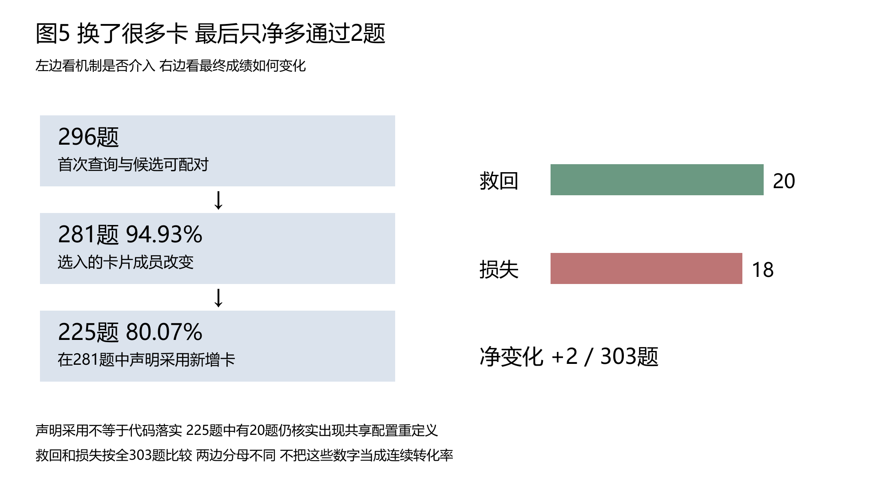
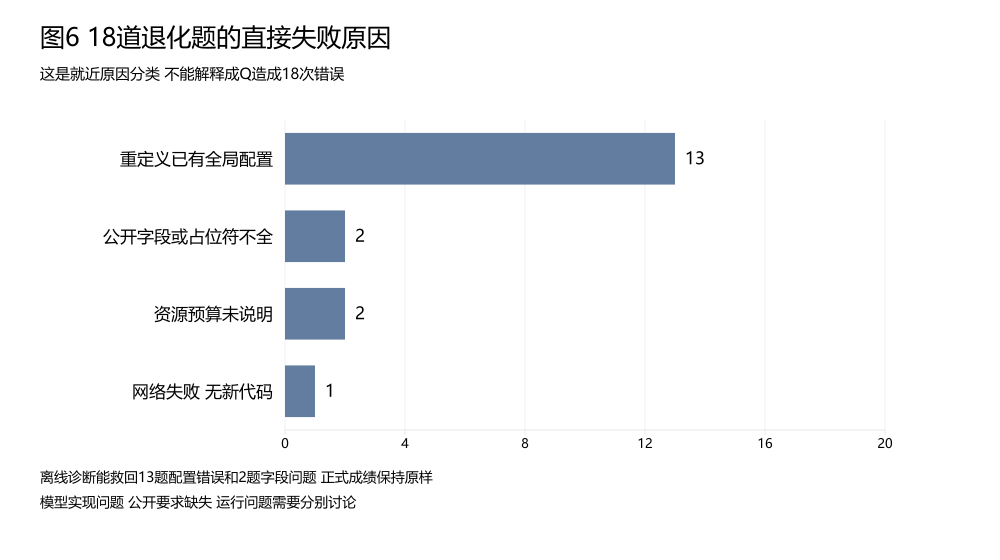

# CLE本周Q值探索主线与实验验证报告

报告资料截止2026年10月22日。重组日期2026年10月26日。内容依据用户手动修订的《CLE项目本周Q值选卡探索实验报告_20261022.docx》，原文件保留。

**总判断：Q确实影响选卡，稳定提高最终Joint的收益尚未建立。** 本报告把研究主线、任务回答和实验直接连接。点击“E编号”看验证；实验末尾可回到提出该问题的主线或要求。Joint指同一份交付代码同时通过功能与安全测试。

读表约定：F为功能通过，S为安全通过；同题两者都过才计Joint。Q是经验卡根据历史解题反馈累积的分数；“覆盖率”在本报告中指获得过有效反馈的卡片比例。实验臂是一种对照设置，重复是相同设置再次独立运行；题族是同一具体来源题型的分组，不能把多次运行当成不同题型。

本次重组不新增模型调用、不更新Q、不重算原模型成绩。原Word概览中的“298道D_grow”按其结果表及原manifest校正为D_gate，原件未修改。下面“暂停/未执行”均指原报告截止时点，不代表2026年10月26日晚间的全部项目现状。

## 一 研究主线

本专项的问题是：**固定1939张经验卡，让卡片根据解题反馈获得历史分数，能否经过“排序改变—选卡改变—正确落实”提高代码的功能安全联合通过率。** 模型参数不更新，经验正文不重建。

### M01 Q需要先改变实际选择才能影响生成

核验点是最终选入的卡片ID集合，而非仅改变候选顺序。[E03 重复选卡](#e03)直接测Q影响是否超过模型波动；[E06 历史采用链](#e06)观察变化是否被声明采用。**判断：机制影响已支持，适用条件仍有限。**

### M02 获得更多反馈可以扩大学习覆盖但不等于卡片正确

核验点是有有效反馈的去重卡数、有效更新资格与实际曝光。[E02 覆盖过程](#e02)测到50.13%；[E04 全池比较](#e04)核对Q在被选卡中的登场比例。**判断：覆盖扩大已支持，Q收敛和正确性未由覆盖率证明。**

### M03 学习Q最终应优于原选卡相似度和打乱Q

核心验证是同池冻结比较的最终Joint。[E04 全298题四臂](#e04)是主要结果；[E05 建库题在线历史比较](#e05)仅作辅助。**判断：稳定增益未建立，不能解释为已经证明普遍无效。**

### M04 选卡后的代码落实和奖励归因可能阻断收益

核验点是建议是否正确实现，以及错误惩罚是否落在真正造成错误的建议上。[E07 损失题诊断](#e07)、[E08 1003与907案例](#e08)提供具体路径。**判断：局部机制已支持，总体失败归因比例尚未测全。**

### M05 检索适用性公开要求和测试覆盖决定结果怎样解释

[E09 检索初标](#e09)说明四指标的证据缺口；[E07](#e07)和[E08](#e08)说明契约缺失与测试盲区。**判断：真实缺陷已定位，正式检索金标准和外部Q评价尚未补齐。**

### M06 本专项贡献是受控迁移检验与瓶颈定位

Q更新、相似度混排和经验选卡不是本专项首创。[E01 机制定义](#e01)界定实际迁移；[E04](#e04)、[E08](#e08)给出结果与诊断。**判断：已有有边界的经验研究成果，未形成Q稳定提分或完整CLE整体有效性的证明。**

## 二 要求快捷回答

### R01 Q到底有没有真正影响选卡

**回答：有。** 固定候选的160次重复选卡显示差异超过该实验中的模型波动，但不限卡条件的机制证据不能直接覆盖限三卡生成。[查看E03](#e03) · [回到M01](#m01)

### R02 Q有没有让代码更正确

**回答：尚未建立稳定收益。** 全298题Q2为102题通过，Q1为104题；共同可测配对差异区间跨0。[查看E04](#e04) · [回到M03](#m03)

### R03 为什么覆盖率已经提高仍没有明显提分

**回答：覆盖、选入、声明采用和正确落实是不同环节。** 获得负反馈也计覆盖，且被声明采用的建议仍可能未落实。[查看E02](#e02) · [查看E06](#e06) · [查看E08](#e08) · [回到M02](#m02)

### R04 原来通过的18题为什么损失

**回答：13题配置覆盖、2题公开字段不足、2题资源政策不明确、1题网络缺测。** 这些是已诊断的直接失败路径，不是18次Q独立负效应。[查看E07](#e07) · [回到M04](#m04)

### R05 四项检索指标是否已经测完

**回答：没有正式完成。** 914对是AI初标，人工确认0；候选池召回不是整库召回，高准确率也可能来自大量未选负类。[查看E09](#e09) · [回到M05](#m05)

### R06 全量学习全量评价和外部测试各完成到哪里

**回答：旧273题学习和旧298题四臂均有完整结果；最新强化状态只完成D_init303及D_grow23。** 最新Q2/Q3的D_gate和Base/Plus在当时未执行。[查看E02](#e02) · [查看E10](#e10) · [回到M03](#m03)

### R07 本周能向老师说明什么贡献

**回答：能说明Q会改变选卡，并以全池比较和代码案例指出收益转化受阻的位置。** 不能说经验选卡或EMA更新首创，也不能把局部诊断当完整CLE的外部提升。[查看E01](#e01) · [查看E04](#e04) · [查看E08](#e08) · [回到M06](#m06)

## 三 综合分析与主线判断

**最可靠的链条是“干预确实进入系统，收益没有稳定跟上”。** [E03](#e03)控制候选并重复选择，支持Q的机制作用；[E04](#e04)覆盖全298题，未显示稳定胜过相似度和打乱Q。两个结果并不矛盾：改变输入并不保证生成代码改善。

**当前应把注意力放在选择之后，而非只追求覆盖率。** [E06](#e06)中281/296题改变卡片成员，225题声明采用新增卡，但仍有20题覆盖外部配置。[E08](#e08)进一步定位正确核心建议未实现、却被整段失败扣分的实例；这使Q同时学习了“建议是否好”和“模型是否能实现”等混合因素。

**数据与验证也限制归因。** [E07](#e07)的字段及资源政策缺口、[E08](#e08)的共享队列测试盲区，说明测试成绩有具体边界。[E09](#e09)又缺人工适用性标签，因此不能把所有未提分都归给Q公式或检索。

**对后续主线的影响：** 保留Q为机制候选，先将功能保持、经验适用前提、代码落实及奖励归因分开验证。原报告的暂停是当时决定；后续已改为主要问题完成预先登记的全量比较，少量低分不取消既定全量。仍须保留匹配对照、固定预算和真实环境，不通过反复追加轮数追逐正结果。

## 四 实验验证目录

[E01 机制定义](#e01) · [E02 学习覆盖](#e02) · [E03 重复选卡](#e03) · [E04 全池四臂](#e04) · [E05 在线历史对照](#e05) · [E06 采用与Joint](#e06) · [E07 退化题诊断](#e07) · [E08 建议与奖励案例](#e08) · [E09 检索初标](#e09) · [E10 状态与成本](#e10)

### E01 Q机制与单题流程的定义核对

来源：[M01](#m01) · [M06](#m06) · [R07](#r07)

#### 1 实验目标

界定“引入Q”实际改变了什么，防止把排序权重、模型选卡和直接取前三混为一谈。这里是机制与实现定义核对，不是一次新的提分实验。

#### 2 实验内容

固定1939卡正文与生命周期。原P7为初析、候选召回、选卡、复析与声明采用、规划、首次生成c0；未Joint时最多一次修复c1，交付末次代码。召回合并向量Top24与词面Top8。Q条件以0.5倍候选内标准化相似度加0.5倍标准化Q重排，模型不看Q数值，仍自主终选0–3卡。

同题尝试使用题前Q，题后仅对声明采用且符合有效测量条件的卡依次更新：新Q=0.7×旧Q+0.3×奖励，Joint通过为+1，否则−1。更新外部卡片效用，不训练模型权重。

#### 3 实验结果

本专项借鉴外部记忆效用反馈思想，在固定卡库上改变候选呈现及Q状态。它与完整CLE重新提炼、合并、退役经验不同；也不是“50%的卡由Q选、50%的卡由相似度选”。

#### 4 实验分析

**回应M01/M06：** 实际干预位置已明确；收益仍由[E04](#e04)判断。**可信度：** 对本报告机制定义有实现与运行记录依据；本次重组不重新裁定外部论文全部细节。**主线影响：** 方法贡献不能写成首创选卡或首创EMA，应聚焦迁移验证与代码级瓶颈。原证据：用户定稿第二节、旧四臂manifest及运行器。

[返回M01](#m01) · [返回R07](#r07) · [实验目录](#experiments)

### E02 完整学习与有效反馈覆盖的演变

来源：[M02](#m02) · [R03](#r03) · [R06](#r06)

#### 1 实验目标

测量“有多少卡获得过有效反馈”。有反馈指visits大于0，允许Q恰好为0；它不是卡片正确率或Q收敛率。

#### 2 实验内容

沿历史学习节点核对固定1939分母。数据职责：D_init303题用于建库侧，D_grow273用于成长学习，D_gate298用于内部审计比较。CWE是漏洞大类，family是具体来源题型分组，统计按原manifest记录。这里不把三池874题合为独立测试率。

#### 3 实验结果

| 节点 | 有反馈卡 | 覆盖率 | 实际含义 |
|---|---:|---:|---|
| 旧M1状态 | 466/1939 | 24.03% | 早期探索及不限卡D_grow观察后 |
| 资格清理后 | 416/1939 | 21.45% | 撤销162条不合格事件，50卡失去支持 |
| 修复32道D_grow补学后 | 436/1939 | 22.49% | 32题中24题通过 |
| D_init限三覆盖优先后 | 669/1939 | 34.50% | 303题完整运行 |
| D_init不限卡覆盖优先后 | 926/1939 | 47.76% | 303题完整运行 |
| Q参与D_init排序后 | 967/1939 | 49.87% | 303题完整运行 |
| Q参与D_grow前23题后 | 972/1939 | 50.13% | 23/273，Joint11题 |

完整历史学习不止小探针：首轮273题观察Joint105（272完整测量）；不限卡273题观察Joint109；冻结后同273题回测Joint100。它们输入状态和张数规则不同，不能作纯Q单变量提分曲线。

#### 4 实验分析

**回应M02/R03：** 覆盖扩大是事实，撤销不合格事件造成的下降也不是性能退步。未反馈卡可能未召回、未选、未采用或无有效奖励，不能直接判为无用。**可信度：** 覆盖计数在对应快照内可核对；跨节点的因果可比性有限。**主线影响：** 不再用覆盖低作为Q未发挥的唯一解释，需结合[E04](#e04)实际曝光和[E08](#e08)奖励归因。原证据：定稿覆盖表及各学习summary。

[返回M02](#m02) · [返回R03](#r03) · [返回R06](#r06) · [实验目录](#experiments)

### E03 固定候选下四方式重复选卡

来源：[M01](#m01) · [R01](#r01)

#### 1 实验目标

检验Q造成的卡片ID集合差异，是否大于同一种方式重复运行的自身波动。

#### 2 实验内容

固定8题与候选，Q0–Q3各5次，共160次。只选卡，不生成代码、不更新Q；该批取消卡片数量上限。原CLE、相似度、学习Q、同CWE打乱Q分别作为条件。

#### 3 实验结果

原报告复用的独立分析显示，Q2相对Q1和Q3的集合差异超过自身波动，Holm多比较校正后p=0.0006。

#### 4 实验分析

**回应M01/R01：已支持“Q会影响实际选卡”。** 固定候选与重复设计比单看一次换卡更能区分模型波动。**可信度：机制层证据较强，范围限于8题、不限卡和该Q快照。** p值不是Q正确概率；本实验没有代码结果，不能支持提高Joint，也不直接替代限三卡全量机制分析。原证据：定稿第五节及`results/curated/cle_selector_repeat_20261019/`。

[返回M01](#m01) · [返回R01](#r01) · [实验目录](#experiments)

### E04 冻结旧Q后的298题四臂完整比较

来源：[M02](#m02) · [M03](#m03) · [R02](#r02)

#### 1 实验目标

检验学习Q的最终Joint是否优于原CLE、纯相似度及打乱Q；这里“收益”指同一交付代码的联合通过增加。

#### 2 实验内容

旧M1卡库状态，D_gate298题、217个family，四种方式各一次、共1192条P7。最多三卡、同题配对。该快照不是后来972卡获得反馈的状态。

#### 3 实验结果

| 方式 | 完整测量 | F | S | Joint 统一298分母 |
|---|---:|---:|---:|---:|
| Q0 原CLE终选 | 298 | 120 | 227 | 97/298 32.55% |
| Q1 语义相似度重排 | 298 | 123 | 230 | 104/298 34.90% |
| Q2 学习Q重排 | 296 | 118 | 228 | 102/298 34.23% |
| Q3 同CWE打乱Q | 298 | 119 | 230 | 100/298 33.56% |

| 共同完整296题的比较 | Q2救回 | Q2损失 | 题族95%差异区间 百分点 |
|---|---:|---:|---|
| Q2相对Q0 | 16 | 10 | −1.28 至 +5.30 |
| Q2相对Q1 | 13 | 14 | −3.56 至 +2.81 |
| Q2相对Q3 | 14 | 12 | −2.73 至 +4.04 |

Q2选入出现次数中55.57%来自有反馈卡，声明采用出现中61.22%来自有反馈卡。出现次数与全库去重覆盖24.03%的分母不同。

#### 4 实验分析

**回应M03/R02：稳定增益未建立。** Q2没有稳定胜过相似度和打乱Q，区间均跨0；不代表四方式等效或Q普遍无效。**回应M02：** 有反馈卡已大量进入实际选择，不能仅用全库覆盖24%解释结果。**可信度：** 完整覆盖这批内部审计总体，且保留共同可测配对；只有一次生成、Q2有2题缺测、D_gate有历史开发曝光，外部推广有限。原证据：`results/curated/cle_memory_q_full_gate_cap3_20261019/`。**主线影响：** 保留机制结论，收缩提分主张，下一步完整匹配比较不得混用新旧Q状态。

[返回M03](#m03) · [返回R02](#r02) · [返回M02](#m02) · [实验目录](#experiments)

### E05 303道建库题的三次历史在线结果

来源：[M03](#m03) · [R06](#r06)

#### 1 实验目标

观察Q参与前向排序之后，同题在线成绩是否出现明显变化，并界定它与冻结迁移评价的区别。

#### 2 实验内容

比较三批D_init303题记录：覆盖优先限三、覆盖优先不限卡、在线Q限三。前两批虽不按数值Q排序，仍用访问状态优先选未学卡，不能当原CLE/Q0；起始状态也不一致。

#### 3 实验结果

| 设置 | 完整测量 | 首轮通过 | 修复新增 | 最终Joint |
|---|---:|---:|---:|---:|
| 覆盖优先限三 | 300 | 130 | 8 | 138/303 |
| 覆盖优先不限卡 | 299 | 133 | 7 | 140/303 |
| Q参与限三 | 299 | 137 | 3 | 140/303 |

Q参与相对第一批救回20、损失18，净+2；相对第二批救回14、损失14，净0。

#### 4 实验分析

**回应M03：没有看到明显净增，但它不是Q独立因果对照。** 源题本身产过卡，在线更新及初始状态不同。**可信度：** 303题过程成绩完整留存，归因控制弱于[E04](#e04)。**主线影响：** 140/303不能写成跨题族迁移提升，也不能将138→140全部归给Q。原证据：定稿第四节及在线D_init summary。

[返回M03](#m03) · [返回R06](#r06) · [实验目录](#experiments)

### E06 从卡片成员变化到实际采用和Joint

来源：[M01](#m01) · [M04](#m04) · [R03](#r03)

#### 1 实验目标

区分排序变、成员变、声明采用新增卡及最终成败变化，不把它们当同一件事。

#### 2 实验内容

303题历史对照中296题首轮查询及候选可配对；其余7题含初析和网络/记录差异。按卡片ID及声明采用字段交叉分析，最终成绩仍用原交付代码。

#### 3 实验结果

| 分组 | 题数 | 旧Joint到新Joint | 救回 / 损失 |
|---|---:|---|---|
| 成员改变 | 281/296 94.93% | 128到130 | 19 / 17 |
| 其中声明采用新增卡 | 225/281 80.07% | 103到110 | 16 / 9 |
| 其中未声明采用新增卡 | 51/281 | 22到18 | 3 / 7 |
| 其中采用字段异常 | 5/281 | 3到2 | 0 / 1 |
| 成员相同 | 15/296 | 8到9 | 1 / 0 |
| 首轮不可配对 | 7/303 | 2到1 | 0 / 1 |
| 全部303题 | 303 | 138到140 | 20 / 18 |

281题成员变化中245题成败未变。225道声明采用新增卡的题中，仍有20题出现外部配置重定义，占8.89%。

#### 4 实验分析

**回应M01/M04：变化确实进入采用阶段，但未稳定变成收益。** 94.93%来自历史关联比较，不能当Q独立效应；相同卡也有救回，说明生成及流程还有其他因素。**可信度：** 计数和代码实例可追溯，属于事后分组；20/18与296题漏斗分母不同，不能接成连续转化率。**主线影响：** “已采用”只能证明模型作过声明，后续必须核对实现。原证据：`results/curated/cle_q_dinit_selection_joint_20261021/`。

[返回M04](#m04) · [返回R03](#r03) · [实验目录](#experiments)

### E07 18道退化题及跨批配置覆盖诊断

来源：[M04](#m04) · [M05](#m05) · [R04](#r04)

#### 1 实验目标

查清旧过新不过的直接失败路径，区分代码错误、公开契约不足和运行缺测。

#### 2 实验内容

逐题读原代码和验证，用单独诊断副本局部修改后本地复验，不改正式模型成绩、不更新经验或Q。另复查三次D_init运行中170份疑似配置重定义代码，原版及删除重定义版共340次本地验证。

#### 3 实验结果

| 原因 | 数量 | 题号 | 诊断结果 |
|---|---:|---|---|
| 全局配置重定义 | 13 | 1003、1223、1241、1299、1363、1364、150、352、487、488、642、664、670 | 删除不当顶层重定义，13题恢复Joint |
| 公开字段或占位符不全 | 2 | 1037、989 | 诊断补齐后恢复Joint，不计模型救回 |
| 资源预算未说明 | 2 | 874、907 | 精确上限未公开，新旧结果均可复现 |
| 网络失败无新代码 | 1 | 885 | 属运行故障，不能归给选卡策略 |

跨批170份代码中，限三58、不限卡51、在线Q61；删除顶层重定义后分别恢复28、20、31个运行实例，共79例，涉及45道唯一题。

#### 4 实验分析

**回应M04/R04：配置覆盖是这批损失的重要直接路径。** 同时出现在无数值Q与有Q批次，不能称Q特有问题。**可信度：** 局部删改与原验证器复验使直接路径证据较强；诊断修改不是模型自主改进，170份是筛选样本，不能外推全部失败比例。**回应M05：** 两类未公开要求使分数归因受限。**主线影响：** 优先检验功能保持与公开契约，并保留独立Q对照。原证据：定稿第六节及旧损失/噪声审计归档。

[返回M04](#m04) · [返回R04](#r04) · [实验目录](#experiments)

### E08 正确建议被扣分与测试遗漏的实例

来源：[M04](#m04) · [M05](#m05) · [R03](#r03) · [R07](#r07)

#### 1 实验目标

检验“整段失败是否能准确代表卡片建议无效”，以及“Joint通过是否覆盖全部题面义务”。

#### 2 实验内容

追溯1003卡片正文、两次声明采用、生成代码与Q事件；对照907共享队列及验收行为。救回案例用于对称核对，不只挑损失。

#### 3 实验结果

1003的`hint-79-4223192076816222301`核心建议要求保留外部USER_POST_FORMAT。模型c0/c1均声明采用，却仍重定义模板；代码两次失败，该卡Q约从−0.565到−0.695再到−0.787。该卡源自1003自身，附带其他字段也非全部适用。

907预置queue.Queue共享task_queue；旧通过代码也把它换成列表，仅因测试只看返回布尔值而未测共享队列写入获得通过。

救回题也有混杂：1174修正isinstance参数类型、1382修正AST验证、834修正ORDER BY解析；1113未声明采用也救回，999/1063通过但仍有配置或互斥卡问题。

#### 4 实验分析

**回应M04：1003直接支持“正确核心建议没落实仍被整体奖励扣分”的机制路径。** 不表示整张卡全正确，也不是跨题迁移。**回应M05：907支持具体测试盲区。** 不能由Joint通过推断真实业务完全满足。**可信度：** 个案证据具体可核对；没有测出所有误奖惩数量或纯模型随机失败总数。**主线影响：** 奖励归因和实现能力需分开，不能只增加学习轮数。原证据：定稿案例及Q事件/代码复核记录。

[返回M04](#m04) · [返回M05](#m05) · [返回R07](#r07) · [实验目录](#experiments)

### E09 914个题卡对的检索适用性AI初标

来源：[M05](#m05) · [R05](#r05)

#### 1 实验目标

判断卡片是否直接适用于当前题目，测候选池内准确率、精确率、召回率、F1；它不是代码Joint。

#### 2 实验内容

914对AI初标，人工确认0。校准6题中1394含2对信息不足，整题未纳入逐题汇总，实际5题330对可评；开发8题515对。旧检索门槛约0.761，不是Q协议的−1。

#### 3 实验结果

AI初标：直接89、条件385、不相关285、冲突153、信息不足2。

| 开发8题的方法 | 候选召回直接卡 | 终选卡 | 终选直接卡 | 候选池内准确率 |
|---|---:|---:|---:|---:|
| 原题加初析R0 | 18/60 30% | 6 | 0 | 87.18% |
| 原题直接R-query | 54/60 90% | 0 | 0 | 88.35% |

R0含449个真负例，R-query含455个。R-query精确率分母为0，应记无法计算，不填0或1。不能把914−2写成912对都已正式测完。

#### 4 实验分析

**回应M05/R05：正式检索评价尚未完成。** 候选找到更多不等于终选适用卡更多，高准确率可被大量负类垫高。**可信度：** 这些是模型辅助估计，缺人工金标准；整库1939卡召回未测。**主线影响：** 先区分召回遗漏与终选问题，不能用该高阈值样本解释当前Q全量表现。原证据：`results/curated/cle_retrieval_q_20261017/`及公开契约修订资料。

[返回M05](#m05) · [返回R05](#r05) · [实验目录](#experiments)

### E10 截止时点的实验状态成本与后续缺口

来源：[M03](#m03) · [M06](#m06) · [R06](#r06)

#### 1 实验目标

说明哪些结论对应哪份已执行状态，避免把最新Q覆盖和旧四臂成绩拼成一次完整实验。

#### 2 实验内容

汇总原报告暂停快照、22组历史记录与Token用量。主记录含同题跨轮和复用，不是独立任务总数；成本估算不当实付账单。

#### 3 实验结果

| 项目 | 截止时点结果 |
|---|---|
| D_init在线学习 | 303/303，Joint140 |
| D_grow在线学习 | 23/273，Joint11 |
| 最新强化Q的D_gate Q2/Q3 | 当时各0/298，未执行 |
| Base/Plus Q专项 | 未执行 |
| 历史主记录 | 22组、3423条，另160次纯选卡 |
| 已知模型Token | 输入219710233，输出21560254，共241270487 |
| 按当时给定单价估算 | 约302.46元，不含Embedding及部分未知用量，非账单 |

早期24题四方式Joint为5/3/4/5；48题不限卡Q1/Q2/Q3为17/21/20，另批补Q0为18。它们不是全298题的重复，可保留历史诊断而不拼总率。

#### 4 实验分析

**回应R06：有完整旧实验，也有未完成的新状态，必须分开。** 最新覆盖50.13%不能继承旧24.03%状态的298题分数。**可信度：** 历史状态与汇总可追溯，未知用量和未执行部分仍未知；原报告当时暂停不等于本日所有实验暂停。**主线影响：** 本专项已形成机制与负结果诊断，但完整CLE及外部泛化未由此结案。原证据：用户定稿第七节及在线状态summary。

[返回M03](#m03) · [返回R06](#r06) · [返回主线总览](#main) · [实验目录](#experiments)

## 五 资料与阅读边界

用户手改的20261022原Word是本稿内容依据，原件保留。本次只重组与映射，不新增历史逐题复验。各实验已给出原生证据位置，完整资料经研究总览及实验登记表调取。

[回到主线](#main) · [回到要求快捷回答](#requirements) · [回到综合分析](#synthesis)
