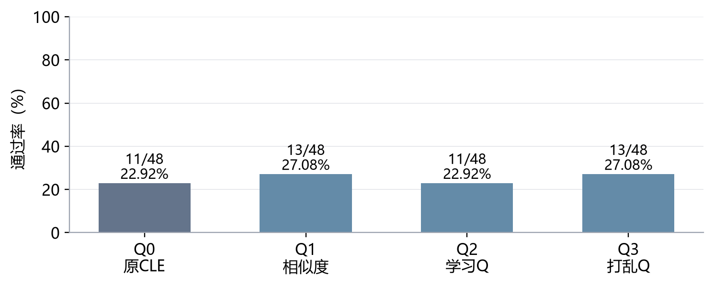
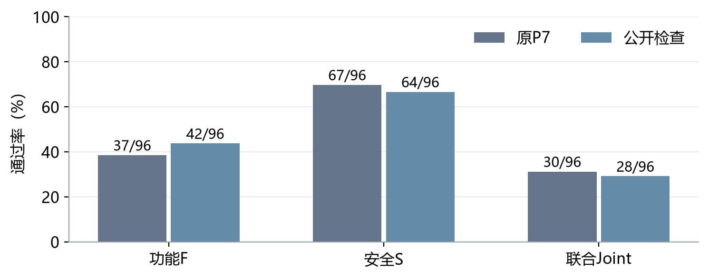
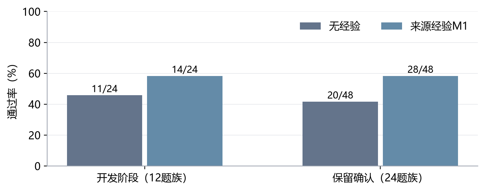
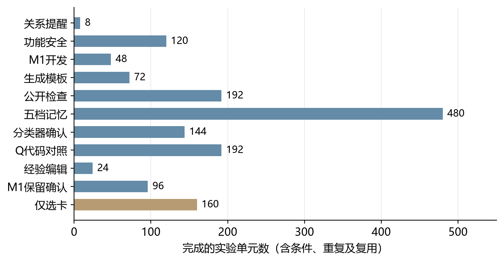

# 10月26日-11月1日实验探索报告

报告周期：2026年10月26日至11月1日　结果统计截至：10月27日01:02

## 一、本周实验主线

本周研究围绕一个问题展开：怎样让已有经验真正帮助模型生成同时满足功能和安全要求的代码。根据老师希望引入记忆奖励Q值、区分功能与安全经验、按任务选择记忆详细程度的意见，以及学长提出的分轮积累反馈、同题回测和跨题族迁移思路，实验先检查经验能否改变模型的选择，再检查这种改变能否落实为正确代码。本人进一步要求补齐检索质量测量，采用固定完整名单验证主要问题，并比较DeepSeek v3.2与v4.1使用不同来源经验时的表现。因此，本周将Joint（同一份交付代码同时通过功能和安全测试）作为主要成绩，并结合具体选卡、采用声明和代码实现解释结果。老师、学长的要求归属依据本对话转述。

截至统计时间，v4.1基础迁移清单已完成1376个代码实验单元和160次仅选卡实验；这些单元包括同题不同条件、重复运行及精确复用，不能理解为1536道独立新题。本报告汇总本周完成的清单及其沿用的历史材料，尚未结束的一周不预填后续成绩。总体上，Q改变选卡的作用已有证据，稳定提高正确率的作用尚未建立；来源经验方案出现正向信号，但仍需匹配条件下的全量验证。

### （一）引入Q值，判断它是否改善经验选择与最终正确率

Q值已经改变了具体卡片编号，而不只是显示顺序：在代码对照中，学习Q组相对原CLE组有46/48次首次选卡集合变化，32/48次声明采用了新增卡片。但学习Q组的Joint为11/48，与原CLE相同，低于纯相似度和打乱Q的13/48，因此本轮支持“Q影响选择”，尚不支持“Q稳定提分”[【A1】](#a1)。

证据对应：重复选卡实验支撑“影响超过模型自身选卡波动”；四组代码对照支撑“本轮没有对应的成绩改善”，两者均见[【A1】Q的选卡作用与代码结果](#a1)。

### （二）分轮积累反馈，再检查同题收益与跨题族迁移

本周使用的是v3.2历史学习得到的冻结Q，1939张卡中972张曾获得反馈；本周没有在v4.1上新增Q学习。因此，当前结果能够回答旧Q迁移后怎样影响选择，不能回答v4.1按轮学习后是否会改善，也没有完成新模型全量同题回测和298题迁移评价[【A1】](#a1)[【A7】](#a7)。

证据对应：冻结库及实际选卡覆盖说明本轮使用了什么Q，见[【A1】](#a1)；学习次数、卡片生成数和未执行范围说明哪些任务仍未完成，见[【A7】完成范围与测量缺口核对](#a7)。

### （三）分开功能与安全经验，解释为什么安全修复会破坏正常功能

目前的拆分表达没有带来预期改善：混合原卡和仅功能视图均为13/24，功能与安全分区组合为9/24；对同一段既有代码增加经验编辑，也没有改变这组诊断题的Joint。具体代码表明，额外改写白名单、替换现有对象或没有落实边界检查，均可能破坏功能，但不能把全部失败都归为安全要求过强[【A2】](#a2)。另一种来源经验使用方案在保留题上达到28/48，高于无经验的20/48，提示仍有值得完整验证的使用方式[【A6】](#a6)。

证据对应：分区对照与同起点编辑支撑“当前拆分方式未改善”，见[【A2】功能与安全经验的表达和编辑](#a2)；正向信号及代码救回路径来自另一流程，见[【A6】来源经验的开发与保留确认](#a6)，不能归为Q或拆分本身的收益。

### （四）按任务选择合适的记忆程度，并训练分类器

经验越详细并不一定越好。五档记忆中，操作模板为47/96，完整来源示例为42/96，无记忆为44/96，差异尚不足以确认稳定优势[【A3】](#a3)。分类器已经使用真实生成结果训练，但在保留题上仅21/48，未超过固定一句风险提醒的22/48；当前训练题中可可靠区分档位的信号较少，不能宣布分类器已学会“什么题应该用什么记忆”[【A4】](#a4)。

证据对应：五档全对照支撑“详细程度与成绩不是简单递增关系”，见[【A3】五档记忆程度对照](#a3)；训练标签来源与保留题比较支撑“分类器收益未建立”，见[【A4】记忆程度分类器验证](#a4)。

### （五）测量检索准确率、精确率、召回率和F1

当前有检索、选择和采用记录，但尚无完成人工确认的题目—卡片适用性标签，因此本周不能给出正式检索四指标。选中卡片的Q覆盖率和采用率都不能替代召回率；缺少适用卡总数这个分母，就不能判断漏掉了多少有用经验[【A7】](#a7)。

证据对应：现有记录能计算什么、缺失什么标签，以及候选池召回与全库召回的区别，见[【A7】](#a7)。这里支撑的是“测量尚未完成”的判断，不是检索有效或无效的判断。

### （六）完整执行预定实验，不因小样本没有提分就停止验证

本轮固定清单全部完成，11个代码实验包的零API回放均与原记录一致，12个具体案例已查看题面、经验、代码及验证结果。完成清单保证了本轮没有按成绩挑选留下的实验，但各包仍是其预定规模，不能把24题族两重复写成48道独立题，更不能替代全298题评价[【A7】](#a7)。

证据对应：各包完成数、复用关系和回放检查支撑“固定清单完整执行”，见[【A7】](#a7)；[【A1】至【A6】](#experiments)分别给出对应样本上的结果，正常负结果保留，后续主要问题仍按已登记全量计划推进。

### （七）比较两个使用模型与两套来源经验，区分模型能力和经验适配

本周主要完成v4.1使用既有材料的比较，还没有从空库建立v4.1自己的完整经验库，也没有完成两个模型交叉使用两套卡库的匹配实验。来源经验方案的正向信号说明经验的选择和使用方式值得研究，但它采用专门来源材料与另一生成流程，不能当作两模型交叉适配已被证实[【A6】](#a6)[【A7】](#a7)。

证据对应：专门来源经验的使用条件与收益范围见[【A6】](#a6)；新卡库、交叉矩阵及完整评价的缺口见[【A7】](#a7)。

<!-- pagebreak -->

## 二、待做实验

以下安排来自已登记的七项要求与全量验证方案。截至本报告统计时间，这些新增全量包尚未完成；下文的数量是计划规模，旧结果经逐项匹配后才能抵扣。待做编号【T1】至【T9】用于阅读导航，括号内保留原任务包名称，便于找到执行记录。本节列出后续任务总表，不表示全部任务都要在本周内完成。

执行顺序为：先统一规格，再完成新模型自己的Q学习、同题回测及跨题族评价，随后完成功能安全与记忆程度实验，最后建设新卡库并做交叉比较。检索记录与标签工作随相关实验同步推进；某一模型或验证环境尚未就绪时，其他独立任务继续开展。

待做导航：[【T1】统一规格](#t1)　[【T2】Q学习](#t2)　[【T3】Q回测与迁移](#t3)　[【T4】功能安全](#t4)　[【T5】记忆程度与分类器](#t5)　[【T6】检索测量](#t6)　[【T7】新卡库](#t7)　[【T8】模型与卡库交叉](#t8)　[【T9】Base/Plus](#t9)。

### 【T1】全量实验的共同规格与旧结果复用核对（F0）

实验原因：回应[要求六](#r6)。本轮已经完成的局部对照可以提供线索，但题号相同不代表模型输入、经验库和验证规则相同。先完成这项零API准备，才能确定哪些结果可以直接复用，以及后续全量实验究竟还需运行多少次。

实验步骤：

1. 固定D_init 303题、D_grow 273题和D_gate 298题名单，核对family（题族，即具有共同来源或任务结构的一组题）归属，登记原题及公开契约修订。
2. 对齐P7流程、原验证器、模型参数、经验版本、候选范围和重复编号；公开契约只包含题目允许提供的要求，不加入隐藏测试。
3. 将旧结果逐项归为直接复用、历史参照或故障诊断，列出可复用的运行单元与剩余名单，保留原始记录。
4. 为后续各包固定执行顺序、逻辑任务数和累计费用预算；技术预检检查流程能否运行，不根据模型成绩筛掉题目。

[返回要求六](#r6)　[返回待做实验](#todo)

### 【T2】v4.1在固定旧卡库上的分轮Q学习（FQ学习）

实验原因：回应[要求一](#r1)和[要求二](#r2)。现有实验已证明旧Q能影响v4.1选卡，却没有建立正确率收益[【A1】](#a1)。需要让v4.1根据自己的实际解题反馈学习Q，区分“旧模型的评分不适配新模型”与“Q方法本身没有带来收益”。

实验步骤：

1. 固定旧库1939张卡的正文与资格规则，将新学习链的Q和visits（获得合格反馈的次数）从零开始；旧Q及旧实验保留。
2. 使用v4.1按原P7完成全部303道D_init题，Q参与排序、模型最多选三张卡，只更新实际采用且反馈合格的卡，保存K0状态。
3. 随后按固定顺序完整运行273道D_grow题三轮，逐题更新Q并依次保存K1、K2、K3；学习阶段共计划1122次P7任务。
4. 每轮记录Joint、获反馈卡数、实际采纳、反馈来源题族与成本。三轮按固定设计完成，不因某轮没有提分而跳过，也不按成绩临时增加轮次。

[返回要求一](#r1)　[返回要求二](#r2)　[返回待做实验](#todo)

### 【T3】冻结各轮Q的同题回测与全D_gate四组对照（FQ评价）

实验原因：回应[要求二](#r2)。学习过程中的通过率会随Q状态变化，不能直接代表学习结束后的效果。需要先检验它是否帮助做过的题，再检验相同CWE（漏洞类别）下不同题族是否受益。

实验步骤：

1. 使用【T2】保存的K0至K3，在完整273道D_grow题上比较纯相似度Q1与四个冻结Q2状态，每条件两次重复，共2730次任务；评价期间不更新Q或卡片。
2. 固定以第三轮K3开展迁移评价，不从回测结果中挑最好的一轮。全298道D_gate题比较Q0原CLE、Q1纯相似度、Q2学习Q、Q3同CWE内打乱Q及visits，每组两次重复，共2384次任务。
3. 按【T1】统一后的候选范围共享首次初析、候选与余弦值，记录选卡编号变化、声明采用和实际代码落实；单列同CWE且反馈题族不同的结果。
4. 主要比较Q2与Q1、Q3的Joint救回和损失，报告按题族计算的统计区间、重复波动、覆盖率和成本，分别回答同题学习收益与跨题族迁移收益。

[返回要求一](#r1)　[返回要求二](#r2)　[返回待做实验](#todo)

### 【T4】功能与安全经验分开呈现的全量对照（FFS）

实验原因：回应[要求三](#r3)。局部实验中，将功能与安全分栏并未自动改善Joint[【A2】](#a2)。老师关心的是在保障安全时为什么正常功能会失败，因此需要完整测量两类结果，并分析功能损失发生在哪里。

实验步骤：

1. 固定v4.1、1939卡库和P7流程，关闭Q增量，使用完整298道D_gate题；带卡条件固定同题候选与选入卡，再改变经验呈现内容。
2. 比较无卡B0、混合经验BM、仅功能BF、仅安全BS、功能安全分栏BFS，五条件各两次重复，共2980次任务。
3. 统计F、S、Joint及功能与安全通过／失败的四种组合，重点对比BFS与BM在同一题上的功能损失和安全救回。
4. 对照题面、卡片、生成代码和验证记录，将差异归为公开契约缺失、来源假设迁移、功能实现错误、安全实现错误或无法区分，判断分开呈现是否回答了老师的要求。

[返回要求三](#r3)　[返回待做实验](#todo)

### 【T5】全D_grow记忆程度标签与全D_gate分类器验证（FG）

实验原因：回应[要求四](#r4)。现有五档实验中许多题在各档下同成同败，可用于训练分类器的可靠标签有限[【A3】](#a3)，分类器也尚未超过固定档位[【A4】](#a4)。需要补足全量真实生成结果，再判断题目特征能否帮助选择记忆程度。

实验步骤：

1. 在查看新成绩前，按题族固定D_grow训练与开发归属；统一五档的候选资格和来源材料，避免不同档位实际换了经验库。
2. 对全部273题分别使用L0无记忆、L1风险提醒、L2机制与前提、L3目标操作模板、L4完整来源示例，每档两次重复，共2730次任务。
3. 从真实结果提取档位偏好标签，保留无法区分的情况；只用训练与开发侧确定分类器、最佳固定档和简单公开规则，不把全部失败标为“无需记忆”。
4. 冻结三种策略，在全298道D_gate题上各运行两次，共1788个逻辑任务。逐题比较Joint、功能安全结果和所选档位；同协议同档位的运行单元精确复用，报告实际调用与逻辑规模的区别。

[返回要求四](#r4)　[返回待做实验](#todo)

### 【T6】全任务范围的检索四指标与人工复核（FR）

实验原因：回应[要求五](#r5)及学长提出的召回率要求。已有914个题卡对的AI标签尚未得到人工确认[【A7】](#a7)，只能作为模型辅助估计。需要明确适用卡在哪里被漏掉，才能解释是检索、门槛还是最终选卡限制了Q的作用。

实验步骤：

1. 覆盖D_grow 273题和D_gate 298题，优先复用代码实验的公开初析与检索记录，不为测检索重新生成代码。
2. 每题以原题、初析、原题加初析三种查询收集向量Top24与词面Top8的联集，再固定抽取16张其余合法卡；去重形成共同评价池，并按预定规则纳入池外实际选中卡。
3. 隐藏方法、排名、Q和历史成绩，完成AI初标与人工确认。沿用直接适用、有条件适用、无关、冲突、信息不足五类；信息不足留待裁决，不默认标错。
4. 计算候选池内准确率、精确率、召回率和F1，分别报告最初召回与最终选卡的遗漏。全库召回率仍写未测量；人工未完成时列出待复核量，其他代码实验照常推进。

[返回要求二](#r2)　[返回要求五](#r5)　[返回待做实验](#todo)

### 【T7】使用v4.1从空库建立新的CLE经验库（FX建库）

实验原因：回应[要求七](#r7)，也补齐[要求二](#r2)中“积累经验”的新增卡片部分。固定1939卡学习Q只改变评分，不会产生v4.1自己的经验库；没有新库，就无法开展两套来源经验的交叉比较。

实验步骤：

1. 建立独立运行目录，v4.1从空经验开始，按原CLE在D_init上冷启动生成卡片，保留每张卡的来源任务和提炼记录。
2. 在D_grow上执行原主动回放、三轮演化与全局门控，保存各轮经验状态、筛选结果和费用；按原调度记录实际做题次数，不把三轮演化写成三次固定全题扫描。
3. 冻结最终新库并登记实际卡数，记为C41N，其中N为实际数量；它与旧1939卡库分别保存，新增卡片的过程与【T2】的固定库Q学习分开报告。

[返回要求二](#r2)　[返回要求七](#r7)　[返回待做实验](#todo)

### 【T8】两种使用模型与两套经验库的全量交叉比较（FX核心交叉）

实验原因：回应用户提出的[要求七](#r7)。现有P3换模结果与P7经验实验的流程不同，不能直接把差值全部解释为经验收益。需要在同一P7规则下，分别比较模型本身、旧经验和新经验的作用。

实验步骤：

1. 在【T7】新库完成后，统一P7、公开契约和验证规则，关闭Q更新；两个使用模型分别为v3.2和v4.1，卡片条件为无卡、旧1939卡库、新C41N库。
2. 六条件各完成全298道D_gate题、两次重复，共3576个逻辑任务。按【T1】映射复用完全相同的既有单元，不用旧P3成绩填充P7无卡条件。
3. 比较每个模型的有卡减无卡收益、同一经验库在两模型上的表现，以及更换经验库后收益是否随模型改变，结合选卡、采用和代码记录解释结果。
4. v3.2若暂不能接入，先完成v4.1可执行条件并保留剩余清单。结论限定于这两套具体经验库；要归因于卡片生产模型本身，还需另设输入和预算匹配的重复建库。

[返回要求七](#r7)　[返回待做实验](#todo)

### 【T9】Base与Plus上的外部验证（FX外部）

实验原因：回应[要求六](#r6)和[要求七](#r7)。D_gate参与过项目门控和历史研究，仅靠内部审计结果不能回答效果是否能迁移到外部任务。Base与Plus用于补充这一证据，目前执行仍依赖原验证环境。

实验步骤：

1. 补齐并核对原验证镜像及官方正向校准，固定Base 115题和Plus 140题名单，不用其他验证后端替代。
2. 延用【T8】六条件，在两个数据集上分别运行两次重复，共3060个逻辑任务。经验和Q保持冻结，隐藏测试反馈不回传，按原项目生成与末次交付规则执行。
3. 分集报告F、S、Joint、完整测量数、缺测和成本，比较相对无卡条件的收益是否延续；未运行的条件写待执行，不以零分替代。

[返回要求六](#r6)　[返回要求七](#r7)　[返回待做实验](#todo)

详细规格、原实验ID和预算口径见[七项要求的全量任务清单](../../CLE-PLAN-20261027-seven-requirements-v01.md)。本次只补充报告的待做板块，没有执行上述新实验。

<!-- pagebreak -->

## 三、实验内容与结果分析

本节统一使用F（功能通过）、S（安全通过）与Joint报告交付代码的结果。图表分母为预定实验单元数；缺测不计通过，但与已测失败分列。每个“实验单元”是某题在某一条件、某一次重复中的结果。family（题族）表示同一任务模板衍生的题目，重复及同族样本不能当作独立证据。CWE表示安全弱点类别，同属一类不意味着具体任务要求相同。

各包使用deepseek-v4.1-flash-1017，关闭思考，temperature为0，正式输出预算为4096 Token（模型处理文本的计量单位），保持单条user消息。原P7先分析、选卡、规划再生成，最多三张卡、最多一次修复；首次Joint通过时结束，否则交付末次代码。A6使用A7流程，A2的补充编辑为单步诊断，均在实验内单独说明。

实验导航：[【A1】Q作用](#a1)　[【A2】功能安全](#a2)　[【A3】五档记忆](#a3)　[【A4】分类器](#a4)　[【A5】公开约束](#a5)　[【A6】来源经验](#a6)　[【A7】完成范围](#a7)

<!-- pagebreak -->

### 【A1】Q的选卡作用与代码结果

#### 1. 实验思路

针对[要求一](#r1)，必须把“Q改变选择”和“改变后代码更正确”分开检验。前者采用重复选卡，估计模型在条件不变时也会出现的波动；后者在相同题目上生成完整代码，检查Joint。四个条件分别是Q0原CLE候选顺序、Q1纯相似度排序、Q2学习Q排序、Q3同CWE内打乱Q及访问次数。模型仍负责最终选卡，Q2并非直接取Q最高的三张卡。

#### 2. 实验步骤

1. 固定1939张经验正文和历史Q快照。972张卡的visits大于0，即曾获得反馈，覆盖率为50.13%；Q恰好为0但有反馈的卡也计入。这个快照包含v3.2的部分在线学习状态，不是v4.1重新学习的Q。
2. 对8个题族的相同查询、候选和余弦相似度，分别运行四种排序，每种重复5次，共160次选卡。使用排序混合参数λ=0.5、相似度阈值δ=−1和置换种子20261015；这是本轮探索设置，不能写成所有历史CLE实验的默认参数。
3. 在24个预留题族上，每个条件重复2次，共192个代码单元。首次初析和候选共享，模型最多选三张；后续修复依各组代码独立进行，Q和经验始终冻结。
4. 按相同题目及重复编号配对，比较卡号集合、新增卡采用、F/S/Joint与救回损失。统计以题族为单位处理相关性，保留缺测及历史技术失败记录。

#### 3. 实验结果

| 条件 | F通过数 | S通过数 | Joint通过数 | 完整测量 |
| --- | --- | --- | --- | --- |
| Q0 原CLE | 19/48 | 33/48 | 11/48 | 48/48 |
| Q1 相似度 | 19/48 | 35/48 | 13/48 | 48/48 |
| Q2 学习Q | 18/48 | 33/48 | 11/48 | 48/48 |
| Q3 打乱Q | 20/48 | 32/48 | 13/48 | 47/48 |

重复选卡的160次有效记录显示，Q2相对Q0、Q1、Q3的卡号集合差异超过组内波动，Holm校正（同时比较多组时减少误判的方法）后的p值分别为0.006、0.0072和0.00015。代码实验中，Q2对Q0的首次选卡集合变化46/48次，新增卡声明采用32/48次。Q2选中卡片的位置中134/139有过Q反馈，首次声明采用的位置中97/97有过反馈；这些是卡片位置数，不是独立题数。

#### 4. 实验分析

图1中，学习Q组与原CLE组同为22.92%，比相似度和打乱Q各低4.17个百分点。逐题配对后，Q2相对Q1没有救回、损失2次；相对Q3救回1次、损失3次；相对Q0救回和损失各2次。Q2与Q1、Q3的两项成绩比较校正后p值均为1，现有数据未支持学习Q提高Joint。Q3有一格缺测，不能将这一格解释成模型已被测出失败。

这个结果不能再主要解释为“没有接触到有Q的卡”，因为实际选中与声明采用的卡片大多已有反馈。具体失败仍发生在后面的落实环节：1209采用了算术相关建议，但生成代码错误访问AST节点的left/right属性；1065采用了跳过无效字段的建议，却仍然抛出异常；901还存在公开题面未确定阈值的问题。因此，Q的选卡作用已有直接证据，旧Q迁移适配、卡片适用性和代码实现能力则尚未被独立区分。下一步应完成新模型自己的分轮Q学习及冻结全量比较，不能凭本轮负结果宣布Q普遍无效。

对应原实验：D03a、D03b。数据来源：[四臂统计和逐包汇总](../../../../results/curated/cle_v41_completion_20261026/summary.json)、[选卡波动分析](../../../../translation_work/diagnostics/20261026/cle_v41_completion/CLOSEOUT/D03a_selector_noise.json)、[代码与卡片复核](../../../../translation_work/diagnostics/20261026/cle_v41_completion/CLOSEOUT/agent_case_review.json)。

[返回要求一](#r1)　[返回要求二](#r2)　[返回本周实验主线](#main)

<!-- pagebreak -->

### 【A2】功能与安全经验的表达和编辑

#### 1. 实验思路

针对老师在[要求三](#r3)中提出的“保证安全的前提下让功能正常”，本实验先控制经验来源，只改变经验怎样呈现。若将功能和安全建议分开能够避免错误迁移，分区组合应比原混合卡更好。另从相同既有代码出发比较带卡与无卡编辑，用于观察记忆是否能帮助修复，减少起始代码不同带来的干扰。

#### 2. 实验步骤

1. 固定12个题族、每题2次重复和五种条件，共120个代码单元：无记忆B0、原混合卡BM、仅功能视图BF、仅安全视图BS、功能与安全分区组合BFS。
2. 共享首次初析及选卡。分区只读取来源卡正文，不查看目标题答案；分别记录AI分区和规则补全，生成模型接收相同公开任务，按原P7完成生成和最多一次修复。
3. 汇总各条件F、S与Joint，将BFS和BM按同题配对，查明损失是否来自实际采用的建议或额外改写。
4. 补充编辑实验固定6个题族、2次重复，以同一段BM首轮代码作为起点，只比较输入经验与不输入经验的单次编辑，共24个单元；它不是另一轮完整P7成绩。

#### 3. 实验结果

| 条件 | F通过数 | S通过数 | Joint通过数 |
| --- | --- | --- | --- |
| 无记忆B0 | 12/24 | 19/24 | 12/24 |
| 原混合卡BM | 14/24 | 19/24 | 13/24 |
| 功能视图BF | 15/24 | 19/24 | 13/24 |
| 安全视图BS | 13/24 | 18/24 | 12/24 |
| 分区组合BFS | 12/24 | 18/24 | 9/24 |

五组均完成完整测量。BFS相对BM救回0次、损失4次。补充编辑中，无卡与带卡均为F 7/12、S 9/12、Joint 6/12，救回和损失均为0；带卡条件实际有9/12次输入经验，其余起点没有可用的采用卡列表。

#### 4. 实验分析

图2显示，分区组合的Joint为37.50%，低于原混合卡的54.17%。仅功能视图的功能通过数增加1次，但Joint没有增加，这说明改善功能的题目与安全通过的题目不一定重合。研究目标要求同一份代码同时满足两方面，因而不能用F单独增加替代Joint改善。

1326的分区组合代码改写了白名单，破坏原有功能，但没有声明采用相关卡片。这说明“看到了不同的经验文本”和“明确使用某张卡导致错误”仍需区分。另一组编辑没有改变结果，也只说明这6个题族的单步编辑未产生收益；编辑输出格式不包含采用声明，不能把汇总中的采用数0解释为没有记忆输入。当前证据不支持直接推广这一拆分方式，后续全量实验应保留功能保持、来源假设迁移和实际代码改动三类分析，检验老师关心的损失具体发生在哪里。

对应原实验：B02、B05。数据来源：[逐包汇总](../../../../results/curated/cle_v41_completion_20261026/summary.json)、[实际案例复核](../../../../translation_work/diagnostics/20261026/cle_v41_completion/CLOSEOUT/agent_case_review.json)。

[返回要求三](#r3)　[返回本周实验主线](#main)

<!-- pagebreak -->

### 【A3】五档记忆程度对照

#### 1. 实验思路

针对[要求四](#r4)，先测量同一道题在不同记忆详细程度下的结果，再考虑训练分类器。如果大多数题对五档记忆都表现相同，分类器就缺少可学习的差别。五档分别为L0无记忆、L1一句风险提醒、L2机制与适用前提、L3面向目标任务的操作模板、L4完整来源示例。

#### 2. 实验步骤

1. 固定48个D_grow题族，每题五档、每档两次重复，共480个单元；事先分为36个训练题族和12个开发题族。D_grow是用于积累经验和反馈的任务池，不是最终独立测试集。
2. 从相同来源材料形成不同档位，排除同题族来源。15张缺少来源代码的卡在所有档位共同排除，避免只有L4可用卡范围不同。
3. 各档按原P7预算生成和验证，记录真实采用、交付成绩和输入Token。按题族查看两次重复是否支持同一档位，而不根据一次偶然成功指定标签。
4. 先报告五档完整结果，再将训练题族中具有可靠成功证据的记录交给A4；开发题族结果用于检验，不回填训练标签。

#### 3. 实验结果

| 档位 | F通过数 | S通过数 | Joint通过数 | 完整测量 |
| --- | --- | --- | --- | --- |
| L0 无记忆 | 53/96 | 71/96 | 44/96 | 95/96 |
| L1 风险提醒 | 53/96 | 74/96 | 46/96 | 96/96 |
| L2 机制前提 | 53/96 | 74/96 | 44/96 | 96/96 |
| L3 操作模板 | 54/96 | 75/96 | 47/96 | 96/96 |
| L4 来源示例 | 49/96 | 71/96 | 42/96 | 96/96 |

L3相对L0救回6次、损失3次，净增加3次；题族重采样95%区间为−3.125至+10.417个百分点，配对检验p=0.5625。48个题族中31个在五档下成功的重复次数相同，其中17个全部失败、13个全部成功，另1个各档均一次成功；只有2个题族存在某档两次成功、另一档两次失败的稳定强差别，均在训练部分。

#### 4. 实验分析

图3没有呈现记忆越详细、Joint越高的趋势。L3比无记忆高3.125个百分点，而L4低2.083个百分点，说明完整示例可能带来额外来源假设，操作模板也可能更容易与目标要求衔接。不过区间跨过0，当前不能确认L3总体更好，更不能仅凭L4总分较低就认定每个完整示例有害。

从分类器角度看，31/48个题族没有可见的档位差别，意味着大量结果无法告诉模型“该选哪一档”。全部失败的题目也不能自动标成L0最优，因为它们没有证明无记忆更合适。逐题检查还发现1005在L4下成功却没有采用声明，1059有来源四字段白名单与目标三字段要求的差别。这些现象要求后续标签同时考虑真实使用与可重复成绩，以免分类器学到生成波动或来源不匹配。

对应原实验：C02。数据来源：[五档结果](../../../../results/curated/cle_v41_completion_20261026/summary.json)、[案例复核](../../../../translation_work/diagnostics/20261026/cle_v41_completion/CLOSEOUT/agent_case_review.json)。

[返回要求四](#r4)　[返回本周实验主线](#main)

<!-- pagebreak -->

### 【A4】记忆程度分类器验证

#### 1. 实验思路

分类器（根据题目特征预测应该采用哪一档记忆的模型）要回答[要求四](#r4)中的任务适配问题。检验它的价值不能只看是否能够输出标签，还需要与固定简单策略比较。本实验使用A3的实际结果训练，再比较分类器、固定L1和公开规则三种策略，避免用目标题的正确答案选择记忆档位。

#### 2. 实验步骤

1. 仅使用36个训练题族制作标签。某档两次Joint都通过时，按预定规则选平均输入Token最少的合格档；全失败或缺少有效记忆介入的情况标为未解决，不强行指定最佳档位。
2. 最终得到19个有效题族标签：11个L0、7个L1、1个L3；另外17个保留未解决。提取公开题面长度、参数、绑定关系和副作用等特征，用逻辑回归训练，并仅在训练部分用三折划分选择设置。
3. 在12个开发题族查看三种策略，各为两次重复；随后固定分类器及策略，在24个保留题族上比较，每种策略两重复，共144个逻辑单元。
4. 对预测到同一档且协议完全一致的12个单元精确复用已有输出。按同题配对比较Joint，保留实际采用数和缺测，不因某策略较差重新训练或换题。

#### 3. 实验结果

| 策略 | F通过数 | S通过数 | Joint通过数 | 完整测量 |
| --- | --- | --- | --- | --- |
| 分类器 | 24/48 | 37/48 | 21/48 | 48/48 |
| 固定L1 | 25/48 | 38/48 | 22/48 | 48/48 |
| 公开规则 | 25/48 | 34/48 | 19/48 | 47/48 |

开发部分三种策略均为Joint 7/24。保留题中，分类器相对固定L1救回1次、损失2次；相对公开规则救回3次、损失1次，两项比较Holm校正后p均为1。分类器条件有12/48次声明采用，固定L1有45/48次；不同策略可能主动选择L0，因此采用率应结合预测档位解释。

#### 4. 实验分析

图4显示，分类器没有超过最简单的固定L1策略。它比公开规则高2次，却比固定L1少1次，不能据此证明学习型选择优于固定提醒。分类器大多学习到L0或L1，而训练样本只有一个L3、没有可靠的L2或L4标签，当前数据不足以训练出覆盖五档的清晰决策。

这项实验已经落实了“用真实结果训练分类器”的方法步骤，但尚未实现“分类器能帮助提高成绩”的研究目标。问题首先在于标签信息不足，而不是应立即换一个更复杂的分类模型。后续完整比较应扩大预定训练池，保留未解决标签，并在不参与标签生成的题族上验证；不能把同题五档中的最高分直接当作推理时可获得的信息。

对应原实验：C03/C04a、C04b。数据来源：[分类器结果汇总](../../../../results/curated/cle_v41_completion_20261026/summary.json)、[完整分析来源](../../../../translation_work/diagnostics/20261026/cle_v41_completion/CLOSEOUT/agent_synthesis.md)。

[返回要求四](#r4)　[返回本周实验主线](#main)

<!-- pagebreak -->

### 【A5】公开约束提醒与生成流程比较

#### 1. 实验思路

针对[要求三](#r3)中“为什么功能会挂掉”，本组实验检查模型是否忽略了公开契约（题目已经说明的接口、对象和行为要求）。提醒的作用应与经验内容分开测量；利用公开检查反馈修复代码，则是更大范围的流程改变。三组实验分别考察关系提醒、生成模板和公开检查流程，样本及变量不同，结果分别报告。

#### 2. 实验步骤

1. 关系提醒B03R固定1个题族、2次重复，比较无卡/带卡与绑定提醒/关系提醒的四种组合，共8个单元。初析、候选和生成前计划共享，只在预定生成阶段改变提醒；本周精确复用已完成记录。
2. 模板实验固定12个题族、2次重复，比较登记的P00、P13、P22三种生成模板，共72个单元；共享首轮复析和规划，到生成阶段才分叉。
3. 公开检查D02固定48个题族、2次重复，比较原P7与PUBLIC流程，共192个单元。PUBLIC按预定协议使用公开检查和反馈决定修复与交付，隐藏测试不回传给模型；这一对照改变的是完整代码使用流程，不只是一句提示。
4. 分别统计各实验内部的成绩和配对变化，读取公开检查失败案例。已保存响应用于零API回放，回放发现的临时目录差异经修复后复核，不额外生成代码。

#### 3. 实验结果

| 实验与条件 | Joint通过数 | 补充结果 |
| --- | --- | --- |
| 关系提醒四种组合 | 各2/2 | 8/8完整测量，无成绩区分空间 |
| P00／P13／P22模板 | 10/24、10/24、11/24 | 每组24/24完整测量 |
| 原P7 | 30/96 | F 37/96；S 67/96；完整测量95/96 |
| PUBLIC公开检查 | 28/96 | F 42/96；S 64/96；完整测量96/96 |

PUBLIC相对原P7救回4次、损失6次，Joint净减少2次。D02全部192个单元的零API回放最终与原成绩一致；为修复回放临时目录问题完成21项相关离线检查，旧差异现场保留。

#### 4. 实验分析

图5中，公开检查使F从37次增加到42次，但S从67次降至64次，Joint也由30次降至28次。这说明“更多公开检查”未必等于更正确的交付，检查本身若理解错公开要求，也会把正确代码改坏。1001的公开自检在内容已转义的情况下仍拒绝包含onerror的文本，继而促使代码破坏安全输出，是具体可核对的例子。

关系提醒的四种组合全部通过，只能说明接线按预定变量运行，无法证明提醒在总体上有效。模板P22仅多一次通过，也不足以承担整体提分结论。对主线而言，公开契约缺失、模型没有遵守契约、检查器错误扩大契约是三种不同问题；后续应把它们作为完整功能保持实验的解释层，避免把所有功能失败都归到经验卡或Q上。

对应原实验：B03R、S2_P13_P22、D02。数据来源：[逐包统计](../../../../results/curated/cle_v41_completion_20261026/summary.json)、[实际案例复核](../../../../translation_work/diagnostics/20261026/cle_v41_completion/CLOSEOUT/agent_case_review.json)。

[返回要求三](#r3)　[返回实验导航](#experiments)

<!-- pagebreak -->

### 【A6】来源经验的开发与保留确认

#### 1. 实验思路

为进一步回答[要求三](#r3)和[要求七](#r7)，本实验比较同一生成流程有无合格来源经验时的表现。M1使用专门的M1_SOURCE36来源材料，与1939卡库不同；代码处理采用A7 protect流程，两组均封顶一次公开证据修复。因此，它检验的是这一来源经验方案的作用，不能将收益记到Q或原P7头上。

#### 2. 实验步骤

1. 在12个开发题族上，分别使用无经验与M1来源经验，每题2次重复，共48个单元。来源经验排除同题族材料，固定公开题面、模型和A7修复预算。
2. 按确认前登记的开发增量规则选出M1，固定其配置，再在24个保留题族上运行两条件、两重复，共96个单元；不根据中途成绩调整方案。
3. 记录每次实际注入的经验，验证同一交付代码的F/S/Joint，并将两组按题目和重复配对，核对救回、损失以及建议是否落实。
4. 同时报告按题族重采样区间和原协议精确检验，披露保留题此前在D02中的暴露；该组称方案保留确认，不称整个CLE从未见过的最终测试。

#### 3. 实验结果

| 阶段与条件 | F通过数 | S通过数 | Joint通过数 |
| --- | --- | --- | --- |
| 开发：无经验 | 11/24 | 20/24 | 11/24 |
| 开发：M1 | 14/24 | 21/24 | 14/24 |
| 保留：无经验 | 27/48 | 37/48 | 20/48 |
| 保留：M1 | 33/48 | 39/48 | 28/48 |

两部分均完成完整测量。开发阶段M1实际注入17/24次，救回5次、损失2次；保留阶段实际注入37/48次，救回9次、损失1次，Joint净增加8次，即16.67个百分点。保留阶段95%题族重采样区间为+2.083至+33.333个百分点，题族区组精确双侧检验p=0.078125；M1两次重复间没有题族Joint分歧，无经验组有4个。

#### 4. 实验分析

图6显示，M1在开发和保留题上均高于无经验，保留部分同时改善F、S和Joint，是本轮最值得继续完整验证的正向结果。1001中可以追踪到来源经验建议使用html.escape，建议进入输入后在代码中落实，并对应最终救回；唯一损失案例338则涉及公开题面要求字符串、夹具使用字节串的冲突，不能不加区分地记为经验质量问题。

但两个统计方法给出的判断并不完全相同：重采样区间为正，原协议精确检验未达到0.05。报告保留两者，不只挑有利的一项。因此当前结论是有方向性信号，尚未完成统计确认。下一步应在同一A7流程、相同来源资格和固定全量名单上继续比较；如果要解释成模型与卡库的交叉作用，还需单独固定使用模型、来源库及预算，完成真正的交叉矩阵。

对应原实验：S2_M1、S4。数据来源：[开发及保留题统计](../../../../results/curated/cle_v41_completion_20261026/summary.json)、[完整统计与案例分析](../../../../translation_work/diagnostics/20261026/cle_v41_completion/CLOSEOUT/agent_synthesis.md)。

[返回要求三](#r3)　[返回要求七](#r7)　[返回本周实验主线](#main)

<!-- pagebreak -->

### 【A7】完成范围、费用记录与测量缺口核对

#### 1. 复核思路

这一项是零API资料复核，不是新的代码生成实验。它回应[要求二](#r2)、[要求五](#r5)、[要求六](#r6)和[要求七](#r7)：确认本周实际完成了哪些验证，哪些只是已有输入或未来任务。完成数、检索质量与最终代码正确率属于不同问题，需要分别提供证据。

#### 2. 复核步骤

1. 按执行索引读取各包计划、完成数和原生结果，区分代码单元、仅选卡单元、共享前序输出及同档精确复用，不合并成独立题目总数。
2. 检查11个代码包的既有零API回放结果，并读取12个代表案例的题面、卡片、计划、代码和验证记录。案例用于说明具体路径，不用于估计全体失败原因的比例。
3. 汇总已报告Token、物理HTTP（实际发出的网络请求）、未知用量和在途请求。沿用原账本的来源范围，失败未知用量不记为免费，不假设缓存命中率。
4. 查验Q更新、经验生成以及人工检索标签状态。没有执行或缺少必要标签的项目记为尚未验证，不能填入0分或从历史摘要反造记录。

#### 3. 复核结果

| 核对项 | 当前记录 | 能说明什么 |
| --- | --- | --- |
| 代码实验单元 | 1376/1376 | 固定清单完成，含复用及重复 |
| 仅选卡单元 | 160/160 | 只检验选卡，不产生代码成绩 |
| 零API代码包回放 | 11包一致 | 已存响应可重走对应流程 |
| 实际代码案例复核 | 12例 | 提供具体原因证据，不代表总体比例 |
| 本轮Q更新／新经验生成 | 0／0 | 没有完成新模型学习与建库 |
| 已报告Token | 65,186,659 | 累计账本用量，不是本周新增实付 |
| 物理HTTP | 10,338 | 包含记入来源的实际请求与重试 |
| 已结束未知用量HTTP／在途 | 302／0 | 未知部分不能记为零费用 |

这份累计记录包含本轮各包及列入恢复来源的请求，不能等同于整台电脑全部历史用量或本周新支出。当前没有足够账单依据给出人民币实付。关系提醒8格和分类器同档12格等复用均保留在各自逻辑分母中，不应为凑“新实验数”再次调用模型。

#### 4. 复核分析

图7和表格支持“基础清单完整完成”，并不支持“已做完全量新模型验证”。v4.1的新Q学习、全298题Q四臂、从空库建立新经验、两个模型交叉使用两库，以及原验证镜像下的Base/Plus评价，均不在已完成范围内。旧P3、旧Q等结果只有在题面、模型、流程、反馈和预算匹配后才能作为新对照，否则只能保留为背景。

检索方面，准确率衡量题卡对的选入与未选入判断是否正确；精确率衡量选出的卡有多少适用；召回率衡量适用卡有多少被选出；F1综合精确率和召回率。目前缺少人工确认的适用性标签，不能形成正式四指标。即使完成共同候选池标注，也只能先报告“候选池内召回率”；整库适用卡未被完整标注时，全库召回率仍未测量。这是测量缺口，不是已经证明检索差，也不能用Q覆盖率代替它。

数据来源：[清单与成本汇总](../../../../results/curated/cle_v41_completion_20261026/summary.json)、[零API回放](../../../../translation_work/diagnostics/20261026/cle_v41_completion/CLOSEOUT/replay_results.json)、[七项要求与全量任务](../../CLE-PLAN-20261027-seven-requirements-v01.md)。

[返回要求二](#r2)　[返回要求五](#r5)　[返回要求六](#r6)　[返回要求七](#r7)

<!-- pagebreak -->

## 四、对研究主线的判断与下一周安排

本周最确定的进展，是把“经验进入输入”“模型声明采用”“代码正确落实”和“最终Joint改善”分开观察。Q确实改变了选择，但在本轮旧Q迁移条件下没有改善Joint[【A1】](#a1)；将功能与安全经验分区、让分类器选择记忆程度，也没有稳定超过对应简单对照[【A2】](#a2)[【A4】](#a4)。这些结果要求后续研究围绕具体适用条件与实现路径解释效果，不能只增加卡片或调整排序后便推定模型会正确执行。

来源经验方案在固定保留题上有正向信号，应保留为完整验证的候选[【A6】](#a6)。它与Q比较采用的流程和材料不同，下一步必须先匹配条件，再判断收益来自经验质量、使用方式还是模型能力。用户提出的全量优先原则适用于这些主要问题：先固定名单、变量和预算，再完成评价；技术探针负责确认流程可运行，不承担决定研究结论的职责。

下一步首先完成[【T1】共同规格与复用核对](#t1)，随后通过[【T2】新模型Q学习](#t2)和[【T3】冻结评价](#t3)闭合最早的老师、学长任务。之后用[【T4】](#t4)和[【T5】](#t5)回答功能安全与记忆程度两项要求，[【T6】](#t6)同步补充检索证据；最后以[【T7】至【T9】](#t7)完成新卡库、交叉比较和外部验证。具体操作在前面的待做板块逐项列明，本次报告更新没有派发新的模型请求。

## 五、资料与版本说明

本报告依据[截至10月27日的完整收尾报告](../CLE-RPT-20261027-v41-closeout-v01/CLE-RPT-20261027-v41-closeout-v01.md)、原生汇总以及既有案例复核重组。实验编号A1至A7是本周阅读编号，正文保留D03b、B02等原实验名，便于映射到运行目录；它们没有产生新的实验身份。周内后续结果应更新统计截止时间并另存版本，不改写历史成绩。

上周用户手工定稿的Q报告、10月26日14:26的迁移报告和10月27日收尾版均保留。本周数据与图表通过Markdown源稿生成Word，Word内【A1】等引用为已完成实验书签，【T1】等为待做实验书签，可点击前往相应内容，再通过末尾链接返回要求。所有判断以所链接实验的明确条件为范围，未执行任务不记为失败。

[返回本周实验主线](#main)　[返回待做实验](#todo)　[返回实验导航](#experiments)
