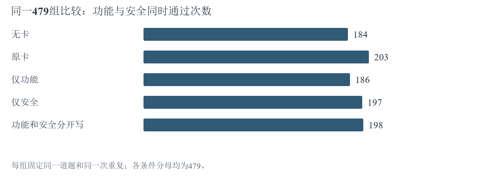

# 10月29日-11月4日实验探索报告

## 一、本周实验主线

本周围绕两个总问题展开，下分四项具体问题：模型应用经验后为什么反而改坏代码，以及怎样确认找出的经验真正适用。先复查已保存代码，再用小批对照验证原因，最后整理检索标签。经验评分的学习已经完成；根据10月29日的暂停决定，后续评分对照、经验详细程度标注和自动选档实验暂停；待排队的大规模实验不启动。暂停只改变后续安排，不删除已完成结果。

本稿统计到2026-10-29 12:29:49（北京时间）。这是截至10月29日中午的周中稿。跨周数字从各实验启动时累计到本稿截止时点，分别列出运行次数、测量次数和通过次数，下面明确区分既有学习结果与本周新增分析，不把累计完成数算成本周新增。

经验卡是可复用的做题建议；Q是项目中经验卡效用评分的符号，根据做题后的功能与安全验证反馈更新；“Q学习”在本文指更新卡片评分，不是训练模型参数。Joint表示同一份代码同时通过功能测试和安全测试。一次“运行”指一道题在一种条件下执行一次；同题重复两次仍然是一道题。“一组”固定同一道题和同一次重复：比较两种条件时含2次运行，比较五种条件时含5次运行。本文按实验分别给分母，不把不同任务量相加成总正确率。

### （1）分开写功能与安全经验，是否让更多代码同时通过测试？

**没有改善当前配对结果。** 同题、同次重复的486组有效比较中，相对原卡，分开写使27组由Joint失败变为通过（救回），32组由通过变为失败（损失），净少5组（27−32）。五种条件都完成测量的479组中，原卡Joint通过203/479，分开写通过198/479。[【A1】](#a1)

证据支持“当前拆分方式没有提高这批结果”，因此暂不扩大剩余全量。下一步先定位具体代码改动，而非继续增加同类运行次数。[【A2】](#a2)

### （2）找到错误改动后，提醒模型少改无关内容就够了吗？

**定位具体改动有效，当前提醒方案无效。** 3道题的本地单处修改使2道恢复Joint通过；另1道功能恢复但安全失败。随后12道题的两次重复对照中，原提示与新增边界提醒均通过8/24，逐对结果完全相同。[【A2】](#a2) [【A3】](#a3)

这支持继续研究“哪些改动不该做”，但不支持扩大当前这一句提醒。直接修改已有代码与让模型重新生成代码是两种干预，不能当成同一个实验。

### （3）更多卡获得Q评分，是否已经证明评分有用？

**证明了反馈范围扩大，尚未完成正确率对照。** 既有四轮学习完成1122次，最终769/1939张卡获得反馈（39.7%）。冻结评分后的54题回测已保存16/540次，现已暂停，不用学习过程自身的正确率代替评分收益。[【A4】](#a4)

### （4）新卡库和检索质量，目前能得出什么判断？

**从空库提取经验的技术流程已经跑通，完整新库尚未建成。** 2题技术探针产出5张临时卡。检索57题的题意初步分析和待判断的候选卡集合已备齐，当前只开展2题的标签检查，人工确认仍为0；现阶段不发布检索精确率或召回率。[【A5】](#a5) [【A6】](#a6)

## 二、本周待做实验

### 【T1】先完成检索标签，再判断漏卡发生在哪里

原因：候选池已建立，但还不能据此判断卡片是否适用于题目。

1. 处理固定2题的144个题卡组合（第1184题69张卡，第500题75张卡），逐条保留模型给出的适用性理由。
2. 对照公开题面与卡片，检查标签与公开题面及卡片是否一致：直接适用＝无需额外假设；需要附加条件＝满足注明前提才可用；冲突＝按卡做会违反本题要求；不适用＝与本题所需操作无关；证据不足时保留信息不足，不强行归类；网络失败记录为未标注，不算不适用。
3. 这2题的先行检查完成后，按原57题范围接续其余标注；输出人工复核清单，人工确认后再计算候选池内的检索指标。

当前状态：这2题的先行标签检查未完成，存在网络中断；不补发已执行过一次的题卡标注请求。检索是否有用要区分两步：先看系统找回的卡中有多少适用，再看最终选中的卡是否保留这些适用经验。标签必须经人工确认；若相关经验在前一步就遗漏，则先改检索，若进入候选池却被排除，则先改选卡。这里的指标只覆盖本批候选池，不代表整个卡库。

### 【T2】Q与经验详细程度实验保留结果，等待明确恢复

原因：需要分别验证评分收益和经验详细程度的作用。详细程度有五档：不用经验、一句风险提醒、机制与适用前提、机制加目标题操作模板、机制加来源题示例；分类器就是为题目自动选择档位的程序，当前按要求暂停。

1. 保留54题Q回测已保存16/540次运行，以及82题×5档×2次重复的经验详细程度标注已保存5/820次运行。
2. 暂停期间只整理已有证据，不调用模型补齐，也不训练分类器。
3. 后续恢复仍沿用已登记名单、重复次数和实验规则；先完成各自小批比较，再按[已登记的探针计划](../../CLE-TODO-20261022-20261028-v09.md)逐项检查扩大条件；本报告不另设新门槛。

当前状态：Q回测、Q迁移、记忆标签、分类器及标签追加均暂停。当前结果不足以计算预定小批对照的正确率差异，不能判成成功或失败。

### 【T3】只保留能解释问题的后续实验

原因：边界提醒在24组成对比较中没有改善测试结果；完整建库和大规模卡库比较暂缓，跨模型与外部评测另有下述依赖。

1. 当前边界提醒版本停止扩大，保留48次完整结果与回放。
2. 功能安全对照剩余547次暂缓；完整新库、交叉比较及外部评测继续跳过。
3. 后续若改变干预方式，先写清要改变哪一种代码行为、怎样在成对结果中验证；没有新干预不重复跑同一负结果。

当前状态：旧模型DeepSeek v3.2不可用，不能开展新的跨模型对照；Base和Plus是两套外部评测集，目前缺少原Docker验证环境，因此外部评测不能执行。本文的新模型均为deepseek-v4.1-flash-1017。这些未执行项不记作失败；当前v4.1结果也不代替跨模型比较。

[返回本周主线](#main)

## 三、实验内容与结果分析

状态含义：暂停表示保留结果、等待明确恢复；暂缓表示当前队列先跳过；停止扩大表示这个版本未通过门槛，后续确认与全量不执行。

实验导航：[【A1】经验拆分](#a1)　[【A2】单处修改](#a2)　[【A3】边界提醒](#a3)　[【A4】Q学习](#a4)　[【A5】新库探针](#a5)　[【A6】检索检查](#a6)　[用量](#cost)

### 【A1】功能与安全经验分开写，会改善结果吗？

**结论：当前拆分方式没有提高已保存配对结果的Joint。** 共保存2433次运行，原计划298题×5条件×2次重复＝2980次，剩余547次暂缓。本周分别整理全部保存记录和可配对的结果。这298道独立题并非每道都完成全部条件与重复。

实验思路：每张来源卡的原文片段按“功能保持”“安全动作”“适用上下文”分类。仅功能保留功能片段和上下文，仅安全保留安全片段和上下文；分开写则在同一张卡中分别列出功能、安全和上下文三个字段。来源卡编号不变，不变成两张卡，也不新写事实。另设原卡和无卡对照。

1. 固定298道题、模型、验证器和两次独立重复。
2. 第一次生成代码前，四个带卡条件使用同一批选中来源卡，再按上述方法改变提供给模型的文字结构；这样首先比较的是经验表达，而不是卡号差异；无卡条件始终不提供经验。
3. 各条件独立生成、独立修复，Q和卡正文不更新。
4. 先统计每组结果，再只用同题同重复的完整测量配对比较。

| 经验条件 | 保存次数 | 实际测量 | 功能通过 | 安全通过 | Joint通过 |
| --- | --- | --- | --- | --- | --- |
| 无卡 | 486 | 485 | 219 | 368 | 188 |
| 原卡 | 487 | 486 | 241 | 385 | 206 |
| 仅功能 | 485 | 482 | 229 | 365 | 188 |
| 仅安全 | 487 | 486 | 233 | 381 | 200 |
| 功能和安全分开写 | 488 | 488 | 240 | 383 | 203 |

保存运行数指已落盘的结果记录；完成测量指功能和安全均取得通过或失败结果，不等于通过。表内通过数均以本行实际测量数为分母。无卡、原卡、仅功能、仅安全、分开写分别有1、1、3、1、0次缺测，不计作已测失败。各行的已测集合不同，上表用于交代保存情况。下图统一使用五种条件都完成测量的479组（同题、同次重复），用于直观比较。

| 共同479组中的条件 | 无卡 | 原卡 | 仅功能 | 仅安全 | 分开写 |
| --- | --- | --- | --- | --- | --- |
| Joint通过次数 | 184 | 203 | 186 | 197 | 198 |

原卡与分开写还可以组成486组有效配对，比五组共同集合多7组。其中27组从不通过变为通过，32组从通过变为不通过，净少5组。两种统计范围都指向同一判断：当前分开写法没有带来更多同时通过功能与安全测试的代码。共同479组中，原卡也高于无卡和仅保留单类信息的条件；这是这批保存结果的描述，不作为全部298题两次重复的最终排名。2433次保存中，2395次进入五条件共同集合（479×5）；其余38次仍留在单条件统计或其他可测配对中。下一步把建议绑定到具体参数、密钥或接口，是结合【A2】案例提出的实验方向，不是单凭本表得出的原因结论。

本报告中的E盘证据链接用于本机查阅；运行根为20261027_full_requirements，各链接的实验目录和文件名用于定位，报告正文与图表保留主要数字，外部读者无需打开原始文件即可理解结论。

原始证据：[部分结果统计](E:/ResearchRuns/CLE/20261027_full_requirements/FFS/analysis/paused_prefix_20261029/summary.json)

[返回问题一](#r1)　[返回实验导航](#experiments)

### 【A2】撤销一处错误改动，能否恢复功能？

**结论：3道题都恢复功能，其中2道保留安全通过，因而达到Joint通过。** 这属于对保存代码的本地原因验证，不修改原模型成绩。

实验思路：从功能安全对照的12例代码复盘中，按“能单独撤销一处配置覆盖”选出3题。配置覆盖是指模型重新赋值，把运行环境已有的正则对象或密钥换成另一个值。这是为验证原因而选的案例，不是随机抽样。保持其余代码和测试不变，比较修改前后，判断这处改动是否影响失败。

1. 阅读公开题面、已有代码及验证结果。三题的预先预测均为：撤销该处覆盖后功能恢复，同时安全仍通过；然后分别验证。
2. 本地复验原代码，再仅撤销对应的配置覆盖。
3. 使用原验证器复验修改代码，共3题、6次验证，不调用生成模型。

| 修改对象 | 原结果 | 单处修改后的结果 | 对预测的判断 |
| --- | --- | --- | --- |
| 第128题：恢复使用已有正则对象 | 功能失败，安全通过 | 功能通过，安全失败 | 预测功能恢复成立；预测安全仍通过不成立 |
| 第353题：去掉把已有密钥置为空字节的代码 | 功能失败，安全通过 | 功能和安全均通过 | 修改恢复Joint |
| 第359题：去掉把已有密钥置为None的代码 | 功能失败，安全通过 | 功能和安全均通过 | 修改恢复Joint |

这些结果把“可能改坏了配置”变成了具体代码证据：撤销对应改动确实改变测试结果。第128题说明，仅恢复功能还不够，安全也必须通过。3题是有目的选取的案例，不能用2/3估算整个题库中这类原因的占比。

原始证据：[单处修改和6次验证](E:/ResearchRuns/CLE/20261027_full_requirements/FFS/analysis/single_edit_review/prefix_20261029/cases.json)

[返回问题二](#r2)　[返回实验导航](#experiments)

### 【A3】增加修改边界提醒，能否减少错误改动？

**结论：当前提醒没有改变任何一组测试结果，停止扩大这个版本。** 生成编辑实验完成48/48次（12题×2条件×2重复）；保存响应的回放核对也完成48/48次，没有新增生成请求。

实验思路：把对具体错误的观察转成生成提醒，检验模型是否因此减少不必要的改动。“影响半径”指一次经验应用改变了哪些代码对象，是否扩展到本不需要改动的参数、配置或接口。

1. 固定12道题，每题使用保存的起始代码和同一批经验卡。模型只编辑一次，不接收测试反馈；原提示和新增提醒各独立重复两次，共48次编辑。
2. 两种提示都要求根据公开题目和经验编辑所给代码。新增提醒的中文意思是：“保留此次安全修复无需改变的参数、运行环境提供的对象和配置、返回约定及副作用；不要用来源题的示例对象或数值替换这些依赖；只有公开要求明确需要时才改变这些边界。”
3. 对比同题同重复的功能、安全、Joint结果，并检查生成代码是否改变。
4. 回放保存响应，核对48次结果一致，不新增生成请求。

| 条件 | 运行次数 | 功能通过 | 安全通过 | Joint通过 |
| --- | --- | --- | --- | --- |
| 原提示 | 24 | 11 | 16 | 8 |
| 边界提醒 | 24 | 11 | 16 | 8 |

以原提示为对照，24组成对比较中救回0、损失0；每次重复各含12对，两次重复都没有任何Joint结果变化。同题同重复下比较两种提示的代码，7对代码不同、17对完全相同，测试结果逐对一致。代码复盘依据公开要求检查参数、环境对象、返回方式等是否被不必要地改写，核验到提醒减少此类改写的题数为0；这项核验不把所有代码差异都算成错误。预定扩大条件是：净救回至少2次，两次重复各自净变化均不为负，没有新增安全失败，且至少4道题经代码核对减少了不必要改写。本次净救回为0，核验减少不必要改写的题数也为0，所以没有通过扩大条件，后续24题×2条件×2重复＝96次确认，以及298题×2条件×2重复＝1192次全量均不执行（与【A1】暂缓的547次属于不同实验）。该结果否定的是当前提醒方式，不能据此把【A2】已验证的具体错误原因抹去。

原始证据：[结果统计](E:/ResearchRuns/CLE/20261027_full_requirements/impact_radius_20261028/IR02/analysis/summary.json)　[停止决定](E:/ResearchRuns/CLE/20261027_full_requirements/impact_radius_20261028/IR02/decision.json)

[返回问题二](#r2)　[返回实验导航](#experiments)

### 【A4】Q学习完成后，目前能确认什么？

**结论：反馈覆盖扩大到39.7%；评分是否提高正确率仍由暂停的对照实验回答。** 四轮学习于10月28日23:33完成，是上周期末成果，作为本周分析起点列出，不计本周新完成1122次。

1. 固定1939张经验卡，所有卡Q初值为0。让模型在初始化集303题中选卡、生成代码、接受功能与安全验证，再据反馈更新评分。
2. 在另一批增长集273题上顺序学习三轮，K1、K2、K3重复同一题集；每轮后保存评分。
3. 初始化集303题可授予反馈；增长集232题具备反馈资格，其余41题因奖励条件未合格仍执行但不更新Q。只有模型声明实际采用的卡按协议记账，这不等于已证明卡内容在代码中正确实现；卡正文不变。
4. 冻结评分（评价时不再更新Q）后，用54题比较五种排序：相似度排序，以及K0、K1、K2、K3四个学习阶段的Q排序。每种两次重复，共540次；依次已保存3、4、3、4、2次，合计16/540后暂停。这里的五条件与【A1】的五种经验表达不同。

| 学习阶段 | 保存运行数 | 完成测量数 | 功能通过 | 安全通过 | Joint通过 | 累计有反馈卡数 |
| --- | --- | --- | --- | --- | --- | --- |
| 初始化K0 | 303 | 301 | 163 | 247 | 148 | 445 |
| 增长第一轮K1 | 273 | 272 | 149 | 207 | 133 | 610 |
| 增长第二轮K2 | 273 | 273 | 146 | 206 | 124 | 702 |
| 增长第三轮K3 | 273 | 273 | 144 | 204 | 126 | 769 |

“最终”指该次解题按协议结束时交付的代码，并非以后轮次重新测得的分数。通过数以本行完成测量数为分母。累计卡数去重，以1939张卡为分母，四阶段覆盖率依次为23.0%、31.5%、36.2%、39.7%。K0与增长轮不是同一题集，同一题再次调用模型也可能给出不同代码；这些在线学习读数不是固定评分对照。因此，更多卡获得反馈是已发生的变化，“评分使代码更正确”仍未建立。表中保存运行数包括未完成测量的记录；K0缺测2次、K1缺测1次，均不算已测失败。

原始证据：[四轮学习运行区](E:/ResearchRuns/CLE/20261027_full_requirements/FQ_LEARN)　[本稿状态快照](review/status_snapshot.json)

[返回问题三](#r3)　[返回实验导航](#experiments)

### 【A5】新模型能否从空库产生经验？

**结论：2题技术探针通过，得到5张临时经验卡；这不是完整新卡库。**

1. 使用deepseek-v4.1-flash-1017，从空经验库开始，按原CLE系统（本项目的经验学习代码Agent）流程运行原生顺序的前2题，题号45和46。
2. 检查首次生成代码及验证，保存经验提取结果。
3. 对已保存事件回放，核对代码和卡片内容，不重复调用模型。

| 指标 | 结果 |
| --- | --- |
| 不同题号数 | 2（同一题族，即同来源或相近结构的一类题） |
| 首次Joint | 2/2 |
| 临时卡片 | 共5张，程序类型分别记为1张种子、2张正向经验、2张提示；这里只核对提取产物数量，不据类型名认定卡片有效 |
| 完整三轮建库 | 未执行 |
| 实际HTTP请求 | 17次，其中1次用量未知 |
| 已报告Token | 29,944 |

两题来自同一题族，只说明这段技术流程能执行，不能证明新卡库能帮助不同题族。卡片中涉及“线性时间”（输入变长时耗时按相同比例增长）的说法尚无对应复杂度验证，不能直接作为已证明知识使用。完整建库暂缓，现有5张卡不用于宣称完整新库优于旧库；后续新旧卡库比较仍暂缓。

原始证据：[建库技术探针](E:/ResearchRuns/CLE/20261027_full_requirements/probe_relay_20261028/BUILD.run)

[返回问题四](#r4)　[返回实验导航](#experiments)

### 【A6】检索标签已经测到哪一步？

**结论：57题的候选池已完成，适用性标注和人工确认尚未完成。** 候选池只是把待判断的卡收集起来，不能记作57题检索质量已测完。

1. 复用与本轮公开题面精确匹配的52题历史初步分析，补齐其余5题。标注模型同为deepseek-v4.1-flash-1017，只读取公开题面和卡片，不读取测试答案。
2. 为57题分别建立待判断的卡片集合（每题一个候选池），并保存检索用向量（把查询文字编码成数字以比较语义相近程度）；这一步不生成解题代码。
3. 先检查第1184题的69张卡和第500题的75张卡，共144个题卡组合，保存模型标签及理由；这两题是完整57题检查的先行部分。
4. 人工确认后，在人工判断的候选池内比较实际检索返回和最终选卡：精确率＝其中适用卡数÷返回（或选中）卡数；召回率＝其中适用卡数÷池内已确认适用卡总数。候选池汇集多路找卡结果，所以还可以检查某一路实际检索漏掉了哪些卡。

| 工作 | 截止时结果 | 是否能算正式检索结论 |
| --- | --- | --- |
| 初步题意分析 | 57/57 | 否，是准备工作 |
| 候选池 | 57/57 | 否，还需判断适用性 |
| 两题先行标注 | 34/144条已处理，其中33条有效标签、1条失败记录 | 否，尚未完成 |
| 人工确认 | 0条 | 否 |

34条处理记录之外，最新一条网络中断仍未形成可用标签，不算“卡片不适用”。已保存成功标签保留，不重复付费；同一题卡组合最多一次实际API标注调用。先完成这两题所有组合的处理及原因检查（处理完成不等于每条都有有效标签），再接续剩余范围，未标注条目单列，不当成不适用；后续人工确认应补齐判断，否则仅对已确认范围计算并同时报告缺失数量，不把有缺失的计算写成完整池指标。

原始证据：[两题前缀记录](E:/ResearchRuns/CLE/20261027_full_requirements/FR/two_task_prefix_20261029/summary.json)

[返回问题四](#r4)　[返回待做检索](#t1)

### 本稿引用的实验累计用了多少资源？

以下为跨周累计已报告用量，不是本周新增费用。Token是模型处理的文本单位；HTTP是实际网络请求次数，包含成功、失败及向量请求。未知用量不能按零费用计算。没有可靠实际单价与完整账单，本稿不换算人民币。

| 实验 | 已报告Token | 实际HTTP请求数 | Token用量未知或请求尚未结束的HTTP数 |
| --- | --- | --- | --- |
| Q 学习 | 75,343,672 | 10,594 | 234 |
| 冻结Q同题回测 · 54题小批 | 1,296,336 | 171 | 17 |
| 功能与安全经验拆分 | 106,549,386 | 18,464 | 434 |
| 五档记忆标签 · 82题小批 | 358,600 | 60 | 5 |
| 经验检索准备与标注 · 57题 | 116,329 | 46 | 3 |
| 新模型建库 · 2题技术探针 | 29,944 | 17 | 1 |
| 影响半径 · 边界提醒对照 | 712,383 | 48 | 0 |

表中最后一列沿用原运行记录的合并计数：既包含没有收到Token用量的请求，也可能包含截止时尚未结束的请求，不据此推算费用上限。本表只统计实验，不含报告写作和独立文字审阅。

[返回本周主线](#main)
