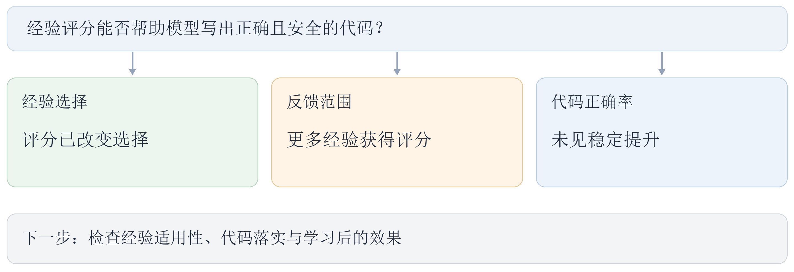

# 10月14日-10月21日实验探索总结

本周围绕“给经验打分，能否帮助模型写出正确且安全的代码”开展探索。结果表明，评分能够改变模型选用的经验，扩大反馈范围也让更多经验获得评分，但这些变化没有带来稳定的正确率提升。

这说明，选到经验只是第一步，关键还在于经验是否适用于当前任务，以及模型能否正确落实。增加经验的使用机会，并不等于增加正确解题的机会。

下一步将继续检查经验与题目的匹配、代码使用经验的方式，并在完成学习后，通过固定对照检验效果。

[查看本周完整实验报告](../CLE-RPT-20261014-20261021-weekly-v06/CLE-RPT-20261014-20261021-weekly-v06.md)
