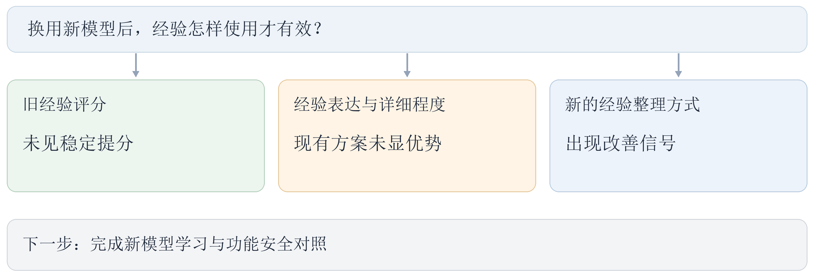

# 10月22日-10月28日实验探索总结

本周将课题转到新模型，重点检查旧经验能否继续发挥作用，以及经验怎样表达、讲到多具体才有帮助。已有对照显示，旧评分仍能改变选卡，但未带来稳定提分；将功能和安全建议分开、自动选择经验详细程度，也没有优于简单做法。

另一种经验整理方式出现了改善信号，需要继续验证。当前正在让新模型重新积累反馈，并扩大功能与安全对照，重点查清经验是否真正减少错误，而不只改变了选卡或代码。

下一步优先完成主要对照，其余探索分批验证，根据结果决定是否扩大，集中回答“哪些经验有用、怎样使用才有用”。

[查看本周完整实验报告](../CLE-RPT-20261022-20261028-weekly-v06/CLE-RPT-20261022-20261028-weekly-v06.md)
